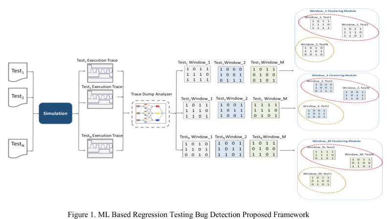
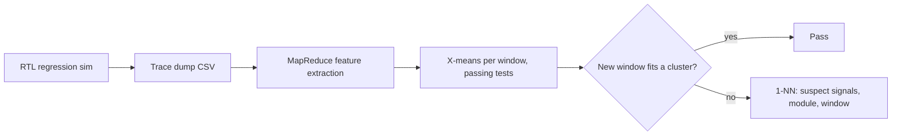

<!-- generated by yt-paper; edits will be overwritten -->
[DVCon](../dvcon/index.md) › [Europe](../dvcon/europe.md) › [2018](../dvcon/by-year.md#2018) › [Verification](../dvcon/by-topic.md#verification)

# Guiding Functional Verification Regression Analysis Using Machine Learning and Big Data Methods

<figure class="rep-fig" markdown>
{ loading=lazy }
<figcaption>Figure 1. ML Based Regression Testing Bug Detection Proposed Framework — from the original paper (Eman El Mandouh et al.)</figcaption>
</figure>

[:material-open-in-new: Original paper](https://dvcon-proceedings.org/wp-content/uploads/guiding-functional-verification-regression-analysis-using-machine-learning-and-big-data-methods.pdf){ .md-button .md-button--primary target=_blank }

| | |
|---|---|
| Authors | Eman El Mandouh (Mentor Graphics Siemens Business), Laila Maher (Cairo University), Moutaz Ahmed (Cairo University), Yasmin ElSharnoby (Cairo University), Amr G. Wassal (Cairo University); DVCon Europe |
| Venue | DVCon Europe 2018 |
| Topic | Verification |
| Type | PAPER |
| ID | `ref-20261018-ade1` |

## Summary

**The paper proposes an unsupervised X-means clustering framework that learns good-behavior trace windows from passing regression tests, flags failing windows as outliers, localizes the buggy window, module, and signals using COI-based signal selection and Hadoop MapReduce trace processing, reporting 81% full success and 2.7x speedup on an Ethernet MAC.**

**이 논문은 통과한 회귀 테스트로부터 정상 동작 트레이스 윈도우를 X-means 클러스터링으로 학습하고, COI 기반 신호 선택과 Hadoop MapReduce 트레이스 처리를 결합해 실패 윈도우, 모듈, 신호를 국소화하는 비지도 학습 프레임워크를 제안하며, Ethernet MAC에서 81% 완전 성공과 2.7배 속도 향상을 보고한다.**

## Key Insights

- Trace dumps are split into fixed 100-cycle windows, and one X-means clustering model is trained per window index using passing regression tests; a test whose window fails assignment to all learned clusters is flagged as buggy.

- 트레이스 덤프를 고정 길이 100 사이클 윈도우로 나누고, 윈도우 인덱스마다 별도의 X-means 클러스터링 모델을 통과한 테스트로 학습한다. 모든 학습된 클러스터에 할당되지 않는 테스트 윈도우를 버그 후보로 판정한다.

- Feature vector per window = count of 0-to-1 transitions per selected signal; signals are pruned by COI score (threshold 10) from 2342 Ethmac signals, plus RTL static filtering of memories, counters, and equivalent signals.

- 윈도우별 특징 벡터는 선택된 각 신호의 0에서 1로의 전이 횟수이다. 신호는 COI 점수(임계값 10)로 Ethmac의 2342개 신호 중에서 선별되며, RTL 정적 분석으로 메모리, 카운터, 등가 신호가 추가로 제외된다.

- MapReduce on a 4-node Hadoop cluster accelerated trace encoding and feature extraction by 2.7x versus sequential processing across five Ethernet test classes (trace sizes 40MB to 5.5GB).

- 4노드 Hadoop 클러스터에서 MapReduce를 적용하여, 5개 Ethernet 테스트 클래스(트레이스 크기 40MB~5.5GB)에 대해 순차 처리 대비 트레이스 인코딩 및 특징 추출을 2.7배 가속했다.

- Evaluated with mutation-injected bugs: on average 81% full success, 13% partial success (superset of signals), and 6% failure; about 83% of bugs were detected in the same cycle as injection.

- 뮤테이션으로 주입한 버그에 대해 평균 81% 완전 성공, 13% 부분 성공(버그 신호를 포함하는 상위 집합), 6% 실패를 기록했으며, 주입과 같은 사이클에 검출된 비율은 평균 83%였다.

- Training used 1,500 constrained-random SystemVerilog tests (1,167 to 2M cycles) on the OpenCores Ethernet MAC; X-means was capped at 20 clusters, and the paper reports no false-positive rate on passing tests.

- 학습에는 OpenCores Ethernet MAC에 대해 1,500개의 제약 랜덤 SystemVerilog 테스트(1,167~200만 사이클)가 사용되었고, X-means 클러스터 수는 최대 20으로 제한되었다. 본문에는 통과 테스트에 대한 오탐율과 기준 방법과의 비교가 제시되지 않았다.

## Detailed Summary

### Background and Problem

- Regression debugging in functional verification requires manually analyzing very large trace dumps (thousands of GBs across regression) to find the cycle, module, and signals responsible for a mismatch against reference behavior.

- 기능 검증의 회귀 디버깅은 매우 큰 트레이스 덤프(회귀 전체에서 수천 GB)를 수작업으로 분석하여, 기준 동작과 불일치하는 사이클, 모듈, 신호를 찾아야 하는 작업이다.

- Prior dynamic-analysis work (Inferno, zamiaCAD-based dynamic slicing with statistical ranking, regression-suite statement ranking) either builds checkers from behavior or ranks HDL statements; this paper instead targets regression-to-regression change analysis by learning good behavior from passing tests.

- 기존 동적 분석 연구(Inferno, zamiaCAD 기반 동적 슬라이싱과 통계적 순위, 회귀 스위트 기반 문장 순위 매기기)는 동작으로부터 체커를 생성하거나 HDL 문장을 순위화한다. 본 논문은 통과한 테스트로부터 정상 동작을 학습하여 회귀 간 변화를 분석하는 방향을 취한다.

### Architecture and Methodology

- Flow: RTL regression simulation (Questa) → trace dump analyzer (CSV traces, MapReduce on Hadoop) → feature extraction per window → X-means clustering trained on passing tests → new test windows checked for cluster membership → failing window assigned to nearest neighbor (1-NN) to derive suspected signals, module name, and window number.

- 흐름: RTL 회귀 시뮬레이션(Questa) → 트레이스 덤프 분석기(CSV 트레이스, Hadoop 상의 MapReduce) → 윈도우별 특징 추출 → 통과 테스트로 X-means 클러스터링 학습 → 새 테스트 윈도우의 클러스터 소속 검사 → 실패 윈도우를 최근접 이웃(1-NN)으로 분류하여 의심 신호, 모듈 이름, 윈도우 번호 도출.

- Windowing: the trace is split into fixed windows of 100 cycles; a separate clustering model is built per window index $w_i$.

- 윈도우 분할: 트레이스를 100 사이클 고정 윈도우로 나누며, 윈도우 인덱스 $w_i$마다 별도의 클러스터링 모델을 구축한다.

- Feature: number of value changes to 1'b1 per selected signal within a window.

- 특징: 윈도우 내에서 선택된 신호의 1'b1로의 값 변화 횟수.

- Signal selection: light RTL static analysis (elaboration) excludes memories, counters, clocks/resets, and equivalent signals; COI score = number of signals in a signal's cone of influence, computed via DFS tree per signal, with an iterative midway threshold. The threshold is 10 for Ethmac (2342 signals).

- 신호 선택: 경량 RTL 정적 분석(elaboration)으로 메모리, 카운터, 클록/리셋, 등가 신호를 제외한다. COI 점수는 신호의 cone of influence에 포함된 신호 수이며, 신호별 DFS 트리로 계산하고 반복적인 중간값 임계치를 사용한다. Ethmac(신호 2342개)에서 임계값은 10이다.

- Clustering: X-means (extension of k-means) selects k automatically using BIC, starting from one cluster and splitting locally; Euclidean distance; max 20 clusters.

- 클러스터링: X-means(k-means 확장)는 BIC를 사용해 k를 자동으로 결정하며, 하나의 클러스터에서 시작해 국소적으로 분할한다. 거리 척도는 유클리드 거리이고 최대 클러스터 수는 20이다.

- MapReduce: 128 MB HDFS blocks → mappers emit (window_id, count) for 0-to-1 transitions, shuffle groups by window, reducers sum counts.

- MapReduce: 128 MB HDFS 블록 → 매퍼가 (window_id, count) 쌍을 생성(0→1 전이 계수) → 셔플이 윈도우별로 묶음 → 리듀서가 합계를 계산한다.

- Test setup: OpenCores Ethernet MAC (connects PHY to Wishbone bus). Training set of 1,500 constrained-random SystemVerilog tests in five classes (Register Access, Register Reset, TX Packet, TX CRC, TX-RX). Test lengths from 1,167 to 2,000,000 cycles; trace sizes 40 MB to 5.5 GB.

- 테스트 환경: OpenCores Ethernet MAC(PHY와 Wishbone 버스 연결). 학습 세트는 다섯 클래스(Register Access, Register Reset, TX Packet, TX CRC, TX-RX)의 1,500개 제약 랜덤 SystemVerilog 테스트다. 테스트 길이는 1,167~2,000,000 사이클, 트레이스 크기는 40 MB~5.5 GB이다.

- Bug injection: mutation testing (one syntactic fault per version; logical, relational, unary, and constant operator replacements) across modules such as eth_maccontrol, eth_macstatus, eth_rxaddrcheck, eth_transmitcontrol, eth_wishbone, and ethmac (total of 79 mutants in Table 2a).

- 버그 주입: 뮤테이션 테스트(버전당 구문상 결함 하나; 논리, 관계, 단항, 상수 연산자 치환)를 사용하며, eth_maccontrol, eth_macstatus, eth_rxaddrcheck, eth_transmitcontrol, eth_wishbone, ethmac 등의 모듈에 적용된다(표 2a 기준 총 79개 뮤턴트).

- Metrics: Success (exact bug signals), Partial Success (superset of signals containing the buggy ones), Failure; bug detection latency = detected cycle minus injected cycle.

- 지표: Success(정확한 버그 신호), Partial Success(버그 신호를 포함하는 상위 집합), Failure. 버그 검출 지연 = 검출 사이클 − 주입 사이클.

### Results and Conclusions

- MapReduce on a 4-node Hadoop cluster (quad-core i7, 16 GB per node): 2.7x speedup over sequential processing for encoding and feature extraction across the five test classes.

- 4노드 Hadoop 클러스터(노드당 쿼드코어 i7, 16 GB)에서 MapReduce는 다섯 테스트 클래스의 인코딩 및 특징 추출에서 순차 처리 대비 2.7배 가속을 달성했다.

- Accuracy across test classes: on average 81% full success, 13% partial success, 6% failure.

- 테스트 클래스 전체 정확도는 평균 81% 완전 성공, 13% 부분 성공, 6% 실패였다.

- Latency: on average 83% of detected bugs were flagged in the same cycle as injection.

- 지연: 검출된 버그의 평균 83%가 주입과 같은 사이클에 플래그되었다.

- The conclusion reports detection "with up to 81% accuracy." The paper gives no per-class breakdown in the text, no false-positive rate on passing tests, and no comparison with baseline methods; these are limitations of the reported evidence.

- 결론부는 "최대 81% 정확도"로 검출을 보고한다. 본문에는 클래스별 세부 결과, 통과 테스트에 대한 오탐율, 기준 방법과의 비교가 없으며, 이는 보고된 근거의 한계이다.

- The paper is a DVCon Europe-style preprint with a fixed 100-cycle window and a Ethmac-specific COI threshold, so generalization to other designs is not demonstrated.

- 고정 100 사이클 윈도우와 Ethmac 전용 COI 임계값을 사용하므로 다른 설계로의 일반화는 입증되지 않았다.

## Videos

<iframe src="https://www.youtube-nocookie.com/embed/jhJqVpl1BAI" title="[DVCON2018] guiding functional verification regression analysis machine learning big data methods" loading="lazy" allow="accelerometer; clipboard-write; encrypted-media; gyroscope; picture-in-picture; web-share" referrerpolicy="strict-origin-when-cross-origin" allowfullscreen></iframe>

**[DVCON2018] guiding functional verification regression analysis machine learning big data methods** — [Watch on YouTube](https://www.youtube.com/watch?v=jhJqVpl1BAI) · [Video page](../videos/jhJqVpl1BAI.md)
