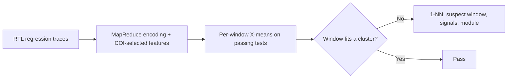

<!-- generated by yt-paper; edits will be overwritten -->
[DVCon](../dvcon/index.md) › [Europe](../dvcon/europe.md) › [2018](../dvcon/by-year.md#2018) › [Verification](../dvcon/by-topic.md#verification)

# Guiding Functional Verification Regression Analysis Using Machine Learning and Big Data Methods

<figure class="rep-fig" markdown>
{ loading=lazy }
<figcaption>Figure 1. ML Based Regression Testing Bug Detection Proposed Framework — from the original paper (Eman El Mandouh et al.)</figcaption>
</figure>

[:material-open-in-new: Original paper](https://dvcon-proceedings.org/wp-content/uploads/guiding-functional-verification-regression-analysis-using-machine-learning-and-big-data-methods.pdf){ .md-button .md-button--primary target=_blank }

| | |
|---|---|
| Authors | Eman El Mandouh (Mentor Graphics Siemens Business), Laila Maher (Cairo University), Moutaz Ahmed (Cairo University), Yasmin ElSharnoby (Cairo University), Amr G. Wassal (Cairo University); DVCon Europe |
| Venue | DVCon Europe 2018 |
| Topic | Verification |
| Type | PAPER |
| ID | `ref-20261018-ade1` |

## Summary

**The paper proposes learning good behavior from passing regression tests with per-window X-means clustering over MapReduce-encoded trace features, flagging failing trace windows and localizing suspect signals and modules, and reports 81% full-success bug localization on an Ethernet MAC (Ethmac) with mutation-injected bugs.**

**이 논문은 통과한 회귀 테스트로부터 X-means 클러스터링을 윈도우 단위로 학습하고, MapReduce로 인코딩한 트레이스 특징을 사용해 실패한 트레이스 윈도우와 의심 신호·모듈을 찾아내며, mutation으로 주입한 버그에 대해 Ethmac(Ethernet MAC)에서 81% 완전 성공률을 보고한다.**

## Key Insights

- Bug localization is cast as outlier detection: a failing test is flagged when its 100-cycle trace windows fail assignment to clusters learned only from passing regression tests, then a 1-NN classifier names suspect signals, module, and window.

- 버그 위치 추정은 이상 탐지 문제로 구성된다. 통과한 회귀 테스트로만 학습한 클러스터에 100사이클 트레이스 윈도우가 배정되지 않으면 실패로 표시하고, 1-NN 분류기로 의심 신호, 모듈, 윈도우를 지목한다.

- Feature vectors are per-window counts of 0-to-1 transitions per selected signal, with signals pruned by COI size (threshold 10 on 2,342 Ethmac signals) plus RTL static filtering of memories, counters, and equivalent signals.

- 특징 벡터는 선택된 신호별로 윈도우 내 0→1 전이 횟수이다. 신호는 COI 크기 임계값(2,342개 Ethmac 신호에 대해 10)과 메모리·카운터·동등 신호를 제외하는 RTL 정적 분석으로 선별한다.

- MapReduce (Hadoop, 4 nodes) speeds up trace encoding and feature extraction by 2.7x over sequential processing on traces ranging from 40 MB to 5.5 GB.

- Hadoop 4노드 클러스터에서 MapReduce는 트레이스 인코딩과 특징 추출을 순차 처리 대비 2.7배 빠르게 하며, 처리 대상 트레이스 크기는 40 MB에서 5.5 GB이다.

- On mutation-injected bugs the framework reports 81% full success, 13% partial success, and 6% failure, and 83% of bugs are detected in the injection cycle itself.

- mutation으로 주입한 버그에 대해 완전 성공 81%, 부분 성공 13%, 실패 6%를 보고하며, 버그의 83%는 주입된 사이클에서 바로 탐지되었다.

- Evaluation is limited to one design (Ethmac) and mutation-based bugs, has no baseline comparison, and the stated 1,500 training tests do not match Table 1, which sums to 1,550.

- 평가는 한 설계(Ethmac)와 mutation 기반 버그에 한정되고 기준선 비교가 없다. 학습 테스트 수 1,500은 Table 1 합계(1,550)와 일치하지 않는다.

## Detailed Summary

### Background and Problem

- Debugging regression failures in large HW designs means analyzing thousands of GB of trace dumps, and manually localizing the failing cycle, module, and signals is slow.

- 대형 HW 설계의 회귀 실패를 디버깅하려면 수천 GB의 트레이스 덤프를 분석해야 하며, 실패 사이클·모듈·신호를 수작업으로 찾는 일은 느리다.

- Prior trace-analysis work (Inferno, dynamic slicing with statistical ranking, regression-based statement ranking) relies on invariants, coverage, or per-statement data. This paper instead learns the design's good behavior from passing regression tests.

- 기존 트레이스 분석 연구(Inferno, 동적 슬라이싱과 통계적 순위화, 회귀 기반 문장 순위화)는 불변식, 커버리지, 문장 단위 데이터에 의존한다. 이 논문은 통과한 회귀 테스트로부터 설계의 정상 동작을 학습하는 방식을 택한다.

### Architecture and Methodology

- Pipeline: RTL regression simulation produces CSV traces, which a MapReduce (Hadoop) trace analyzer encodes. X-means then builds one clustering model per trace window, trained on passing tests. A failing window that fails cluster assignment is flagged, and a 1-NN classifier compares it with its nearest neighbor to list suspect signals, the module, and the window index.

- 파이프라인: RTL 회귀 시뮬레이션이 CSV 트레이스를 생성하고, MapReduce(Hadoop) 트레이스 분석기가 이를 인코딩한다. 이후 통과한 테스트로 윈도우마다 별도의 X-means 모델을 학습한다. 클러스터 배정에 실패한 실패 윈도우를 표시하고, 1-NN 분류기가 가장 가까운 이웃과 비교해 의심 신호, 모듈, 윈도우 번호를 제시한다.

- Features: count of $1'b1$ transitions per selected signal in each 100-cycle window. Signal selection combines COI size thresholding with RTL static filtering.

- 특징: 100사이클 윈도우 내에서 선택된 신호별 $1'b1$ 전이 횟수이다. 신호 선별은 COI 임계값 방식과 RTL 정적 필터링을 결합한다.

- MapReduce: mappers emit (window_id, count) pairs, shuffle groups them by window, and reducers sum per signal.

- MapReduce: 매퍼가 (window_id, count) 쌍을 출력하고, shuffle 단계가 윈도우 단위로 묶으며, 리듀서가 신호별로 합산한다.

### Results and Conclusions

- Setup: Ethmac (Ethernet MAC) with 1,500 training tests (text; Table 1 sums to 1,550) across five test classes, lengths from 1,167 to 2M cycles, and mutation-injected faulty tests.

- 실험 환경: Ethmac(Ethernet MAC), 5개 테스트 클래스에 걸친 학습 테스트 1,500개(본문 기준, Table 1 합계는 1,550), 길이 1,167사이클에서 200만 사이클, mutation으로 버그를 주입한 실패 테스트를 사용하였다.

- MapReduce on a 4-node Hadoop cluster gives a 2.7x speedup over sequential encoding and feature extraction.

- 4노드 Hadoop 클러스터에서 MapReduce는 순차 인코딩과 특징 추출 대비 2.7배 속도 향상을 보였다.

- Detection: 81% full success, 13% partial success, and 6% failure, with 83% of bugs detected in the injection cycle. X-means is capped at 20 clusters.

- 탐지 결과: 완전 성공 81%, 부분 성공 13%, 실패 6%이며, 버그의 83%가 주입 사이클에서 탐지되었다. X-means 클러스터 수 상한은 20이다.

- Limitations: one design, mutation-based bugs only, and no baseline comparison. The approach is a promising feasibility study rather than a validated production flow.

- 한계: 한 설계, mutation 기반 버그만 다루며 기준선 비교가 없다. 실무 검증 흐름보다는 타당성 검토 수준의 연구로 보는 것이 적절하다.

## Videos

<iframe src="https://www.youtube-nocookie.com/embed/jhJqVpl1BAI" title="[DVCON2018] guiding functional verification regression analysis machine learning big data methods" loading="lazy" allow="accelerometer; clipboard-write; encrypted-media; gyroscope; picture-in-picture; web-share" referrerpolicy="strict-origin-when-cross-origin" allowfullscreen></iframe>

**[DVCON2018] guiding functional verification regression analysis machine learning big data methods** — [Watch on YouTube](https://www.youtube.com/watch?v=jhJqVpl1BAI) · [Video page](../videos/jhJqVpl1BAI.md)
