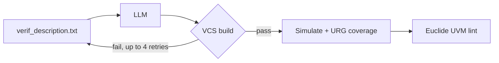

<!-- generated by yt-paper; edits will be overwritten -->
[DVCon](../dvcon/index.md) › [US](../dvcon/us.md) › [2025](../dvcon/by-year.md#2025) › [Verification](../dvcon/by-topic.md#verification)

# VerifLLMBench: An Open-Source Benchmark for Testbenches Generated with Large Language Models

<figure class="rep-fig" markdown>
{ loading=lazy }
<figcaption>Fig. 1: LLM TB Generation to Build Flow — from the original paper (Nishanth Somashekara Murthy et al.)</figcaption>
</figure>

[:material-open-in-new: Original paper](https://dvcon-proceedings.org/wp-content/uploads/1059.pdf){ .md-button .md-button--primary target=_blank }

| | |
|---|---|
| Authors | Nishanth Somashekara Murthy (University of Minnesota), Eldon Nelson (Synopsys Inc.), Sachin S. Sapatnekar (University of Minnesota), John Sartori (University of Minnesota) |
| Venue | DVCon US 2025 |
| Topic | Verification |
| Type | PAPER |
| ID | `ref-20261018-b468` |

## Summary

**The paper proposes an MIT-licensed benchmark and methodology that scores LLM-generated UVM testbenches on build convergence, VCS coverage, and Euclide lint, using five verified DUTs and three LLMs (ChatGPT-4o, Gemini 1.5 Pro, Llama3.2).**

**이 논문은 다섯 개의 검증된 DUT와 세 개의 LLM(ChatGPT-4o, Gemini 1.5 Pro, Llama3.2)을 사용해, LLM이 생성한 UVM 테스트벤치를 빌드 수렴성, VCS 커버리지, Euclide lint 기준으로 평가하는 MIT 라이선스 벤치마크와 방법론을 제안한다.**

## Key Insights

- Across five DUTs, Gemini 1.5 Pro had the highest average build success (88%) and coverage (79.3%), followed by ChatGPT-4o (84%, 70.6%) and Llama3.2 (64%, 46.8%).

- 다섯 개 DUT 평균 기준으로 Gemini 1.5 Pro가 빌드 성공률 88%, 커버리지 79.3%로 가장 높았고, ChatGPT-4o는 84%, 70.6%, Llama3.2는 64%, 46.8%였다.

- LLM testbenches reach strong line and toggle coverage (ALU line 96%), but FSM, branch, conditional, and group coverage lag; ALU branch coverage is 76%.

- LLM 테스트벤치는 line 및 toggle 커버리지가 강하지만(ALU line 96%), FSM, branch, conditional, group 커버리지는 낮으며 ALU의 branch 커버리지는 76%이다.

- Group coverage collapses on large bin spaces: adder_8bit defines 135,705 bins and the LLM sequences cover only 0.18% (ChatGPT-4o) and 0.20% (Gemini 1.5 Pro) on average.

- bin 공간이 큰 group 커버리지는 무너진다. adder_8bit은 135,705개 bin을 정의했지만 LLM 시퀀스는 평균 0.18%(ChatGPT-4o), 0.20%(Gemini 1.5 Pro)만 커버했다.

- The VCS coverage score averages only nonzero metrics, which can hide per-metric gaps, so individual metrics should be reported alongside it.

- VCS 커버리지 점수는 0이 아닌 값만 평균하므로 metric별 공백이 가려질 수 있어, 개별 metric을 함께 보고해야 한다.

- Recurring failures are scoreboard reference-model errors (e.g., high-impedance values from wrong interface coupling) and TLM port misuse; the fixed harness isolates TB-generator quality from DUT bugs.

- 반복되는 실패는 scoreboard 참조 모델 오류(잘못된 인터페이스 결합으로 인한 high-impedance 값)와 TLM 포트 오용이며, 고정된 harness는 테스트벤치 생성기 품질과 DUT 버그를 분리해 준다.

## Detailed Summary

### Background and Problem

- Prior LLM benchmarks (RTLLM, VerilogEval) target RTL generation; no open benchmark evaluates LLM-generated UVM testbenches.

- 기존 LLM 벤치마크(RTLLM, VerilogEval)는 RTL 생성을 대상으로 하며, LLM이 생성한 UVM 테스트벤치를 평가하는 공개 벤치마크는 없다.

- Syntax success alone is insufficient; verification engineers need build convergence, functional coverage, and UVM lint quality as metrics.

- 문법 성공만으로는 부족하며, 검증 엔지니어에게는 빌드 수렴성, 기능 커버리지, UVM lint 품질 지표가 필요하다.

### Architecture and Methodology

- Fixed harness: a predefined interface with cover-groups, a top module, and a `include header that selects each LLM's package via macros. Five DUTs from [1]: accu, adder_8bit, adder_16bit, fsm, alu.

- 고정된 harness: 커버리지 cover-group이 포함된 사전 정의 인터페이스, top 모듈, 그리고 LLM별 패키지를 매크로로 선택하는 `include 헤더. DUT는 [1]의 다섯 개(accu, adder_8bit, adder_16bit, fsm, alu)를 사용한다.

- One prompt template (verif_description.txt) requests the full UVM component set (transaction through test). Each run is stateless. Models: ChatGPT-4o, Gemini 1.5 Pro, Llama3.2.

- 단일 프롬프트 템플릿(verif_description.txt)이 transaction부터 test까지 전체 UVM 컴포넌트를 요청한다. 각 실행은 상태를 저장하지 않는다. 모델은 ChatGPT-4o, Gemini 1.5 Pro, Llama3.2이다.

- Flow: VCS 2022.06 build with up to 4 syntax-repair retries, simulation with coverage (line, condition, toggle, FSM, branch, group) merged in URG, and Euclide 2024.09 lint on LLM code only. Makefiles automate the flow.

- 흐름: VCS 2022.06 빌드(문법 수정 재시도 최대 4회), URG로 병합되는 line, condition, toggle, FSM, branch, group 커버리지 시뮬레이션, LLM 코드에만 적용하는 Euclide 2024.09 lint. Makefile로 자동화한다.

### Results and Conclusions

- Averages over five DUTs (build successes out of 5 runs / VCS coverage / lint errors/warnings): ChatGPT-4o 84% / 70.6% / 1.8/6.6; Gemini 1.5 Pro 88% / 79.3% / 7/2.8; Llama3.2 64% / 46.8% / 0/9.8.

- 다섯 DUT 평균(빌드 성공 횟수/5회 실행, VCS 커버리지, lint 오류/경고): ChatGPT-4o 84% / 70.6% / 1.8/6.6; Gemini 1.5 Pro 88% / 79.3% / 7/2.8; Llama3.2 64% / 46.8% / 0/9.8.

- Line and toggle coverage are strong. FSM, branch, conditional, and group coverage are weak; no clear link to parameter count.

- line 및 toggle 커버리지는 강하고, FSM, branch, conditional, group 커버리지는 약하다. 파라미터 수와의 명확한 상관관계는 없다.

- Scoreboards often fail on correct DUTs; the authors conclude that constrained randomization, directed tests, larger context, and UVM-specific training are needed. The DUTs are simple, so the coverage conclusions are preliminary.

- 올바른 DUT에서도 scoreboard가 실패하는 경우가 많다. 저자들은 constrained randomization, directed test, 더 큰 context, UVM 특화 학습이 필요하다고 결론짓는다. DUT가 단순하므로 커버리지 결론은 예비적이다.

## Videos

<iframe src="https://www.youtube-nocookie.com/embed/LnieLz-qAFw" title="[DVCON2025]VerifLLMBench:An Open-Source Benchmark forTestbenches Generated with Large LanguageModels" loading="lazy" allow="accelerometer; clipboard-write; encrypted-media; gyroscope; picture-in-picture; web-share" referrerpolicy="strict-origin-when-cross-origin" allowfullscreen></iframe>

**[DVCON2025]VerifLLMBench:An Open-Source Benchmark forTestbenches Generated with Large LanguageModels** — [Watch on YouTube](https://www.youtube.com/watch?v=LnieLz-qAFw) · [Video page](../videos/LnieLz-qAFw.md)
