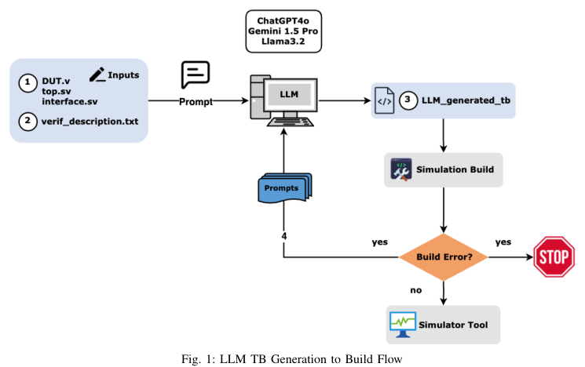
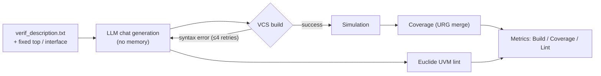

<!-- generated by yt-paper; edits will be overwritten -->
[DVCon](../dvcon/index.md) › [US](../dvcon/us.md) › [2025](../dvcon/by-year.md#2025) › [Verification](../dvcon/by-topic.md#verification)

# VerifLLMBench: An Open-Source Benchmark for Testbenches Generated with Large Language Models

<figure class="rep-fig" markdown>
{ loading=lazy }
<figcaption>Fig. 1: LLM TB Generation to Build Flow — from the original paper (Nishanth Somashekara Murthy et al.)</figcaption>
</figure>

[:material-open-in-new: Original paper](https://dvcon-proceedings.org/wp-content/uploads/1059.pdf){ .md-button .md-button--primary target=_blank }

| | |
|---|---|
| Authors | Nishanth Somashekara Murthy (University of Minnesota), Eldon Nelson (Synopsys Inc.), Sachin S. Sapatnekar (University of Minnesota), John Sartori (University of Minnesota) |
| Venue | DVCon US 2025 |
| Topic | Verification |
| Type | PAPER |
| ID | `ref-20261018-b468` |

## Summary

**The paper proposes VerifLLMBench, an MIT-licensed benchmark and flow that evaluates LLM-generated UVM testbenches on five verified DUTs using build convergence, VCS coverage, and Euclide UVM lint, finding that LLMs reach high line and toggle coverage but struggle with FSM, branch, conditional, and group coverage.**

**VerifLLMBench는 검증된 DUT 5종에 대해 LLM이 생성한 UVM 테스트벤치를 빌드 수렴도, VCS 커버리지, Euclide UVM lint로 평가하는 MIT 라이선스 벤치마크 및 흐름을 제시하며, LLM은 line·toggle 커버리지는 높게 달성하지만 FSM·branch·conditional·group 커버리지에서는 취약함을 보인다.**

## Key Insights

- Averaged over five DUTs and five runs, ChatGPT-4o reached 84% build success, 70.6% VCS coverage, and 1.8 lint errors / 6.6 warnings; Gemini 1.5 Pro reached 88%, 79.3%, and 7 / 2.8; Llama3.2 reached 64%, 46.8%, and 0 / 9.8.

- 5개 DUT와 5회 실행의 평균 기준으로 ChatGPT-4o는 빌드 성공률 84%, VCS 커버리지 70.6%, lint 에러 1.8 / 경고 6.6을 기록했고, Gemini 1.5 Pro는 88%, 79.3%, 7 / 2.8, Llama3.2는 64%, 46.8%, 0 / 9.8을 기록했다.

- Line and toggle coverage are the strongest metrics, while FSM, branch, conditional, and group coverage are weak; e.g., alu shows 96% line vs. 76% branch coverage, and adder_8bit (135,705 bins) had only 0.18% and 0.20% of group bins covered by ChatGPT-4o and Gemini 1.5 Pro.

- Line 및 toggle 커버리지가 가장 강하고 FSM, branch, conditional, group 커버리지는 약하다. 예를 들어 alu는 line 96% 대비 branch 76%를 보였으며, adder_8bit(135,705 bin)은 ChatGPT-4o와 Gemini 1.5 Pro가 group bin을 각각 0.18%, 0.20%만 커버했다.

- The VCS 'Coverage' column averages only nonzero metrics, which can hide per-metric gaps; the authors recommend evaluating each metric separately.

- VCS의 'Coverage' 열은 0이 아닌 메트릭만 평균하므로 메트릭별 공백이 가려질 수 있다. 저자들은 메트릭별로 개별 평가할 것을 권장한다.

- Recurring failure modes include scoreboards that report failures on a fully verified DUT (caused by interface coupling that yields high-impedance z values), TLM port type mismatches, missing connect_phase methods, and incorrect variable types.

- 반복적으로 나타난 실패 유형은 완전히 검증된 DUT에서도 scoreboard가 실패를 보고하는 문제(인터페이스 결합으로 인한 high-impedance z 값), TLM 포트 타입 불일치, connect_phase 메서드 누락, 잘못된 변수 타입이다.

- A fixed top module, interface with covergroups, and include-header macros that select the package per LLM and iteration make runs reproducible; each LLM is queried without memory, and syntax-fix iterations are capped at four.

- 고정된 top 모듈, covergroup을 포함한 interface, LLM 및 반복 횟수별로 패키지를 선택하는 include 헤더 매크로 덕분에 실행이 재현 가능하며, 각 LLM은 메모리 없이 질의되고 구문 수정 반복은 4회로 제한된다.

## Detailed Summary

### Background and Problem

- Prior LLM benchmarks (RTLLM [1], VerilogEval [2]) target RTL generation. No open benchmark existed for evaluating LLM-generated UVM testbenches (TBs).

- 기존 LLM 벤치마크(RTLLM [1], VerilogEval [2])는 RTL 생성을 대상으로 한다. LLM이 생성한 UVM 테스트벤치(TB)를 평가할 수 있는 공개 벤치마크는 없었다.

- Benchmarking a TB is harder than benchmarking a DUT, since it requires judging stimulus quality and how well the TB exercises the DUT ("testing the tester"). The paper uses coverage as the main proxy.

- TB 벤치마킹은 DUT 벤치마킹보다 어렵다. 자극(stimulus)의 품질과 TB가 DUT를 얼마나 잘 exercise하는지를 판단해야 하기 때문이다("테스터를 테스트하는 문제"). 본 논문은 주요 대리 지표로 커버리지를 사용한다.

- LLM selection criteria are discussed (licensing, parameter count, context window, quantization, cost). GPU memory is estimated as $M = \frac{P \times 4\ \text{bytes} \times 32/Q \times 1.2}{10^9}$ GB. For example, Llama3.1 405B needs about 486 GB at 8-bit.

- LLM 선정 기준(라이선스, 파라미터 수, context window, quantization, 비용)을 논의하며, GPU 메모리는 $M = \frac{P \times 4\ \text{bytes} \times 32/Q \times 1.2}{10^9}$ GB로 추정한다. 예를 들어 Llama3.1 405B는 8-bit에서 약 486 GB가 필요하다.

- The three LLMs evaluated are ChatGPT-4o, Gemini 1.5 Pro, and Llama3.2, chosen for cost and compute constraints from the five candidates.

- 평가 대상 LLM은 ChatGPT-4o, Gemini 1.5 Pro, Llama3.2이며, 후보 5종 중 비용과 연산 자원 제약을 고려해 선택되었다.

### Architecture and Methodology

- **Fixed harness**: The DUT is a verified RTL from RTLLM [1]. The interface `accu_if` contains all DUT I/O and covergroups. The top module uses `uvm_config_db` for the virtual interface and dumps waveforms. `include.svh` uses macros (for example, `GPTt1`–`GPTt5`, `Llamat1`) to select the generated package.

- **고정 harness**: DUT는 RTLLM [1]의 검증된 RTL이다. Interface `accu_if`는 모든 DUT I/O와 covergroup을 포함한다. Top 모듈은 `uvm_config_db`로 virtual interface를 전달하고 파형을 덤프한다. `include.svh`는 매크로(예: `GPTt1`–`GPTt5`, `Llamat1`)로 생성된 패키지를 선택한다.

- **DUTs (5)**: accu (8-bit accumulate after 4 inputs), adder_8bit, adder_16bit (built from full adders), fsm (sequence detector), and alu (32-bit MIPS ALU).

- **DUT (5종)**: accu(4개 입력 후 8비트 누적), adder_8bit, adder_16bit(full adder 기반), fsm(시퀀스 검출기), alu(32비트 MIPS ALU).

- **Prompt (verif_description.txt)**: Sets the verification-engineer role, describes the DUT behavior and I/O, fixes the interface and top, and requires nine classes (transaction, sequence, sequencer, driver, monitor, agent, scoreboard, environment, test) with phase expectations and TLM connections. Lessons learned: omitting the component list led to incomplete TBs (for example, no scoreboard). Overly detailed prompts caused truncated responses.

- **프롬프트(verif_description.txt)**: 검증 엔지니어 역할을 지정하고, DUT 동작과 I/O를 기술하며, interface와 top은 고정한다. 그리고 9개 클래스(transaction, sequence, sequencer, driver, monitor, agent, scoreboard, environment, test)에 대해 phase 요구사항과 TLM 연결을 요구한다. 얻은 교훈으로는 컴포넌트 목록을 생략하면 TB가 불완전해진다(예: scoreboard 누락)는 점과, 지나치게 상세한 프롬프트는 응답을 잘리게 만든다는 점이 있다.

- **Flow**: LLM chat generation (no memory, each iteration independent) → VCS 2022.06 compile. Syntax failures trigger a correction prompt, capped at four attempts → simulation (runtime errors are excluded from coverage) → coverage collection (line, condition, toggle, FSM, branch, functional) merged with URG → Euclide 2024.09 UVM lint, applied only to LLM-generated code. Fatal and Error are combined into "Errors." The whole process is automated with Makefiles, with five runs per design and LLM.

- **흐름**: LLM chat 생성(메모리 없음, 반복마다 독립) → VCS 2022.06 컴파일. 구문 오류 시 수정 프롬프트를 보내며 최대 4회로 제한 → 시뮬레이션(런타임 오류는 커버리지 분석에서 제외) → 커버리지 수집(line, condition, toggle, FSM, branch, functional)을 URG로 병합 → LLM 생성 코드에만 Euclide 2024.09 UVM lint 적용. Fatal과 Error는 "Errors"로 합산한다. 전체 과정은 Makefile로 자동화되었으며, 설계와 LLM마다 5회씩 실행했다.

### Results and Conclusions

- **Table III (average)**: ChatGPT-4o 84% build, 70.6% coverage, 1.8 errors / 6.6 warnings. Gemini 1.5 Pro 88%, 79.3%, 7 / 2.8. Llama3.2 64%, 46.8%, 0 / 9.8. Llama3.2 built only once in 5 runs for alu and twice for fsm (fsm coverage 9.9%).

- **Table III (평균)**: ChatGPT-4o 빌드 84%, 커버리지 70.6%, 에러 1.8 / 경고 6.6. Gemini 1.5 Pro 88%, 79.3%, 7 / 2.8. Llama3.2 64%, 46.8%, 0 / 9.8. Llama3.2는 alu에서 5회 중 1회만 빌드에 성공했고, fsm에서는 2회 성공했으며 fsm 커버리지는 9.9%였다.

- **Per-metric trends**: Line coverage is consistently highest, and toggle coverage follows it closely. FSM, branch, conditional, and group coverage are the weakest. The paper states that FSM coverage is the hardest metric for LLMs. Assertion coverage is 0% in all cases because the DUTs contain no assertions.

- **메트릭별 경향**: Line 커버리지가 일관되게 가장 높고, toggle 커버리지가 그 뒤를 바짝 따른다. FSM, branch, conditional, group 커버리지가 가장 약하다. 논문은 FSM 커버리지를 LLM에게 가장 어려운 메트릭으로 지적한다. DUT에 assertion이 없으므로 assertion 커버리지는 모든 경우 0%이다.

- **Group coverage**: For adder_16bit (165 bins), average group coverage was 22.7% (Gemini 1.5 Pro) and 33.5% (Llama3.2). For adder_8bit (135,705 bins), ChatGPT-4o and Gemini covered 0.18% and 0.20% on average. ChatGPT-4o reached 39% group coverage on accu.

- **Group 커버리지**: adder_16bit(165 bin)의 평균 group 커버리지는 Gemini 1.5 Pro 22.7%, Llama3.2 33.5%였다. adder_8bit(135,705 bin)은 ChatGPT-4o와 Gemini가 평균 각각 0.18%, 0.20%만 커버했다. ChatGPT-4o는 accu에서 group 커버리지 39%를 기록했다.

- **Llama3.2**: Adding constraint randomization hurt build convergence and lowered coverage.

- **Llama3.2**: Constraint randomization을 추가하면 빌드 수렴이 저해되고 커버리지도 낮아졌다.

- **Challenges**: Scoreboards falsely reported failures on verified DUTs because of interface coupling that produced z values. Other issues were TLM port type mismatches and missing connect_phase methods. Including a long DUT description increased token usage and degraded output quality.

- **문제점**: Scoreboard가 완전히 검증된 DUT에서도 인터페이스 결합으로 인해 z 값이 발생해 실패를 보고했다. 그 밖에 TLM 포트 타입 불일치와 connect_phase 메서드 누락이 있었다. DUT 설명을 길게 포함하면 토큰 사용량이 늘고 출력 품질이 떨어졌다.

- **Conclusions**: LLMs produce usable TBs for basic line and toggle coverage but are not yet adequate for sophisticated test strategies. Improvements need constrained randomization, directed tests, larger context windows, and UVM-specific training. The paper finds no clear correlation between parameter count and performance.

- **결론**: LLM은 기본적인 line 및 toggle 커버리지를 위한 사용 가능한 TB를 만들지만, 정교한 테스트 전략에는 아직 충분하지 않다. 개선을 위해서는 constrained randomization, directed test, 더 큰 context window, UVM 특화 학습이 필요하다. 논문은 파라미터 수와 성능 사이에 뚜렷한 상관관계가 없다고 밝힌다.

- **Caveats**: The DUTs are small, only three LLMs and five runs were evaluated, and the source text is truncated in the appendix after Fig. 9 (accu_if.sv).

- **한계**: DUT가 작고, LLM 3종과 5회 실행만 평가했으며, 원문은 부록에서 Fig. 9(accu_if.sv) 이후가 잘려 있다.

## Videos

<iframe src="https://www.youtube-nocookie.com/embed/LnieLz-qAFw" title="[DVCON2025]VerifLLMBench:An Open-Source Benchmark forTestbenches Generated with Large LanguageModels" loading="lazy" allow="accelerometer; clipboard-write; encrypted-media; gyroscope; picture-in-picture; web-share" referrerpolicy="strict-origin-when-cross-origin" allowfullscreen></iframe>

**[DVCON2025]VerifLLMBench:An Open-Source Benchmark forTestbenches Generated with Large LanguageModels** — [Watch on YouTube](https://www.youtube.com/watch?v=LnieLz-qAFw) · [Video page](../videos/LnieLz-qAFw.md)
