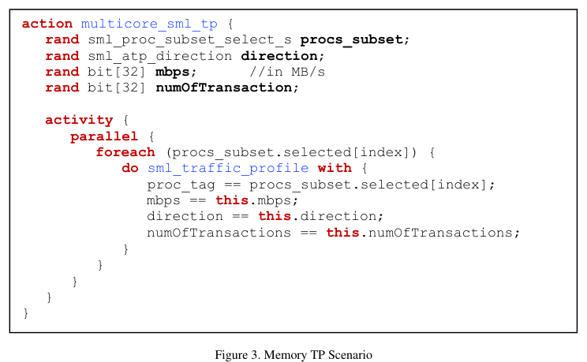
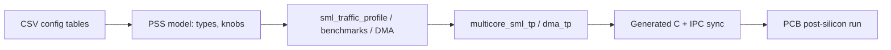

<!-- generated by yt-paper; edits will be overwritten -->
[DVCon](../dvcon/index.md) › [US](../dvcon/us.md) › [2020](../dvcon/by-year.md#2020) › [Verification](../dvcon/by-topic.md#verification)

# Post-Silicon Performance Validation Using PSS

<figure class="rep-fig" markdown>
{ loading=lazy }
<figcaption>Figure 3. Memory TP Scenario — from the original paper (Dayoung Kim et al.)</figcaption>
</figure>

[:material-open-in-new: Original paper](https://dvcon-proceedings.org/wp-content/uploads/post-silicon-performance-validation-using-pss.pdf){ .md-button .md-button--primary target=_blank }

| | |
|---|---|
| Authors | Dayoung Kim (Samsung Electronics), Jaehun Lee (Samsung Electronics), Daeseo Cha (Samsung Electronics), Phu L. Huynh (Cadence Design Systems), Jake Kim (Cadence Design Systems) |
| Venue | DVCon US 2020 |
| Topic | Verification |
| Type | PAPER |
| ID | `ref-20261018-b4a5` |

## Summary

**Samsung and Cadence use PSS (Perspec) to build configuration-driven, reusable performance and long-running DMA/memory traffic scenarios for post-silicon validation of a multi-cluster CPU test chip, reporting a 4–9% design-methodology gain measured through these PSS scenarios.**

**삼성전자와 Cadence는 PSS(Perspec)를 사용해 다중 클러스터 CPU 테스트 칩의 포스트 실리콘 성능 검증을 위한 설정 기반의 재사용 가능한 성능 및 장시간 DMA/메모리 트래픽 시나리오를 구축했으며, 이 PSS 시나리오로 측정한 새 설계 방법론의 성능 향상을 4~9%로 보고했다.**

## Key Insights

- Composing a single traffic-profile action (sml_traffic_profile) over a parallel core subset (multicore_sml_tp) lets the tool generate the per-core C code, IPC, and synchronization points automatically, so engineers debug at action level and drop to C only on failures.

- 단일 트래픽 프로파일 액션(sml_traffic_profile)을 병렬 코어 서브셋(multicore_sml_tp)에 구성하면 툴이 코어별 C 코드, IPC, 동기화 지점을 자동 생성하므로, 엔지니어는 액션 수준에서 디버깅하고 실패 시에만 C 수준으로 내려간다.

- Reusability comes from keeping cluster and processor names out of the scenarios and generating the PSS types from CSV configuration tables; per the paper, a future 10-cluster design (C0–C9) would need only a config change, though project-specific tests such as dma_tp_cl0 must be rewritten.

- 시나리오에서 클러스터 및 프로세서 이름을 제외하고 CSV 설정 테이블로부터 PSS 타입을 생성하여 재사용성을 확보한다. 논문에 따르면 향후 10개 클러스터(C0~C9) 설계는 설정 변경만으로 가능하나, dma_tp_cl0처럼 프로젝트 고유의 테스트는 다시 작성해야 한다.

- The same PSS scenarios run unmodified in simulation and emulation and produce the same results, which supports reusing pre-silicon stimulus for post-silicon bring-up.

- 동일한 PSS 시나리오를 수정 없이 시뮬레이션과 에뮬레이션에서 실행해 같은 결과를 얻었으며, 이는 포스트 실리콘 bring-up에서 프리 실리콘 자극을 재사용할 수 있음을 뒷받침한다.

- The reported design-methodology benefit is 4–9% for BLK_CPU1/BLK_CPU2 versus BLK_CPU0; the normalized table values (0.91–0.98, BLK_CPU0 = 1) do not state the metric's direction, so interpret them with care.

- 보고된 설계 방법론 효과는 BLK_CPU0 대비 BLK_CPU1/BLK_CPU2에서 4~9%이다. 정규화된 표 값(0.91~0.98, BLK_CPU0 = 1)은 지표의 방향이 명시되어 있지 않으므로 해석에 주의해야 한다.

- Productivity gains are asserted qualitatively and no effort or schedule measurements are provided, so the claims should be treated as anecdotal.

- 생산성 향상은 정성적으로만 주장되며 공수나 일정에 대한 측정 데이터가 없으므로 일화적 주장으로 봐야 한다.

## Detailed Summary

### Background and Problem

- The test chip has five quad-core CPU blocks (20 cores, Table 1) built with different cell libraries and physical implementations, so performance must be measured per block under CPU, memory, and I/O activity.

- 테스트 칩은 쿼드코어 CPU 블록 5개(표 1 기준 코어 20개)로 구성되며, 블록마다 서로 다른 cell library와 물리 구현 기법을 사용하므로 CPU, 메모리, I/O 활동이 동시에 일어나는 상황에서 블록별 성능을 측정해야 한다.

- Hand-written embedded C tests are slow to produce, give poor coverage, and make resource allocation, IPC, and synchronization error-prone.

- 수작업 임베디드 C 테스트는 작성에 시간이 오래 걸리고 커버리지가 낮으며, 자원 할당, IPC, 동기화에서 오류가 발생하기 쉽다.

### Architecture and Methodology

- A PSS traffic profile generator (TPG) builds memory TP scenarios: `sml_traffic_profile` is the base action (core, direction, MB/s, transaction count), and `multicore_sml_tp` runs it in parallel over a selected core subset.

- PSS 기반 트래픽 프로파일 생성기(TPG)가 메모리 TP 시나리오를 구성한다. 기본 액션은 sml_traffic_profile(코어, 방향, MB/s, 트랜잭션 수)이고, multicore_sml_tp는 선택된 코어 서브셋에서 이를 병렬로 실행한다.

- Dhrystone, CoreMark, lmbench, and gzip are wrapped as PSS actions with PMCCNTR start/stop bracketing.

- Dhrystone, CoreMark, lmbench, gzip은 PMCCNTR 시작/정지 액션으로 감싼 PSS 액션으로 구현된다.

- `dma_tp` runs a DMA scenario on one core while the remaining cores run the TP scenario on the same cluster. `repeat` statements extend it to long post-silicon runs (9999 iterations in Fig. 15).

- dma_tp는 한 코어에서 DMA 시나리오를 실행하는 동안 같은 클러스터의 나머지 코어가 TP 시나리오를 실행한다. repeat 문으로 포스트 실리콘 장시간 실행을 구성한다(그림 15에서 9999회 반복).

- Project-specific data lives in CSV tables, from which the PSS model (types and knobs) is generated.

- 프로젝트 고유 정보는 CSV 테이블에 두며, 이로부터 PSS 모델(타입과 knob)을 생성한다.

### Results and Conclusions

- The new Samsung design methodology on BLK_CPU1 and BLK_CPU2 shows a 4–9% performance gain over BLK_CPU0, measured by PSS scenarios (Fig. 16, based on simulation time).

- BLK_CPU1과 BLK_CPU2에 적용한 새 삼성 설계 방법론은 PSS 시나리오로 측정했을 때 BLK_CPU0 대비 4~9%의 성능 향상을 보인다(그림 16, 시뮬레이션 시간 기준).

- Scenarios run unmodified in simulation and emulation with identical results.

- 시나리오는 시뮬레이션과 에뮬레이션에서 수정 없이 실행되었고 결과가 동일했다.

- The paper claims a new configuration can be validated in a few days, but productivity gains are not quantified.

- 논문은 새 설정을 며칠 내에 검증할 수 있다고 주장하지만, 생산성 향상은 정량화되어 있지 않다.

## Videos

<iframe src="https://www.youtube-nocookie.com/embed/oT47WOHEeJ8" title="[DVCon2020] Post-Silicon Performance Validation Using PSS" loading="lazy" allow="accelerometer; clipboard-write; encrypted-media; gyroscope; picture-in-picture; web-share" referrerpolicy="strict-origin-when-cross-origin" allowfullscreen></iframe>

**[DVCon2020] Post-Silicon Performance Validation Using PSS** — [Watch on YouTube](https://www.youtube.com/watch?v=oT47WOHEeJ8) · [Video page](../videos/oT47WOHEeJ8.md)
