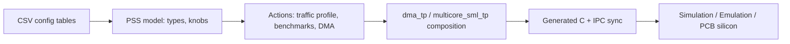

<!-- generated by yt-paper; edits will be overwritten -->
[DVCon](../dvcon/index.md) › [US](../dvcon/us.md) › [2020](../dvcon/by-year.md#2020) › [Verification](../dvcon/by-topic.md#verification)

# Post-Silicon Performance Validation Using PSS

<figure class="rep-fig" markdown>
{ loading=lazy }
<figcaption>Figure 1. Test-chip (TC) Block Diagram — from the original paper (Dayoung Kim et al.)</figcaption>
</figure>

[:material-open-in-new: Original paper](https://dvcon-proceedings.org/wp-content/uploads/post-silicon-performance-validation-using-pss.pdf){ .md-button .md-button--primary target=_blank }

| | |
|---|---|
| Authors | Dayoung Kim (Samsung Electronics), Jaehun Lee (Samsung Electronics), Daeseo Cha (Samsung Electronics), Phu L. Huynh (Cadence Design Systems), Jake Kim (Cadence Design Systems) |
| Venue | DVCon US 2020 |
| Topic | Verification |
| Type | PAPER |
| ID | `ref-20261018-b4a5` |

## Summary

**Uses PSS and Perspec to build reusable, auto-synchronized multicore memory, benchmark, and DMA traffic scenarios for post-silicon performance validation of a multi-cluster Samsung test chip, measuring 4–9% gains for new design methodology.**

**PSS와 Perspec을 사용해 다중 클러스터 Samsung 테스트 칩의 post-silicon 성능 검증을 위한 재사용 가능한 자동 동기화 멀티코어 메모리, 벤치마크, DMA 트래픽 시나리오를 구축했으며, 새 설계 방법론에서 4–9% 성능 향상을 측정했다고 보고한다.**

## Key Insights

- Driving the PSS model from CSV processor/memory configuration tables makes scenarios portable across cluster counts; only the config files change, and only cluster-named actions (e.g., dma_tp_cl0) must be rewritten.

- PSS 모델을 processor/memory 구성 CSV 테이블로 구동하면 클러스터 수가 달라져도 시나리오를 이식할 수 있으며, 설정 파일만 바꾸고 클러스터 이름이 들어간 액션(예: dma_tp_cl0)만 다시 작성하면 된다.

- Composing a DMA action with parallel multicore traffic-profile actions lets Perspec generate the IPC and synchronization C code automatically; C-level debugging was needed only when a test failed.

- DMA 액션을 병렬 멀티코어 트래픽 프로파일 액션과 결합하면 Perspec이 IPC 및 동기화 C 코드를 자동 생성하며, C 수준 디버깅은 테스트 실패 시에만 필요했다.

- Wrapping Dhrystone, CoreMark, lmbench, and gzip as PSS actions with PMCCNTR start/stop counters allows the benchmarks to be combined with concurrent DMA and memory traffic.

- Dhrystone, CoreMark, lmbench, gzip을 start/stop PMCCNTR 카운터와 함께 PSS 액션으로 감싸면, 벤치마크를 동시 DMA 및 메모리 트래픽과 조합할 수 있다.

- The paper reports a 4–9% performance enhancement for the new Samsung design methodology over BLK_CPU0, and the same scenarios ran unmodified in simulation and emulation with identical results.

- 논문은 BLK_CPU0 대비 새 Samsung 설계 방법론의 4–9% 성능 향상을 보고하며, 동일한 시나리오가 시뮬레이션과 에뮬레이션에서 수정 없이 동일한 결과를 냈다고 한다.

- Productivity gains are stated qualitatively (e.g., a new environment validated in a few days) with no measured effort or schedule data, so the ROI claim is not quantified.

- 생산성 향상은 정성적으로만 제시되며(예: 며칠 내 새 환경 검증), 측정된 공수나 일정 데이터가 없어 ROI 주장은 정량화되지 않았다.

## Detailed Summary

### Background and Problem

- Post-silicon performance validation of a Samsung test chip with five CPU blocks (BLK_CPU0–BLK_CPU4), each quad-core (20 cores, clusters CL0–CL4), used to evaluate new cell libraries, on-chip monitors, and physical implementation techniques.

- 다섯 개의 CPU 블록(BLK_CPU0–BLK_CPU4, 각 쿼드코어, 총 20코어, 클러스터 CL0–CL4)으로 구성된 Samsung 테스트 칩의 post-silicon 성능 검증이며, 새 cell library, on-chip monitor, 물리 구현 기법을 평가하는 데 쓰인다.

- Hand-written embedded test software is costly to build and must be redone for each configuration, so the goal is long-running, concurrent scenarios covering CPU, memory, and DMA traffic with resource allocation and IPC handled automatically.

- 손으로 작성한 임베디드 테스트 SW는 구축 비용이 크고 구성이 바뀔 때마다 다시 만들어야 하므로, 리소스 할당을 자동화한 CPU·메모리·DMA 동시 트래픽 장시간 시나리오가 목표다.

### Architecture and Methodology

- Four-step approach: traffic-profile scenarios, standard benchmarks, long-running composed tests, and a reusable environment.

- 4단계 접근: 트래픽 프로파일 시나리오, 표준 벤치마크, 장시간 조합 테스트, 재사용 가능한 환경.

- The per-core action `sml_traffic_profile` (direction, MB/s, transaction count) is composed into `multicore_sml_tp` using `parallel`/`foreach` over a `procs_subset` knob constrained by cluster.

- 코어 단위 액션 `sml_traffic_profile`(방향, MB/s, 트랜잭션 수)을 `parallel`/`foreach`와 클러스터 기준 `procs_subset` 제약을 사용해 `multicore_sml_tp`로 조합한다.

- `dma_tp` runs `start_pm_counter`, `dma_scenario`, and `stop_pm_counter` on one core while three other cores run `multicore_sml_tp`. Generated C code implements two sync points (A0 starts A1–A3; A0 waits for their completion).

- `dma_tp`는 한 코어에서 `start_pm_counter`, `dma_scenario`, `stop_pm_counter`를 실행하고, 나머지 세 코어는 `multicore_sml_tp`를 실행한다. 생성된 C 코드는 두 개의 sync point(A0이 A1–A3을 시작시키고, A0이 이들의 완료를 기다림)를 구현한다.

- `si_dma_tp` wraps `dma_tp` in a PSS `repeat(count)` loop for silicon runs (the example uses 9999 iterations).

- `si_dma_tp`는 실리콘 실행을 위해 `dma_tp`를 PSS `repeat(count)` 루프로 감싼다(예시는 9999회 반복).

### Results and Conclusions

- Normalized to BLK_CPU0 = 1, BLK_CPU1 scores 0.95–0.98 and BLK_CPU2 scores 0.91–0.94 across Write_Read, Dhrystone, Gzip, Lmbench, and Traffic Profile + DMA; the text reports a 4–9% enhancement from the new Samsung design methodology.

- BLK_CPU0 = 1로 정규화했을 때, Write_Read, Dhrystone, Gzip, Lmbench, Traffic Profile + DMA 전반에서 BLK_CPU1은 0.95–0.98, BLK_CPU2는 0.91–0.94를 보였다. 본문은 새 Samsung 설계 방법론으로 4–9% 성능 향상이 있다고 보고한다.

- The same scenarios ran without modification in simulation and emulation and gave the same results.

- 동일한 시나리오가 시뮬레이션과 에뮬레이션에서 수정 없이 실행되어 같은 결과를 냈다.

- Reconfiguring for a different cluster count needs only config changes, reportedly done in a few days. Productivity gains are asserted qualitatively, with no measured effort data.

- 클러스터 수가 다른 구성으로 바꾸려면 설정 변경만 필요하며 며칠이면 가능하다고 한다. 다만 생산성 향상은 정성적으로만 주장되며 측정된 공수 데이터는 없다.

## Videos

<iframe src="https://www.youtube-nocookie.com/embed/oT47WOHEeJ8" title="[DVCon2020] Post-Silicon Performance Validation Using PSS" loading="lazy" allow="accelerometer; clipboard-write; encrypted-media; gyroscope; picture-in-picture; web-share" referrerpolicy="strict-origin-when-cross-origin" allowfullscreen></iframe>

**[DVCon2020] Post-Silicon Performance Validation Using PSS** — [Watch on YouTube](https://www.youtube.com/watch?v=oT47WOHEeJ8) · [Video page](../videos/oT47WOHEeJ8.md)
