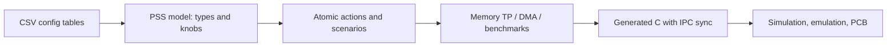

<!-- generated by yt-paper; edits will be overwritten -->
[DVCon](../dvcon/index.md) › [US](../dvcon/us.md) › [2020](../dvcon/by-year.md#2020) › [Verification](../dvcon/by-topic.md#verification)

# Post-Silicon Performance Validation Using PSS

<figure class="rep-fig" markdown>
{ loading=lazy }
<figcaption>Figure 1. Test-chip (TC) Block Diagram — from the original paper (Dayoung Kim et al.)</figcaption>
</figure>

[:material-open-in-new: Original paper](https://dvcon-proceedings.org/wp-content/uploads/post-silicon-performance-validation-using-pss.pdf){ .md-button .md-button--primary target=_blank }

| | |
|---|---|
| Authors | Dayoung Kim, Jaehun Lee, Daeseo Cha (Samsung Electronics), Phu L. Huynh, Jake Kim (Cadence Design Systems) |
| Venue | DVCon US 2020 |
| Topic | Verification |
| Type | PAPER |
| ID | `ref-20261018-b4a5` |

## Summary

**Samsung and Cadence use PSS (Perspec) to build config-driven, reusable performance and long-running stress scenarios (memory traffic profiles, DMA, wrapped CPU benchmarks) for multi-version post-silicon validation of a quad-core-cluster test chip, reporting a 4–9% gain for a new design methodology.**

**Samsung과 Cadence는 PSS(Perspec)를 사용해 설정 기반의 재사용 가능한 성능 및 장시간 스트레스 시나리오(메모리 traffic profile, DMA, 벤치마크 래핑)를 구성하여, 여러 버전의 쿼드코어 클러스터 test chip을 post-silicon에서 검증했으며, 새 설계 방법론에서 4~9% 성능 향상을 보고했습니다.**

## Key Insights

- A CSV configuration-table to PSS model flow (e.g., sml_cluster_tag_e generated from the processor table) keeps scenarios reusable; per the paper, only the config file changes when cluster count or names change, though tests naming specific clusters (dma_tp_cl0) must be rewritten.

- CSV 설정 테이블에서 PSS 모델을 생성하는 흐름(예: 프로세서 테이블로부터 sml_cluster_tag_e 생성)으로 시나리오를 재사용할 수 있으며, 논문에 따르면 클러스터 수나 이름이 바뀌어도 설정 파일만 수정하면 되지만 특정 클러스터를 지정한 테스트(dma_tp_cl0)는 다시 작성해야 합니다.

- Parallel and sequence activities let the PSS tool auto-generate IPC messages and sync points (e.g., core A0 starts A1-A3 and waits for their completion before stop_pm_counter); engineers debug at action level and drop to C only for failing actions.

- parallel 및 sequence activity를 통해 PSS 도구가 IPC 메시지와 동기화 지점을 자동 생성합니다(예: 코어 A0이 A1-A3을 시작시키고 이들의 완료를 기다린 뒤 stop_pm_counter 실행). 엔지니어는 action 수준에서 디버그하고, 실패한 action에서만 C 수준으로 내려갑니다.

- Per-core memory traffic profile knobs (direction, MB/s, transaction count) compose into bandwidth stress; the CL4 example has four cores writing at 800 MB/s with a loop of 12 transactions.

- 코어별 메모리 traffic profile knob(방향, MB/s, 트랜잭션 수)을 조합해 대역폭 스트레스를 구성할 수 있으며, CL4 예시에서는 4개 코어가 800 MB/s로 쓰기를 수행하고 루프 횟수는 12입니다.

- The paper reports a 4~9% performance enhancement for new Samsung design methodology blocks (BLK_CPU1/2 vs BLK_CPU0), but the Fig. 16 table values (0.91-0.98) have no labeled metric direction or units, so verify before citing.

- 논문은 새 Samsung 설계 방법론 블록(BLK_CPU1/2 대 BLK_CPU0)에서 4~9% 성능 향상을 보고하지만, Fig. 16 표의 값(0.91-0.98)에는 지표의 방향이나 단위가 표시되어 있지 않으므로 인용 전에 확인이 필요합니다.

- The same scenarios reportedly run unmodified in simulation and emulation with identical results, and PSS repeat statements extend them into long post-silicon runs (e.g., dma_tp repeated 9999 times); the productivity gain is claimed only qualitatively.

- 동일한 시나리오가 수정 없이 시뮬레이션과 에뮬레이션에서 동일한 결과를 보인다고 하며, PSS repeat 문으로 post-silicon의 장시간 실행으로 확장할 수 있습니다(예: dma_tp 9999회 반복). 생산성 향상은 정성적으로만 주장되며 정량적 수치는 없습니다.

## Detailed Summary

### Background and Problem

- A post-silicon test chip with five CPU blocks (BLK_CPU0 to BLK_CPU4, quad-core each; 20 cores in clusters CL0 to CL4) evaluates new cell libraries, on-chip monitor IPs and physical implementation techniques via PPA measurements.

- 다섯 개의 CPU 블록(BLK_CPU0~BLK_CPU4, 블록당 쿼드코어, CL0~CL4 클러스터 총 20 코어)으로 구성된 post-silicon test chip에서 새 cell library, on-chip monitor IP, 물리 구현 기법을 PPA 측면에서 측정합니다.

- Hand-writing embedded test software for memory traffic, benchmarks and long-running multi-master stress is costly, and cluster count and naming change across chip versions.

- 메모리 트래픽, 벤치마크, 장시간 multi-master 스트레스용 embedded 테스트 SW를 수작업으로 작성하는 비용이 크며, 칩 버전마다 클러스터 수와 이름이 바뀝니다.

### Architecture and Methodology

- Four-step flow: performance test scenarios, wrapped de facto benchmarks (Dhrystone, CoreMark, lmbench, gzip), long-running composed scenarios, and a reusable config-driven environment.

- 4단계 흐름: 성능 테스트 시나리오, 래핑된 de facto 벤치마크(Dhrystone, CoreMark, lmbench, gzip), 장시간 실행용 조합 시나리오, 설정 기반의 재사용 가능한 환경.

- Memory TP: an atomic `sml_traffic_profile` action per core (direction, MB/s, transaction count) is composed by `multicore_sml_tp` under `parallel`, selected through the auto-generated `procs_subset` knob. Start/stop PMCCNTR actions measure cycles.

- Memory TP: 코어별 원자 action `sml_traffic_profile`(방향, MB/s, 트랜잭션 수)을 `multicore_sml_tp`가 `parallel` 하에서 조합하며, 자동 생성된 `procs_subset` knob으로 코어를 선택합니다. PMCCNTR 시작/정지 action으로 사이클을 측정합니다.

- `dma_tp`: one core runs start_pm_counter, DMA and stop_pm_counter while three others run the traffic profile. The tool generates C with IPC sync points.

- `dma_tp`: 한 코어가 start_pm_counter, DMA, stop_pm_counter를 수행하고 나머지 세 코어가 traffic profile을 실행합니다. 도구가 IPC 동기화 지점이 포함된 C 코드를 생성합니다.

### Results and Conclusions

- The new Samsung design methodology on BLK_CPU1/2 is reported to give a 4~9% performance gain over BLK_CPU0. The Fig. 16 table values (0.91-0.98) lack a labeled metric direction.

- BLK_CPU1/2의 새 Samsung 설계 방법론은 BLK_CPU0 대비 4~9% 성능 향상을 보고합니다. Fig. 16 표의 값(0.91-0.98)에는 지표 방향이 표시되어 있지 않습니다.

- Identical scenarios run unmodified in simulation and emulation, and PSS `repeat` extends them to post-silicon runs (dma_tp repeated 9999 times).

- 동일한 시나리오가 수정 없이 시뮬레이션과 에뮬레이션에서 실행되며, PSS `repeat`로 post-silicon 장시간 실행으로 확장됩니다(dma_tp 9999회 반복).

- Productivity gains are claimed only qualitatively; no quantified effort comparison is given.

- 생산성 향상은 정성적으로만 주장되며, 정량적인 공수 비교는 제시되지 않습니다.

## Videos

<iframe src="https://www.youtube-nocookie.com/embed/oT47WOHEeJ8" title="[DVCon2020] Post-Silicon Performance Validation Using PSS" loading="lazy" allow="accelerometer; clipboard-write; encrypted-media; gyroscope; picture-in-picture; web-share" referrerpolicy="strict-origin-when-cross-origin" allowfullscreen></iframe>

**[DVCon2020] Post-Silicon Performance Validation Using PSS** — [Watch on YouTube](https://www.youtube.com/watch?v=oT47WOHEeJ8) · [Video page](../videos/oT47WOHEeJ8.md)
