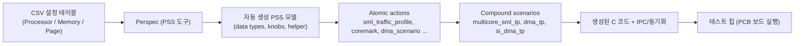

<!-- generated by yt-paper; edits will be overwritten -->
[Others](../others/index.md) › [Verification](../others/by-topic.md#verification)

# Post-Silicon Performance Validation Using PSS

[:material-open-in-new: Original paper](https://dvcon-proceedings.org/wp-content/uploads/post-silicon-performance-validation-using-pss.pdf){ .md-button .md-button--primary target=_blank }

| | |
|---|---|
| Authors | Dayoung Kim, Jaehun Lee, Daeseo Cha (Samsung Electronics); Phu L. Huynh, Jake Kim (Cadence Design Systems). 학회/발표처는 원문에 명시되지 않음. 참고: 제목 힌트의 저자 'Laura Hyslop'은 원문에서 확인되지 않음 |
| Venue | Others |
| Topic | Verification |
| Type | PAPER |
| ID | `ref-20261018-b4a5` |

## Summary

**Samsung 테스트 칩(쿼드코어 CPU 블록 5개)의 PPA 검증을 위해 Cadence Perspec 기반 PSS로 트래픽 프로파일, 벤치마크, 장시간 DMA+메모리 스트레스 시나리오를 재사용 가능하게 모델링하고, 설정 CSV만 바꾸면 환경을 재구성할 수 있음을 보인 사례 논문.**

&nbsp;

## Key Insights

- PSS의 action 단위 모델링으로 코어 선택, 방향, 대역폭, 트랜잭션 수 같은 제어 노브를 scenario 수준에서 다루면, IPC와 동기화 코드는 도구가 자동 생성한다. 엔지니어는 C 코드 레벨 디버깅을 실패 원인 분리 단계에서만 하게 된다.

&nbsp;

- 프로세서/메모리 토폴로지를 CSV 설정 테이블에서 PSS 데이터 타입(sml_cluster_tag_e, sml_processor_tag_e 등)으로 자동 생성하고, 시나리오가 프로젝트 고유 이름을 참조하지 않도록 설계하면 클러스터 수가 바뀌어도 시나리오 재사용이 가능하다. 단, 특정 클러스터를 이름으로 지정한 테스트(예: dma_tp_cl0)는 재작성이 필요하다.

&nbsp;

- 벤치마크(Dhrystone, CoreMark, lmbench, gzip)를 PSS action으로 감싸고 PMU 사이클 카운터 start/stop action으로 감싸면, 설계 방법론 차이에 따른 성능 차이를 일관된 조건에서 측정할 수 있다.

&nbsp;

- repeat 문으로 시뮬레이션용 시나리오를 실리콘에서 9999회 반복하는 식으로 장시간 테스트를 만들 수 있다. 다만 논문의 결과 그래프는 simulation time 기준이며, 실리콘 성능 수치는 본문에 없다.

&nbsp;

- 원문 결과 표는 BLK_CPU0을 1로 정규화한 값(BLK_CPU1 0.95~0.98, BLK_CPU2 0.91~0.94)을 보여주며, 본문은 4~9% 개선이라고 설명한다. 표의 지표 방향(낮을수록 좋은지)이 명시되지 않아 해석 시 주의가 필요하다. 생산성 향상도 정량 측정 없이 정성적으로만 서술되어 있다.

&nbsp;

## Detailed Summary

### 배경 및 문제 정의

&nbsp;

- 신규 반도체 기술(라이브러리 셀, on-chip monitor IP, 물리 구현 기법)은 양산 전에 테스트 칩으로 검증되어야 하며, 이 논문은 Samsung 테스트 칩의 PPA(Power, Performance, Area) 개선을 측정하는 과정을 다룬다.

&nbsp;

- 칩 내 임베디드 프로세서 코어와 펌웨어가 늘어나면서, 프로세서/메모리/IO 서브시스템의 동작, 통신, 동기화, 성능을 검증하는 테스트 소프트웨어를 만드는 시간과 인력 부담이 커진다.

&nbsp;

- 문제는 (1) 설계 구성(클러스터 수, 셀 라이브러리, 물리 구현)이 바뀔 때마다 테스트를 다시 작성해야 하고, (2) 수동으로 작성한 실사용 시나리오는 커버리지가 낮으며, (3) 여러 bus master가 동시에 동작할 때 자원 충돌, 메모리 할당, IPC, 동기화를 손으로 구현하기 어렵다는 점이다.

&nbsp;

### 핵심 아키텍처 및 방법론

&nbsp;

테스트 칩은 BLK_CPU0~BLK_CPU4 다섯 개의 CPU 블록을 포함하며, 각 블록은 쿼드코어(총 20코어, 클러스터 CL0~CL4)다. BLK_CPU0은 기존 Samsung DM, BLK_CPU1/2는 신규 DM을 적용한 블록이다. 기술 흐름은 다음과 같다.

&nbsp;

논문이 제시한 4단계 접근법은 다음과 같다.

&nbsp;

1. **성능 측정 시나리오 생성**: STA 타이밍 리포트로 클럭 속도와 최대 대역폭을 정하고, Traffic Profile Generator(TPG)를 PSS로 구현한다.

&nbsp;

2. **표준 벤치마크 래핑**: Dhrystone, CoreMark, lmbench, gzip을 PSS action으로 감싸고, 코어, 메모리 블록 등을 제어 노브로 노출한다. `start_pm_counter`/`stop_pm_counter` action은 ARM PMCCNTR 레지스터를 리셋/시작/정지해 사이클 수를 얻는다.

&nbsp;

3. **장시간 테스트 합성**: 짧은 테스트를 조합하고 run-time loop로 감싸 PCB 보드에서 측정 가능한 길이로 만든다.

&nbsp;

4. **재사용 가능한 PSS 환경**: 프로젝트 의존 설정은 CSV에 두고, 시나리오는 프로젝트 고유 이름을 참조하지 않게 작성한다.

&nbsp;

**주요 시나리오 구성**

&nbsp;

- **메모리 TP(traffic profile)**: `sml_traffic_profile` 원자 action은 코어 하나가 메모리에 접근하는 것을 나타내며, 제어 노브는 코어, 방향(read/write/random), 대역폭(MB/s), 트랜잭션 수다. `multicore_sml_tp`는 `procs_subset` 구조체로 여러 코어를 `parallel`로 묶는다. `procs_subset`의 `size`, `A0_selected`~`E3_selected`, `num_CL0`~`num_CL4`는 Table 1에서 PSS 도구가 자동 생성한다.

&nbsp;

- **DMA + 메모리 TP (`dma_tp`)**: 한 클러스터 안에서 코어 하나는 `start_pm_counter → dma_scenario → stop_pm_counter`를 실행하고, 나머지 세 코어는 `multicore_sml_tp`를 수행한다. 제약식으로 선택된 클러스터의 코어만 쓰도록 한다.

&nbsp;

- **시스템 연결성 시나리오**: DMA0(LPDDR4→UART 표시), DMA1(QSPI/SPI→LPDDR4) 등 여러 HW 자원을 동시에 활성화해 corner case와 전력을 측정한다.

&nbsp;

**자동 생성된 동기화**

&nbsp;

CL0 예시(Fig. 11)에서 A0이 Sync point 1(시작 시 IPC로 A1~A3에 시작 신호)과 Sync point 2(A1~A3 완료 대기 후 `stop_pm_counter`)를 담당한다. 도구가 이 IPC 메시지와 대기 코드를 C 코드로 자동 생성한다.

&nbsp;

**Post-silicon 장시간 테스트**

&nbsp;

`repeat (count)` 구문으로 시뮬레이션 시나리오를 실리콘에서 반복한다. 예: `si_dma_tp`는 `dma_tp`를 9999회 반복한다.

&nbsp;

**재사용성**

&nbsp;

현재 칩의 `sml_cluster_tag_e`는 CL0~CL3(본문)으로 설명되지만, Table 1에는 CL4까지 있어 본문과 표가 일치하지 않는다. 다음 버전에서 클러스터가 10개로 늘어나도 `dma_tp`는 이름을 참조하지 않으므로 재사용할 수 있고, 변경은 설정 파일에 한정된다고 주장한다.

&nbsp;

### 실험 결과 및 결론

&nbsp;

**측정 결과 (Fig. 16 / 결과 표, BLK_CPU0 = 1 정규화)**

&nbsp;

| 시나리오 | BLK_CPU0 | BLK_CPU1 | BLK_CPU2 |
|---|---|---|---|
| Memory Access (Write_Read) | 1 | 0.98 | 0.91 |
| Dhrystone | 1 | 0.97 | 0.91 |
| Gzip compress | 1 | 0.97 | 0.93 |
| Lmbench | 1 | 0.96 | 0.91 |
| Stress (Traffic Profile + DMA) | 1 | 0.95 | 0.94 |

&nbsp;

- 본문은 신규 DM이 PSS 시나리오 기준 **4~9% 성능 향상**을 보인다고 서술한다. 표 값 1-0.91=9%, 1-0.96=4%와 대응하므로 낮을수록 좋은 지표(시간/사이클)로 보인다. 다만 원문이 지표 방향을 명시하지 않았다.

&nbsp;

- 결과는 **simulation time** 기준이라고 명시되어 있다. 시뮬레이션과 에뮬레이션에서 수정 없이 같은 결과를 냈다고 주장하지만, 이 결과는 실리콘 측정값이 아니다.

&nbsp;

**결론과 한계**

&nbsp;

- PSS로 성능 측정 시나리오와 시스템 검증 시나리오를 자동 생성하고 코드 생성 작업을 크게 줄였다고 주장한다. 또한 설정 변경만으로 환경을 며칠 안에 재구성할 수 있다고 한다.

&nbsp;

- 생산성 향상의 "추정치"를 수동 코딩 대비로 제시하겠다고 했으나, 본문에는 정량 수치가 없다.

&nbsp;

- 클러스터 수 변경에 따른 재구성 시간("a few days")과 생산성 향상은 정성적 주장이다.

&nbsp;

- 제목 힌트의 저자 'Laura Hyslop'은 원문에서 찾을 수 없으며, 원문 저자는 Kim, Lee, Cha, Huynh, Kim이다. 참고문헌 [4]는 DVCon 2019 발표이지만, 본 논문의 발표 학회는 명시되지 않았다.

&nbsp;

## Videos

<iframe src="https://www.youtube-nocookie.com/embed/oT47WOHEeJ8" title="[DVCon2020] Post-Silicon Performance Validation Using PSS" loading="lazy" allow="accelerometer; clipboard-write; encrypted-media; gyroscope; picture-in-picture; web-share" referrerpolicy="strict-origin-when-cross-origin" allowfullscreen></iframe>

**[DVCon2020] Post-Silicon Performance Validation Using PSS** — [Watch on YouTube](https://www.youtube.com/watch?v=oT47WOHEeJ8) · [Video page](../videos/oT47WOHEeJ8.md)
