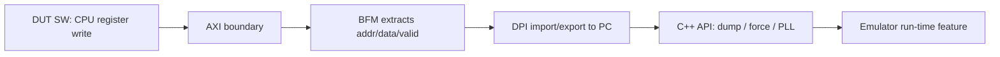

<!-- generated by yt-paper; edits will be overwritten -->
[DVCon](../dvcon/index.md) › [Europe](../dvcon/europe.md) › [2023](../dvcon/by-year.md#2023) › [Emulation](../dvcon/by-topic.md#emulation)

# A Novel Framework to Accelerate System Validation on Emulation

<figure class="rep-fig" markdown>
{ loading=lazy }
<figcaption>Figure 3: A Novel Framework to Accelerate System Validation on Emulation — from the original paper (Manoj Sharma Khandelwal et al.)</figcaption>
</figure>

[:material-open-in-new: Original paper](https://dvcon-proceedings.org/wp-content/uploads/90935.pdf){ .md-button .md-button--primary target=_blank }

| | |
|---|---|
| Authors | Manoj Sharma Khandelwal (Samsung Semiconductors R&D India, Bangalore), Rinkesh Yadav (Samsung Semiconductors R&D India, Bangalore), Sarang Kalbande (Samsung Semiconductors R&D India, Bangalore), Garima Srivastav (Samsung Semiconductors R&D India, Bangalore), Hyundon Kim (Samsung Electronics) |
| Venue | DVCon Europe 2023 |
| Topic | Emulation |
| Type | PAPER |
| ID | `ref-20261018-ba2c` |

## Summary

**Proposes a framework in which DUT software triggers emulator run-time features (waveform dump, signal force, PLL frequency change) through a register write captured at the AXI boundary by a BFM, relayed via DPI to C++ APIs, instead of testbench-side commands.**

**DUT 소프트웨어가 AXI 경계에서 BFM이 포착한 레지스터 쓰기를 통해 에뮬레이터의 런타임 기능(파형 덤프, 신호 강제, PLL 주파수 변경)을 제어하도록 하며, 이를 DPI로 C++ API에 전달하여 테스트벤치 측 명령 방식을 대체하는 프레임워크를 제안한다.**

## Key Insights

- Emulator run-time controls (dump, force, PLL) are normally driven from the testbench; this paper moves triggering into DUT software by mapping a CPU register write to an AXI-side BFM, then a DPI call, then a C++ API call.

- 에뮬레이터 런타임 제어(덤프, 강제, PLL)는 보통 테스트벤치에서 구동되며, 이 논문은 CPU 레지스터 쓰기를 AXI 측 BFM, DPI 호출, C++ API 호출 순으로 매핑하여 트리거를 DUT 소프트웨어로 옮긴다.

- For dump and force use cases, the framework removes the need to look up PC addresses, signal hierarchies, or timestamps and removes stop-run-force-rerun cycles, because the trigger is the function call itself.

- 덤프 및 강제 사용 사례에서는 PC 주소, 신호 계층, 타임스탬프 조회와 stop-run-force-rerun 반복이 필요 없어지는데, 트리거가 함수 호출 자체이기 때문이다.

- PLL output frequency is computed in the testbench via DPI-C from multiplier/divider values written by the CPU, enabling DFS scenarios without re-running the emulation with fixed frequencies.

- PLL 출력 주파수는 CPU가 기록한 multiplier/divider 값으로부터 DPI-C를 통해 테스트벤치에서 계산되므로, 고정 주파수로 에뮬레이션을 재실행하지 않고도 DFS 시나리오를 수행할 수 있다.

- The only quantitative claim is a preliminary emulation-time improvement over simulation for DFS scenarios reported as 'approximately X80' (garbled in the text); no workload, platform, or data table is given, so it should be treated as unverified.

- 유일한 정량적 주장은 DFS 시나리오에 대한 시뮬레이션 대비 에뮬레이션 시간의 예비 개선치로, 본문에서 'approximately X80'으로 표기되어 있으나 깨진 표기이다. 워크로드, 플랫폼, 데이터 표가 제시되지 않아 검증되지 않은 수치로 취급해야 한다.

- DPI call latency can alter timing-dependent software behavior and reduce emulator run-time performance; the authors acknowledge this but do not quantify the overhead.

- DPI 호출 지연은 타이밍에 의존하는 소프트웨어 동작을 바꿀 수 있고 에뮬레이터 런타임 성능을 떨어뜨릴 수 있다. 저자들은 이를 언급하지만 오버헤드를 정량화하지는 않았다.

## Detailed Summary

### Background and Problem

- Simulation exposes run-time controls (trigger-dump, force-release, memory read/write, signal reads) to the testbench, but emulators expose them only through library commands or testbench software, which need manual intervention and detailed knowledge of signal hierarchies and timestamps.

- 시뮬레이션은 trigger-dump, force-release, 메모리 읽기/쓰기, 신호 값 읽기 같은 런타임 제어를 테스트벤치에서 수행할 수 있다. 반면 에뮬레이터는 라이브러리 명령이나 테스트벤치 소프트웨어를 통해서만 이를 제공하며, 수동 개입과 신호 계층·타임스탬프에 대한 세부 지식이 필요하다.

- Dump example: capturing a waveform around `cmd_initialize()` requires finding the PC or timestamp and guessing run durations. Force example: forcing a signal after `reset_config()` needs stop, force, and re-run cycles.

- 덤프 예시: `cmd_initialize()` 주변의 파형을 캡처하려면 PC나 타임스탬프를 찾고 실행 시간을 추정해야 한다. 강제 예시: `reset_config()` 이후 신호를 강제하려면 stop, force, 재실행 과정을 반복해야 한다.

- PLL frequencies had to be fixed before the run, so any frequency change required a re-run, which limits DFS scenarios.

- PLL 주파수는 실행 전에 고정해야 하므로 주파수를 바꿀 때마다 재실행이 필요하며, 이는 DFS 시나리오를 제한한다.

### Architecture and Methodology

- Software writes a predefined address in an existing system-function register. This creates an AXI transaction at the block boundary, and a bus functional model (BFM) extracts address, data, and valid.

- 소프트웨어가 기존 시스템 기능 레지스터의 사전 정의된 주소에 쓰기를 수행한다. 이 쓰기는 블록 경계에서 AXI 트랜잭션을 만들고, BFM(bus functional model)이 address, data, valid를 추출한다.

- The BFM converts these signals into a DPI import/export message to the PC side, where a C++ API drives the emulator's dump on/off, force, or PLL frequency configuration.

- BFM은 이 신호를 PC 측으로 가는 DPI import/export 메시지로 변환하며, C++ API가 에뮬레이터의 덤프 on/off, 강제, PLL 주파수 설정을 구동한다.

- For the PLL, a DPI-C model computes the output frequency from multiplier and divider values in the testbench. Divided clocks are then applied to clock wires at run time.

- PLL의 경우 DPI-C 모델이 테스트벤치에서 multiplier 및 divider 값으로부터 출력 주파수를 계산한다. 분주된 클록은 런타임에 클록 와이어에 적용된다.

### Results and Conclusions

- The only quantitative result is preliminary: an emulation-time improvement over simulation for DFS scenarios, printed as "approximately X80" (garbled). The text gives no workload, platform, or table.

- 유일한 정량적 결과는 예비 수치로, DFS 시나리오에서 시뮬레이션 대비 에뮬레이션 시간 개선을 "approximately X80"으로 표기했다(깨진 표기). 본문에는 워크로드, 플랫폼, 데이터 표가 없다.

- Stated limitations: DPI call delays can affect timing-dependent logic, and DPI calls may reduce emulator run-time performance. The overhead is not quantified.

- 명시된 한계: DPI 호출 지연이 타이밍에 의존하는 로직에 영향을 줄 수 있고, DPI 호출이 에뮬레이터 런타임 성능을 떨어뜨릴 수 있다. 오버헤드는 정량화되지 않았다.

- Conclusion: software-controlled debug and dynamic frequency control reduce validation turnaround, but the evidence is qualitative beyond the single claim.

- 결론: 소프트웨어 주도 디버그와 동적 주파수 제어로 검증 턴어라운드를 줄일 수 있다고 주장하지만, 단일 수치를 제외하면 근거는 정성적이다.

## Videos

<iframe src="https://www.youtube-nocookie.com/embed/CKrVtVSJQrs" title="[DVCON2023_EUROPE]A Novel Framework to Accelerate System Validation on Emulation" loading="lazy" allow="accelerometer; clipboard-write; encrypted-media; gyroscope; picture-in-picture; web-share" referrerpolicy="strict-origin-when-cross-origin" allowfullscreen></iframe>

**[DVCON2023_EUROPE]A Novel Framework to Accelerate System Validation on Emulation** — [Watch on YouTube](https://www.youtube.com/watch?v=CKrVtVSJQrs) · [Video page](../videos/CKrVtVSJQrs.md)
