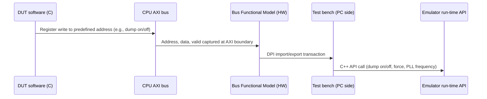

<!-- generated by yt-paper; edits will be overwritten -->
[DVCon](../dvcon/index.md) › [Europe](../dvcon/europe.md) › [2023](../dvcon/by-year.md#2023) › [Emulation](../dvcon/by-topic.md#emulation)

# A Novel Framework to Accelerate System Validation on Emulation

<figure class="rep-fig" markdown>
{ loading=lazy }
<figcaption>Figure 3: A Novel Framework to Accelerate System Validation on Emulation — from the original paper (Manoj Sharma Khandelwal et al.)</figcaption>
</figure>

[:material-open-in-new: Original paper](https://dvcon-proceedings.org/wp-content/uploads/90935.pdf){ .md-button .md-button--primary target=_blank }

| | |
|---|---|
| Authors | Manoj Sharma Khandelwal (Samsung Semiconductors R&D India), Rinkesh Yadav (Samsung Semiconductors R&D India), Sarang Kalbande (Samsung Semiconductors R&D India), Garima Srivastav (Samsung Semiconductors R&D India), Hyundon Kim (Samsung Electronics) |
| Venue | DVCon Europe 2023 |
| Topic | Emulation |
| Type | PAPER |
| ID | `ref-20261018-ba2c` |

## Summary

**A Samsung framework that lets software running on the DUT control emulator run-time features (trigger/dump, force, PLL frequency change) by writing a system register that an AXI BFM converts into DPI calls and C++ API invocations.**

**DUT 소프트웨어가 시스템 레지스터에 쓰기를 수행하면 AXI BFM이 이를 DPI 호출과 C++ API 호출로 변환하여, 에뮬레이터의 런타임 기능(trigger/dump, force, PLL 주파수 변경)을 소프트웨어에서 제어하는 Samsung의 프레임워크이다.**

## Key Insights

- Run-time emulator controls are driven from DUT software via a chain of CPU register write, AXI BFM capture, DPI call from HW to the testbench, and C++ API call, removing manual testbench commands.

- 에뮬레이터 런타임 제어는 CPU 레지스터 쓰기 → AXI BFM 캡처 → HW에서 테스트벤치로의 DPI 호출 → C++ API 호출의 체인을 통해 DUT 소프트웨어에서 구동되며, 수동 테스트벤치 명령이 필요 없어진다.

- Dump and force use cases no longer need signal hierarchy lookup, PC- or timestamp-based triggers, or manual run stopping; start_dump()/stop_dump() wrap the function under debug.

- Dump 및 force 사용 사례에서는 신호 hierarchy 탐색, PC 또는 타임스탬프 기반 trigger, 수동 run 중지가 더 이상 필요 없으며, start_dump()/stop_dump()가 디버그 대상 함수를 감싼다.

- PLL frequency is changed at run time through register configuration using a DPI-C PLL model, so DFS scenarios can be validated without re-running the emulation as in the earlier flow.

- PLL 주파수는 DPI-C PLL 모델을 통해 레지스터 설정으로 런타임에 변경되므로, 기존 방식처럼 에뮬레이션을 재실행하지 않고 DFS 시나리오를 검증할 수 있다.

- The approach adds DPI call latency: it can break logic that depends on delays and can reduce emulator run-time performance, which the authors list as limitations.

- DPI 호출은 지연을 추가하여 지연에 의존하는 로직을 깨뜨릴 수 있고 에뮬레이터 런타임 성능을 떨어뜨릴 수 있으며, 저자들은 이를 한계로 제시한다.

- The text reports approximately X80 emulation-time improvement over simulation for DFS scenarios, but the supporting result data is absent from the document, so this figure is unverified.

- 문서는 DFS 시나리오에서 시뮬레이션 대비 약 X80의 에뮬레이션 시간 개선을 보고하지만, 뒷받침하는 결과 데이터가 문서에 없어 이 수치는 검증되지 않았다.

## Detailed Summary

### Background and Problem

- Simulators expose Trigger-Dump, Force-Release, memory read/write and signal-get operations as SystemVerilog tasks callable from the DUT or testbench. Emulators expose the equivalent run-time features only through library commands or testbench software functions, which need manual intervention and cannot be driven from the DUT's own software.

- 시뮬레이터는 Trigger-Dump, Force-Release, 메모리 읽기/쓰기, 신호 값 읽기 같은 기능을 SystemVerilog 태스크로 제공하며, DUT나 테스트벤치에서 호출할 수 있다. 에뮬레이터에서는 같은 런타임 기능이 라이브러리 명령이나 테스트벤치 소프트웨어 함수를 통해서만 제공되어 수동 개입이 필요하고, DUT 자체 소프트웨어에서는 제어할 수 없다.

- Dump example: to capture a waveform around `cmd_intialize()`, the user must locate the function address, trigger on the processor program counter, guess a run duration, and start/stop the dump manually. Pitfalls: finding the signal hierarchy, the execution timestamp, the execution runtime, and the stop point.

- Dump 예시: `cmd_intialize()` 주변의 파형을 얻으려면 사용자가 함수 주소를 찾고, 프로세서 program counter에 trigger를 걸고, 실행 시간을 추정한 뒤 dump를 수동으로 시작/중지해야 한다. 문제점은 신호 hierarchy 탐색, 실행 타임스탬프, 실행 소요 시간, 중지 시점 파악이다.

- Force example: to force a signal after `reset_config()`, the user must find a trigger point for function completion, stop the run, force the signal, and rerun.

- Force 예시: `reset_config()` 이후 신호를 force하려면 함수 완료 시점의 trigger 지점을 찾고, run을 멈추고, 신호를 force한 뒤 다시 run해야 한다.

- PLL example: the simulation PLL model is not directly synthesizable. Frequencies had to be assigned or forced before the emulation run, so any frequency change required a re-run, which limits DFS and clock-ratio scenarios.

- PLL 예시: 시뮬레이션용 PLL 모델은 합성 가능하지 않다. 주파수는 에뮬레이션 실행 전에 할당하거나 force해야 했고, 이후 변경에는 재실행이 필요해 DFS 및 클록 비율 시나리오가 제한되었다.

### Architecture and Methodology

The framework maps run-time requests to a unique address in an existing system-function register in the DUT. The flow is:

이 프레임워크는 런타임 요청을 DUT의 기존 시스템 기능 레지스터 내 고유 주소에 매핑한다. 흐름은 다음과 같다.

- Step 1: the CPU writes to a register mapped to the user function.

- 1단계: CPU가 사용자 함수에 매핑된 레지스터에 쓴다.

- Step 2: the BFM extracts address and data from the AXI write on the same bus.

- 2단계: BFM이 CPU가 쓰기를 수행한 동일 버스의 AXI 쓰기에서 address와 data를 추출한다.

- Step 3: based on the extracted data, a standard emulator DPI call sends a message from hardware to the test bench.

- 3단계: 추출된 데이터를 기반으로 표준 에뮬레이터 DPI 호출이 HW에서 테스트벤치로 메시지를 전송한다.

- Step 4: the test bench calls a C++ API that triggers the corresponding emulator run-time feature.

- 4단계: 테스트벤치가 C++ API를 호출하여 해당 에뮬레이터 런타임 기능을 트리거한다.

- Dump usage: wrapper functions `start_dump()` and `stop_dump()` surround the function under debug, and `dump_time()` can be used to specify duration. The user no longer needs hierarchy, timestamp, or run-length knowledge.

- Dump 사용법: `start_dump()`와 `stop_dump()` 래퍼 함수가 디버그 대상 함수를 감싸며, `dump_time()`으로 지속 시간을 지정할 수 있다. 사용자는 hierarchy, 타임스탬프, 실행 길이를 알 필요가 없다.

- Force usage: `force_signal()` forces a signal at run time using the same four-step path.

- Force 사용법: `force_signal()`이 같은 4단계 경로를 통해 런타임에 신호를 force한다.

- PLL usage: a hardware PLL emulation model supports run-time frequency changes through DPI-C. When the CPU writes the multiplier or divider register, the values are captured by the BFM and passed to the testbench. The testbench C functions compute the output frequency from the input frequency and multiplier/divider values. The result is further divided and applied to the clock wires at run time, which enables DFS testing (Figure 7).

- PLL 사용법: 하드웨어 PLL 에뮬레이션 모델이 DPI-C를 통해 런타임 주파수 변경을 지원한다. CPU가 multiplier 또는 divider 레지스터를 쓰면 BFM이 값을 캡처하여 테스트벤치로 전달한다. 테스트벤치의 C 함수가 입력 주파수와 multiplier/divider 값으로 출력 주파수를 계산한다. 결과는 추가로 분주되어 런타임에 클록 와이어에 인가되며, 이를 통해 DFS 테스트가 가능해진다(Figure 7).

- Limitations stated: DPI-induced delays can affect functionality that depends on timing, and DPI calls can reduce emulator run-time performance.

- 명시된 한계: DPI로 인한 지연이 타이밍에 의존하는 기능에 영향을 줄 수 있고, DPI 호출이 에뮬레이터 런타임 성능을 저하시킬 수 있다.

### Results and Conclusions

- The only quantitative claim is a preliminary result for DFS scenarios: "approximately X80" emulation-time improvement over simulation. The text, as extracted, has no accompanying data table or measurements, and the "X80" string appears garbled, so this figure cannot be verified from the document. The results snippets referenced in the text are not present.

- 정량적 주장은 DFS 시나리오의 예비 결과 하나뿐이다. 시뮬레이션 대비 에뮬레이션 시간이 "approximately X80" 개선되었다고 되어 있다. 추출된 텍스트에는 이를 뒷받침하는 데이터 표나 측정값이 없고 "X80" 문자열도 깨진 것으로 보이므로, 문서만으로는 이 수치를 검증할 수 없다. 본문이 참조하는 결과 스니펫도 문서에 없다.

- The authors conclude the framework lets validation users control the emulator from DUT software, including trigger, dump, memory access, signal force, and frequency changes. They argue this shortens validation turnaround. No comparison against alternative run-time control methods is provided.

- 저자들은 이 프레임워크가 검증 사용자가 DUT 소프트웨어에서 trigger, dump, 메모리 접근, 신호 force, 주파수 변경을 포함한 에뮬레이터 제어를 할 수 있게 한다고 결론짓는다. 이를 통해 검증 턴어라운드를 단축한다고 주장한다. 다른 런타임 제어 방식과의 비교는 제공되지 않았다.

## Videos

<iframe src="https://www.youtube-nocookie.com/embed/CKrVtVSJQrs" title="[DVCON2023_EUROPE]A Novel Framework to Accelerate System Validation on Emulation" loading="lazy" allow="accelerometer; clipboard-write; encrypted-media; gyroscope; picture-in-picture; web-share" referrerpolicy="strict-origin-when-cross-origin" allowfullscreen></iframe>

**[DVCON2023_EUROPE]A Novel Framework to Accelerate System Validation on Emulation** — [Watch on YouTube](https://www.youtube.com/watch?v=CKrVtVSJQrs) · [Video page](../videos/CKrVtVSJQrs.md)
