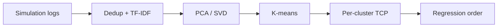

<!-- generated by yt-paper; edits will be overwritten -->
[DVCon](../dvcon/index.md) › [US](../dvcon/us.md) › [2022](../dvcon/by-year.md#2022) › [Verification](../dvcon/by-topic.md#verification)

# Finding a Needle in a Haystack: A Novel Log Analysis Method with Test Clustering in Distributed Systems

<figure class="rep-fig" markdown>
{ loading=lazy }
<figcaption>Figure 1. Flow of the Proposed Algorithm. — from the original paper (Jin Choi et al.)</figcaption>
</figure>

[:material-open-in-new: Original paper](https://dvcon-proceedings.org/wp-content/uploads/Finding-a-Needle-in-a-Haystack-A-Novel-Log-Analysis-Method-with-Test-Clustering-in-Distributed-System-1.pdf){ .md-button .md-button--primary target=_blank }

| | |
|---|---|
| Authors | Jin Choi, Sangwoo Noh, Sooncheol Hong, Hanna Jang, Seonghee Yim, Seonil Brian Choi (Samsung, per samsung.com email domains); venue not stated in the document |
| Venue | DVCon US 2022 |
| Topic | Verification |
| Type | PAPER |
| ID | `ref-20261018-bdff` |

## Summary

**Clusters terabyte-scale simulation logs by log-derived components using TF-IDF, PCA and K-means, then reorders test cases within each cluster (Farthest-First performed best), reaching 90% error detection in 73.08 h versus 368.57 h for the baseline order on an industrial verification project.**

**테라바이트 규모의 시뮬레이션 로그에서 로그 기반 컴포넌트를 TF-IDF, PCA, K-means로 클러스터링한 뒤 클러스터 내부에서 테스트 케이스 순서를 재정렬하는 방법으로, 최적 전략인 Farthest-First는 기준 순서 368.57시간 대비 73.08시간 만에 에러의 90%를 검출했다(산업용 검증 프로젝트 기준).**

## Key Insights

- Using log-derived components (tasks, functions, sequences, UVM and user-defined errors) as TF-IDF features gives tighter K-means clusters than clustering by test names, per the paper's t-SNE comparison (qualitative only).

- 로그에서 추출한 컴포넌트(task, function, sequence, UVM 및 사용자 정의 에러)를 TF-IDF 특징으로 사용하면 테스트 이름 기반 클러스터링보다 K-means 클러스터가 더 조밀해진다는 것이 논문의 t-SNE 비교 결과이며, 이는 정성적 비교에 그친다.

- Farthest-First cluster-wise ordering reached 90% error detection in 73.08 h (23.2% of 315.37 h total run time) versus 368.57 h (80.2% of 459.52 h) for the original order, while using 76.1% of test cases.

- Farthest-First 클러스터별 정렬은 전체 실행 시간 315.37시간 중 23.2%에 해당하는 73.08시간에 에러 90% 검출에 도달했으며, 원래 순서는 459.52시간 중 80.2%에 해당하는 368.57시간이 걸렸고, 이때 테스트 케이스는 76.1%만 사용되었다.

- Weighted clustering on access-register errors found those errors in 19 h versus 45 h, but overall 90% detection was delayed by up to three days, so the weighting is an explicit trade-off.

- Access-register 에러에 가중치를 준 클러스터링은 해당 에러를 45시간 대신 19시간에 찾았지만, 전체 90% 검출은 최대 3일 지연되어 명시적인 트레이드오프가 존재한다.

- Error-Count/Runtime-wise, expected to be best, underperformed (106.79 h); the authors attribute this to component and run-time changes across tool versions, and the evaluation covers only one project.

- 기대와 달리 Error-Count/Runtime-wise 전략은 106.79시간으로 성능이 낮았으며, 저자들은 툴 버전 간 컴포넌트 및 실행 시간 변화를 원인으로 추정하고, 평가는 단일 프로젝트에 한정된다.

## Detailed Summary

### Background and Problem

- Debugging repeated errors across terabytes of regression logs is costly, and manual test prioritization depends on engineers' domain knowledge.

- 테라바이트 규모 회귀 로그에서 반복되는 에러를 디버깅하는 비용이 크며, 수동 테스트 우선순위 지정은 엔지니어의 도메인 지식에 의존한다.

- Prior similarity-based TCP work (FAST min-hash/LSH, historical failure data, program-entity ordering) targets software or generic test suites; this paper targets RTL simulation logs and clusters on log-derived components.

- 기존 유사도 기반 TCP 연구(FAST의 min-hash/LSH, 과거 실패 데이터, 프로그램 엔티티 순서 기반)는 주로 소프트웨어나 일반 테스트 스위트를 대상으로 하며, 본 논문은 RTL 시뮬레이션 로그를 대상으로 로그에서 추출한 컴포넌트를 클러스터링한다.

### Architecture and Methodology

- Three-phase pipeline: preprocessing (dedup, TF-IDF over components, PCA or SVD reducing dimensionality by 92% and 85%, from 3,990 features), K-means clustering with K chosen by maximum Silhouette score in 0–30, and optional weighted clustering with weights on non-error versus error components ($\alpha$, $\beta$, $w$).

- 3단계 파이프라인: 전처리(중복 제거, 컴포넌트 TF-IDF 벡터화, PCA 또는 SVD로 차원 축소 - 3,990개 특징에서 각각 92%, 85%로 감소), Silhouette 점수 최대값(0–30 범위)으로 K를 정하는 K-means 클러스터링, 그리고 비에러/에러 컴포넌트에 가중치($\alpha$, $\beta$, $w$)를 주는 선택적 가중 클러스터링.

- Five TCP strategies compared: Without-TCP, Random, Farthest-First, Closest-First, and Error-Count/Runtime-wise.

- 비교한 5가지 TCP 전략: Without-TCP, Random, Farthest-First, Closest-First, Error-Count/Runtime-wise.

- Deployment: Airflow DAG pipelines run after regression; Spark and MongoDB handle distributed log processing; the model is served in memory (Nginx, Gunicorn, Django) behind a thread-safe Singleton.

- 배포: 회귀 후 Airflow DAG 파이프라인 실행, Spark와 MongoDB로 분산 로그 처리, 스레드 안전 Singleton 기반으로 인메모리 모델을 서빙(Nginx, Gunicorn, Django).

### Results and Conclusions

- On hundreds of thousands of test cases from one project, Farthest-First reached 90% error detection in 73.08 h versus 368.57 h for Without-TCP; Closest-First took 166.89 h, Random 96.7 h, and Error-Count/Runtime-wise 106.79 h.

- 한 프로젝트의 수십만 개 테스트 케이스에서 Farthest-First는 에러 90% 검출까지 73.08시간이 걸린 반면, Without-TCP는 368.57시간이 걸렸다. Closest-First는 166.89시간, Random은 96.7시간, Error-Count/Runtime-wise는 106.79시간이었다.

- Weighted clustering found targeted register-access errors earlier (19 h vs 45 h) at the cost of up to three days' delay in overall 90% detection.

- 가중 클러스터링은 대상 register-access 에러를 더 일찍 찾았다(19시간 대 45시간). 대신 전체 90% 검출은 최대 3일 지연되었다.

- Inference latency dropped from 20–40 s to about 2 s (under 1 s with caching). Results come from a single project with no variance reported.

- 추론 지연은 20–40초에서 약 2초(캐싱 시 1초 미만)로 줄었다. 결과는 단일 프로젝트에서 나왔으며 분산(variance)은 보고되지 않았다.

## Videos

<iframe src="https://www.youtube-nocookie.com/embed/_JOrnyqSEDU" title="[DVCON2022] Finding a Needle in a Haystack A Novel Log Analysis Method with Test Clustering in" loading="lazy" allow="accelerometer; clipboard-write; encrypted-media; gyroscope; picture-in-picture; web-share" referrerpolicy="strict-origin-when-cross-origin" allowfullscreen></iframe>

**[DVCON2022] Finding a Needle in a Haystack A Novel Log Analysis Method with Test Clustering in** — [Watch on YouTube](https://www.youtube.com/watch?v=_JOrnyqSEDU) · [Video page](../videos/_JOrnyqSEDU.md)
