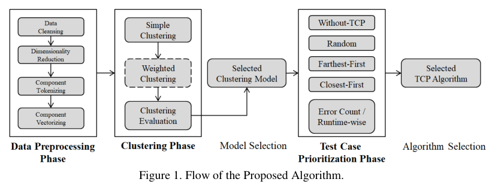
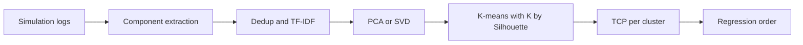

<!-- generated by yt-paper; edits will be overwritten -->
[DVCon](../dvcon/index.md) › [US](../dvcon/us.md) › [2022](../dvcon/by-year.md#2022) › [Verification](../dvcon/by-topic.md#verification)

# Finding a Needle in a Haystack: A Novel Log Analysis Method with Test Clustering in Distributed Systems

<figure class="rep-fig" markdown>
{ loading=lazy }
<figcaption>Figure 1. Flow of the Proposed Algorithm. — from the original paper (Jin Choi et al.)</figcaption>
</figure>

[:material-open-in-new: Original paper](https://dvcon-proceedings.org/wp-content/uploads/Finding-a-Needle-in-a-Haystack-A-Novel-Log-Analysis-Method-with-Test-Clustering-in-Distributed-System-1.pdf){ .md-button .md-button--primary target=_blank }

| | |
|---|---|
| Authors | Jin Choi, Sangwoo Noh, Sooncheol Hong, Hanna Jang, Seonghee Yim, Seonil Brian Choi (Samsung) |
| Venue | DVCon US 2022 |
| Topic | Verification |
| Type | PAPER |
| ID | `ref-20261018-bdff` |

## Summary

**The paper proposes a K-means-based test case prioritization method that clusters test cases by TF-IDF features of components extracted from terabyte-scale simulation logs, and runs it in an automated, in-memory ML pipeline on distributed infrastructure, reaching 90% error detection in 73.08 h versus 368.57 h for unprioritized regression.**

**이 논문은 terabyte 규모 시뮬레이션 로그에서 추출한 component의 TF-IDF 특징으로 test case를 K-means 클러스터링하고, 분산 인프라 위의 자동화된 in-memory ML 파이프라인으로 실행하는 test case prioritization 기법을 제안하며, 우선순위를 적용하지 않은 regression의 368.57 h 대비 Farthest-First로 90% 오류 검출에 73.08 h가 걸린다고 보고한다.**

## Key Insights

- Components (Task, Function, Sequence, UVM and user-defined errors) extracted from logs and TF-IDF vectorized give a clustering feature space; the raw 3,990 features are reduced with PCA or SVD (stated as 92% and 85% of dimensions) before K-means, with K chosen by maximum Silhouette score in the range 0 to 30.

- Task, Function, Sequence, UVM 및 사용자 정의 error 등 로그에서 추출한 component를 TF-IDF로 벡터화해 클러스터링 특징 공간을 만든다. 원본 3,990개 feature는 PCA 또는 SVD로 차원 축소(논문 표기 92% 및 85%)한 뒤 K-means를 적용하며, K는 0~30 범위에서 Silhouette score 최대값으로 선택한다.

- Farthest-First prioritization was the best TCP option: 90% of errors were detected in 73.08 h versus 368.57 h for Without-TCP, using 76.1% of test cases (versus 100%), and the paper reports a 23.9% reduction in test count to reach 90% errors.

- Farthest-First가 가장 우수한 TCP였다. 90% error 검출에 Without-TCP의 368.57 h 대비 73.08 h가 걸렸고, 필요한 test case 비율은 100%에서 76.1%로 줄었다. 논문은 90% 도달에 필요한 test 수가 23.9% 감소했다고 보고한다.

- Weighting critical errors (register access) made those errors appear in 19 h versus 45 h for simple clustering, but delayed full 90% error detection by up to three days, so weighting is an explicit trade-off between specific-error and broad-error coverage.

- Critical error(register access)에 가중치를 주면 해당 error가 단순 클러스터링의 45 h 대신 19 h에 나타났지만, 90% error 검출 시간은 최대 3일 지연되었다. 특정 error 조기 검출과 광범위한 error 커버리지 사이의 명시적 trade-off다.

- Error-Count/Runtime-wise prioritization, expected to be best, underperformed (106.79 h); the authors attribute this to changes in error counts and runtimes across component versions, so history-aware features are needed.

- 기대와 달리 Error-Count/Runtime-wise 방식은 106.79 h로 성능이 낮았다. 저자들은 component 버전 간 error 수와 runtime이 변했기 때문으로 보며, history를 반영한 특징이 필요하다고 제안한다.

- Model serving uses an in-memory, thread-safe Singleton model behind Nginx, Gunicorn and Django: inference averaged about 2 s (under 1 s with caching) versus 20 to 40 s when queued on LSF, and Airflow DAGs run the flow without human intervention.

- 모델 서빙은 Nginx, Gunicorn, Django 위에서 thread-safe Singleton in-memory 모델로 동작한다. 추론은 평균 약 2 s(캐싱 시 1 s 미만)로, LSF 큐에서 대기할 때의 20~40 s보다 빠르며, Airflow DAG가 사람의 개입 없이 흐름을 실행한다.

## Detailed Summary

### Background and Problem

- Debugging common errors across many test cases in digital design verification is tedious and time-consuming; the paper cites that verification accounts for about 70% of the development process [1][2].

- 많은 test case에서 공통 error를 반복적으로 디버깅하는 작업은 지루하고 시간이 많이 든다. 논문은 verification이 전체 개발 공정의 약 70%를 차지한다고 인용한다 [1][2].

- Manual, domain-knowledge-based test ordering does not scale to terabytes of simulation logs and hundreds of thousands of test cases.

- 엔지니어의 도메인 지식에 의존한 수동 test 순서 정하기는 terabyte 규모 시뮬레이션 로그와 수십만 개 test case로 확장되지 않는다.

- The goal is to reorder regression so that a target rate of error detection (here 90%) is reached as early as possible, at minimum regression time and resource cost.

- 목표는 목표 error 검출률(여기서는 90%)에 가능한 한 빨리 도달하도록 regression 순서를 재배열하고, regression 시간과 자원 비용을 최소화하는 것이다.

- Related work covers similarity-based TCP (FAST, min-hashing and LSH [3]; ordered program entities [5]; historical failure data [6]; test-code reuse [7]) and ML-based bug discovery in x86 regressions [4]. The authors' distinction is clustering on log-derived components, not just test results.

- 관련 연구로는 유사도 기반 TCP(min-hashing과 LSH를 쓴 FAST [3], 프로그램 엔티티 순서 [5], 과거 failure 데이터 [6], test 코드 재사용 [7])와 x86 regression에서 ML로 버그를 찾는 연구 [4]가 있다. 저자들의 차별점은 test 결과만이 아니라 로그에서 추출한 component로 클러스터링한다는 점이다.

### Architecture and Methodology

The method has three phases.

방법은 세 단계로 구성된다.

- **Data preprocessing:** duplicate components are removed, the rest are tokenized and vectorized with TF-IDF, and dimensionality is reduced with PCA or SVD. The raw feature set is 3,990 components.

- **데이터 전처리:** 중복 component를 제거하고, 나머지는 tokenize한 뒤 TF-IDF로 벡터화하며, PCA 또는 SVD로 차원을 줄인다. 원본 feature는 3,990개 component다.

- **Clustering:** K-means is used because it suits the distributed, parallel system. K is selected by maximum Silhouette score within 0 to 30, with the Elbow method used to justify the upper bound. Naive clustering on test names is compared with component-based clustering from logs; the authors report the log-based clusters are tighter.

- **클러스터링:** 분산 병렬 시스템에 적합하다는 이유로 K-means를 사용한다. K는 0~30 범위에서 Silhouette score 최대값으로 선택하며, Elbow 방법으로 상한을 정당화한다. test 이름 기반의 단순 클러스터링과 로그 기반 component 클러스터링을 비교했고, 저자들은 로그 기반 클러스터가 더 촘촘하다고 보고한다.

- **Weighted clustering:** components are split into non-error types (Task, Function, Sequence) and error types (tool and user-defined errors). Weight matrices $W_c$ and $W_e$ scale the TF-IDF values, controlled by hyper-parameters $\alpha$ (all components), $\beta$ (all errors) and $w$ (individual items). In the experiment, $\beta$ was set above $\alpha$, and specific register-access errors were weighted. The authors report a smaller average centroid distance than in the unweighted case.

- **가중 클러스터링:** component를 non-error 유형(Task, Function, Sequence)과 error 유형(tool error 및 사용자 정의 error)으로 나눈다. 가중치 행렬 $W_c$와 $W_e$를 TF-IDF 값에 곱하며, 하이퍼파라미터 $\alpha$(전체 component), $\beta$(전체 error), $w$(개별 항목)로 조정한다. 실험에서는 $\beta$를 $\alpha$보다 크게 설정했고, register 접근 관련 특정 error에 가중치를 주었다. 저자들은 가중치가 없을 때보다 평균 centroid 거리가 작다고 보고한다.

- **TCP per cluster:** five strategies are compared: (1) Without-TCP (original regression order), (2) Random sampling, (3) Farthest-First (farthest from centroid first), (4) Closest-First, and (5) Error-Count/Runtime-wise (more error types and shorter runtime first). Each cluster contributes its top-ranked tests in rounds until all errors are detected. The paper's pseudocode is loose and incomplete (for example, its loop condition is written as "while C is empty").

- **클러스터 내 TCP:** 다섯 가지 전략을 비교한다. (1) Without-TCP(원래 regression 순서), (2) Random 샘플링, (3) Farthest-First(centroid에서 가장 먼 것부터), (4) Closest-First, (5) Error-Count/Runtime-wise(error 종류가 많고 runtime이 짧은 것 우선)다. 각 클러스터에서 상위 test를 라운드 단위로 뽑아 모든 error가 검출될 때까지 실행한다. 논문의 의사코드는 느슨하고 불완전하다(예: 루프 조건이 "while C is empty"로 적혀 있음).

- **System:** an extension of the authors' earlier DVCon 2020 automation system [10]. Log processing runs on Spark and MongoDB, with multithreading. Models are served from memory through Nginx (load balancing and caching), Gunicorn and Django. A thread-safe Singleton keeps model memory at O(1) rather than O(N) in the number of threads. Airflow DAGs chain log collection, prioritization and automatic regression at the end of the regression flow.

- **시스템:** 저자들의 이전 DVCon 2020 자동화 시스템 [10]을 확장한 구조다. 로그 처리는 Spark와 MongoDB에서 멀티스레딩으로 수행한다. 모델은 Nginx(load balancing, caching), Gunicorn, Django를 통해 메모리에서 서빙한다. thread-safe Singleton으로 모델 메모리를 thread 수 N에 대해 O(N)이 아니라 O(1)로 유지한다. Airflow DAG가 regression 흐름 끝에서 로그 수집, 우선순위 산정, 자동 regression을 연결한다.

### Results and Conclusions

- **Dataset:** hundreds of thousands of test cases from one verification project; logs total terabytes.

- **데이터셋:** 한 검증 프로젝트의 수십만 개 test case이며, 로그는 총 terabyte 규모다.

- **Table 1 (time to detect 90% of errors / total run time):**

- **표 1 (90% error 검출 시간 / 전체 실행 시간):**

| TCP | Time to 90% | Total run | Ratio of tests for 90% |
|---|---|---|---|
| Without-TCP | 368.57 h | 459.52 h | 100% |
| Farthest-First | 73.08 h | 315.37 h | 76.1% |
| Closest-First | 166.89 h | 288.22 h | 97.7% |
| Random | 96.7 h | 325.25 h | 87.5% |
| Error-count/Runtime-wise | 106.79 h | 386.02 h | 90.6% |

| TCP | 90% 검출 시간 | 전체 실행 시간 | 90% 검출에 필요한 test 비율 |
|---|---|---|---|
| Without-TCP | 368.57 h | 459.52 h | 100% |
| Farthest-First | 73.08 h | 315.37 h | 76.1% |
| Closest-First | 166.89 h | 288.22 h | 97.7% |
| Random | 96.7 h | 325.25 h | 87.5% |
| Error-count/Runtime-wise | 106.79 h | 386.02 h | 90.6% |

- Farthest-First is the fastest. The authors attribute this to test cases far from centroids exposing more distinct errors than those near centroids.

- Farthest-First가 가장 빨랐다. 저자들은 centroid에서 먼 test case가 가까운 것보다 서로 다른 error를 더 많이 드러냈기 때문이라고 해석한다.

- **Weighted clustering:** the targeted errors appeared at 19 h versus 45 h for simple clustering, but time to 90% errors was delayed by up to three days. The authors present this as a configurable trade-off.

- **가중 클러스터링:** 대상 error는 단순 클러스터링의 45 h 대비 19 h에 나타났지만, 90% error 검출 시간은 최대 3일 지연되었다. 저자들은 이를 설정 가능한 trade-off로 제시한다.

- **System:** in-memory inference takes about 2 s on average (under 1 s with caching), versus 20 to 40 s when jobs are queued on LSF. Distributed, multithreaded processing reduces processing time more than standalone systems (Figure 7).

- **시스템:** in-memory 추론은 평균 약 2 s(캐싱 시 1 s 미만)가 걸리며, LSF에서 큐 대기 시의 20~40 s와 비교된다. 분산 및 멀티스레드 처리는 단독 시스템보다 처리 시간을 크게 줄인다(Figure 7).

- **Limitations stated by the authors:** the method depends on component names, which may change without behavioral change; only K-means was tested; and results rely on one project version. The evaluation reports single-run figures on one dataset, with no variance or cross-project validation.

- **저자가 밝힌 한계:** 방법이 component 이름에 의존하므로, 동작 변화 없이 이름이 바뀌면 정확도가 떨어질 수 있다. K-means만 사용했고, 결과는 하나의 프로젝트 버전에 기반한다. 평가는 한 데이터셋에서 단일 실행 수치만 보고하며, 분산이나 프로젝트 간 검증은 없다.

- **Conclusion:** clustering-based, component-driven TCP with automated pipelines reduces time to a target error-detection rate, and the strategy can be chosen per dataset and configured via weights.

- **결론:** component 기반 클러스터링 TCP와 자동화 파이프라인으로 목표 error 검출률 도달 시간을 줄일 수 있으며, 데이터셋에 따라 전략을 고르고 가중치로 설정할 수 있다.

## Videos

<iframe src="https://www.youtube-nocookie.com/embed/_JOrnyqSEDU" title="[DVCON2022] Finding a Needle in a Haystack A Novel Log Analysis Method with Test Clustering in" loading="lazy" allow="accelerometer; clipboard-write; encrypted-media; gyroscope; picture-in-picture; web-share" referrerpolicy="strict-origin-when-cross-origin" allowfullscreen></iframe>

**[DVCON2022] Finding a Needle in a Haystack A Novel Log Analysis Method with Test Clustering in** — [Watch on YouTube](https://www.youtube.com/watch?v=_JOrnyqSEDU) · [Video page](../videos/_JOrnyqSEDU.md)
