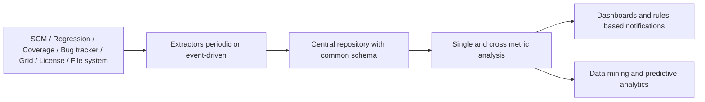

<!-- generated by yt-paper; edits will be overwritten -->
[DVCon](../dvcon/index.md) › [US](../dvcon/us.md) › [2018](../dvcon/by-year.md#2018) › [Verification](../dvcon/by-topic.md#verification)

# Improving Verification Predictability and Efficiency Using Big Data

[:material-open-in-new: Original paper](https://dvcon-proceedings.org/wp-content/uploads/improving-verification-predictability-and-efficiency-using-big-data.pdf){ .md-button .md-button--primary target=_blank }

| | |
|---|---|
| Authors | Darron K. May (Mentor Graphics Inc.) |
| Venue | DVCon US 2018 |
| Topic | Verification |
| Type | PAPER |
| ID | `ref-20261018-c017` |

## Summary

**The paper proposes a central, web-ready Big Data infrastructure that captures scattered verification metrics (SCM, regression, coverage, bugs, licenses, compute) and applies cross-metric trending, data mining, and predictive analysis to improve verification predictability and resource efficiency.**

**이 논문은 흩어져 있는 검증 메트릭(SCM, 회귀, 커버리지, 버그, 라이선스, 컴퓨트 자원)을 수집하는 중앙형 웹 기반 Big Data 인프라를 제안하고, 교차 메트릭 트렌드 분석, 데이터 마이닝, 예측 분석을 적용해 검증 예측 가능성과 자원 효율을 높이는 방법을 설명합니다.**

## Key Insights

- Most verification metrics (regression queue/CPU/run times, grid host loading, license checkouts, storage, bin counts, code churn) are generated but not retained; a central repository with extractors that run periodically or on events is the proposed fix.

- 회귀 큐/CPU/실행 시간, 그리드 호스트 부하, 라이선스 체크아웃, 스토리지, 빈(bin) 수, 코드 churn 등 대부분의 검증 메트릭은 생성되지만 보관되지 않습니다. 논문은 주기적 또는 이벤트 기반으로 동작하는 extractor와 중앙 저장소로 이를 해결하자고 제안합니다.

- Cross-metric plots give diagnostic cues: high code coverage with low functional coverage suggests more tests are needed, while low code coverage with high functional coverage suggests a functional model gap or unused design areas; bin counts separate coverage drops caused by model additions.

- 교차 메트릭 플롯은 진단 단서를 제공합니다. 코드 커버리지는 높고 기능 커버리지는 낮으면 테스트 추가가 필요함을, 코드 커버리지는 낮고 기능 커버리지는 높으면 기능 모델의 보완 필요 또는 설계의 미사용 영역을 시사합니다. 빈 수를 함께 보면 커버리지 모델 추가로 인한 하락을 구분할 수 있습니다.

- Bug closure and code churn both follow S-curves over a project, so trending them against coverage gives a sign-off progress estimate; the paper claims very high accuracy when studied across projects but gives no quantitative data.

- 버그 종결률과 코드 churn은 모두 프로젝트 전체에서 S-curve를 따르므로, 커버리지와 함께 추세를 보면 sign-off 진행률을 추정할 수 있습니다. 논문은 여러 프로젝트에 걸쳐 분석하면 정확도가 매우 높다고 주장하지만, 본문에 정량적 데이터는 없습니다.

- The debug-starting-point heuristic correlates per-coverage-point pass/fail signatures with regression outcomes: a point covered only by failing tests is a likely failure cause, and the approach is patented (J. Larabell, US patent).

- 디버그 시작점 휴리스틱은 커버리지 포인트별 pass/fail 시그니처를 회귀 결과와 상관시킵니다. 실패한 테스트에서만 커버되는 포인트는 실패 원인일 가능성이 높으며, 이 접근법은 J. Larabell 명의 미국 특허입니다.

- The paper is a conceptual overview with no experimental evaluation; it does not recommend a specific database or framework, and it notes that a commercial tool would need multi-database support and a modern web stack.

- 이 논문은 실험 평가가 없는 개념 개요입니다. 특정 데이터베이스나 프레임워크를 추천하지 않으며, 상용 도구라면 다중 DB 지원과 최신 웹 기술 스택이 필요하다고만 언급합니다.

## Detailed Summary

### Background and Problem

- Verification flows (testplan, SCM, build/regression, coverage, bug tracking, compute grid, license server, file system) generate large amounts of data, but most of it is discarded or kept in isolated per-tool silos. Only a small fraction of project data is saved, and metrics cannot be compared across tools or projects.

- 검증 흐름(testplan, SCM, 빌드/회귀, 커버리지, 버그 추적, 컴퓨트 그리드, 라이선스 서버, 파일 시스템)은 대량의 데이터를 생성하지만, 대부분은 폐기되거나 도구별로 고립된 상태로 남습니다. 프로젝트 데이터의 극히 일부만 저장되며, 도구와 프로젝트 간 메트릭 비교가 불가능합니다.

- The paper frames Big Data as the capture, process, and analyze pipeline, using the 3V model (volume, velocity, variety), later extended with machine learning and digital footprint. It argues that verification data qualifies once it is combined and retained.

- 논문은 Big Data를 capture, process, analyze 파이프라인으로 설명하고, 3V 모델(volume, velocity, variety)을 기반으로 하며 이후 machine learning과 digital footprint가 추가되었다고 정리합니다. 검증 데이터도 결합되고 보관되면 Big Data 요건을 충족한다고 주장합니다.

- Goal: predict sign-off date, detect progress and bottlenecks, and allocate compute and license resources more efficiently, both within and across projects.

- 목표: sign-off 일정 예측, 진행 상황과 병목 탐지, 컴퓨트 및 라이선스 자원의 효율적 배분을 프로젝트 내부와 프로젝트 간에서 달성하는 것입니다.

### Architecture and Methodology

Proposed flow:

제안된 흐름:

- **Storage:** Server RDBMS (SQL Server, Oracle, PostgreSQL, DB2) for reliability and consistency, or NoSQL (MongoDB, Cassandra, CouchDB, HBase, Redis) for flexible semi- or unstructured data. Hadoop (HDFS, MapReduce) is discussed for distributed storage on commodity hardware. The backend should allow database choice while keeping security and authentication.

- **저장소:** 신뢰성과 일관성을 위한 서버형 RDBMS(SQL Server, Oracle, PostgreSQL, DB2) 또는 반정형·비정형 데이터에 유연한 NoSQL(MongoDB, Cassandra, CouchDB, HBase, Redis)을 사용합니다. 범용 하드웨어 클러스터의 분산 저장을 위해 Hadoop(HDFS, MapReduce)도 논의됩니다. 백엔드는 DB 선택의 유연성을 유지하면서 보안과 인증을 제공해야 합니다.

- **Frontend:** HTML5, CSS3, and JavaScript libraries (Angular, React, Bootstrap, Node.js) with dashboards for interactive visualization. Ruby on Rails and Python/Django are both viable server-side options; the paper does not pick a winner and cites a Ruby on Rails metrics system from [4].

- **프런트엔드:** HTML5, CSS3, JavaScript 라이브러리(Angular, React, Bootstrap, Node.js)를 사용하며, 대화형 시각화를 위한 대시보드를 구성합니다. 서버 측 프레임워크로는 Ruby on Rails와 Python/Django가 모두 가능하며, 논문은 어느 쪽이 우위인지 정하지 않고 [4]의 Ruby on Rails 기반 메트릭 시스템을 인용합니다.

- **Extraction cadence:** Compute and license samples at least every minute, SCM samples on every commit, regression samples per run (nightly or commit-triggered smoke tests).

- **추출 주기:** 컴퓨트 및 라이선스 샘플은 최소 1분마다, SCM 샘플은 커밋마다, 회귀 샘플은 실행마다(야간 실행은 주기적, 스모크 테스트는 커밋 이벤트 기반) 수집합니다.

- **Metric catalogue (Table 1):** Testplan and requirement status (design, verification, verified requirements); SCM line counts split into functional, comment, and whitespace, plus code churn; regression pass/fail counts, queue/CPU/run times, and mean time between regressions; grid host loading and memory; license features checked out; storage used and capacity; code, functional, and testplan coverage with bin counts; bug open, closed, and in-progress counts with mean time between fixes.

- **메트릭 목록(Table 1):** Testplan 및 요구사항 상태(설계, 검증, 검증 완료 요구사항), 기능/주석/공백 라인 수로 나눈 SCM 라인 수와 코드 churn, 회귀의 pass/fail 수, 큐/CPU/실행 시간과 회귀 간 평균 시간, 그리드 호스트 부하와 메모리, 체크아웃된 라이선스 기능, 사용 스토리지와 용량, 코드/기능/testplan 커버리지와 빈 수, 버그의 open/closed/in-progress 수와 평균 수정 간격.

- **Analysis techniques:**
  - *Trending:* coverage over time, and bug closure and code churn following S-curves to estimate remaining time.
  - *Cross-metric plots:* code vs functional coverage on one time axis, with bin counts to separate coverage drops caused by model growth.
  - *Smart functions:* real-time views, license-use league tables, gauges, and rules such as alerts on coverage drops over a window or bugs open beyond a threshold.
  - *Housekeeping:* down-sampling of resource metrics to keep trends while reducing storage.
  - *Domain analysis:* functional, comment, and whitespace LOC for RTL or HVL; per-user lines added, removed, or modified.
  - *Co-change mining:* conditional probability that files change together, flagging unexpected coupling as refactoring candidates.
  - *Meta-data enrichment:* recording the tool that found a bug or the design instance, so mean time between fixes can be compared per method.
  - *Cross-references:* linking bug IDs to commits and recording the revision where a bug was found and resolved.

- **분석 기법:**
  - *트렌딩:* 시간에 따른 커버리지, 그리고 버그 종결과 코드 churn의 S-curve를 활용한 잔여 시간 추정.
  - *교차 메트릭 플롯:* 코드 커버리지와 기능 커버리지를 같은 시간축에 배치하고, 빈 수를 함께 보아 모델 확장으로 인한 커버리지 하락을 구분.
  - *스마트 기능:* 실시간 뷰, 라이선스 사용 리그 테이블, 게이지, 일정 구간 내 커버리지 하락이나 기준을 넘긴 버그 수명에 대한 알림 규칙.
  - *데이터 관리:* 추세는 유지하면서 저장량을 줄이기 위한 자원 메트릭의 다운샘플링.
  - *도메인 분석:* RTL 또는 HVL의 기능/주석/공백 LOC, 사용자별 추가·삭제·수정 라인 수.
  - *동시 변경 마이닝:* 파일들이 함께 변경될 조건부 확률을 계산하여 의도하지 않은 결합을 리팩터링 후보로 표시.
  - *메타데이터 확장:* 버그를 찾은 도구나 설계 인스턴스를 기록하여 방법론별 평균 수정 간격을 비교.
  - *교차 참조:* 버그 ID를 커밋과 연결하고, 버그가 발견되고 해결된 리비전을 기록.

- **Debug-starting-point heuristic (patented, [5]):** A coverage point covered only by failing tests is a likely failure cause; a point covered by passing tests is unlikely to be the cause. Each point is rated by how well its per-test pass/fail signature correlates with the regression pass/fail signature. It assumes sufficient passing and failing tests, incomplete coverage (not 100%), and limited overlap between tests.

- **디버그 시작점 휴리스틱(특허, [5]):** 실패한 테스트에서만 커버되는 커버리지 포인트는 실패 원인일 가능성이 높고, 통과한 테스트에서 커버되는 포인트는 원인일 가능성이 낮습니다. 각 포인트는 테스트별 pass/fail 시그니처가 회귀 전체의 pass/fail 시그니처와 얼마나 잘 상관되는지로 평가합니다. 충분한 수의 통과/실패 테스트, 100% 미만의 커버리지, 테스트 간 낮은 중복을 전제로 합니다.

### Results and Conclusions

- The paper is a conceptual overview. It reports no experiments, benchmarks, or measured improvements; the claim of "very high levels of accuracy" for S-curve prediction is not supported by quantitative data in the text.

- 이 논문은 개념적 개요입니다. 실험, 벤치마크, 측정된 개선 수치는 보고하지 않습니다. S-curve 예측이 "매우 높은 정확도"를 가진다는 주장도 본문에서 정량적 데이터로 뒷받침되지 않습니다.

- Context numbers cited: META Group/Gartner 3V definition (2001); IBM (2013) stating 90% of the world's data was generated in the prior two years; newer reports of data growth of 40% to 50% per year.

- 인용된 배경 수치: META Group/Gartner의 3V 정의(2001), IBM의 2013년 발표(전 세계 데이터의 90%가 직전 2년 사이에 생성됨), 최근 보고서에서 언급된 연간 40%~50% 데이터 증가율.

- Conclusion: combining all verification metrics in a shared Big Data platform, applying data mining and predictive analysis, and retaining data across projects should let resources be used more efficiently and improve sign-off predictability. The paper does not recommend a specific technology stack, and suggests a commercial tool would need multi-database support and a modern web stack.

- 결론: 모든 검증 메트릭을 공유 Big Data 플랫폼에 결합하고, 데이터 마이닝과 예측 분석을 적용하며, 프로젝트 간 데이터를 보존하면 자원을 더 효율적으로 쓰고 sign-off 예측 가능성을 높일 수 있습니다. 논문은 특정 기술 스택을 추천하지 않으며, 상용 도구라면 다중 DB 지원과 최신 웹 기술 스택이 필요하다고 제안합니다.

## Videos

<iframe src="https://www.youtube-nocookie.com/embed/M0AezW85SRg" title="[DVCON2018] Improving Verification Predictability and Efficiency Using Big Data" loading="lazy" allow="accelerometer; clipboard-write; encrypted-media; gyroscope; picture-in-picture; web-share" referrerpolicy="strict-origin-when-cross-origin" allowfullscreen></iframe>

**[DVCON2018] Improving Verification Predictability and Efficiency Using Big Data** — [Watch on YouTube](https://www.youtube.com/watch?v=M0AezW85SRg) · [Video page](../videos/M0AezW85SRg.md)
