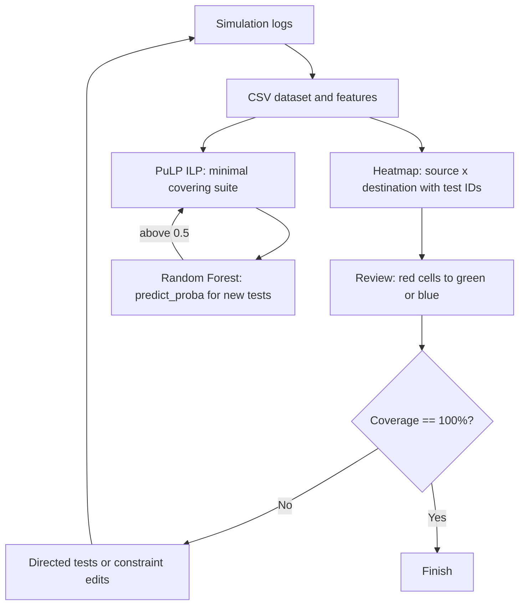

<!-- generated by yt-paper; edits will be overwritten -->
[DVCon](../dvcon/index.md) › [US](../dvcon/us.md) › [2025](../dvcon/by-year.md#2025) › [Verification](../dvcon/by-topic.md#verification)

# Enhancing SDC Verification in SoCs: Heatmap Visualization and Machine Learning Approaches for Optimal Coverage Closure

<figure class="rep-fig" markdown>
{ loading=lazy }
<figcaption>Figure 6. SDC coverage closure flow with optimized test suite finding. — from the original paper (Seungkyu Baek et al.)</figcaption>
</figure>

[:material-open-in-new: Original paper](https://dvcon-proceedings.org/wp-content/uploads/1031-2.pdf){ .md-button .md-button--primary target=_blank }

| | |
|---|---|
| Authors | Seungkyu Baek (Samsung Electronics Inc.), Jaein Hong (Samsung Electronics Inc.), Moonki Jun (Samsung Electronics Inc.), Sungcheol Park (Samsung Electronics Inc.) |
| Venue | DVCon US 2025 |
| Topic | Verification |
| Type | PAPER |
| ID | `ref-20261018-c3f8` |

## Summary

**The paper combines RTL-level SDC-aware simulation, source-to-destination heatmap visualization, and a PuLP integer-programming plus Random Forest test-suite optimizer to close timing-exception coverage, cutting one IP's regression from 78 to 19 vectors and 27 h to 10 h (~63%) while reaching 100% timing-exception path coverage.**

**이 논문은 RTL 수준 SDC-aware 시뮬레이션, source-to-destination 히트맵 시각화, 그리고 PuLP 정수계획법과 Random Forest 기반 테스트 스위트 최적화를 결합해 타이밍 예외 커버리지를 닫는 방법을 제시하며, 한 IP에서 회귀 테스트를 78개에서 19개 벡터로, 27시간에서 10시간(약 63% 단축)으로 줄이면서 타이밍 예외 경로 커버리지 100%를 달성했습니다.**

## Key Insights

- Heatmap as a gap map: a cross-table of SDC source points (rows) × destination points (columns) with covering test IDs in each cell turns summarized simulation-log coverage into actionable gaps; during closure, red cells are re-marked green or blue after review, so a closed heatmap contains only gray and green.

- 히트맵을 갭 맵으로 활용: SDC source 포인트(행)와 destination 포인트(열)의 교차표에 각 셀별 커버 테스트 ID를 표시하면, 요약된 시뮬레이션 로그 커버리지를 실행 가능한 갭 정보로 바꿀 수 있습니다. 커버리지 클로저 과정에서 빨간 셀은 리뷰 후 녹색 또는 파란색으로 변경되어, 클로즈된 히트맵에는 회색과 녹색 셀만 남습니다.

- Set-cover ILP with ML gating: each test is a binary variable, every SDC path must be covered by at least one selected test, and weights reflect unique paths, skippable paths, and simulation time. A Random Forest predicts whether newly added tests should join the suite (re-optimize when predict_proba > 0.5).

- ML로 게이트된 set-cover ILP: 각 테스트는 이진 변수이며, 모든 SDC 경로는 선택된 테스트 중 최소 하나에 의해 커버되어야 합니다. 가중치는 고유 경로, 스킵 가능 경로, 시뮬레이션 시간을 반영합니다. Random Forest는 새로 추가된 테스트가 스위트에 포함되어야 하는지 예측하며, predict_proba가 0.5를 초과하면 최적화를 다시 수행합니다.

- Measured results on one IP with 387 timing-exception paths: suite reduced from 78 to 19 test vectors, regression TAT from 27 h to 10 h (~63% reduction), with 100% coverage of the defined timing-exception paths.

- 387개 타이밍 예외 경로를 가진 한 IP에서의 측정 결과: 테스트 스위트가 78개에서 19개 벡터로 줄었고, 회귀 TAT는 27시간에서 10시간으로 감소(약 63% 단축)했으며, 정의된 타이밍 예외 경로는 100% 커버되었습니다.

- X-propagation at RTL catches SDC errors before GLS: 'fail' tests expose timing exceptions defined at incorrect points (e.g., a set_false_path on a cross-clock path); 'pass' test messages, such as a redundant set_false_path where two clocks are tied at top level, can be triaged and waived after architectural review.

- RTL에서 X-propagation을 사용하면 GLS 이전에 SDC 오류를 찾을 수 있습니다. 'fail' 테스트는 잘못된 지점에 정의된 타이밍 예외(예: 클록 도메인 교차 신호에 대한 잘못된 set_false_path)를 드러내며, 'pass' 테스트 메시지는 두 클록이 최상위에서 묶여 있어 중복된 set_false_path와 같은 경우를 아키텍처 리뷰 후 분류하고 waive할 수 있습니다.

- Scope limits: the approach was validated on a limited set of subsystem-level IPs; block- or chip-level heatmaps with thousands of rows and columns are flagged as open challenges, and the LPDDR5X controller/PHY application (64,202 paths from 318 constraints) reports TAT reduction without quantified figures.

- 적용 범위의 한계: 이 방법은 서브시스템 수준의 제한된 IP 집합에서 검증되었습니다. 수천 개의 행과 열을 가진 블록·칩 수준 히트맵은 미해결 과제로 제시되었으며, LPDDR5X 컨트롤러/PHY 적용 사례(318개 constraint에서 도출된 64,202개 경로)는 TAT 감소가 보고되었으나 정량적 수치는 제시되지 않았습니다.

## Detailed Summary

### Background and Problem

- Gate-level simulation (GLS) for SDC (Synopsys Design Constraints) verification starts only after physical implementation, runs far slower than RTL simulation, and limits the number of tests that can be executed. Timing mismatches found late (including setup/hold issues) have caused silicon re-spins.

- SDC(Synopsys Design Constraints) 검증을 위한 게이트 레벨 시뮬레이션(GLS)은 물리 구현 이후에야 시작되며, RTL 시뮬레이션보다 훨씬 느려 실행 가능한 테스트 수가 제한됩니다. setup/hold 문제를 포함해 늦게 발견된 타이밍 불일치는 실리콘 re-spin의 원인이 되어 왔습니다.

- RTL-level SDC-aware simulation (e.g., VCS setup checks on multicycle and false paths at elaboration) moves detection earlier. However, RTL X-optimism can yield false passes. Enabling X-propagation adds GLS-like X-pessimism, so setup violations propagate X values through the design.

- RTL 수준 SDC-aware 시뮬레이션(예: elaboration 단계에서 multicycle 및 false path에 대한 VCS setup 검사)은 검출 시점을 앞당깁니다. 다만 RTL의 X-optimism으로 인해 거짓 통과가 발생할 수 있습니다. X-propagation을 활성화하면 GLS와 유사한 X-pessimism이 추가되어 setup 위반 시 주입된 X 값이 설계 내부로 전파됩니다.

- Simulation logs and coverage tools report only summarized source/destination information. This makes it hard to find SDC coverage gaps, and regression suites accumulate redundant tests.

- 시뮬레이션 로그와 커버리지 도구는 source/destination 정보를 요약해서만 제공합니다. 이 때문에 SDC 커버리지 갭을 찾기 어렵고, 회귀 스위트에는 중복 테스트가 쌓입니다.

### Architecture and Methodology

The flow has two parts, both driven by SDC path coverage data.

이 흐름은 두 부분으로 구성되며, 둘 다 SDC 경로 커버리지 데이터에 기반합니다.

**(A) Heatmap-based gap identification.** Simulation logs are parsed into a CSV dataset. A cross-table is built with source points as rows, destination points as columns, and covering test IDs in each cell. A summary header reports the test rate, coverage progress, and deltas from the previous regression. During closure, initial cells are gray or red (uncovered); after review, red cells become green or blue. The closed heatmap contains only gray and green cells.

**(A) 히트맵 기반 갭 식별.** 시뮬레이션 로그를 파싱해 CSV 데이터셋을 만듭니다. source 포인트를 행, destination 포인트를 열로 하고, 각 셀에 커버하는 테스트 ID를 기록한 교차표를 구성합니다. 요약 헤더에는 테스트 비율, 커버리지 진행률, 이전 회귀 대비 변화량이 표시됩니다. 커버리지 클로저 과정에서 초기 셀은 회색 또는 빨간색(미커버)이며, 리뷰 후 빨간 셀은 녹색 또는 파란색으로 바뀝니다. 클로즈된 히트맵에는 회색과 녹색 셀만 남습니다.

Three features are extracted from the heatmap for ML:

ML을 위해 히트맵에서 세 가지 특징을 추출합니다.

1. Number of asynchronous paths covered by individual tests

1. 개별 테스트가 커버하는 비동기 경로 수

2. Number of unique paths covered by individual tests

2. 개별 테스트가 커버하는 고유 경로 수

3. Number of waivable paths (e.g., counter register paths)

3. waive 가능한 경로 수(예: counter register 경로)

**(B) ML-assisted regression optimization.** The suite is selected with a set-cover integer program solved in PuLP:

**(B) ML 기반 회귀 최적화.** 테스트 스위트는 PuLP로 풀는 set-cover 정수계획 문제로 선택합니다.

$$\text{Minimize } \sum_{i=1}^{n} x_i \quad (1), \qquad \text{Minimize } \sum_{i=1}^{n} w_i x_i \quad (2)$$

$$\text{Minimize } \sum_{i=1}^{n} x_i \quad (1), \qquad \text{Minimize } \sum_{i=1}^{n} w_i x_i \quad (2)$$

$$x_i \in \{0,1\} \quad (3), \qquad \sum_{i:\, j \in S_i} x_i \ge 1 \;\; \forall j \in A \quad (4)$$

$$x_i \in \{0,1\} \quad (3), \qquad \sum_{i:\, j \in S_i} x_i \ge 1 \;\; \forall j \in A \quad (4)$$

Here $x_i$ selects test $i$, $w_i$ weights unique paths, skippable paths, and simulation time, $A$ is the set of paths to cover, and $S_i$ is the subset of paths covered by test $i$. Only explicit constraints are modeled.

여기서 $x_i$는 테스트 $i$의 선택 여부, $w_i$는 고유 경로·스킵 가능 경로·시뮬레이션 시간을 반영한 가중치, $A$는 커버해야 할 전체 경로 집합, $S_i$는 테스트 $i$가 커버하는 경로 부분집합입니다. 명시적 제약만 모델링합니다.

A scikit-learn RandomForestClassifier is trained on features (time consumption, number of covered points, unique areas, aggregate skipability), with labels of 1 for tests in the optimized suite and 0 otherwise. The paper gives Random Forest's rationale as robustness, interpretability, feature importance, and few hyperparameters. For new tests, predict_proba is evaluated: if it exceeds 0.5, the optimization is re-run and the suite updated.

scikit-learn의 RandomForestClassifier를 특징(시뮬레이션 시간, 커버 포인트 수, 고유 영역 수, 누적 스킵 가능성)으로 학습하며, 최적화 스위트에 포함된 테스트는 1, 그렇지 않은 테스트는 0으로 라벨링합니다. 논문은 Random Forest를 선택한 이유로 견고성, 해석 가능성, 특징 중요도 제공, 적은 하이퍼파라미터를 듭니다. 새 테스트에 대해서는 predict_proba를 평가하며, 값이 0.5를 초과하면 최적화를 다시 수행하고 스위트를 갱신합니다.

**Experimental setup (Section IV).** The target is a CPU block in an HPC-oriented SoC: about 10M gates, 4 nm, 1.5 GHz, with Cortex-M3 and quad-core Cortex-A55 processors plus GPIO, UART, I2C, SPI, QSPI, and timer peripherals. The SDC has 1,069 constraints, including timing exceptions defined by 37 commands (e.g., set_multicycle_path, set_false_path) that affect 82,554 paths. The block has 554 functional regression scenarios.

**실험 환경(4장).** 대상은 HPC 지향 SoC의 CPU 블록입니다. 약 10M 게이트, 4 nm, 1.5 GHz이며, Cortex-M3와 쿼드코어 Cortex-A55 프로세서, GPIO, UART, I2C, SPI, QSPI, timer 주변장치를 포함합니다. SDC는 1,069개 constraint로 구성되며, 37개 명령(예: set_multicycle_path, set_false_path)으로 정의된 타이밍 예외가 82,554개 경로에 영향을 줍니다. 이 블록에는 554개의 기능 회귀 시나리오가 있습니다.

**Error classes found via X-propagation at RTL:**

**RTL X-propagation으로 찾은 오류 유형:**

1. Timing exception constraints at incorrect points. Found in "fail" tests (Fig. 7), where a set_false_path on a cross-clock-domain signal (ic_enable) was wrong. Fixing it requires an SDC or design change and a full regression rerun, so it is prioritized.

1. 잘못된 지점에 정의된 타이밍 예외 constraint. 'fail' 테스트에서 발견되었으며(그림 7), 클록 도메인 교차 신호(ic_enable)에 대한 set_false_path가 잘못된 사례입니다. 수정에는 SDC 또는 설계 변경과 전체 회귀 재실행이 필요해 우선 처리합니다.

2. Timing exceptions based on misunderstood clock relationships on asynchronous paths. Found in "pass" tests (Fig. 8), where a set_false_path is redundant because two clocks are tied at the top level. It does not immediately affect functionality and can be waived after architectural review.

2. 비동기 경로에서 클록 관계를 잘못 이해한 타이밍 예외. 'pass' 테스트에서 발견되었으며(그림 8), 최상위에서 두 클록이 묶여 있어 set_false_path가 중복된 사례입니다. 즉시 기능에 영향을 주지는 않으며, 아키텍처 리뷰 후 waive할 수 있습니다.

### Results and Conclusions

- **Specific IP (387 timing-exception paths):** the regression suite shrinks from 78 to 19 test vectors. Runtime drops from 27 h to 10 h (about 63% reduction), with 100% coverage of the defined timing-exception paths (Table III).

- **특정 IP(타이밍 예외 경로 387개):** 회귀 테스트 스위트가 78개에서 19개 벡터로 줄었습니다. 실행 시간은 27시간에서 10시간으로 감소(약 63% 단축)했고, 정의된 타이밍 예외 경로는 100% 커버되었습니다(표 III).

- **GLS-based sign-off comparison:** the traditional approach used a single vector covering one path (0.3% coverage). At the SS block level, a single optimized vector verified 203 timing paths, about 60% of SDC-defined paths.

- **GLS 기반 sign-off 비교:** 기존 방식은 경로 1개만 커버하는 단일 벡터(커버리지 0.3%)를 사용했습니다. SS 블록 수준에서는 최적화된 단일 벡터가 203개 타이밍 경로를 검증했으며, 이는 SDC 정의 경로의 약 60%에 해당합니다.

- **Scope and limitations:** the method was evaluated on a limited set of subsystem-level IPs. Block- and chip-level use is flagged as challenging, given heatmaps with thousands of rows and columns and the need for system-level scenario definition. The authors also propose replacing structural CDC/RDC checks or subjective designer reviews with functional regression and metric-based closure at RTL freeze.

- **적용 범위 및 한계:** 이 방법은 서브시스템 수준의 제한된 IP 집합에서 평가되었습니다. 수천 개의 행과 열을 가진 히트맵, 그리고 시스템 수준 시나리오 정의의 필요성 때문에 블록·칩 수준 적용은 어려운 과제로 제시되었습니다. 저자들은 RTL freeze 시점에 구조적 CDC/RDC 검증이나 설계자의 주관적 리뷰를 기능 회귀와 메트릭 기반 커버리지 클로저로 대체하는 방안도 제안합니다.

- **Ongoing work:** the methodology is being applied at block level to an LPDDR5X controller and PHY, covering 64,202 paths from 318 constraints. The paper reports a TAT reduction there but gives no quantified figures.

- **진행 중인 작업:** LPDDR5X 컨트롤러 및 PHY 블록 수준에 적용 중이며, 318개 constraint에서 도출된 64,202개 경로를 커버하는 작업입니다. 논문은 이 사례에서 TAT 감소를 보고하지만 정량적 수치는 제시하지 않았습니다.

- **Future work:** extend to full-system SoC validation, and explore AI-based predictive algorithms that refine the suite automatically.

- **향후 과제:** 전체 시스템 SoC 검증으로 확장하고, 스위트를 자동으로 개선하는 AI 기반 예측 알고리즘을 탐구할 계획입니다.

## Videos

<iframe src="https://www.youtube-nocookie.com/embed/67KjBs3Uw-Q" title="[DVCON2025]Enhancing SDC Verification in SoCs: Heatmap Visualization  Machine Learning Approaches " loading="lazy" allow="accelerometer; clipboard-write; encrypted-media; gyroscope; picture-in-picture; web-share" referrerpolicy="strict-origin-when-cross-origin" allowfullscreen></iframe>

**[DVCON2025]Enhancing SDC Verification in SoCs: Heatmap Visualization  Machine Learning Approaches ** — [Watch on YouTube](https://www.youtube.com/watch?v=67KjBs3Uw-Q) · [Video page](../videos/67KjBs3Uw-Q.md)
