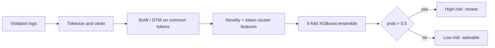

<!-- generated by yt-paper; edits will be overwritten -->
[DVCon](../dvcon/index.md) › [US](../dvcon/us.md) › [2023](../dvcon/by-year.md#2023) › [Verification](../dvcon/by-topic.md#verification)

# Check Low-Power Violations by Using Machine Learning Based Classifier

<figure class="rep-fig" markdown>
{ loading=lazy }
<figcaption>Figure 4. The overall flow of proposed approach. — from the original paper (Chi-Ming Lee et al.)</figcaption>
</figure>

[:material-open-in-new: Original paper](https://dvcon-proceedings.org/wp-content/uploads/1027-Check-Low-Power-Violations-by-Using-Machine-Learning-Based-Classifier.pdf){ .md-button .md-button--primary target=_blank }

| | |
|---|---|
| Authors | Chi-Ming Lee (MediaTek Inc.), Chung-An Wang (MediaTek Inc.), Cheok-Yan Goh (MediaTek Inc.), Chia-Cheng Tsai (MediaTek Inc.), Chien-Hsin Yeh (MediaTek Inc.), Chia-Shun Yeh (MediaTek Inc.), Chin-Tang Lai (MediaTek Inc.) |
| Venue | DVCon US 2023 |
| Topic | Verification |
| Type | PAPER |
| ID | `ref-20261018-c426` |

## Summary

**An ML pipeline (BoW tokenization, novelty and token-cluster features, 5-fold XGBoost ensemble) triages isolation-clamp low-power violations, keeping all true issues on three designs while cutting manual review effort by 12–50%.**

**BoW 토큰화, novelty 및 token-cluster 피처, 5-fold XGBoost 앙상블로 구성된 ML 파이프라인이 isolation clamp 저전력 violation을 분류하여, 3개 설계에서 모든 true design issue를 유지하면서 수동 리뷰 공수를 12~50% 줄입니다.**

## Key Insights

- On three testing designs (A, B, C) the full ensemble reached recall 1 (all 166, 117, and 539 true issues retained) while review reduction was 50%, 12%, and 18%, respectively.

- 3개 테스트 설계(A, B, C)에서 전체 앙상블은 recall 1을 달성하여 true design issue 166, 117, 539건을 모두 유지했으며, 리뷰 감소율은 각각 50%, 12%, 18%였습니다.

- Only tokens shared between training and testing designs enter the DTM (e.g., 200 of 359 words for A, 292 of 429 for B, 597 of 956 for C), so non-common tokens would be lost without the added features.

- 학습 및 테스트 설계 간 공통 토큰만 DTM에 포함되므로(A 359개 중 200개, B 429개 중 292개, C 956개 중 597개 단어), 추가 피처가 없으면 non-common 토큰의 정보가 손실됩니다.

- The 1-dimensional novelty feature (tokens unseen in historical waived violations) and the 30-dimensional token-cluster features (K-means over character-level BoW) recover signal from non-common tokens.

- 1차원 novelty 피처(과거 waived violation에 없던 토큰)와 30차원 token-cluster 피처(문자 단위 BoW에 대한 K-means)가 non-common 토큰에서 신호를 복원합니다.

- The final model is a 5-fold cross-validated XGBoost ensemble that picks the highest predicted probability, with a fixed 0.5 threshold for high-risk classification; training plus inference takes about 3 minutes per design on a 2-core CPU.

- 최종 모델은 5-fold 교차검증 XGBoost 앙상블로, 가장 높은 예측 확률을 선택하며 고위험 분류 임계값은 0.5로 고정됩니다. 설계당 학습과 추론에 2-core CPU 기준 약 3분이 걸립니다.

- Evidence is narrow: one check type (Isolation clamp value), three designs, and a single fixed threshold, so the claimed generalization to other check flows is untested in the paper.

- 근거가 제한적입니다. 검사 종류 하나(Isolation clamp value), 설계 3개, 고정 임계값 하나만 사용했으므로 다른 검사 흐름으로의 일반화는 논문에서 검증되지 않았습니다.

## Detailed Summary

### Background and Problem

- Manual review of simulator-generated low-power violations (isolation clamp value check) is labor-intensive; as violation counts grow, time-limited reviews can stay unfinished, so design issues surface after RTL freeze and require ECO.

- 시뮬레이터가 생성한 저전력 violation(isolation clamp value 검사)의 수동 리뷰는 노동집약적입니다. violation 수가 늘면 시간이 제한된 리뷰가 끝나지 않아 설계 이슈가 RTL freeze 이후에야 드러나고 ECO가 필요해집니다.

- The authors frame triage as supervised binary classification (waivable false alarm vs. high-risk true issue), treating violation signal names as text in the spirit of spam filtering.

- 저자들은 violation 신호 이름을 텍스트로 취급하고 스팸 필터링 방식을 따라, 분류 문제를 지도학습 이진 분류(waivable 오탐 vs. high-risk true issue)로 정식화합니다.

### Architecture and Methodology

- Preprocessing: tokenize signal names, lowercase, strip common prefixes, digits, and brackets, then build Bag-of-words vectors and a Document-Term Matrix restricted to tokens common to training and testing designs.

- 전처리: 신호 이름을 토큰화하고 소문자화하며, 공통 prefix, 숫자, 괄호를 제거한 뒤 BoW 벡터를 만들고, 학습 설계와 테스트 설계에 공통된 토큰으로 제한한 DTM을 구성합니다.

- Feature engineering: a 1-dimensional novelty feature (tokens absent from historical waived violations) and 30-dimensional token-cluster features (K-means over character-level BoW of non-common tokens).

- 피처 엔지니어링: 과거 waived violation에 없던 토큰을 나타내는 1차원 novelty 피처와, non-common 토큰의 문자 단위 BoW에 대한 K-means로 만든 30차원 token-cluster 피처를 사용합니다.

- Model: XGBoost base learners trained in 5-fold cross-validation; the highest predicted probability is the output, with 0.5 as the high-risk threshold.

- 모델: 5-fold 교차검증으로 학습한 XGBoost 기본 모델을 사용하며, 가장 높은 예측 확률을 출력으로 택하고 고위험 임계값은 0.5입니다.

### Results and Conclusions

- Training data: historical designs (7,000 violations, 284 true issues). Testing: A (2,002 / 166), B (1,001 / 117), C (3,177 / 539).

- 학습 데이터는 historical 설계(violation 7,000건, true issue 284건)입니다. 테스트는 A(2,002 / 166), B(1,001 / 117), C(3,177 / 539)입니다.

- The full ensemble (configuration 5) reaches recall 1 on all three designs, with review reduction of 50% (A), 12% (B), and 18% (C). Ablations against an SVM baseline and single-stage XGBoost configurations are shown in Fig. 8, whose values are not given in the text.

- 전체 앙상블(configuration 5)은 세 설계 모두에서 recall 1을 달성했으며, 리뷰 감소율은 A 50%, B 12%, C 18%입니다. SVM 기준 모델 및 단계별 XGBoost 구성과의 ablation 비교는 Fig. 8에 있으나 본문에는 수치가 없습니다.

- Limitations: one check type, three designs, five-seed averaging without reported variance, and no evaluation beyond these test sets.

- 한계: 검사 종류 하나, 설계 3개, 분산 보고 없는 5-seed 평균이며, 이 테스트 세트 이외의 평가는 없습니다.

### 배경 및 문제

&nbsp;

- 시뮬레이터가 생성한 저전력 violation(isolation clamp value 검사)의 수동 리뷰는 노동집약적입니다. violation 수가 늘면 시간이 제한된 리뷰가 끝나지 않아 설계 이슈가 RTL freeze 이후에야 드러나고 ECO가 필요해집니다.

&nbsp;

- 저자들은 violation 신호 이름을 텍스트로 취급하고 스팸 필터링 방식을 따라, 분류 문제를 지도학습 이진 분류(waivable 오탐 vs. high-risk true issue)로 정식화합니다.

&nbsp;

### 구조 및 방법론

&nbsp;

- 전처리: 신호 이름을 토큰화하고 소문자화하며, 공통 prefix, 숫자, 괄호를 제거한 뒤 BoW 벡터를 만들고, 학습 설계와 테스트 설계에 공통된 토큰으로 제한한 DTM을 구성합니다.

&nbsp;

- 피처 엔지니어링: 과거 waived violation에 없던 토큰을 나타내는 1차원 novelty 피처와, non-common 토큰의 문자 단위 BoW에 대한 K-means로 만든 30차원 token-cluster 피처를 사용합니다.

&nbsp;

- 모델: 5-fold 교차검증으로 학습한 XGBoost 기본 모델을 사용하며, 가장 높은 예측 확률을 출력으로 택하고 고위험 임계값은 0.5입니다.

&nbsp;

### 결과 및 결론

&nbsp;

- 학습 데이터는 historical 설계(violation 7,000건, true issue 284건)입니다. 테스트는 A(2,002 / 166), B(1,001 / 117), C(3,177 / 539)입니다.

&nbsp;

- 전체 앙상블(configuration 5)은 세 설계 모두에서 recall 1을 달성했으며, 리뷰 감소율은 A 50%, B 12%, C 18%입니다. SVM 기준 모델 및 단계별 XGBoost 구성과의 ablation 비교는 Fig. 8에 있으나 본문에는 수치가 없습니다.

&nbsp;

- 한계: 검사 종류 하나, 설계 3개, 분산 보고 없는 5-seed 평균이며, 이 테스트 세트 이외의 평가는 없습니다.

&nbsp;

## Videos

<iframe src="https://www.youtube-nocookie.com/embed/0cEVwOlM79M" title="[DVCON2023]Check Low-Power Violations by Using Machine Learning Based Classifier" loading="lazy" allow="accelerometer; clipboard-write; encrypted-media; gyroscope; picture-in-picture; web-share" referrerpolicy="strict-origin-when-cross-origin" allowfullscreen></iframe>

**[DVCON2023]Check Low-Power Violations by Using Machine Learning Based Classifier** — [Watch on YouTube](https://www.youtube.com/watch?v=0cEVwOlM79M) · [Video page](../videos/0cEVwOlM79M.md)
