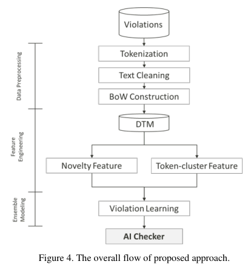
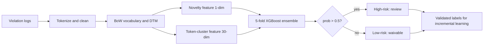

<!-- generated by yt-paper; edits will be overwritten -->
[DVCon](../dvcon/index.md) › [US](../dvcon/us.md) › [2023](../dvcon/by-year.md#2023) › [Verification](../dvcon/by-topic.md#verification)

# Check Low-Power Violations by Using Machine Learning Based Classifier

<figure class="rep-fig" markdown>
{ loading=lazy }
<figcaption>Figure 4. The overall flow of proposed approach. — from the original paper (Chi-Ming Lee et al.)</figcaption>
</figure>

[:material-open-in-new: Original paper](https://dvcon-proceedings.org/wp-content/uploads/1027-Check-Low-Power-Violations-by-Using-Machine-Learning-Based-Classifier.pdf){ .md-button .md-button--primary target=_blank }

| | |
|---|---|
| Authors | Chi-Ming Lee (MediaTek Inc., Hsinchu, Taiwan), Chung-An Wang (MediaTek Inc.), Cheok-Yan Goh (MediaTek Inc.), Chia-Cheng Tsai (MediaTek Inc.), Chien-Hsin Yeh (MediaTek Inc.), Chia-Shun Yeh (MediaTek Inc.), Chin-Tang Lai (MediaTek Inc.) |
| Venue | DVCon US 2023 |
| Topic | Verification |
| Type | PAPER |
| ID | `ref-20261018-c426` |

## Summary

**The paper applies an XGBoost ensemble over Bag-of-Words violation-log features, novelty tokens, and token-cluster features to classify Isolation clamp violations as waivable or high-risk, reducing manual review by 12–50% across three MediaTek low-power designs while keeping all true design issues in the high-risk set.**

**XGBoost 앙상블을 Bag-of-Words 기반 violation 로그 특징, novelty token, token-cluster 특징과 결합해 Isolation clamp violation을 waivable과 high-risk로 분류하며, 3개 MediaTek low-power 설계에서 수동 리뷰 작업을 12~50% 줄이면서도 모든 true design issue를 high-risk 집합에 유지함.**

## Key Insights

- Violation triage is framed as supervised binary classification over tokenized simulation violation logs (tokenize, clean, BoW, DTM), trained on historical waived vs. true-issue violations; pretrained NLP models are judged unsuitable because design signal names carry no general-language semantics.

- Violation triage를 토큰화된 시뮬레이션 violation 로그에 대한 지도 이진 분류 문제(tokenize, clean, BoW, DTM)로 정의하고, 과거 waived violation과 true-issue violation으로 학습함. 설계 신호 이름은 일반 언어의 의미를 갖지 않으므로 사전 학습된 NLP 모델은 적합하지 않다고 판단함.

- Common tokens between training and test designs were only 200/359 (A), 292/429 (B), and 597/956 (C). Novelty-token (1 dimension) and token-cluster (30 dimensions, K-means over character-level BoW of non-common tokens) features recover information otherwise dropped from the DTM.

- 학습 설계와 테스트 설계 간 공통 token 수는 A 200/359, B 292/429, C 597/956에 불과함. Novelty token 특징(1차원)과 token-cluster 특징(30차원, non-common token의 문자 단위 BoW에 K-means 적용)이 DTM에서 버려지는 정보를 복원함.

- Ablation over five configurations (SVM baseline, XGBoost with preprocessing only, +novelty, +token-cluster, +5-fold ensemble): the full ensemble reaches recall 1 on all three testing designs, with review reduction of 50% (A), 12% (B), and 18% (C), averaged over five seeds.

- 5가지 구성(전처리만 적용한 SVM 기준선, 전처리 XGBoost, novelty 추가, token-cluster 추가, 5-fold 앙상블)에 대한 ablation에서 전체 앙상블은 세 테스트 설계 모두에서 recall 1에 도달했고, 5개 seed 평균 기준 review reduction은 A 50%, B 12%, C 18%임.

- Inference uses the max predicted probability across five fold models with a 0.5 threshold; the full preprocessing, feature engineering, training, and inference pipeline runs in about 3 minutes per design on a 2-core CPU.

- 추론은 5개 fold 모델의 최대 예측 확률을 사용하고 임계값은 0.5임. 설계당 전처리·특징 생성·학습·추론 전체 파이프라인이 2-core CPU에서 약 3분 걸림.

- Scope is limited: only the Isolation clamp value check on three designs, with the training set drawn from other designs' Isolation checks. The text notes a recall vs. review-reduction trade-off, and exact per-configuration values appear only in Fig. 8, which is not available as text.

- 범위는 세 설계의 Isolation clamp value check로 제한됨. 본문은 recall과 review reduction 사이의 trade-off를 언급하며, 구성별 세부 수치는 텍스트가 아닌 Fig. 8에만 있음.

## Detailed Summary

# Check Low-Power Violations by Using Machine Learning Based Classifier

[Check Low-Power Violations by Using Machine Learning Based Classifier]

### Background and Problem

- Simulation-based verification emits violations that designers must manually triage into waivable false alarms or true design issues. As design complexity grows, violation counts grow, the time-limited review may stay incomplete, and unfound issues surface after RTL freeze, forcing ECOs and delaying tape-out.

- 시뮬레이션 기반 검증은 violation을 출력하며, 설계자는 이를 수동으로 waivable(오탐) 또는 true design issue로 분류해야 함. 설계 복잡도가 증가하면 violation 수도 늘어나고, 시간이 제한된 리뷰가 미완료로 남아 issue가 RTL freeze 이후에야 발견되고 ECO와 tape-out 지연이 발생함.

- The authors treat violation text as a classification problem, following spam-filtering practice, because violation signal names encode physical characteristics.

- 저자들은 spam filtering 방식을 따라 violation 텍스트를 분류 문제로 다룸. violation 신호 이름이 물리적 특성을 인코딩하기 때문임.

- The case study is the Isolation clamp value check, a low-power check that verifies correct isolation cell types between two power domains.

- 사례 연구 대상은 Isolation clamp value check이며, 두 power domain 사이에서 올바른 isolation cell 유형을 검증하는 low-power 검사임.

### Architecture and Methodology

The approach has three stages: data preprocessing, feature engineering, and ensemble modeling.

접근법은 데이터 전처리, 특징 공학, 앙상블 모델링의 세 단계로 구성됨.

- **Preprocessing:** Signals are word-tokenized (e.g., `Common1_Common2_A1_B2_[C3]` splits on underscores). Cleaning lowercases tokens, removes common prefix tokens, and strips digits and brackets. Each log becomes a BoW count vector, and the vectors are stacked into a Document-term Matrix. Vocabulary is restricted to tokens common to training and test designs.

- **전처리:** 신호를 단어 단위로 토큰화함(예: `Common1_Common2_A1_B2_[C3]`은 밑줄 기준으로 분리). 정제 단계에서 소문자 변환, 공통 prefix token 제거, 숫자와 대괄호 제거를 수행함. 각 로그는 BoW 카운트 벡터가 되고, 이 벡터들을 쌓아 Document-term Matrix를 구성함. 어휘는 학습 설계와 테스트 설계 모두에 공통으로 존재하는 token으로 제한됨.

- **Novelty feature:** A binary flag marking whether a violation contains any token present in the new design's distinct token set but absent from historical waived violations. For training data from historical designs, the reference set is true issues versus waived violations.

- **Novelty 특징:** violation에 새 설계의 distinct token 집합에는 있으나 과거 waived violation에는 없는 token이 하나라도 있는지를 나타내는 이진 플래그. 과거 설계 학습 데이터의 경우 기준 집합은 true issue와 waived violation의 비교임.

- **Token-cluster feature:** Non-common tokens are encoded as character-level BoW vectors (one dimension per letter) and grouped with K-means. Per-violation cluster occurrence counts become features, so tokens with similar word structure are not discarded.

- **Token-cluster 특징:** non-common token을 문자 단위 BoW(알파벳당 한 차원)로 인코딩하고 K-means로 묶음. violation별 cluster 출현 횟수를 특징으로 사용하여 단어 구조가 유사한 token이 버려지지 않도록 함.

- **Ensemble:** Base learners are XGBoost models trained with 5-fold cross-validation (5 models). For each violation, the highest candidate probability is the final prediction. Probability above 0.5 is high-risk, otherwise low-risk. Pretrained NLP models are explicitly not used.

- **앙상블:** 기반 학습기는 5-fold 교차 검증으로 학습한 XGBoost 모델 5개임. violation마다 후보 확률 중 최댓값을 최종 예측으로 선택함. 확률이 0.5를 초과하면 high-risk, 그렇지 않으면 low-risk로 판정함. 사전 학습된 NLP 모델은 사용하지 않음.

- **Training data:** Historical designs (7000 violations, 284 true issues, per Table IV) are shared across all three testing designs.

- **학습 데이터:** 과거 설계(Table IV 기준 violation 7000개, true issue 284개)를 세 테스트 설계가 공유함.

Key quantities:

주요 지표:

- Recall = (true issues in predicted high-risk set) / (total true issues). The target is recall 1.

- Recall = (high-risk 예측 집합에 포함된 true issue 수) / (전체 true issue 수). 목표는 recall 1.

- Review reduction = fraction of violations eliminated from manual review as low-risk.

- Review reduction = low-risk로 판정되어 수동 리뷰에서 제외된 violation의 비율.

### Results and Conclusions

- **Dataset (Table IV):** Testing designs A, B, C contain 2002, 1001, and 3177 violations, with 166, 117, and 539 true issues respectively. This reading maps the four-column table to historical, A, B, C in order.

- **데이터셋 (Table IV):** 테스트 설계 A, B, C는 각각 violation 2002, 1001, 3177개와 true issue 166, 117, 539개를 포함함. 4열 표를 historical, A, B, C 순서로 읽은 해석임.

- **Ablation (Table VI, five seeds averaged):** Configurations are (1) SVM with preprocessing, (2) XGBoost with preprocessing, (3) XGBoost with novelty feature, (4) XGBoost with novelty and token-cluster features, and (5) the ensemble with all features. Configuration 5 is the proposed approach.

- **Ablation (Table VI, 5개 seed 평균):** 구성은 (1) 전처리만 적용한 SVM, (2) 전처리 XGBoost, (3) novelty 특징 추가 XGBoost, (4) novelty와 token-cluster 특징 추가 XGBoost, (5) 모든 특징을 사용한 앙상블이며, 구성 5가 제안 방식임.

- **Headline results:** Configuration 5 reaches recall 1 on A, B, and C. Review reduction at that recall is 50%, 12%, and 18%. Adding methods increases recall toward 1 and lowers review reduction, so the trade-off is explicit. Per-configuration values are only shown in Fig. 8 and are not in the text.

- **주요 결과:** 구성 5는 A, B, C 모두에서 recall 1에 도달함. 이 recall을 유지할 때 review reduction은 각각 50%, 12%, 18%임. 방법을 추가할수록 recall은 1에 가까워지고 review reduction은 낮아지므로 trade-off가 명시적으로 존재함. 구성별 세부 값은 Fig. 8에만 나오며 본문 텍스트에는 없음.

- **Cost:** About 3 minutes per design on a 2-core CPU.

- **비용:** 설계당 2-core CPU에서 약 3분.

- **Claimed benefits:** Fewer false alarms, shift-left of issue discovery, and incremental retraining from validated labels.

- **주장된 이점:** 오탐 감소, issue 발견의 shift-left, 검증된 라벨을 이용한 점진적 재학습.

- **Limitations:** Evaluation covers one check type and three designs. The paper states that other text-based checks could be applicable but does not test them.

- **한계:** 검증은 한 종류의 검사와 세 설계로 제한됨. 본문은 다른 텍스트 기반 검사에도 적용 가능할 것이라고 언급하지만 실험으로 검증하지는 않음.

## Videos

<iframe src="https://www.youtube-nocookie.com/embed/0cEVwOlM79M" title="[DVCON2023]Check Low-Power Violations by Using Machine Learning Based Classifier" loading="lazy" allow="accelerometer; clipboard-write; encrypted-media; gyroscope; picture-in-picture; web-share" referrerpolicy="strict-origin-when-cross-origin" allowfullscreen></iframe>

**[DVCON2023]Check Low-Power Violations by Using Machine Learning Based Classifier** — [Watch on YouTube](https://www.youtube.com/watch?v=0cEVwOlM79M) · [Video page](../videos/0cEVwOlM79M.md)
