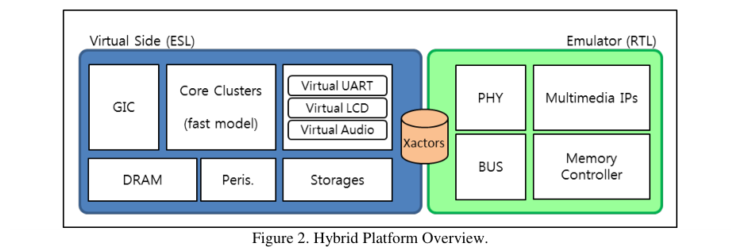
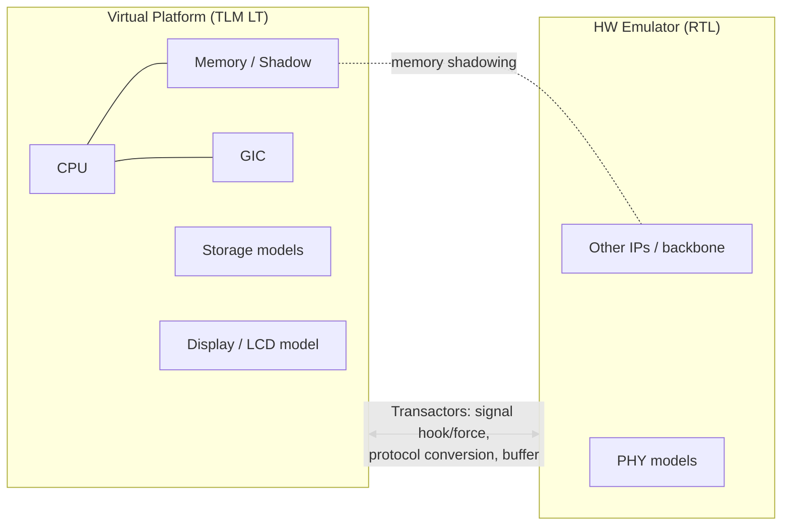

<!-- generated by yt-paper; edits will be overwritten -->
[DVCon](../dvcon/index.md) › [US](../dvcon/us.md) › [2017](../dvcon/by-year.md#2017) › [Emulation](../dvcon/by-topic.md#emulation)

# EARLY SOFTWARE DEVELOPMENT AND VERIFICATION METHODOLOGY USING HYBRID EMULATION PLATFORM

<figure class="rep-fig" markdown>
{ loading=lazy }
<figcaption>Figure 2. Hybrid Platform Overview. — from the original paper (Woojoo Kim et al.)</figcaption>
</figure>

[:material-open-in-new: Original paper](https://dvcon-proceedings.org/wp-content/uploads/early-software-development-and-verification-methodology-using-hybrid-emulation-platform.pdf){ .md-button .md-button--primary target=_blank }

| | |
|---|---|
| Authors | Woojoo Kim (Samsung Electronics), Haemin Park (Samsung Electronics), Hyundon Kim (Samsung Electronics), Seonil Brian Choi (Samsung Electronics), SukWon Kim (Samsung Electronics) |
| Venue | DVCon US 2017 |
| Topic | Emulation |
| Type | PAPER |
| ID | `ref-20261018-c6c6` |

## Summary

**The paper proposes a hybrid platform that co-emulates a TLM-LT virtual platform (CPU, memory, storage, display) with an RTL emulator (remaining IPs) via transactors and memory shadowing, enabling Android SW bring-up on a 2.5-billion-gate mobile AP before silicon boards are available, with Android boot reduced from 661 min to 47 min (14.1x).**

**이 논문은 TLM LT 가상 플랫폼(CPU, 메모리, 스토리지, 디스플레이)과 RTL 에뮬레이터(나머지 IP)를 트랜스액터와 메모리 셰도잉으로 공동 에뮬레이션하는 하이브리드 플랫폼을 제안하며, 2.5억 게이트 모바일 AP에서 실리콘 보드 이전에 Android SW bring-up을 가능하게 하고 Android 부팅 시간을 661분에서 47분(14.1배)으로 줄인다.**

## Key Insights

- Partitioning CPU, memory and external-device models onto a TLM LT virtual platform while keeping the rest of the RTL on the emulator removes per-cycle synchronization on the boot-critical path: Linux kernel boot dropped from 96 min (pure emulator) to 2 min (48x) and Android boot from 661 min to 47 min (14.1x).

- 부팅 핵심 경로인 CPU, 메모리, 외부 장치 모델을 TLM LT 가상 플랫폼에 두고 나머지 RTL은 에뮬레이터에 두면 사이클 단위 동기화가 제거된다. Linux 커널 부팅은 순수 에뮬레이터 96분에서 2분(48배), Android 부팅은 661분에서 47분(14.1배)으로 줄었다.

- Transactors use signal hooking and forcing to translate between TLM transactions in the virtual platform and pin-level protocols in the emulator (AMBA ACE, sideband, eMMC/UFS/Display/Camera PHYs), with an internal buffer and cache scheme that reduces inter-platform synchronization frequency.

- 트랜스액터는 신호 hooking과 forcing으로 가상 플랫폼의 트랜잭션 수준 프로토콜과 에뮬레이터의 핀 수준 프로토콜을 변환한다(AMBA ACE, sideband, eMMC/UFS/Display/Camera PHY). 내부 버퍼와 캐시 방식으로 두 플랫폼 간 동기화 빈도를 줄인다.

- Memory shadowing sits between the two domains so that CPU memory accesses on the virtual platform do not have to traverse the emulator backbone at emulation speed, supporting both back-door and front-door transactions.

- 두 도메인 사이의 메모리 셰도잉은 가상 플랫폼의 메모리 요청을 에뮬레이터 백본 속도까지 기다리지 않고 처리하게 하며, back-door와 front-door 접근을 모두 지원한다.

- Automating hybrid platform generation (memory map, interrupt map, black-boxing emulator IPs, transactor insertion) cut total build time from 620 min (manual) to 390 min (automatic), a 37.1% reduction, at about 3% overhead over a pure emulation build.

- 하이브리드 플랫폼 생성 자동화(메모리 맵, 인터럽트 맵, 블랙박스 처리, 트랜스액터 삽입)로 전체 빌드 시간이 수동 620분에서 자동 390분으로 줄었다(37.1% 감소). 순수 에뮬레이션 대비 오버헤드는 약 3%다.

- Android boot-up accounted for about 87% of total operating time; the authors note the gain is smaller for Android than for Linux because initialization and register programming remain on the emulator side and cross-domain communication is heavy.

- Android 부팅이 전체 동작 시간의 약 87%를 차지한다. 저자들은 초기화와 레지스터 프로그래밍이 에뮬레이터 측에 남고 도메인 간 통신이 많아 Linux보다 이득이 작다고 설명한다.

## Detailed Summary

### Background and Problem

- Mobile AP development is gated by software bring-up, which normally starts only after a silicon development board arrives, even though a functionally complete RTL exists months earlier.

- 모바일 AP 개발에서 SW bring-up은 보통 개발 보드가 SW 엔지니어에게 전달된 후에 시작된다. 그러나 완성된 RTL은 보드 전달보다 수개월 먼저 존재한다.

- Full-chip RTL simulation is far too slow for OS work. The paper cites simulation at a few dozen KHz for multi-hundred-million-gate designs, roughly $10^6$ times slower than silicon, so one silicon second corresponds to about 11.6 days of simulation.

- 전체 칩 RTL 시뮬레이션은 OS 작업에는 너무 느리다. 논문은 수억 게이트 설계에서 시뮬레이션 속도가 수십 KHz 수준이며 실리콘 대비 약 $10^6$배 느리다고 제시한다. 이 경우 실리콘에서 1초에 해당하는 SW 실행에 약 11.6일이 걸린다.

- Pure RTL emulation is about 1000x faster than simulation (several hundred KHz to MHz) but still about $10^3$ slower than silicon. Booting Linux and Android on it takes more than ten hours by the authors' account.

- 순수 RTL 에뮬레이션은 시뮬레이션보다 약 1000배 빠르지만(수백 KHz~MHz) 실리콘 대비 약 $10^3$배 느리다. 저자들에 따르면 에뮬레이터에서 Linux와 Android를 부팅하는 데 10시간 이상 걸린다.

- Pure ESL/TLM virtual platforms are fast but need extensive modeling. Prior ESL-RTL co-emulation work (GPU verification [10], Palladium Hybrid VIP-based external devices [11]) either covered only a narrow driver-verification scope or relied on VIPs that cannot match full SFR behavior, so they cannot support full Android bring-up.

- 순수 ESL/TLM 가상 플랫폼은 빠르지만 모델링 비용이 크다. 기존 ESL-RTL 공동 에뮬레이션 연구(GPU 검증 [10], Palladium Hybrid의 VIP 기반 외부 장치 [11])는 범위가 좁거나 전체 SFR 동작을 재현하지 못하는 VIP에 의존해 전체 Android bring-up을 지원하지 못한다.

### Architecture and Methodology

The platform splits the SoC between two domains:

플랫폼은 SoC를 두 도메인으로 나눈다.

- **Virtual platform (TLM LT):** CPU, memories, external storage and display models, which generate heavy transaction traffic during Android boot. A GIC is also modeled here.

- **가상 플랫폼(TLM LT):** Android 부팅 중 트랜잭션 트래픽을 많이 만드는 CPU, 메모리, 외부 스토리지 및 디스플레이 모델. GIC도 여기에 모델링된다.

- **Emulator (RTL):** all remaining IPs of the 2.5-billion-gate AP, with PHY models attached to external devices.

- **에뮬레이터(RTL):** 2.5억 게이트 AP의 나머지 모든 IP와 외부 장치에 연결된 PHY 모델.

Key mechanisms:

핵심 메커니즘:

- **Transactors (Sec. 3-2):** implemented on the emulator side, they perform signal forcing and hooking without altering DUT function. They convert transaction-level protocol to pin-level protocol and include an internal buffer to absorb the speed gap. Transactors cover AMBA ACE, sideband signals, and PHYs for eMMC, UFS, display and camera.

- **트랜스액터(Sec. 3-2):** 에뮬레이터 측에 구현되며 DUT 기능을 바꾸지 않고 신호 forcing과 hooking만 수행한다. 트랜잭션 수준 프로토콜을 핀 수준 프로토콜로 변환하고, 속도 차이를 흡수하는 내부 버퍼를 가진다. 대상은 AMBA ACE, sideband 신호, eMMC·UFS·Display·Camera용 PHY이다.

- **Timing synchronization (Sec. 3-3):** a cache scheme in each transactor buffer reduces how often the two platforms must synchronize, instead of syncing every cycle.

- **타이밍 동기화(Sec. 3-3):** 각 트랜스액터 버퍼의 캐시 방식으로 매 사이클 동기화 대신 두 플랫폼 간 동기화 빈도를 줄인다.

- **Memory shadowing (Sec. 3-4):** a scheme between the domains serves virtual-platform memory requests locally so they do not stall on emulator backbone speed. It supports back-door and front-door accesses.

- **메모리 셰도잉(Sec. 3-4):** 두 도메인 사이에 위치하며, 가상 플랫폼의 메모리 요청을 로컬에서 처리해 에뮬레이터 백본 속도에 묶이지 않게 한다. back-door와 front-door 접근을 모두 지원한다.

- **Automation flow (Sec. 3-5, Fig. 5):** a DB-creation script for the emulator is generated from transactor and IP information in a predefined format. Virtual platform creation is generated from a memory map and an interrupt map. Emulator IPs that are modeled in the virtual platform are marked black-box, and the testbench and emulator porting are regenerated.

- **자동화 흐름(Sec. 3-5, Fig. 5):** 사전 정의된 형식의 트랜스액터 및 IP 정보로 에뮬레이터 DB 생성 스크립트를 만든다. 메모리 맵과 인터럽트 맵으로 가상 플랫폼을 생성한다. 가상 플랫폼에 모델링된 에뮬레이터 IP는 블랙박스 처리하고, 테스트벤치와 에뮬레이터 포팅을 다시 생성한다.

### Results and Conclusions

Experimental setup: target is a flagship mobile AP with 2.5 billion logic gates, 30 peripherals and 7 external storage devices, validated as a full chip.

실험 환경: 목표는 2.5억 논리 게이트, 30개 주변장치, 7개 외부 스토리지 장치를 가진 플래그십 모바일 AP이며, 전체 칩으로 검증했다.

**Platform build time (Table 1, minutes):**

**플랫폼 빌드 시간(Table 1, 분):**

| Step | Pure Emu | Hybrid (Manual) | Hybrid (Auto) |
|---|---|---|---|
| Env / Testbench | 20 | 60 | 20 |
| DB compile | 360 | 360 | 360 |
| Virtual platform build | 0 | 200 | 10 |
| Total | 380 | 620 | 390 |

| 단계 | 순수 에뮬 | 하이브리드(수동) | 하이브리드(자동) |
|---|---|---|---|
| Env / 테스트벤치 | 20 | 60 | 20 |
| DB 컴파일 | 360 | 360 | 360 |
| 가상 플랫폼 빌드 | 0 | 200 | 10 |
| 합계 | 380 | 620 | 390 |

Manual hybrid build is 63% longer than pure emulation. Automation reduces the total by 37.1% versus manual, and leaves about 3% overhead over pure emulation (about 10 min).

수동 하이브리드 빌드는 순수 에뮬레이션보다 63% 길다. 자동화는 수동 대비 합계를 37.1% 줄이며, 순수 에뮬레이션 대비 약 3%(약 10분)의 오버헤드만 남긴다.

**Performance (Table 2, minutes):**

**성능(Table 2, 분):**

| Phase | Simulation (est.) | Pure Emulator | Hybrid | Speedup |
|---|---|---|---|---|
| Env. init | 4 | 5 | 5 | x1 |
| Linux kernel | 125,867* | 96 | 2 | x48 |
| Android | 741,517* | 661 | 47 | x14.1 |
| Total | 867,384* | 762 | 54 | x14.1 |

| 단계 | 시뮬레이션(추정) | 순수 에뮬레이터 | 하이브리드 | 향상 |
|---|---|---|---|---|
| 환경 초기화 | 4 | 5 | 5 | x1 |
| Linux 커널 | 125,867* | 96 | 2 | x48 |
| Android | 741,517* | 661 | 47 | x14.1 |
| 합계 | 867,384* | 762 | 54 | x14.1 |

\* estimated from cycle count and cps. Android boot accounts for about 87% of total operating time.

\* 사이클 수와 cps로 추정한 값. Android 부팅이 전체 동작 시간의 약 87%를 차지한다.

Conclusions the authors draw:

저자들의 결론:

- Android was brought up and device drivers for all IPs were developed on the hybrid platform before the development board arrived, alongside the chipset fab-out.

- 개발 보드가 도착하기 전, 칩셋 fab-out과 함께 하이브리드 플랫폼에서 Android를 bring-up하고 모든 IP의 디바이스 드라이버를 개발했다.

- Multiple debug runs per workday become feasible. The Android home screen was rendered on a virtual LCD by reading the frame buffer through the display PHY transactor (Fig. 6).

- 작업일당 여러 번의 디버그 실행이 가능해졌다. Android 홈 화면은 디스플레이 PHY 트랜스액터를 통해 프레임 버퍼를 읽어 가상 LCD에 표시되었다(Fig. 6).

- Limitations and future work: the Android gain is smaller than the Linux gain because of emulator-side register programming and heavy cross-domain traffic. Future work targets IP-XACT-based integration and quantifying communication overhead between the platforms.

- 한계 및 향후 과제: 에뮬레이터 측 레지스터 프로그래밍과 도메인 간 트래픽이 많아 Android의 이득이 Linux보다 작다. 향후 과제는 IP-XACT 기반 통합과 두 플랫폼 간 통신 오버헤드 정량화이다.

**Inconsistencies in the source:** the text says Linux boot takes "7 minutes" in one place, while Table 2 lists 2 min for the Linux kernel phase. The text also says "less than 1 hour" for Android boot, consistent with the 54 min total. Table values are reported here.

**원문 내 불일치:** 본문 한 곳에서는 Linux 부팅이 "7분"이라고 하지만 Table 2의 Linux 커널 단계는 2분이다. 본문의 Android 부팅 "1시간 미만"은 54분 합계와 일치한다. 이 요약은 표의 값을 사용한다.

## Videos

<iframe src="https://www.youtube-nocookie.com/embed/X_GWjG3jBPc" title="[DVCON2017]EARLY SOFTWARE DEVELOPMENT AND VERIFICATION METHODOLOGY USING HYBRID EMULATION PLATFORM" loading="lazy" allow="accelerometer; clipboard-write; encrypted-media; gyroscope; picture-in-picture; web-share" referrerpolicy="strict-origin-when-cross-origin" allowfullscreen></iframe>

**[DVCON2017]EARLY SOFTWARE DEVELOPMENT AND VERIFICATION METHODOLOGY USING HYBRID EMULATION PLATFORM** — [Watch on YouTube](https://www.youtube.com/watch?v=X_GWjG3jBPc) · [Video page](../videos/X_GWjG3jBPc.md)
