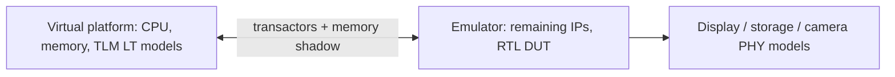

<!-- generated by yt-paper; edits will be overwritten -->
[DVCon](../dvcon/index.md) › [US](../dvcon/us.md) › [2017](../dvcon/by-year.md#2017) › [Emulation](../dvcon/by-topic.md#emulation)

# EARLY SOFTWARE DEVELOPMENT AND VERIFICATION METHODOLOGY USING HYBRID EMULATION PLATFORM

<figure class="rep-fig" markdown>
{ loading=lazy }
<figcaption>Figure 2. Hybrid Platform Overview. — from the original paper (Woojoo Kim et al.)</figcaption>
</figure>

[:material-open-in-new: Original paper](https://dvcon-proceedings.org/wp-content/uploads/early-software-development-and-verification-methodology-using-hybrid-emulation-platform.pdf){ .md-button .md-button--primary target=_blank }

| | |
|---|---|
| Authors | Woojoo Kim, Haemin Park, Hyundon Kim, Seonil Brian Choi, SukWon Kim (Samsung Electronics Co., Ltd.) |
| Venue | DVCon US 2017 |
| Topic | Emulation |
| Type | PAPER |
| ID | `ref-20261018-c6c6` |

## Summary

**A hybrid platform co-emulates a TLM LT virtual platform (CPU, memories, storage/display models) with an RTL emulator (remaining IPs) via transactors and memory shadowing, enabling Android bring-up on a 2.5-billion-gate mobile AP before the development board is ready.**

**CPU와 메모리 서브시스템을 TLM LT 가상 플랫폼에, 나머지 IP를 RTL 에뮬레이터에 배치하고 transactor와 memory shadowing으로 연결하는 하이브리드 에뮬레이션 플랫폼으로, 2.5억 게이트 모바일 AP에서 개발 보드 이전에 Android 부팅을 가능하게 합니다.**

## Key Insights

- Allocating CPU and memory subsystems to a TLM LT virtual platform while the rest of the SoC stays in the emulator cuts Android boot time from 762 min (pure emulation) to 54 min, a 14.1x speedup.

- CPU와 메모리 서브시스템을 TLM LT 가상 플랫폼에 두고 나머지 SoC는 에뮬레이터에 둠으로써 Android 부팅 시간이 pure emulation 762분에서 hybrid 54분으로 줄어 14.1배 빨라집니다.

- Linux kernel boot drops from 96 min to 2 min (48x), because most of its operations run on the virtual platform with little cross-domain traffic; Android boot gains less because it is communication- and emulator-heavy.

- Linux 커널 부팅은 96분에서 2분으로 48배 단축되는데, 대부분의 동작이 가상 플랫폼에서 수행되고 도메인 간 통신이 적기 때문입니다. Android 부팅은 통신과 에뮬레이터 작업이 많아 이득이 더 작습니다.

- Transactors implement AMBA ACE, sideband, and PHY interfaces for eMMC, UFS, display, and camera, forcing and hooking signals so the emulated DUT is unmodified and the virtual LCD renders the Android home screen.

- Transactor는 AMBA ACE, sideband, eMMC/UFS/디스플레이/카메라 PHY 인터페이스를 구현하며, 신호 hooking과 forcing으로 DUT 기능을 바꾸지 않고 가상 LCD에 Android 홈 화면을 표시합니다.

- Memory shadowing with front-door and back-door access plus a cache in transactor buffers reduces cross-domain synchronization frequency, avoiding per-cycle lockstep with the slow emulator.

- Front-door/back-door 접근을 지원하는 memory shadowing과 transactor 버퍼의 cache 방식은 도메인 간 동기화 빈도를 줄여 느린 에뮬레이터에 매 사이클 맞추는 병목을 피합니다.

- Automating hybrid platform generation from memory-map and interrupt-map inputs cut total build time from 620 min (manual) to 390 min (automatic), a 37.1% reduction, with about 3% overhead over pure emulation.

- Memory map과 interrupt map 입력으로 하이브리드 플랫폼 생성을 자동화하여 총 빌드 시간을 수동 620분에서 자동 390분으로 37.1% 줄였으며, pure emulation 대비 오버헤드는 약 3%입니다.

## Detailed Summary

### Background and Problem

- Mobile AP SW (drivers, Linux, Android) usually starts only after the board arrives, although RTL is ready months earlier.

- 모바일 AP의 SW(드라이버, Linux, Android)는 RTL이 몇 달 먼저 준비되어도 개발 보드가 도착한 뒤에야 보통 시작됩니다.

- Full-chip RTL simulation runs at a few dozen KHz, and pure emulation boots Linux/Android in over 10 hours; FPGA prototyping is limited by capacity.

- Full-chip RTL 시뮬레이션은 수십 KHz 수준이고, pure emulation으로는 Linux/Android 부팅에 10시간 이상 걸리며, FPGA 프로토타이핑은 용량 제약이 있습니다.

- Prior ESL co-emulation work (GPU driver focus, or VIP-based external devices) cannot support full Android with real external-device behavior.

- 기존 ESL co-emulation 연구는 GPU 드라이버 중심이거나 VIP 기반 외부 장치 모델을 사용해 실제 외부 장치 동작을 갖춘 full Android를 지원하지 못합니다.

### Architecture and Methodology

- Virtual platform: CPU, memories, and external-device models at TLM LT, connected to emulator-side IPs through transactors.

- 가상 플랫폼: CPU, 메모리, 외부 장치 모델을 TLM LT로 구현하고, transactor를 통해 에뮬레이터 측 IP와 연결합니다.

- Transactors perform signal hooking/forcing and TLM-to-pin protocol conversion, with internal buffers, for AMBA ACE, sideband, and PHY interfaces (eMMC, UFS, display, camera).

- Transactor는 신호 hooking/forcing과 TLM-to-pin 프로토콜 변환을 수행하며 내부 버퍼를 가지고, AMBA ACE, sideband, PHY 인터페이스(eMMC, UFS, 디스플레이, 카메라)를 담당합니다.

- Memory shadowing sits between the two domains to serve memory accesses locally and reduce emulator-backbone traffic.

- Memory shadowing은 두 도메인 사이에 위치해 메모리 접근을 로컬에서 처리하여 에뮬레이터 백본 트래픽을 줄입니다.

- An automated flow generates the emulator DB and virtual platform from predefined memory-map and interrupt-map inputs.

- 자동화 흐름은 사전 정의된 memory map과 interrupt map 입력으로 에뮬레이터 DB와 가상 플랫폼을 생성합니다.

### Results and Conclusions

- Target: 2.5-billion-gate flagship mobile AP with 30 peripherals and 7 external storage devices.

- 대상: 2.5억(2.5 billion) 로직 게이트 규모의 플래그십 모바일 AP, 주변장치 30개, 외부 스토리지 7개.

- Boot times: Android 661 min (pure emulation) vs 47 min (hybrid); total 762 min vs 54 min (14.1x). Linux kernel 96 min vs 2 min (48x).

- 부팅 시간: Android는 pure emulation 661분 대비 hybrid 47분이며, 전체 762분 대비 54분(14.1배)입니다. Linux 커널은 96분 대비 2분(48배)입니다.

- Build time: manual hybrid build was 620 min; automatic generation reduced it to 390 min (37.1%), about 3% over pure emulation.

- 빌드 시간: 수동 hybrid 빌드는 620분이었고, 자동 생성으로 390분(37.1% 단축)이 되었으며, pure emulation 대비 약 3% 증가입니다.

- Android was brought up before board delivery; the paper reports no silicon-level accuracy comparison, and the simulation figures are estimates.

- 개발 보드 이전에 Android bring-up을 완료했다고 보고합니다. 다만 실리콘 수준의 정확도 비교는 없으며, 시뮬레이션 수치는 추정치입니다.

## Videos

<iframe src="https://www.youtube-nocookie.com/embed/X_GWjG3jBPc" title="[DVCON2017]EARLY SOFTWARE DEVELOPMENT AND VERIFICATION METHODOLOGY USING HYBRID EMULATION PLATFORM" loading="lazy" allow="accelerometer; clipboard-write; encrypted-media; gyroscope; picture-in-picture; web-share" referrerpolicy="strict-origin-when-cross-origin" allowfullscreen></iframe>

**[DVCON2017]EARLY SOFTWARE DEVELOPMENT AND VERIFICATION METHODOLOGY USING HYBRID EMULATION PLATFORM** — [Watch on YouTube](https://www.youtube.com/watch?v=X_GWjG3jBPc) · [Video page](../videos/X_GWjG3jBPc.md)
