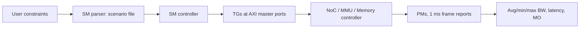

<!-- generated by yt-paper; edits will be overwritten -->
[DVCon](../dvcon/index.md) › [US](../dvcon/us.md) › [2024](../dvcon/by-year.md#2024) › [Verification](../dvcon/by-topic.md#verification)

# Synthetic Traffic based SOC Performance Verification Methodology

<figure class="rep-fig" markdown>
{ loading=lazy }
<figcaption>Figure 1. Performance Verification Flow — from the original paper (Jeonggu Lee et al.)</figcaption>
</figure>

[:material-open-in-new: Original paper](https://dvcon-proceedings.org/wp-content/uploads/1063-1.pdf){ .md-button .md-button--primary target=_blank }

| | |
|---|---|
| Authors | Jeonggu Lee, Taewon Park, Hyungtae Park, Taeyoung Jeon, Hyunjae Woo, Youngsik Kim, Seonil Brian Choi (Samsung Electronics Co., LTD.) |
| Venue | DVCon US 2024 |
| Topic | Verification |
| Type | PAPER |
| ID | `ref-20261018-c74a` |

## Summary

**Proposes synthetic-traffic-based SOC performance verification (STB-ST for NoC/memory backbone, STB-BP for system IPs) using a TG/PM with HW transaction buffering and IP-XACT-driven automation, so performance bugs are found before RTL freeze rather than in late real-traffic runs.**

**SOC 성능 검증을 위해 합성 트래픽 기반 방법론(백본 NoC/메모리용 STB-ST, 시스템 IP용 STB-BP)을 제안한다. HW 트랜잭션 버퍼링을 갖춘 TG/PM과 IP-XACT 기반 자동화를 사용하여, RTL freeze 이후의 실트래픽 검증이 아닌 그 이전 단계에서 성능 버그를 찾는 것이 목적이다.**

## Key Insights

- PCIe round-trip latency dominates emulator-host transfers: a 4 B read is 5-7 us per spec (14 us in practice), so reading 4 GB with 4 B transactions takes over 7 hours versus about 10 minutes with 64 B transactions, which motivates HW-side buffering.

- PCIe 왕복 지연이 에뮬레이터-호스트 전송을 지배한다. 4 B 읽기는 스펙상 5-7 us(실제 14 us)이므로 4 B 트랜잭션으로 4 GB를 읽으면 7시간 이상, 64 B 트랜잭션이면 약 10분이 걸려 HW 측 버퍼링이 필요하다.

- Average-BW-only TGs miss performance bugs; the authors report that bursty patterns (Figure 4-b) exposed degradation that uniform average-BW traffic did not, and trace replay is added for address-sensitive IPs such as MMU and LLC.

- 평균 BW만 생성하는 TG는 성능 버그를 놓친다. 저자들은 버스트성 패턴(Figure 4-b)에서는 성능 저하가 드러났지만 균일한 평균 BW 트래픽에서는 나타나지 않았다고 보고하며, MMU·LLC처럼 주소에 민감한 IP를 위해 트레이스 리플레이를 추가했다.

- Splitting verification into STB-ST (NoC and memory controller backbone with TG combinations) and STB-BP (TG at AXI master ports to sweep SysMMU, up/downsizer, and local bus) lets system IP performance be checked before functional IPs are ready.

- 검증을 STB-ST(TG 조합을 이용한 NoC 및 메모리 컨트롤러 백본)와 STB-BP(AXI 마스터 포트의 TG로 SysMMU, up/downsizer, local bus 검증)로 나누면, 기능 IP가 준비되기 전에도 시스템 IP 성능을 점검할 수 있다.

- The paper reports RTL vs. model agreement within 5% on BW, latency, and MO, and cites detection of an ARQ buffer size bug (RTL/Model 82.0% on affected IPs) and a clock-gating-induced long latency issue.

- 저자들은 BW, 지연, MO에서 RTL과 모델의 차이가 5% 이내라고 보고하며, ARQ 버퍼 크기 버그(해당 IP에서 RTL/Model 82.0%)와 clock gating으로 인한 긴 지연 문제를 검출했다고 언급한다.

- IP-XACT-based TG insertion cut TG automation and scenario generation from 8 h to 10 min each (98%) and raised scenario count from 50 to 4150 (83x); on a flagship mobile AP, 2000+ scenarios ran with 400 TG/PM before RTL freeze.

- IP-XACT 기반 TG 삽입으로 TG 자동화와 시나리오 생성 시간이 각각 8 h에서 10 min(98% 감소)으로 줄었고, 시나리오 수는 50개에서 4150개(83배)로 늘었다. 플래그십 모바일 AP에서는 RTL freeze 이전에 400개 TG/PM으로 2000개 이상의 시나리오를 실행했다.

## Detailed Summary

### Background and Problem

- SOC use cases involve 20+ functional IPs; one under-performing IP can force scenario downgrade, spec-out, or silicon re-spin.

- SOC 유스케이스에는 20개 이상의 기능 IP가 관여하며, 성능이 미달하는 IP 하나만 있어도 시나리오 하향, spec-out 또는 실리콘 re-spin이 발생할 수 있다.

- Real-traffic PV (RTB-PV) with real RTL IPs starts near RTL freeze, needs over a month of scenario preparation, and covers only a few worst-case scenarios, so late-found bugs often cannot be fixed in time.

- 실제 RTL IP를 사용하는 실트래픽 PV(RTB-PV)는 RTL freeze 무렵에야 시작되며, 시나리오 준비에 한 달 이상 걸리고 소수의 worst-case 시나리오만 검증할 수 있어 늦게 발견된 버그를 제때 수정하기 어렵다.

- Backbone (NoC, memory controller) and system IPs (MMU, security, up/downsizer) determine performance and must be checked earlier.

- 백본(NoC, 메모리 컨트롤러)과 시스템 IP(MMU, 보안, up/downsizer)가 성능을 좌우하므로 더 이른 단계에서 검증해야 한다.

### Architecture and Methodology

- TG/PM: host SW plus emulator-side HW, linked via DPI. HW buffers transactions and reports BW/MO/latency per 1 ms frame to reduce host round trips.

- TG/PM: 호스트 SW와 에뮬레이터 측 HW로 구성되며 DPI로 연결된다. HW는 트랜잭션을 버퍼링하고 1 ms 프레임 단위로 BW/MO/지연을 보고하여 호스트 왕복 횟수를 줄인다.

- TGs go beyond average BW: they support varied traffic patterns and trace replay for address-sensitive IPs (MMU, LLC).

- TG는 평균 BW를 넘어서는 기능을 가진다. 다양한 트래픽 패턴을 지원하며, 주소에 민감한 IP(MMU, LLC)를 위해 트레이스 리플레이를 제공한다.

- The SM parser turns user constraints (BW, address pattern, burst, QoS) into scenario descriptors; the SM controller drives TGs and PMs.

- SM parser는 사용자 제약(BW, 주소 패턴, burst, QoS)을 시나리오 descriptor로 변환하고, SM controller는 TG와 PM을 구동한다.

- IP-XACT automation finds attachment points and emits a TG database for the emulation build.

- IP-XACT 자동화는 연결 지점을 찾고 에뮬레이션 빌드용 TG database를 생성한다.

- STB-ST attaches TG combinations to the backbone; STB-BP attaches TGs at AXI master ports to sweep system IPs.

- STB-ST는 백본에 TG 조합을 연결하고, STB-BP는 AXI 마스터 포트에 TG를 연결하여 시스템 IP를 검증한다.

### Results and Conclusions

- Reported RTL-vs-model agreement within 5% on BW, latency, and MO; detected an ARQ buffer bug and a clock-gating long-latency issue.

- BW, 지연, MO에서 RTL과 모델의 차이가 5% 이내라고 보고했으며, ARQ 버퍼 버그와 clock gating으로 인한 긴 지연 문제를 검출했다.

- Automation cut TG insertion and scenario generation from 8 h to 10 min each (total 16 h to 20 min); scenario count rose from 50 to 4150.

- 자동화로 TG 삽입과 시나리오 생성 시간이 각각 8 h에서 10 min으로 줄었고(전체 16 h에서 20 min), 시나리오 수는 50개에서 4150개로 증가했다.

- Applied to a flagship mobile AP: 2000+ scenarios with 400 TG/PM ran before RTL freeze, and almost all system performance bugs were fixed before RTB-PV. These are the authors' claims without independent validation.

- 플래그십 모바일 AP에 적용하여 400개 TG/PM으로 2000개 이상의 시나리오를 RTL freeze 이전에 실행했고, RTB-PV 이전에 대부분의 시스템 성능 버그를 수정했다. 이는 저자들의 주장이며 독립적으로 검증되지는 않았다.

## Videos

<iframe src="https://www.youtube-nocookie.com/embed/BCdN7iCwOqU" title="[DVCON2024]Synthetic Traffic based SOC Performance Verification Methodology" loading="lazy" allow="accelerometer; clipboard-write; encrypted-media; gyroscope; picture-in-picture; web-share" referrerpolicy="strict-origin-when-cross-origin" allowfullscreen></iframe>

**[DVCON2024]Synthetic Traffic based SOC Performance Verification Methodology** — [Watch on YouTube](https://www.youtube.com/watch?v=BCdN7iCwOqU) · [Video page](../videos/BCdN7iCwOqU.md)
