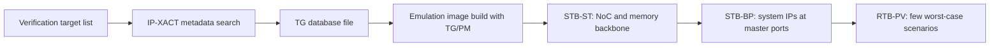

<!-- generated by yt-paper; edits will be overwritten -->
[DVCon](../dvcon/index.md) › [US](../dvcon/us.md) › [2024](../dvcon/by-year.md#2024) › [Verification](../dvcon/by-topic.md#verification)

# Synthetic Traffic based SOC Performance Verification Methodology

<figure class="rep-fig" markdown>
{ loading=lazy }
<figcaption>Figure 1. Performance Verification Flow — from the original paper (Jeonggu Lee et al.)</figcaption>
</figure>

[:material-open-in-new: Original paper](https://dvcon-proceedings.org/wp-content/uploads/1063-1.pdf){ .md-button .md-button--primary target=_blank }

| | |
|---|---|
| Authors | Jeonggu Lee (Samsung Electronics), Taewon Park (Samsung Electronics), Hyungtae Park (Samsung Electronics), Taeyoung Jeon (Samsung Electronics), Hyunjae Woo (Samsung Electronics), Youngsik Kim (Samsung Electronics), Seonil Brian Choi (Samsung Electronics) |
| Venue | DVCon US 2024 |
| Topic | Verification |
| Type | PAPER |
| ID | `ref-20261018-c74a` |

## Summary

**The paper proposes STB-PV, a pre-silicon SOC performance verification flow that uses emulator-based traffic generators/performance monitors (TG/PM), scenario-manager automation, and IP-XACT-driven TG insertion to verify backbone (STB-ST) and system-IP (STB-BP) performance before RTL freeze instead of relying on late RTB-PV.**

**이 논문은 에뮬레이터 기반 트래픽 생성기/성능 모니터(TG/PM), 시나리오 매니저 자동화, IP-XACT 기반 TG 삽입을 결합한 사전 실리콘 SOC 성능 검증 흐름(STB-PV)을 제안하며, 이를 통해 RTL freeze 이전에 백본(STB-ST)과 시스템 IP(STB-BP) 성능을 검증한다.**

## Key Insights

- PCIe latency, not bandwidth, dominates emulator-to-host traffic: the paper cites about 7+ hours for 1G 4-byte reads versus about 10 minutes for 64-byte reads, so the TG/PM buffers transactions in HW and transmits only final results per frame (e.g., 1 ms).

- 에뮬레이터-호스트 간 통신에서는 대역폭보다 PCIe 지연 오버헤드가 병목이다. 논문은 4바이트 읽기 1G회에 7시간 이상, 64바이트 읽기에 약 10분이 걸린다고 제시하며, 이에 따라 TG/PM은 HW 버퍼에 트랜잭션을 모으고 프레임 단위(예: 1 ms)로 최종 결과만 전송한다.

- IP-XACT-based TG insertion cut total setup time from 16 hours to 20 minutes (-98%) and raised scenario count from 50 (manual max) to 4150 (83x) per Figure 10.

- IP-XACT 기반 TG 삽입으로 전체 설정 시간이 16시간에서 20분으로 줄었다(-98%). 시나리오 수는 수동 최대 50개에서 4150개로 늘었다(83배, 그림 10 기준).

- STB-ST/STB-BP lets backbone (NoC, memory controller) and system IPs (SysMMU, up/down sizer, local bus) be verified before RTL freeze; RTL vs. model results agreed within 5%, and this exposed an ARQ buffer bug (10500 vs. 12799 MB/s, 82.0%).

- STB-ST/STB-BP를 통해 RTL freeze 이전에 백본(NoC, 메모리 컨트롤러)과 시스템 IP(SysMMU, up/down sizer, local bus)를 검증할 수 있다. RTL과 모델 결과는 5% 이내로 일치했으며, 이 과정에서 ARQ 버퍼 버그(10500 vs. 12799 MB/s, 82.0%)가 검출되었다.

- Average-BW traffic misses performance bugs; varied traffic patterns and address-trace replay (for MMU/LLC-sensitive IPs) are needed to expose degradation and measure MMU hit rate.

- 평균 BW 트래픽만으로는 성능 버그를 놓치므로, 다양한 트래픽 패턴과 주소 트레이스 리플레이(MMU/LLC처럼 주소에 민감한 블록용)가 필요하다. 리플레이를 통해 MMU hit rate도 평가할 수 있다.

- On a flagship mobile AP SOC, over 2000 scenario experiments ran with 400 TG/PM inserted automatically, and almost all system performance bugs were fixed before RTB-PV began.

- 플래그십 모바일 AP SOC에 적용하여 400개의 TG/PM을 자동 삽입한 상태에서 2000개 이상의 시나리오 실험을 수행했고, RTB-PV 시작 전에 시스템 성능 버그 대부분을 수정했다.

## Detailed Summary

### Background and Problem

- Modern SOC use cases chain more than 20 functional IPs (CPU/GPU/NPU/CAM/DPU). If one IP misses its performance target, the scenario may be downgraded, a spec may be cut, or silicon may need a re-spin.

- 최신 SOC 유스케이스는 20개 이상의 기능 IP(CPU/GPU/NPU/CAM/DPU)가 연동된다. IP 하나라도 성능 목표를 만족하지 못하면 시나리오 다운그레이드, 스펙 축소, 또는 실리콘 재스핀이 필요할 수 있다.

- RTB-PV (real traffic, real RTL IPs) is the most faithful check, but IP bring-up for it lands just before RTL freeze. Preparing scenarios for more than 20 IPs takes over a month, so only a few worst-case scenarios are covered. Bugs found late cannot be fixed in time.

- RTB-PV(실제 트래픽, 실제 RTL IP 사용)는 가장 충실한 검증이지만, 해당 IP 브링업이 RTL freeze 직전에 이루어진다. 20개 이상 IP의 시나리오 준비에 한 달 이상 걸려 최악 시나리오 위주로만 커버할 수 있으며, 늦게 발견된 버그는 제때 수정하기 어렵다.

- Bus topology and memory subsystem changes affect many IPs, so backbone performance must be verified early.

- 버스 토폴로지와 메모리 서브시스템 변경은 많은 IP에 영향을 주므로 백본 성능을 조기에 검증해야 한다.

- The first STB attempt (end of 2018) measured only DRAM utilization and ran slowly because TG operation increased wall-clock time.

- 최초의 STB 시도(2018년 말)는 DRAM 사용률만 측정했고, TG 동작이 wall-clock 시간을 늘려 속도가 느렸다.

- Emulator-to-host communication over PCIe has ample bandwidth (up to 32 GB/s), but per-transaction latency overhead is the bottleneck. The paper reports a 4-byte transaction at 5–7 µs per the PCIe spec and about 14 µs in practice.

- 에뮬레이터와 호스트 간 PCIe 통신은 대역폭(최대 32 GB/s)에는 여유가 있으나 트랜잭션당 지연 오버헤드가 병목이다. 논문은 4바이트 트랜잭션이 PCIe 스펙상 5~7 µs이지만 실제로는 약 14 µs 걸린다고 보고한다.

### Architecture and Methodology

- **TG/PM (Traffic Generator / Performance Monitor):** The SW part runs on the host and handles user configuration and summary output. The HW part runs in the emulator, and the two communicate through a DPI interface. A HW buffer batches transactions so that the number of host round-trips drops. The TG generates AXI traffic from user settings (frequency, target BW, burst length, address pattern, AXID pattern). The PM computes BW, MO, and latency in the emulator and sends average, min, and max values per frame unit (e.g., 1 ms) to the host.

- **TG/PM(Traffic Generator / Performance Monitor):** SW 부분은 호스트에서 사용자 설정과 요약 출력을 담당한다. HW 부분은 에뮬레이터에서 동작하며, 두 부분은 DPI 인터페이스로 통신한다. HW 버퍼가 트랜잭션을 묶어 호스트 왕복 횟수를 줄인다. TG는 사용자 설정(주파수, 목표 BW, burst length, 주소 패턴, AXID 패턴)에 따라 AXI 트래픽을 생성한다. PM은 에뮬레이터 내부에서 BW, MO, 지연을 계산하고 프레임 단위(예: 1 ms)로 평균, 최소, 최대 값을 호스트에 전달한다.

- **TG enhancements:** Beyond average-BW traffic, the TG supports varied traffic patterns. Replay mode reproduces real address traces, which matters for address-sensitive blocks such as MMU and LLC.

- **TG 기능 강화:** 평균 BW 트래픽 외에 다양한 트래픽 패턴을 지원한다. 리플레이 모드는 실제 주소 트레이스를 재현하며, MMU나 LLC처럼 주소에 민감한 블록에 중요하다.

- **Scenario Manager (SM):** Written in synthesizable SystemVerilog with DPI. The SM parser turns user constraints (BW, address pattern, burst length/size, QoS) into a scenario file of descriptors. The SM controller drives all TGs and PMs, monitors their status, and indexes each scenario so each PM stores results separately.

- **Scenario Manager(SM):** 합성 가능한 SystemVerilog와 DPI로 구현된다. SM 파서는 사용자 제약(BW, 주소 패턴, burst length/size, QoS)을 디스크립터로 구성된 시나리오 파일로 변환한다. SM 컨트롤러는 모든 TG와 PM을 구동하고 상태를 모니터링하며, 각 시나리오에 인덱스를 부여해 PM이 결과를 시나리오별로 저장하게 한다.

- **IP-XACT automation:** The flow takes a verification target list, searches the design metadata provided by IP-XACT for the attachment points and signal information, and generates a TG database file for the emulation image build. Because IP-XACT is far smaller than the RTL, parsing is fast.

- **IP-XACT 자동화:** 검증 대상 목록을 입력받아 IP-XACT가 제공하는 설계 메타데이터에서 연결 지점과 신호 정보를 찾고, 에뮬레이션 이미지 빌드에 쓰이는 TG 데이터베이스 파일을 생성한다. IP-XACT는 RTL보다 훨씬 작아 파싱이 빠르다.

- **STB-ST (system-tier stress test):** Targets the NoC and memory controller backbone. Several TGs generate scenario-based traffic across path combinations, and PMs on each path measure BW, latency, DRAM utilization, and MO. The QoS and urgent mechanisms are checked so that real-time IPs (display, camera) keep their guaranteed service.

- **STB-ST(시스템 수준 스트레스 테스트):** NoC와 메모리 컨트롤러 백본을 대상으로 한다. 여러 TG가 시나리오 기반 트래픽을 다양한 경로 조합으로 생성하고, 각 경로의 PM이 BW, 지연, DRAM 사용률, MO를 측정한다. 실시간 IP(디스플레이, 카메라)의 보장 서비스를 위해 QoS 및 urgent 메커니즘도 점검한다.

- **STB-BP (bus performance test):** The functional IP's AXI master port is replaced by a TG so that internal buses, SysMMU, up/down sizer, and local buses can be scanned all the way to DRAM. Checks include min/avg/peak latency, max MO, and max BW.

- **STB-BP(버스 성능 테스트):** 기능 IP의 AXI 마스터 포트를 TG로 대체해, 내부 버스, SysMMU, up/down sizer, local bus를 거쳐 DRAM까지 경로 전체를 점검한다. 점검 항목은 최소/평균/최대 지연, 최대 MO, 최대 BW이다.

### Results and Conclusions

- **Accuracy (Figure 9):** The RTL-vs-model comparison on BW, latency, and MO agreed within 5%. This comparison exposed an ARQ buffer size bug (RTL 10500 MB/s vs. model 12799 MB/s, 82.0%, Fail) and a long-latency issue caused by clock gating.

- **정확도(그림 9):** BW, 지연, MO에 대한 RTL과 모델의 비교는 5% 이내로 일치했다. 이 비교로 ARQ 버퍼 크기 버그(RTL 10500 MB/s vs. 모델 12799 MB/s, 82.0%, Fail)와 clock gating으로 인한 긴 지연 문제가 검출되었다.

- **Efficiency (Figure 10):** TG automation and scenario generation each dropped from 8 hours to 10 minutes. Total time dropped from 16 hours to 20 minutes (-98%). Scenario count rose from 50 (manual, max) to 4150 (83x).

- **효율(그림 10):** TG 자동화와 시나리오 생성은 각각 8시간에서 10분으로 줄었다. 전체 시간은 16시간에서 20분으로 줄었다(-98%). 시나리오 수는 수동 최대 50개에서 4150개로 늘었다(83배).

- **Industrial application:** The flow was applied to a flagship mobile AP SOC. Over 2000 scenario experiments were completed with STB-ST and STB-BP before RTL freeze, and 400 TG/PM instances were inserted automatically. Almost all system performance bugs were fixed before RTB-PV started.

- **산업 적용:** 플래그십 모바일 AP SOC에 적용했다. RTL freeze 이전에 STB-ST와 STB-BP로 2000개 이상의 시나리오 실험을 완료했고, 400개의 TG/PM을 자동 삽입했다. RTB-PV 시작 전에 시스템 성능 버그 대부분이 수정되었다.

- **Limitations and open items:** The paper is an industrial case study with no formal comparison against other methods. Scenario counts differ between the Conclusion (over 2000) and Figure 10 (4150). Future work is to make TG traffic more realistic for mimicking real scenarios.

- **한계 및 향후 과제:** 산업 사례 연구이며 다른 방법과의 정량 비교는 없다. 시나리오 수는 결론부(2000개 이상)와 그림 10(4150개)에서 다르게 제시된다. 향후에는 실제 시나리오를 모사하도록 TG 트래픽의 현실성을 높일 계획이다.

## Videos

<iframe src="https://www.youtube-nocookie.com/embed/BCdN7iCwOqU" title="[DVCON2024]Synthetic Traffic based SOC Performance Verification Methodology" loading="lazy" allow="accelerometer; clipboard-write; encrypted-media; gyroscope; picture-in-picture; web-share" referrerpolicy="strict-origin-when-cross-origin" allowfullscreen></iframe>

**[DVCON2024]Synthetic Traffic based SOC Performance Verification Methodology** — [Watch on YouTube](https://www.youtube.com/watch?v=BCdN7iCwOqU) · [Video page](../videos/BCdN7iCwOqU.md)
