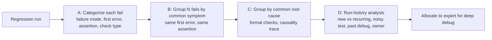

<!-- generated by yt-paper; edits will be overwritten -->
[DVCon](../dvcon/index.md) › [US](../dvcon/us.md) › [2016](../dvcon/by-year.md#2016) › [Verification](../dvcon/by-topic.md#verification)

# Evolution of Triage: Real-time Improvements in Debug Productivity

<figure class="rep-fig" markdown>
{ loading=lazy }
<figcaption>Figure 4. Categorizing a regression failure — from the original paper (Gordon Allan et al.)</figcaption>
</figure>

[:material-open-in-new: Original paper](https://dvcon-proceedings.org/wp-content/uploads/evolution-of-triage-real-time-improvements-in-debug-productivity.pdf){ .md-button .md-button--primary target=_blank }

| | |
|---|---|
| Authors | Gordon Allan (Mentor Graphics Corporation, Fremont, California), gordon_allan@mentor.com |
| Venue | DVCon US 2016 |
| Topic | Verification |
| Type | PAPER |
| ID | `ref-20261018-ca4e` |

## Summary

**The paper defines chip-design triage as a distinct, human-driven step between regression failure reporting and expert debug, classifies it into four types (single fail, historical, multi-fail, systemic), and proposes categorization and commonality-analysis techniques that cut debug time by grouping failures on symptoms and root causes.**

**이 논문은 칩 설계 트리아지를 회귀 실패 보고와 전문가 디버그 사이에 위치한, 사람이 수행하는 독립된 단계로 정의하고, 이를 네 가지 유형(단일 실패, 이력, 다중 실패, 시스템적 실패)으로 분류하며, 증상과 root cause 기준으로 실패를 묶는 분류 및 공통성 분석 기법을 제시한다.**

## Key Insights

- Triage is the first 20-50% of each debug effort by the author's estimate, within a flow where industry data suggests engineers spend 40% of verification time on debug.

- 저자의 추정에 따르면 트리아지는 각 디버그 작업의 처음 20-50%를 차지하며, 업계 데이터에 따르면 엔지니어는 검증 시간의 40%를 디버그에 쓴다.

- Triage is split into four types: A) single failing test disposition, B) historical context of a test or failure mode, C) multi-fail prioritization and resource focus, D) systemic failure identification across projects. The paper argues tools cannot yet automate these; they only assist data gathering, reporting and initial analysis.

- 트리아지는 네 가지 유형으로 나뉜다: A) 단일 실패 테스트의 처리 방향 결정, B) 테스트 또는 실패 모드의 이력 분석, C) 다중 실패의 우선순위 및 리소스 집중, D) 프로젝트 간 시스템적 실패 식별. 저자는 현재 도구가 이를 자동화할 수 없으며, 도구는 데이터 수집, 리포팅, 초기 분석만 지원한다고 주장한다.

- Failure categorization should record failure mode (build-time vs run-time, timeout, scoreboard/golden-reference mismatch), the first logged error message, and the earliest fired assertion, since the first error is closest to the root cause.

- 실패 분류 시에는 실패 모드(build-time 대 run-time, timeout, scoreboard/golden-reference 불일치), 최초로 기록된 에러 메시지, 가장 먼저 발생한 assertion을 기록해야 한다. 첫 번째 에러가 root cause에 가장 가깝기 때문이다.

- Grouping failures by a common root-cause signature rather than by symptom can resolve many failing tests at once. The paper suggests formal property checking around the failure point and a causality check (signal name + simulation time) that traces the fan-in cone back through combinational and sequential logic.

- 증상이 아닌 공통 root-cause signature로 실패를 묶으면 여러 실패 테스트를 한 번에 해결할 수 있다. 논문은 실패 지점 주변에 formal property checking을 적용하고, 신호 이름과 시뮬레이션 시각을 입력으로 조합 및 순차 로직의 fan-in cone을 역추적하는 causality check를 제안한다.

- Run-history analysis of a single test answers whether a failure is new or recurring, whether the test is a noisy/brittle test, what the previous debug session found, and who has debugged similar failures before.

- 단일 테스트의 회귀 이력 분석은 실패가 새로운 것인지 반복되는 것인지, 테스트가 noisy/brittle한지, 이전 디버그 세션에서 무엇이 밝혀졌는지, 유사한 실패를 과거에 누가 디버그했는지를 알려준다.

## Detailed Summary

### Background and Problem

Triage is defined here as the analysis of a discrete set of reported issues of common derivation: determining priority and the method of exploration, analysis, and resolution so that resources are used most effectively. The paper observes that triage of design regression failures differs from medical triage. In medicine, cases are typically isolated and binned quickly, whereas in chip verification, repetition and grouping of failures carry information. Poorly executed triage causes iteration and wasted debug effort. The author estimates that triage makes up the first 20-50% of each debug effort, and industry data cited in the paper says engineers spend 40% of verification time on debug.

이 논문은 트리아지를 공통 원인에서 비롯된 보고된 이슈 집합을 분석하여, 각 이슈의 우선순위와 탐색·분석·해결 방법을 정하고 자원을 가장 효율적으로 사용하도록 하는 활동으로 정의한다. 의료 분야의 트리아지는 사례를 독립적으로 빠르게 분류하지만, 칩 검증에서는 실패의 반복과 그룹핑이 정보를 가진다는 점에서 다르다. 잘못 수행된 트리아지는 반복 작업과 낭비를 초래한다. 저자는 트리아지가 각 디버그 작업의 처음 20-50%를 차지한다고 추정하며, 논문이 인용한 업계 데이터에 따르면 엔지니어는 검증 시간의 40%를 디버그에 쓴다.

The paper identifies four triage patterns:

논문은 네 가지 트리아지 패턴을 제시한다:

- **A.** Single failing test: disposition as RTL/GLS bug, testbench false negative, firmware/software bug, or specification ambiguity.

- **A.** 단일 실패 테스트: RTL/GLS 버그, testbench 오탐(false negative), 펌웨어/소프트웨어 버그, 사양 모호성 중 하나로 처리 방향을 정한다.

- **B.** Historical context: when a test or assertion last failed, and whether it fails intermittently, to find fragile design areas or brittle checks.

- **B.** 이력 문맥: 테스트나 assertion이 마지막으로 언제 실패했는지, 간헐적으로 실패하는지를 확인하여 취약한 설계 영역이나 깨지기 쉬운 check를 찾는다.

- **C.** Multiple failing tests: set resource focus and priority, which is the most common application.

- **C.** 다중 실패 테스트: 자원 집중과 우선순위를 정한다. 가장 흔한 적용 사례이다.

- **D.** Systemic failures: find common root causes across projects.

- **D.** 시스템적 실패: 프로젝트 전반에 걸친 공통 root cause를 찾는다.

### Architecture and Methodology

The paper does not describe a tool. It describes a flow of analysis techniques, with inputs from the regression system, design and testbench collateral, and process/CAD knowledge.

논문은 도구를 제시하지 않는다. 회귀 시스템, 설계 및 testbench 자료, 프로세스/CAD 지식을 입력으로 하는 분석 기법의 흐름을 설명한다.

Main techniques:

주요 기법:

1. **Categorize an individual failure:** classify it as build-time or run-time, and as testbench-caught, timeout, lack of success, or golden-reference mismatch. Record the first error message, the earliest assertion that fired, and the check's origin (designer assertion, VIP assertion, scoreboard, protocol check). For golden-reference mismatches, record time and mismatched signal.

1. **개별 실패 분류:** build-time 또는 run-time, testbench가 잡은 실패, timeout, 성공 조건 미충족, golden-reference 불일치 중 하나로 분류한다. 첫 에러 메시지, 가장 먼저 발생한 assertion, check의 출처(설계자 assertion, VIP assertion, scoreboard, protocol check)를 기록한다. golden-reference 불일치는 시간과 불일치한 신호를 기록한다.

2. **Analyze N fails for symptom commonality:** compare first logged errors, which should be well structured (the paper points to UVM [3]) and filtered to tolerate random data. For assertions, check whether the same assertion fires across tests and under what conditions.

2. **N개 실패의 증상 공통성 분석:** 첫 번째 로그 에러를 비교한다. 이 에러는 구조화되어 있어야 하며(논문은 UVM [3]을 언급), 무작위 데이터에 대한 허용 오차를 두고 필터링한다. assertion의 경우 여러 테스트에서 동일한 assertion이 발생하는지, 어떤 조건에서 발생하는지 확인한다.

3. **Analyze N fails for root-cause commonality:** apply formal property checking to the region around the failure point, and run a causality check in the debug tool. The causality check takes a signal name and simulation time, then traces the logic fan-in cone back through combinational and sequential logic using captured values to find a root-cause signal and value. One root cause can produce several symptoms.

3. **N개 실패의 root cause 공통성 분석:** 실패 지점 주변 영역에 formal property checking을 적용하고, 디버그 도구의 causality check를 실행한다. causality check는 신호 이름과 시뮬레이션 시각을 입력받아, 캡처된 값을 이용해 조합 및 순차 로직의 fan-in cone을 역추적하여 root cause 신호와 값을 찾는다. 하나의 root cause가 여러 증상을 만들 수 있다.

4. **Analyze one test across N regression runs:** determine the test's normal status, maturity, and brittleness; check whether the failure has been seen before and what was found; review the previous debug session; and identify engineers with relevant experience.

4. **하나의 테스트를 N회 회귀 실행에 걸쳐 분석:** 테스트의 정상 상태, 성숙도, 취약성을 판단한다. 실패가 이전에 발생했는지와 그때 무엇이 밝혀졌는지 확인하고, 이전 디버그 세션을 검토하며, 관련 경험이 있는 엔지니어를 찾는다.

The paper concludes that tools for automating all four triage types do not yet exist. Data gathering, reporting, and initial analysis can be automated, but interpretation remains manual.

논문은 네 가지 트리아지 유형을 모두 자동화하는 도구는 아직 존재하지 않는다고 결론짓는다. 데이터 수집, 리포팅, 초기 분석은 자동화할 수 있지만 해석은 여전히 수작업이다.

### Results and Conclusions

The paper gives no quantitative measurements of productivity gains from the proposed techniques, so the reported figures are the author's estimates (20-50% of debug time for triage) and the industry figure (40% of verification time for debug). The main conclusions are:

논문은 제안된 기법으로 얻은 생산성 향상을 정량적으로 측정하지 않는다. 따라서 제시된 수치는 저자의 추정치(트리아지는 디버그 시간의 20-50%)와 업계 수치(디버그는 검증 시간의 40%)이다. 주요 결론은 다음과 같다:

- Triage is a specialized debug activity that can consume significant time. Optimizing it reduces wasted effort in blind debug paths.

- 트리아지는 상당한 시간을 소모할 수 있는 전문화된 디버그 활동이며, 이를 최적화하면 무분별한 디버그 경로에서 낭비되는 노력을 줄일 수 있다.

- Tools support triage through data and reporting, but judgment, experience, and historical context remain human tasks.

- 도구는 데이터와 리포팅을 통해 트리아지를 지원하지만, 판단, 경험, 이력 문맥은 여전히 사람의 몫이다.

- Results should be communicated clearly enough that the next engineer can continue deeper debug without repeating earlier work.

- 결과는 다음 엔지니어가 앞선 작업을 반복하지 않고 깊은 디버그를 이어갈 수 있을 만큼 명확하게 전달되어야 한다.

- Grouping by root cause resolves many failures together and gives the biggest debug payoff, though the paper does not quantify it.

- root cause 기준 그룹화는 많은 실패를 한 번에 해결하여 디버그 효과가 가장 크지만, 논문은 이를 수치로 정량화하지는 않는다.

The paper closes by describing triage engineering as a career role that combines CPU/SoC, firmware, and silicon bring-up skills with debug experience.

논문은 트리아지 엔지니어를 CPU/SoC, 펌웨어, 실리콘 bring-up 기술과 디버그 경험을 결합한 경력 직무로 설명하며 마무리한다.

## Videos

<iframe src="https://www.youtube-nocookie.com/embed/Ck6qeC80QMs" title="[DVCON2016] Evolution of Triage Real time Improvements in Debug Productivity" loading="lazy" allow="accelerometer; clipboard-write; encrypted-media; gyroscope; picture-in-picture; web-share" referrerpolicy="strict-origin-when-cross-origin" allowfullscreen></iframe>

**[DVCON2016] Evolution of Triage Real time Improvements in Debug Productivity** — [Watch on YouTube](https://www.youtube.com/watch?v=Ck6qeC80QMs) · [Video page](../videos/Ck6qeC80QMs.md)
