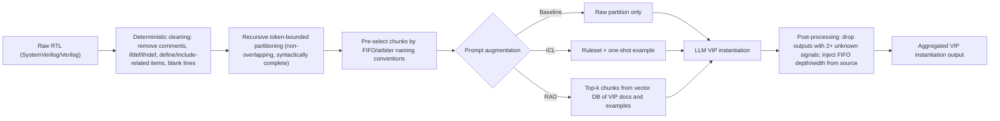

<!-- generated by yt-paper; edits will be overwritten -->
[DVCon](../dvcon/index.md) › [US](../dvcon/us.md) › [2025](../dvcon/by-year.md#2025) › [Verification](../dvcon/by-topic.md#verification)

# Towards Automated Verification IP Instantiation via LLMs

<figure class="rep-fig" markdown>
{ loading=lazy }
<figcaption>Fig. 3- Proposed LLM-based framework for code generation for VIP instantiation — from the original paper (Ghaith Bany Hamad et al.)</figcaption>
</figure>

[:material-open-in-new: Original paper](https://dvcon-proceedings.org/wp-content/uploads/1016-2.pdf){ .md-button .md-button--primary target=_blank }

| | |
|---|---|
| Authors | Ghaith Bany Hamad (Nvidia Corp.), Michael Marcotte (Nvidia Corp.), Syed Suhaib (Nvidia Corp.) |
| Venue | DVCon US 2025 |
| Topic | Verification |
| Type | PAPER |
| ID | `ref-20261018-ccb0` |

## Summary

**A RAG-based LLM flow that automatically instantiates FIFO and arbiter VIP assertions from Verilog RTL, reaching 7/7 and 11/12 correct instantiations with Llama-3-70b, outperforming ICL and baseline prompting without any fine-tuning.**

**Llama-3-70b와 RAG를 사용해 Verilog RTL에서 FIFO 및 arbiter VIP assertion을 자동으로 instantiate하며, fine-tuning 없이 7/7 및 11/12의 정확한 instantiation을 달성하여 ICL과 baseline 프롬프팅보다 우수한 결과를 보인 LLM 기반 흐름이다.**

## Key Insights

- With Llama-3-70b and RAG, FIFO VIP instantiation was 7/7 correct and arbiter VIP instantiation was 11/12 correct (1 incorrect). ICL with chipmixtral_8x7b reached 4/7 (FIFO) and 1/12 (arbiter), and the baseline reached 0 correct in all 19 instances.

- Llama-3-70b와 RAG 조합에서 FIFO VIP instantiation은 7/7 정답, arbiter VIP instantiation은 11/12 정답(1건 오답)이었다. chipmixtral_8x7b 기반 ICL은 FIFO 4/7, arbiter 1/12였고, baseline은 총 19건 모두 정답이 없었다.

- RAG supplies VIP knowledge at inference time from a vector database of internal VIP documents and module-to-VIP instantiation pairs, so no model fine-tuning is needed. New knowledge is added by updating the database, and the underlying LLM can be swapped for newer models.

- RAG는 내부 VIP 문서와 모듈-VIP instantiation 쌍으로 구성된 vector database에서 추론 시점에 VIP 지식을 제공하므로 모델 fine-tuning이 필요 없다. 새 지식은 데이터베이스 갱신으로 추가되며, 기반 LLM도 더 나은 모델로 교체할 수 있다.

- Token-bounded, non-overlapping, syntactically complete partitioning of cleaned RTL, combined with pre-selecting chunks by FIFO/arbiter naming conventions, limits LLM calls on files with hundreds of thousands of lines.

- 토큰 한도 내에서 중복 없이 문법적으로 완결된 단위로 정제된 RTL을 분할하고, FIFO/arbiter 명명 규칙으로 chunk를 사전 선별하여, 수십만 라인 규모 파일에서도 LLM 호출 횟수를 제한한다.

- Post-processing acts as a hallucination filter: an instantiation with 2 or more 'unknown' signal flags is discarded as a false positive, and missing FIFO depth and data width are deterministically extracted from the source and injected into the output.

- 후처리가 hallucination 필터 역할을 한다. unknown 신호 플래그가 2개 이상인 출력은 false positive로 폐기되며, 누락된 FIFO depth와 data width는 소스에서 결정론적으로 추출되어 출력에 주입된다.

- Evaluation is small (7 FIFO and 12 arbiter instances, few DUTs), 'correct' requires all signals correct, and the paper contradicts itself on which model served the baseline and ICL runs (fine-tuned llama in Section V vs chipmixtral_8x7b in Section VI), so the numbers should be treated as indicative.

- 평가 규모가 작고(FIFO 7건, arbiter 12건, DUT 수도 적음), 'correct'는 모든 신호가 맞아야 하며, 논문은 baseline과 ICL 실행에 사용된 모델을 Section V(fine-tuned llama)와 Section VI(chipmixtral_8x7b)에서 서로 다르게 기술한다. 따라서 수치는 참고 수준으로 해석해야 한다.

## Detailed Summary

### Background and Problem

- Formal verification (FV) accounts for about 56% of ASIC design time (as cited in the paper). Building formal testbenches by hand requires skilled experts, which limits how far FV can scale.

- Formal verification(FV)은 ASIC 설계 시간의 평균 약 56%를 차지한다(논문이 인용한 수치). Formal testbench를 수작업으로 만드는 데는 숙련된 전문가가 필요해 FV 확장에 제약이 있다.

- Prior LLM work on hardware assertion generation (AssertLLM, Orenes-Vera et al.) produces assertions below human-level quality, so it is not yet viable for FV teams.

- 기존 LLM 기반 하드웨어 assertion 생성 연구(AssertLLM, Orenes-Vera 등)의 결과물은 사람 수준에 못 미쳐 FV 팀이 실제로 쓰기에는 아직 부족하다.

- Verification IPs (VIPs) package reusable checkers for protocols and standards. Deploying them is hard under tight schedules and when engineers lack VIP expertise.

- Verification IP(VIP)는 프로토콜과 표준을 검증하는 재사용 가능한 checker를 패키징한 것이다. 그러나 일정이 빠듯하거나 엔지니어에게 VIP 전문성이 없으면 배포가 어렵다.

- Generic LLMs (GPT, Llama2/3) lack VIP-specific knowledge. Fine-tuning takes weeks and is costly. Feeding whole RTL files into the prompt hits context-window limits (the paper cites Llama2 at 2048 tokens), which truncates responses.

- 범용 LLM(GPT, Llama2/3)에는 VIP 전용 지식이 없다. Fine-tuning은 수 주가 걸리고 비용이 많이 든다. RTL 파일 전체를 프롬프트에 넣으면 context window 한도에 걸리며(논문은 Llama2를 2048 토큰으로 언급), 응답이 잘린다.

### Architecture and Methodology

The flow has four stages: data pre-processing, prompt augmentation, VIP instantiation, and post-processing. Targets are `assert_vip_fifo` and `assert_vip_arb`.

흐름은 데이터 전처리, 프롬프트 증강, VIP instantiation, 후처리의 4단계로 구성된다. 대상은 `assert_vip_fifo`와 `assert_vip_arb`이다.

- **Pre-processing:** A deterministic filter removes comments, `ifdef`/`ifndef` blocks, port declarations tied to `defines`/`includes`, and resulting blank lines. A proprietary recursive algorithm then splits the code into partitions that obey a maximum token count and keep blocks intact. The partitions do not overlap and together cover the whole file. Rules are registered in driver functions, so new VIPs can be added. The pipeline is multi-threaded.

- **전처리:** 결정론적 필터가 주석, `ifdef`/`ifndef` 블록, `defines`/`includes`와 관련된 포트 선언, 그리고 그로 인해 생기는 빈 줄을 제거한다. 이후 독자적인 재귀 알고리즘이 최대 토큰 수를 지키면서 블록 무결성을 유지하도록 코드를 분할한다. 파티션은 중복되지 않으며 전체 파일을 빠짐없이 덮는다. 규칙은 driver 함수에 등록되므로 새 VIP를 추가할 수 있다. 파이프라인은 multi-threading으로 동작한다.

- **Prompt augmentation:** Three variants are compared. Baseline uses raw partitions. ICL appends FIFO/arbiter rulesets from FV experts and a one-shot VIP example. RAG retrieves relevant chunks from a vector database containing internal VIP documentation and module-code/VIP-instantiation pairs. The rulesets are shared by ICL and RAG.

- **프롬프트 증강:** 세 가지 방식을 비교한다. Baseline은 원본 파티션만 사용한다. ICL은 FV 전문가가 정의한 FIFO/arbiter 규칙셋과 one-shot 예시를 덧붙인다. RAG는 내부 VIP 문서와 모듈 코드/VIP instantiation 쌍을 담은 vector database에서 관련 chunk를 검색한다. 규칙셋은 ICL과 RAG가 공유한다.

- **LLM instantiation:** RAG uses the open-source Llama-3-70b-instruct endpoint, which shows that domain fine-tuning is not required. Section V says the baseline and ICL used a llama model fine-tuned on internal code documentation. Section VI names chipmixtral_8x7b_chat_tp4_trt_h100 for those runs, so the paper is inconsistent on this point.

- **LLM instantiation:** RAG는 오픈소스 Llama-3-70b-instruct endpoint를 사용하며, 이는 도메인 fine-tuning이 필요하지 않음을 보여준다. Section V에서는 baseline과 ICL에 내부 코드 문서로 fine-tuning한 llama 모델을 사용했다고 하지만, Section VI는 같은 실행에 chipmixtral_8x7b_chat_tp4_trt_h100을 명시한다. 논문 내에서 이 부분이 일관되지 않다.

- **Runtime optimization:** Chunks are pre-selected with naming-convention heuristics, so only likely FIFO and arbiter chunks reach the LLM. This can produce false positives, which post-processing removes.

- **런타임 최적화:** 명명 규칙 기반 휴리스틱으로 chunk를 사전 선별하여 FIFO와 arbiter가 있을 가능성이 높은 chunk만 LLM에 보낸다. 이 과정에서 false positive가 생길 수 있으며 후처리에서 제거된다.

- **Post-processing:** The prompt instructs the LLM to flag any signal not found in the partition as unknown. Two or more unknown flags mark the instantiation as a hallucination, and it is discarded. For FIFOs, depth and data width are often absent from the instantiating module, so an automatic retrieval step reads them from the FIFO's source module and injects them into the output.

- **후처리:** 프롬프트는 파티션에서 찾을 수 없는 신호를 unknown으로 표시하도록 LLM에 지시한다. Unknown 플래그가 2개 이상이면 hallucination으로 보고 해당 출력을 폐기한다. FIFO의 경우 depth와 data width가 instantiation 모듈에 없는 경우가 많아, 자동 검색 단계가 FIFO 소스 모듈에서 이 값을 읽어 출력에 주입한다.

### Results and Conclusions

Table I (correct = all signals correct; incorrect = incomplete or wrong signals; missing = no instantiation):

표 I (correct = 모든 신호가 정확함, incorrect = 신호가 불완전하거나 잘못됨, missing = instantiation 없음):

| VIP | LLM | Augmentation | Correct | Incorrect | Missing | Total |
|---|---|---|---|---|---|---|
| assert_vip_fifo | chipmixtral_8x7b | Baseline | 0 | 0 | 7 | 7 |
| assert_vip_fifo | chipmixtral_8x7b | ICL | 4 | 1 | 2 | 7 |
| assert_vip_fifo | Llama-3-70b | RAG | 7 | 0 | 0 | 7 |
| assert_vip_arb | chipmixtral_8x7b | Baseline | 0 | 0 | 12 | 12 |
| assert_vip_arb | chipmixtral_8x7b | ICL | 1 | 4 | 7 | 12 |
| assert_vip_arb | Llama-3-70b | RAG | 11 | 1 | 0 | 12 |

| VIP | LLM | 증강 방식 | Correct | Incorrect | Missing | Total |
|---|---|---|---|---|---|---|
| assert_vip_fifo | chipmixtral_8x7b | Baseline | 0 | 0 | 7 | 7 |
| assert_vip_fifo | chipmixtral_8x7b | ICL | 4 | 1 | 2 | 7 |
| assert_vip_fifo | Llama-3-70b | RAG | 7 | 0 | 0 | 7 |
| assert_vip_arb | chipmixtral_8x7b | Baseline | 0 | 0 | 12 | 12 |
| assert_vip_arb | chipmixtral_8x7b | ICL | 1 | 4 | 7 | 12 |
| assert_vip_arb | Llama-3-70b | RAG | 11 | 1 | 0 | 12 |

- The baseline produced no correct instantiations, which the authors take as evidence that raw prompts are insufficient.

- Baseline은 정답을 하나도 만들지 못했으며, 저자들은 이를 원본 프롬프트만으로는 부족하다는 근거로 본다.

- ICL improved results but was inconsistent, especially for the more complex arbiter task.

- ICL은 성능을 개선했지만 결과가 일관되지 않았고, 특히 더 복잡한 arbiter 작업에서 그랬다.

- RAG performed best on both VIPs and was the only setting with high reliability across both tasks.

- RAG는 두 VIP 모두에서 가장 좋은 성능을 보였으며, 두 작업 전반에서 안정적인 결과를 낸 유일한 방식이었다.

- The authors argue the RAG gain is more useful because it relies on a general open-source model. The flow can therefore move to newer LLMs without retraining.

- 저자들은 RAG의 이득이 범용 오픈소스 모델을 사용해 얻어졌다는 점에서 더 가치가 있다고 주장한다. 따라서 재학습 없이 더 새로운 LLM으로 흐름을 옮길 수 있다.

- The paper claims "far fewer hallucinations" and "syntactically and logically sound" output, but it gives no separate hallucination-rate metric.

- 논문은 "훨씬 적은 hallucination"과 "문법적·논리적으로 건전한 출력"을 주장하지만, 별도의 hallucination 비율 지표는 제시하지 않는다.

- Limitations: only two VIP types and a small number of instances (7 and 12). The paper does not report statistical analysis or the number of DUTs per run. The model-attribution inconsistency noted above also limits comparison across rows.

- 한계: VIP 종류는 두 가지뿐이고 인스턴스 수도 적다(7건, 12건). 통계 분석이나 실행별 DUT 수는 보고되지 않았다. 위에서 언급한 모델 기술의 불일치 때문에 행 간 비교에도 제약이 있다.

## Videos

<iframe src="https://www.youtube-nocookie.com/embed/-yYSOj4vjM8" title="[DVCON2025]Towards Automated Verification IP Instantiation via LLMs" loading="lazy" allow="accelerometer; clipboard-write; encrypted-media; gyroscope; picture-in-picture; web-share" referrerpolicy="strict-origin-when-cross-origin" allowfullscreen></iframe>

**[DVCON2025]Towards Automated Verification IP Instantiation via LLMs** — [Watch on YouTube](https://www.youtube.com/watch?v=-yYSOj4vjM8) · [Video page](../videos/-yYSOj4vjM8.md)
