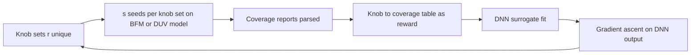

<!-- generated by yt-paper; edits will be overwritten -->
[DVCon](../dvcon/index.md) › [US](../dvcon/us.md) › [2025](../dvcon/by-year.md#2025) › [Verification](../dvcon/by-topic.md#verification)

# Stimulus Diversification and Coverage Closure of 3D NAND Flash with Artificial Intelligence

<figure class="rep-fig" markdown>
{ loading=lazy }
<figcaption>Figure 1. Machine Learning in DV flow — from the original paper (Goutham Pallela et al.)</figcaption>
</figure>

[:material-open-in-new: Original paper](https://dvcon-proceedings.org/wp-content/uploads/1063-2.pdf){ .md-button .md-button--primary target=_blank }

| | |
|---|---|
| Authors | Goutham Pallela (Micron Technology, Inc.), Peiyao Shi (Micron Technology, Inc.), Srinivas Deshmukh (Micron Technology, Inc.), Vaishnavi Venkatesh (Micron Technology, Inc.), Bill Hughes (VerifAI Inc.), Rohit Suvarna (VerifAI Inc.), Sandeep Srinivasan (VerifAI Inc.) |
| Venue | DVCon US 2025 |
| Topic | Verification |
| Type | PAPER |
| ID | `ref-20261018-cee6` |

## Summary

**The paper proposes an RL agent built on DNN surrogates and gradient ascent that tunes testbench knobs using coverage feedback, trained against a black-box model rather than the real DUV, to reach higher NAND functional coverage with fewer simulations.**

**이 논문은 DNN 대리 모델과 gradient ascent 기반 RL 에이전트가 커버리지 피드백으로 테스트벤치 knob을 조정하고, 실제 DUV 대신 black-box 모델로 학습해 더 적은 시뮬레이션으로 NAND 기능 커버리지를 끌어올리는 방법을 제안합니다.**

## Key Insights

- The RL agent is trained without the real DUV: a black-box model or BFM replaces the design, cutting the cost of computing resources and simulation licenses, since each training iteration otherwise needs hundreds of slow design simulations.

- RL 에이전트는 실제 DUV 없이 학습합니다. 설계 시뮬레이션은 느리고 반복마다 수백 번 필요하므로, black-box 모델이나 BFM으로 DUV를 대체해 컴퓨팅 자원과 시뮬레이션 라이선스 비용을 줄입니다.

- The agent fits a DNN from knob settings to coverage reward, then runs gradient ascent on the DNN output with respect to the inputs, using a penalty term L(X) = -f(X) + λP(X) to enforce knob constraints.

- 에이전트는 knob 설정에서 커버리지 보상으로 가는 DNN을 맞춘 뒤, DNN 출력에 대해 입력 knob으로 gradient ascent를 수행합니다. 제약은 페널티 항 L(X) = -f(X) + λP(X)로 강제합니다.

- Reward can be absolute coverage or relative coverage (newly hit bins). The paper argues relative reward is more effective because it targets newly hit bins, and cover groups can each get a dedicated agent.

- 보상은 절대 커버리지 또는 상대 커버리지(새로 hit된 bin 수) 중 선택할 수 있습니다. 저자들은 새 bin 확보를 직접 겨냥하므로 상대 보상이 더 효과적이라고 주장하며, cover group별로 전담 에이전트를 둘 수 있다고 합니다.

- Reported proof-of-concept results: about 2% higher coverage with the same 1000 simulations, and the same coverage reached with 38% fewer simulations. The authors note these are preliminary, from an ongoing project.

- 예비 결과(진행 중인 proof-of-concept 프로젝트)로, 동일한 1000회 시뮬레이션에서 커버리지가 약 2% 더 높았고, 같은 커버리지를 38% 적은 시뮬레이션으로 달성했습니다.

- The best knob sets across all n training iterations are hand-picked for DUV regression, because the final iteration is not necessarily the best, given under-training or learning of negative correlations.

- 마지막 반복이 항상 최고 커버리지인 것은 아니므로(학습 부족 또는 음의 상관관계 학습), n개 반복 전체에서 커버리지가 가장 높은 knob 세트를 골라 실제 DUV 회귀에 사용합니다.

## Detailed Summary

### Background and Problem

- NAND full-chip verification must reach coverage goals before tape-out. The current NAND testbench has about 500k coverage bins, and coverage is reset to zero for the final tape-out netlist, which makes closure harder.

- NAND 풀칩 검증은 tape-out 전에 커버리지 목표를 달성해야 합니다. 현재 NAND 테스트벤치에는 약 500k개의 커버리지 bin이 있으며, 최종 tape-out netlist에서는 커버리지가 0으로 리셋되어 closure가 더 어렵습니다.

- Testbench stimulus is steered by several hundred SV knobs (parameters). Manual knob tuning is tedious because knobs interact and their effect on bins is nonlinear. The paper says this takes multiple weeks and 10%-20% of the verification cycle.

- 테스트벤치 stimulus는 수백 개의 SV knob(parameter)으로 조정됩니다. knob들은 서로 상호작용하고 bin에 대한 영향이 비선형적이어서 수동 튜닝은 번거롭습니다. 논문에 따르면 이 작업은 여러 주가 걸리며 검증 사이클의 10%-20%를 차지합니다.

- Each RL training iteration needs hundreds of slow design simulations, so training the agent directly on the DUV is expensive.

- RL 학습 반복마다 느린 설계 시뮬레이션이 수백 번 필요하므로, DUV에서 직접 에이전트를 학습시키는 것은 비용이 큽니다.

### Architecture and Methodology

Flow of the proposed closed loop:

제안된 폐루프 흐름은 다음과 같습니다.

- **Knobs:** SV parameters, plusargs, or UVM command-line settings are moved into a global parameter file that automation updates after each agent decision.

- **Knob:** SV parameter, plusargs 또는 UVM command-line 설정을 전역 parameter 파일로 옮기고, 에이전트 결정 후 자동화가 이를 갱신합니다.

- **Black-box model:** a BFM or black-box model stands in for the DUV during training.

- **Black-box 모델:** 학습 중에는 BFM 또는 black-box 모델이 DUV를 대신합니다.

- **Feedback path:** coverage reports from the simulator are parsed and mapped to knob settings in a tabular format.

- **피드백 경로:** 시뮬레이터의 커버리지 리포트를 파싱해 knob 설정과 매핑한 표 형태로 전달합니다.

- **Reward:** absolute or relative coverage. Relative reward targets newly hit bins. Cover-group-specific agents can be trained in parallel.

- **보상:** 절대 커버리지 또는 상대 커버리지를 사용합니다. 상대 보상은 새로 hit된 bin을 겨냥합니다. cover group별 에이전트를 병렬로 학습할 수 있습니다.

- **Agent:** a wide DNN with batch normalization and Leaky ReLU, trained to fit the knob-to-reward mapping.

- **에이전트:** batch normalization과 Leaky ReLU를 갖춘 wide DNN이 knob에서 보상으로의 매핑을 학습합니다.

- **Gradient ascent:** the update is $\theta^{(t+1)} = \theta^{(t)} + \eta \nabla f(\theta^{(t)})$. The loss is $L(X) = -f(X) + \lambda P(X)$, where the example penalty is $P(X) = \sum_{i=1}^{n}(X_i - 1)^2$.

- **Gradient ascent:** 갱신식은 $\theta^{(t+1)} = \theta^{(t)} + \eta \nabla f(\theta^{(t)})$입니다. 손실 함수는 $L(X) = -f(X) + \lambda P(X)$이며, 예시 페널티는 $P(X) = \sum_{i=1}^{n}(X_i - 1)^2$입니다.

- **Training loop:** each of the $n$ iterations generates $r$ unique knob sets and runs $s$ simulations per set. Sets are ranked by how many hard-to-reach bins they hit. The best sets across all iterations are chosen for DUV regression.

- **학습 루프:** $n$번의 각 반복에서 $r$개의 고유 knob 세트를 생성하고, 세트당 $s$번의 시뮬레이션을 실행합니다. 세트는 달성하기 어려운 bin을 얼마나 hit했는지로 순위를 매깁니다. 모든 반복에서 가장 좋은 세트를 DUV 회귀에 사용합니다.

- **Human control:** DV engineers define the reward and review knob settings before DUV use.

- **사람의 통제:** DV 엔지니어가 보상을 정의하고, DUV에 사용하기 전에 knob 설정을 검토합니다.

### Results and Conclusions

- In an ongoing proof-of-concept project, the method reaches about 2% higher coverage with the same 1000 simulations. It reaches the same coverage with 38% fewer simulations (Fig. 7 coverage ramp).

- 진행 중인 proof-of-concept 프로젝트에서 이 방법은 동일한 1000회 시뮬레이션에서 커버리지를 약 2% 더 높였습니다. 같은 커버리지를 38% 적은 시뮬레이션으로 달성했습니다(Fig. 7 커버리지 ramp).

- The authors call these results encouraging but preliminary. Future work covers reward fine-tuning, the $r$/$s$ balance, and more advanced RL algorithms to reduce iterations.

- 저자들은 이 결과를 고무적이지만 예비적이라고 설명합니다. 향후 과제로 보상 미세 조정, $r$/$s$ 균형, 반복 횟수를 줄이기 위한 고급 RL 알고리즘이 제시되었습니다.

- The paper concludes that the framework is integrated into the existing DV flow and is planned for future NAND products. It gives no quantitative results beyond the above. The authors also claim a near-zero chance of complete failure with human oversight, but they do not support this with data.

- 논문은 이 프레임워크가 기존 DV 흐름에 통합되었으며 향후 NAND 제품에 적용할 계획이라고 결론짓습니다. 위 내용 외에 정량적 결과는 제시하지 않습니다. 또한 저자들은 사람의 감독이 있으면 완전 실패 가능성이 거의 없다고 주장하지만, 이를 뒷받침하는 데이터는 없습니다.

## Videos

<iframe src="https://www.youtube-nocookie.com/embed/WfdqMw4b1bo" title="[DVCON2025]Stimulus Diversification and Coverage Closure of 3D NAND Flash Artificial Intelligence" loading="lazy" allow="accelerometer; clipboard-write; encrypted-media; gyroscope; picture-in-picture; web-share" referrerpolicy="strict-origin-when-cross-origin" allowfullscreen></iframe>

**[DVCON2025]Stimulus Diversification and Coverage Closure of 3D NAND Flash Artificial Intelligence** — [Watch on YouTube](https://www.youtube.com/watch?v=WfdqMw4b1bo) · [Video page](../videos/WfdqMw4b1bo.md)
