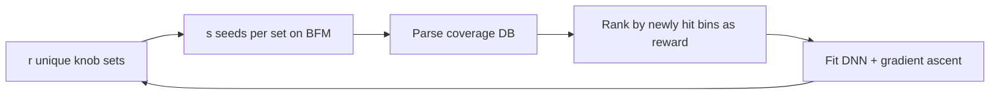

<!-- generated by yt-paper; edits will be overwritten -->
[DVCon](../dvcon/index.md) › [US](../dvcon/us.md) › [2025](../dvcon/by-year.md#2025) › [Verification](../dvcon/by-topic.md#verification)

# Stimulus Diversification and Coverage Closure of 3D NAND Flash with Artificial Intelligence

<figure class="rep-fig" markdown>
{ loading=lazy }
<figcaption>Figure 1. Machine Learning in DV flow — from the original paper (Goutham Pallela et al.)</figcaption>
</figure>

[:material-open-in-new: Original paper](https://dvcon-proceedings.org/wp-content/uploads/1063-2.pdf){ .md-button .md-button--primary target=_blank }

| | |
|---|---|
| Authors | Goutham Pallela (Micron Technology, Inc.), Peiyao Shi (Micron Technology, Inc.), Srinivas Deshmukh (Micron Technology, Inc.), Vaishnavi Venkatesh (Micron Technology, Inc.), Bill Hughes (VerifAI Inc.), Rohit Suvarna (VerifAI Inc.), Sandeep Srinivasan (VerifAI Inc.) |
| Venue | DVCon US 2025 |
| Topic | Verification |
| Type | PAPER |
| ID | `ref-20261018-cee6` |

## Summary

**An RL agent with a DNN surrogate and gradient-ascent knob optimization, trained against a black-box/BFM model instead of the real DUV, auto-tunes SystemVerilog stimulus knobs in a 3D NAND testbench to close functional coverage with fewer simulations (reported ~38% fewer on a proof-of-concept).**

**실제 DUV 대신 블랙박스/BFM 모델로 학습한 DNN 기반 RL 에이전트가 gradient ascent로 SystemVerilog 자극 knob을 자동 조정하여, 3D NAND 테스트벤치의 기능 커버리지를 더 적은 시뮬레이션으로 닫는 방법(PoC에서 약 38% 적은 시뮬레이션 보고)입니다.**

## Key Insights

- Training the RL/DNN agent on a black-box or BFM model instead of the real DUV removes the costly design simulations from the training loop, which the paper cites as the main source of training delay and license/compute cost.

- RL/DNN 에이전트를 실제 DUV 대신 블랙박스 또는 BFM 모델로 학습시켜, 저자들이 학습 지연과 라이선스·컴퓨팅 비용의 주요 원인으로 꼽은 설계 시뮬레이션을 학습 루프에서 제거합니다.

- The reported gains on one ongoing proof-of-concept are ~2% higher coverage with the same 1000 simulations, and the same coverage reached with 38% fewer simulations.

- 하나의 진행 중 PoC에서 보고된 결과는 동일한 1000회 시뮬레이션에서 커버리지 약 2% 향상, 동일 커버리지를 38% 적은 시뮬레이션으로 달성하는 것입니다.

- Reward definition (absolute vs. relative newly-hit-bin coverage, or per-cover-group agents trained in parallel) is the main tuning lever, and the authors stress that DV engineers must control it carefully.

- Reward 정의(절대 커버리지 대 새로 적중한 bin 기준 상대 커버리지, 또는 cover group별로 병렬 학습한 에이전트)가 핵심 튜닝 요소이며, 저자들은 DV 엔지니어가 이를 신중히 통제해야 한다고 강조합니다.

- The deployed knob sets are the best across all n training iterations rather than the last one, because the final iteration may be under-trained or learn negative correlations.

- 배포되는 knob 세트는 마지막 반복이 아니라 n개 학습 반복 전체에서 가장 좋은 세트이며, 이는 마지막 반복이 학습 미완료이거나 음의 상관관계를 학습했을 수 있기 때문입니다.

- Evidence is thin: only a single coverage-ramp plot (Fig. 7) is shown, with no baseline definition, run-to-run variance, or bug-finding results reported.

- 근거는 부족합니다. 단일 커버리지 ramp 플롯(Fig. 7)만 제시되어 있으며, baseline 정의, 실행 간 분산, 버그 검출 결과가 보고되어 있지 않습니다.

## Detailed Summary

### Background and Problem

- NAND full-chip DV must reach coverage goals before tape-out; the current testbench has about 500k coverage bins, and coverage is reset for the final tape-out netlist.

- NAND 풀칩 DV는 tape-out 전에 커버리지 목표를 달성해야 하며, 현재 테스트벤치는 약 500k개의 커버리지 bin을 가지고 있고 최종 tape-out netlist에서는 커버리지가 0으로 초기화됩니다.

- Coverage closure relies on manually tuning several hundred SystemVerilog knobs. Knob interactions and nonlinear knob-to-bin correlations make this tedious, and it consumes 10–20% of the verification cycle, often over multiple weeks.

- 커버리지 클로저는 수백 개의 SystemVerilog knob을 수작업으로 조정하는 데 의존합니다. Knob 간 상호작용과 knob-to-bin 상관관계의 비선형성 때문에 과정이 번거롭고, 검증 사이클의 10–20%를 소모하며, 여러 주가 걸리기도 합니다.

### Architecture and Methodology

- A DNN-based RL agent (from VerifAI) is inserted into the existing constrained-random flow. The feedback loop runs coverage DB → parser → knob/score table → agent → global parameter file → simulation.

- DNN 기반 RL 에이전트(VerifAI 제공)를 기존 constrained-random 흐름에 삽입합니다. 피드백 루프는 coverage DB → parser → knob/score 테이블 → 에이전트 → global parameter 파일 → 시뮬레이션 순서로 이어집니다.

- Training uses a black-box or BFM model of the DUV rather than the real DUV, to cut simulation time and license cost.

- 학습은 실제 DUV 대신 DUV의 블랙박스 또는 BFM 모델로 수행하여 시뮬레이션 시간과 라이선스 비용을 줄입니다.

- Each iteration generates $r$ unique knob sets, runs $s$ seeds per set, and ranks sets by newly hit bins. The reward is absolute or relative coverage, and per-cover-group agents can be trained in parallel.

- 각 반복에서 $r$개의 고유 knob 세트를 생성하고, 세트당 $s$개의 seed를 실행한 뒤, 새로 적중한 bin 수로 세트를 순위화합니다. Reward는 절대 커버리지 또는 상대 커버리지이며, cover group별 에이전트를 병렬로 학습할 수 있습니다.

- The DNN is fit to knob→reward. Gradient ascent with a penalty, $L(X) = -f(X) + \lambda P(X)$, then proposes new knobs. The best knob sets across the $n$ iterations are hand-picked for real-DUV regressions.

- DNN은 knob→reward 관계에 맞춰 학습됩니다. 이후 페널티를 포함한 gradient ascent, $L(X) = -f(X) + \lambda P(X)$,로 새로운 knob을 제안합니다. $n$번 반복 전체에서 가장 좋은 knob 세트를 골라 실제 DUV 회귀 테스트에 사용합니다.

### Results and Conclusions

- On an ongoing proof-of-concept project, the method reaches about 2% higher coverage with the same 1000 simulations, and the same coverage with 38% fewer simulations.

- 진행 중인 proof-of-concept 프로젝트에서 동일한 1000회 시뮬레이션으로 커버리지가 약 2% 높았고, 동일 커버리지를 38% 적은 시뮬레이션으로 달성했습니다.

- Only a single coverage-ramp plot (Fig. 7) is shown. Baselines, variance, and bug-finding results are not reported.

- 커버리지 ramp 플롯 하나(Fig. 7)만 제시되어 있습니다. Baseline, 분산, 버그 검출 결과는 보고되지 않았습니다.

- Future work covers reward tuning, the $r$/$s$ balance, and more advanced RL algorithms to cut training iterations.

- 향후 과제로 reward 튜닝, $r$/$s$ 균형, 학습 반복 횟수를 줄이기 위한 고급 RL 알고리즘 적용이 제시되었습니다.

## Videos

<iframe src="https://www.youtube-nocookie.com/embed/WfdqMw4b1bo" title="[DVCON2025]Stimulus Diversification and Coverage Closure of 3D NAND Flash Artificial Intelligence" loading="lazy" allow="accelerometer; clipboard-write; encrypted-media; gyroscope; picture-in-picture; web-share" referrerpolicy="strict-origin-when-cross-origin" allowfullscreen></iframe>

**[DVCON2025]Stimulus Diversification and Coverage Closure of 3D NAND Flash Artificial Intelligence** — [Watch on YouTube](https://www.youtube.com/watch?v=WfdqMw4b1bo) · [Video page](../videos/WfdqMw4b1bo.md)
