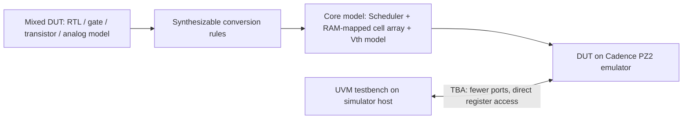

<!-- generated by yt-paper; edits will be overwritten -->
[DVCon](../dvcon/index.md) › [US](../dvcon/us.md) › [2023](../dvcon/by-year.md#2023) › [Emulation](../dvcon/by-topic.md#emulation)

# Accelerated Verification of NAND Flash Memory using HW Emulator

<figure class="rep-fig" markdown>
{ loading=lazy }
<figcaption>Figure 8. Emulator Test Environment — from the original paper (Seyeol Yang et al.)</figcaption>
</figure>

[:material-open-in-new: Original paper](https://dvcon-proceedings.org/wp-content/uploads/1090-Accelerated-Verification-of-NAND-Flash-Memory-using-HW-Emulator.pdf){ .md-button .md-button--primary target=_blank }

| | |
|---|---|
| Authors | Seyeol Yang (Samsung Electronics), Byungwoo Kang (Samsung Electronics), Seoyeon Bae (Samsung Electronics), Choi Jaehyeon (Samsung Electronics), Jintae Kim (Samsung Electronics), Dongeun Lee (Samsung Electronics), Junho Ahn (Samsung Electronics) |
| Venue | DVCon US 2023 |
| Topic | Emulation |
| Type | PAPER |
| ID | `ref-20261018-cf3b` |

## Summary

**Samsung ports a mixed RTL/transistor/analog NAND Flash model to the Cadence PZ2 emulator via synthesizable rewrites, RAM-mapped cell arrays, port reduction, and direct register access, reporting a 101.4X runtime speedup over Verilog simulation on 5,000 test cases.**

**삼성전자는 RTL, 트랜지스터, 아날로그 모델이 혼합된 NAND Flash DUT를 합성 가능한 형태로 재작성하고, 메모리 셀 배열을 에뮬레이터 RAM에 매핑하며, 포트 축소와 direct register access를 적용해 Cadence PZ2 에뮬레이터에 이식했고, 5,000개 테스트 케이스 기준 Verilog 시뮬레이션 대비 101.4X 런타임 가속을 보고했다.**

## Key Insights

- Emulator-compatibility rewrites are mechanical but mandatory: tranif0/tranif1 must become unidirectional nmos/pmos, #delay-controlled inout ports must be split (e.g., with a D-FF), #delay analog units (delay 10ns) are replaced by counter-based logic, and multi-driven nets must be reduced to a single driver or an OR gate.

- 에뮬레이터 호환을 위한 재작성은 기계적이지만 필수적이다. tranif0/tranif1은 단방향 nmos/pmos로 바꿔야 하고, #delay로 제어되는 inout 포트는 분리해야 하며(예: D-FF 사용), #delay 아날로그 유닛(delay 10ns)은 카운터 기반 로직으로 대체하고, 다중 구동 신호는 단일 드라이버 또는 OR 게이트로 줄여야 한다.

- Memory cell arrays (Blocks x Word line x String x Bit line bits, which would exceed 100 GB of registers) are mapped onto emulator RAM rather than synthesized into gates and flip-flops; Vth is modeled as an extra 16-bit dimension with a HW/SW split, where the SW side (Erase/Program/Read processor) computes Vth values and reads/writes the indexed Vth cell model.

- 메모리 셀 배열(Blocks x Word line x String x Bit line 비트 수, 100GB 이상의 레지스터에 해당)은 게이트와 플립플롭으로 합성하지 않고 에뮬레이터 RAM에 매핑한다. Vth는 셀 모델에 16비트 차원을 추가해 모델링하며, HW/SW로 분할한다. SW 측 Erase/Program/Read processor가 Vth 값을 계산하고 하드웨어의 인덱스 [N] Vth 셀 모델에 읽기/쓰기를 수행한다.

- Port reduction (signals forced into DUT nodes, assertions moved inside the DUT) gave more than 5X runtime improvement, and cell presets for redundant verification gave more than 4X, per the paper's section II figures.

- 포트 축소(동작 옵션 신호를 DUT 노드에 강제 적용, assertion을 DUT 내부로 이동)로 5X 이상의 런타임 개선을 얻었고, 중복 검증 제거를 위한 cell preset으로 4X 이상의 개선을 얻었다고 논문 2장에서 보고한다.

- On 5,000 test cases, Verilog simulation took 3751h; emulation with direct memory access took 186h (X20.2), adding interface optimization 42h (X89.3), and adding assertion-checker move 37h (X101.4). Dump time fell from 5179h to 283h (about 18X).

- 5,000개 테스트 케이스 기준 Verilog 시뮬레이션은 3751h, direct memory access 적용 에뮬레이션은 186h(X20.2), 인터페이스 최적화 추가 시 42h(X89.3), assertion checker 이동 추가 시 37h(X101.4)였다. Dump 시간은 5179h에서 283h로(약 18X) 줄었다.

- The trade-off is compile time: emulation compile was 2.5h vs 0.3h for simulation (about 8X slower). The authors judge this acceptable because frequent design changes and large regression volume dominate the total cost, though the I/O datapath timing is still better checked in timing-accurate simulation.

- 트레이드오프는 컴파일 시간이다. 에뮬레이션 컴파일은 2.5h로 시뮬레이션 0.3h 대비 약 8X 느리다. 저자들은 빈번한 설계 변경과 대량의 회귀 테스트가 전체 비용을 지배하므로 이를 수용 가능하다고 판단했지만, I/O 데이터패스의 타이밍은 여전히 타이밍 정확 시뮬레이션에서 검증하는 것이 낫다고 밝힌다.

## Detailed Summary

### Background and Problem

- NAND Flash feature sets grow with each generation while the development and verification schedule stays roughly fixed. Each new algorithm multiplies the number of test cases, and a few very long simulations consume the limited simulation resources.

- NAND Flash는 세대가 바뀔 때마다 기능이 늘어나지만 개발 및 검증 일정은 거의 그대로이다. 새 알고리즘마다 테스트 케이스 수가 크게 늘고, 소수의 매우 긴 시뮬레이션이 제한된 시뮬레이션 자원을 소모한다.

- The DUT mixes design styles that are not directly emulatable: RTL, gate-level, transistor-level netlists (bidirectional `tranif0`/`tranif1`), and analog behavioral models (delay units, pumps, voltage generators) that are non-synthesizable.

- DUT는 에뮬레이션에 바로 올릴 수 없는 여러 설계 방식이 섞여 있다. RTL, 게이트 수준, 트랜지스터 수준 넷리스트(양방향 `tranif0`/`tranif1`), 그리고 합성 불가능한 아날로그 행동 모델(지연 유닛, 펌프, 전압 발생기)이 포함된다.

- The core cell model is non-trivial to map. Naively synthesizing all word lines and bit lines would need more than 100 GB of registers, and per-cell Vth modeling adds further size.

- 코어 셀 모델의 매핑도 단순하지 않다. 모든 워드라인과 비트라인을 그대로 합성하려면 100GB 이상의 레지스터가 필요하며, 셀별 Vth 모델링은 크기를 더 키운다.

- Goal: run regression on the Cadence PZ2 emulator with transaction-based acceleration (TBA) while keeping the existing UVM-based simulation testbench.

- 목표: 기존 UVM 기반 시뮬레이션 테스트벤치를 유지하면서 transaction-based acceleration(TBA)을 적용해 Cadence PZ2 에뮬레이터에서 회귀 테스트를 수행하는 것이다.

### Architecture and Methodology

Flow of the work (diagram summarizes the structure described in the paper):

작업 흐름은 다음과 같다(다이어그램은 논문에서 설명한 구조를 요약한 것이다).

1. **Synthesizable conversion of design styles**
   - Bidirectional transistors (`tranif0`/`tranif1`) are rewritten as unidirectional `nmos`/`pmos` with correct source/drain direction.
   - Bidirectional ports controlled by `#delay` (feedback through inout in analog units) are split into separate ports; the precedence that `#delay` enforced in simulation is restored with a D-FF.
   - Delay-unit models are replaced by counter-driven logic (the paper's DELAY_MODEL uses a CLK10-driven counter with a parameter selecting 10 or 20 cycles).
   - Multi-driven signals are removed by keeping one driver or ORing the outputs at the higher level.

1. **설계 방식별 합성 가능 변환**
   - 양방향 트랜지스터(`tranif0`/`tranif1`)는 소스/드레인 방향을 올바르게 맞춘 단방향 `nmos`/`pmos`로 다시 작성한다.
   - `#delay`로 제어되는 양방향 포트(아날로그 유닛에서 inout을 통한 피드백)는 별도 포트로 분리하고, 시뮬레이션에서 `#delay`가 보장하던 선후 관계는 D-FF로 복원한다.
   - 지연 유닛 모델은 카운터 기반 로직으로 대체한다(논문의 DELAY_MODEL은 CLK10으로 구동되는 카운터를 사용하며, 파라미터로 10 또는 20 사이클을 선택한다).
   - 다중 구동 신호는 단일 드라이버를 유지하거나 상위 계층에서 출력을 OR로 묶어 제거한다.

2. **Core behavior model**
   - Data latch: the page buffer's set/reset/read logic, originally written with always-blocks that are non-synthesizable, is replaced by a new Scheduler Module. Its Synchronizer aligns asynchronous controls (SO_PRECHARGE, MON_S, SET_S, RESET_S) to Clock/Reset, and a Re-timer makes the synchronizer outputs mutually exclusive.
   - Memory cell: the array is stored in emulator RAM rather than gates/flip-flops. Programmed cells are 0 and erased cells are 1. Program/read transfer data between the page buffer and the array.
   - Vth: one 16-bit dimension is added to the cell model so that each cell's Vth can be tracked. Because the full model is too large to synthesize, the Erase/Program/Read processor runs in software, computes Vth, and reads/writes the Vth cell model at index [N] in hardware.

2. **코어 동작 모델**
   - 데이터 래치: 페이지 버퍼의 set/reset/read 로직은 원래 합성 불가능한 always 블록으로 작성되어 있었으며, 이를 새로운 Scheduler 모듈로 대체한다. Scheduler의 Synchronizer는 비동기 제어 신호(SO_PRECHARGE, MON_S, SET_S, RESET_S)를 Clock/Reset에 맞추고, Re-timer는 Synchronizer 출력이 상호 배타적이 되도록 한다.
   - 메모리 셀: 셀 배열은 게이트와 플립플롭 대신 에뮬레이터 RAM에 저장한다. 프로그램된 셀은 0, 소거된 셀은 1로 표현한다. 프로그램과 읽기 과정에서 데이터는 페이지 버퍼와 셀 배열 사이를 이동한다.
   - Vth: 셀 모델에 16비트 차원을 추가해 각 셀의 Vth를 추적한다. 전체 모델은 합성하기에 너무 크므로, Erase/Program/Read processor를 SW에서 실행해 Vth를 계산하고, 하드웨어의 인덱스 [N] Vth 셀 모델에 읽기/쓰기를 수행한다.

3. **Emulation performance improvements**
   - Port reduction: the simulator-to-emulator interface carried every IO/ALE/CLE-related port, and the transfer of all port states on each change was costly. Operation-option signals are instead forced at the corresponding nodes, and assertions are moved inside the emulated DUT, with the necessary signals made synthesizable at the top module.
   - Direct register (memory) access: WRITE/READ data bypasses the I/O port behavior and goes directly to the register/memory. The I/O datapath's timing-dependent behavior is still left to timing-accurate simulation.
   - Cell presets remove unnecessary duplicate verification.

3. **에뮬레이션 성능 개선 기법**
   - 포트 축소: 시뮬레이터와 에뮬레이터 사이 인터페이스가 IO/ALE/CLE 관련 포트를 모두 전달했고, 변화가 생길 때마다 모든 포트 상태를 전송하는 것이 비용이 컸다. 동작 옵션 신호는 해당 노드에 강제 적용하고, assertion은 에뮬레이트되는 DUT 내부로 옮기며, 필요한 신호는 최상위 모듈에서 합성 가능하도록 변경했다.
   - Direct register(memory) access: WRITE/READ 데이터를 I/O 포트 동작 대신 레지스터/메모리로 직접 전달한다. 타이밍에 의존하는 I/O 데이터패스 동작은 여전히 타이밍 정확 시뮬레이션에서 검증한다.
   - Cell preset: 불필요한 중복 검증을 제거한다.

### Results and Conclusions

- Table 1 (5,000 test cases, 18 KB data size with I/O interface, runtime in hours):
  - Verilog simulation: 3751h
  - Emulation with I/O interface: 749h (X5)
  - + Memory direct access: 186h (X20.2)
  - + Interface optimization: 42h (X89.3)
  - + Assertion checker move: 37h (X101.4)

- 표 1(테스트 케이스 5,000개, I/O 인터페이스 사용 시 데이터 크기 18KB, 런타임 단위 시간):
  - Verilog 시뮬레이션: 3751h
  - I/O 인터페이스 사용 에뮬레이션: 749h (X5)
  - + Memory direct access: 186h (X20.2)
  - + 인터페이스 최적화: 42h (X89.3)
  - + Assertion checker 이동: 37h (X101.4)

- Table 2: compile time 0.3h (simulation) vs 2.5h (emulation), about 8X slower. Run time 3751h vs 37h (101X). Dump time 5179h vs 283h (18X).

- 표 2: 컴파일 시간은 시뮬레이션 0.3h, 에뮬레이션 2.5h로 약 8X 느리다. 런타임은 3751h 대 37h(101X). Dump 시간은 5179h 대 283h(18X).

- The abstract claims more than 100X over the Verilog simulator. Section II states "more than five times" for the synthesizable model and port reduction, and "more than four times" for cell presets. These are reported as separate contributions in the paper, not a single consolidated breakdown.

- 초록은 Verilog 시뮬레이터 대비 100X 이상을 주장한다. 2장에서는 합성 가능 모델과 포트 축소에 대해 "5배 이상", cell preset에 대해 "4배 이상"이라고 보고한다. 논문은 이를 하나로 통합한 분해 결과가 아니라 별도 기여로 제시한다.

- Conclusions: the emulator environment lets the team verify more complex Flash behaviors within the same schedule and can serve as a replacement for functional verification and long-running simulation. System-level NAND operation is expected to be verifiable early. The paper gives no coverage metrics, no discussion of debug experience, and no details on the Vth processor interface beyond the high-level description.

- 결론: 에뮬레이터 환경으로 같은 일정 안에서 더 복잡한 Flash 동작을 검증할 수 있으며, 기능 검증과 장시간 시뮬레이션을 대체하는 수단으로 유용하다고 본다. 시스템 수준 NAND 동작도 조기에 검증할 수 있을 것으로 기대한다. 다만 커버리지 지표, 디버그 경험에 대한 논의, Vth processor 인터페이스의 상세 내용은 고수준 설명 이상으로 제시되지 않는다.

## Videos

<iframe src="https://www.youtube-nocookie.com/embed/vumYRdATl74" title="[DVCON2023]Accelerated Verification of NAND Flash Memory using HW Emulator" loading="lazy" allow="accelerometer; clipboard-write; encrypted-media; gyroscope; picture-in-picture; web-share" referrerpolicy="strict-origin-when-cross-origin" allowfullscreen></iframe>

**[DVCON2023]Accelerated Verification of NAND Flash Memory using HW Emulator** — [Watch on YouTube](https://www.youtube.com/watch?v=vumYRdATl74) · [Video page](../videos/vumYRdATl74.md)
