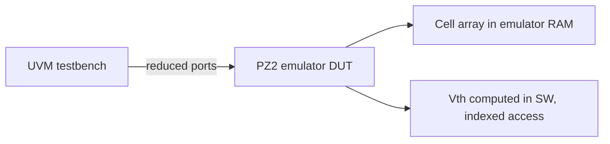

<!-- generated by yt-paper; edits will be overwritten -->
[DVCon](../dvcon/index.md) › [US](../dvcon/us.md) › [2023](../dvcon/by-year.md#2023) › [Emulation](../dvcon/by-topic.md#emulation)

# Accelerated Verification of NAND Flash Memory using HW Emulator

<figure class="rep-fig" markdown>
{ loading=lazy }
<figcaption>Figure 8. Emulator Test Environment — from the original paper (Seyeol Yang et al.)</figcaption>
</figure>

[:material-open-in-new: Original paper](https://dvcon-proceedings.org/wp-content/uploads/1090-Accelerated-Verification-of-NAND-Flash-Memory-using-HW-Emulator.pdf){ .md-button .md-button--primary target=_blank }

| | |
|---|---|
| Authors | Seyeol Yang, Byungwoo Kang, Seoyeon Bae, Choi Jaehyeon, Jintae Kim, Dongeun Lee, Junho Ahn (Samsung Electronics, Hwaseong-si, Gyeonggi-do, Korea) |
| Venue | DVCon US 2023 |
| Topic | Emulation |
| Type | PAPER |
| ID | `ref-20261018-cf3b` |

## Summary

**A Samsung paper describing how to port a NAND Flash DUT that mixes RTL, gates, transistors, and analog behavioral models onto a Cadence PZ2 emulator, using transaction-based acceleration and interface/memory-access optimizations to reach a 101.4x runtime speedup over Verilog simulation on 5,000 test cases.**

**삼성전자 논문으로, RTL, 게이트, 트랜지스터, 아날로그 behavioral model이 혼합된 NAND Flash DUT를 Cadence PZ2 emulator에 이식하는 방법을 설명하며, TBA와 인터페이스/메모리 접근 최적화를 적용해 5,000개 테스트 케이스 기준 Verilog simulation 대비 101.4배의 runtime 가속을 달성했다고 보고한다.**

## Key Insights

- Emulation requires rewriting non-synthesizable constructs first: tranif0/tranif1 transistors become directional nmos/pmos, #delay-controlled inout feedback is split with D-FFs, delay units become counter-based models, and multi-driven nets are merged with OR gates.

- Emulation을 위해서는 먼저 비합성 구문을 재작성해야 합니다. tranif0/tranif1 트랜지스터는 방향이 있는 nmos/pmos로 바꾸고, #delay로 제어되는 inout 피드백은 D-FF로 분리하며, delay unit은 counter 기반 모델로 대체하고, multi-driven net은 OR 게이트로 합칩니다.

- The memory cell array is mapped to emulator RAM instead of flops, and the 16-bit Vth dimension is kept in software and accessed by index so the hardware remains synthesizable.

- 메모리 셀 어레이는 flop 대신 emulator RAM에 매핑하고, 16비트 Vth 차원은 소프트웨어에서 유지하면서 인덱스로 접근하여 하드웨어가 합성 가능한 상태를 유지합니다.

- Interface port count between the UVM testbench and the emulator is a major runtime bottleneck; moving assertion checkers into the DUT and reducing ports raised speedup from 20.2x to 101.4x in the paper's cumulative table.

- UVM testbench와 emulator 사이의 인터페이스 포트 수는 주요 runtime 병목입니다. Assertion checker를 DUT 내부로 옮기고 포트를 줄인 결과, 논문의 누적 표에서 가속비가 20.2배에서 101.4배로 향상되었습니다.

- Direct register/memory access for WRITE/READ, bypassing I/O port data transfer, was the single largest step at 20.2x (186h vs 3751h on 5,000 cases).

- I/O 포트를 통한 데이터 전송을 우회하고 WRITE/READ에 direct register/memory access를 사용한 것이 단일 항목 중 가장 큰 효과로, 20.2배(5,000개 케이스 기준 3751h 대비 186h)를 기록했습니다.

- Trade-off: emulator compile time is about 8x longer (2.5h vs 0.3h) but dump time is 18x faster (283h vs 5179h) and run time is about 101x faster, which matters for frequent design changes and long regressions.

- Trade-off가 존재합니다. Emulator의 compile time은 약 8배 길지만(0.3h 대비 2.5h), dump time은 18배 빠르고(5179h 대비 283h), run time은 약 101배 빠릅니다. 이는 설계 변경이 잦거나 장시간 regression이 필요한 경우에 중요합니다.

## Detailed Summary

### Background and Problem

- NAND Flash feature count and test cases grow each generation while development and verification schedules stay fixed, so simulation runtime limits coverage.

- NAND Flash는 세대가 바뀔 때마다 기능과 테스트 케이스가 늘지만 개발 및 검증 일정은 고정되어 있어, simulation runtime이 커버리지를 제한합니다.

- The DUT mixes RTL, gate-level, transistor-level (tranif0/tranif1, bidirectional), and analog behavioral models (delay, pump, voltage generator), none of which map directly to an emulator.

- DUT는 RTL, 게이트 수준, 트랜지스터 수준(tranif0/tranif1 양방향), 아날로그 behavioral model(delay, pump, voltage generator)이 혼합되어 있어 emulator에 직접 매핑할 수 없습니다.

- Goal: move regression to Cadence PZ2 with transaction-based acceleration (TBA) and cover system-level NAND operation.

- 목표는 regression을 Cadence PZ2로 옮기고 TBA(transaction-based acceleration)를 적용하며, 시스템 수준의 NAND 동작까지 검증하는 것입니다.

### Architecture and Methodology

- Synthesizability fixes: convert bidirectional transistors to directional nmos/pmos, split #delay-controlled inout ports with D-FFs, replace delay units with counter-based logic, and merge multi-driven nets with OR gates.

- 합성 가능성 확보: 양방향 트랜지스터를 방향이 있는 nmos/pmos로 바꾸고, #delay로 제어되는 inout 포트는 D-FF로 분리하며, delay unit은 counter 기반 로직으로 대체하고, multi-driven net은 OR 게이트로 합칩니다.

- Core model: the cell array (Blocks x WL x String x BL bits) is mapped to emulator RAM. Page-buffer asynchronous latches are replaced by a new Scheduler (synchronizer plus re-timer). Vth is an extra 16-bit dimension computed in software and accessed by index.

- 코어 모델: 셀 어레이(Blocks x WL x String x BL 비트)는 emulator RAM에 매핑합니다. Page buffer의 비동기 latch는 새로운 Scheduler(synchronizer와 re-timer)로 대체합니다. Vth는 소프트웨어에서 계산하는 16비트 추가 차원이며 인덱스로 접근합니다.

- Performance: fewer SW-HW ports, assertion checkers moved into the DUT, direct register/memory access for WRITE/READ, and cell presets to remove redundant checks.

- 성능 최적화: SW-HW 간 포트 축소, assertion checker의 DUT 내부 이동, WRITE/READ에 대한 direct register/memory access, 중복 검증 제거를 위한 cell preset을 적용합니다.

### Results and Conclusions

- 5,000 test cases: Verilog simulation 3751h; emulator 749h (5x); +direct memory access 186h (20.2x); +interface optimization 42h (89.3x); +assertion move 37h (101.4x).

- 5,000개 테스트 케이스 기준: Verilog simulation 3751h, emulator 749h(5배), +direct memory access 186h(20.2배), +인터페이스 최적화 42h(89.3배), +assertion 이동 37h(101.4배).

- Compile time is 0.3h (simulation) vs 2.5h (emulation), but dump time drops from 5179h to 283h (18x).

- Compile time은 simulation 0.3h, emulation 2.5h이지만, dump time은 5179h에서 283h로 줄어듭니다(18배).

- The authors conclude the flow enables more coverage and earlier system-level verification. Evidence is a single 5,000-case workload with limited detail on the test mix and the Vth offload cost.

- 저자들은 이 흐름이 더 넓은 커버리지와 조기 시스템 수준 검증을 가능하게 한다고 결론짓습니다. 근거는 단일 5,000개 케이스 워크로드이며, 테스트 구성과 Vth 오프로드 비용에 대한 설명은 제한적입니다.

## Videos

<iframe src="https://www.youtube-nocookie.com/embed/vumYRdATl74" title="[DVCON2023]Accelerated Verification of NAND Flash Memory using HW Emulator" loading="lazy" allow="accelerometer; clipboard-write; encrypted-media; gyroscope; picture-in-picture; web-share" referrerpolicy="strict-origin-when-cross-origin" allowfullscreen></iframe>

**[DVCON2023]Accelerated Verification of NAND Flash Memory using HW Emulator** — [Watch on YouTube](https://www.youtube.com/watch?v=vumYRdATl74) · [Video page](../videos/vumYRdATl74.md)
