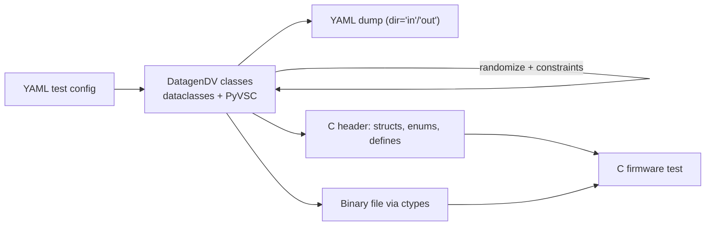

<!-- generated by yt-paper; edits will be overwritten -->
[DVCon](../dvcon/index.md) › [US](../dvcon/us.md) › [2023](../dvcon/by-year.md#2023) › [Verification](../dvcon/by-topic.md#verification)

# DatagenDV: Python Constrained Random Test Stimulus Framework

<figure class="rep-fig" markdown>
{ loading=lazy }
<figcaption>Fig. 1. DatagenDV data flow. — from the original paper (Jonathan George et al.)</figcaption>
</figure>

[:material-open-in-new: Original paper](https://dvcon-proceedings.org/wp-content/uploads/1044-Datagen-Python-Constrained-Random-Test-Stimulus-Framework.pdf){ .md-button .md-button--primary target=_blank }

| | |
|---|---|
| Authors | Jonathan George (Microsoft Corporation), James Mackenzie (Microsoft Corporation) |
| Venue | DVCon US 2023 |
| Topic | Verification |
| Type | PAPER |
| ID | `ref-20261018-d08e` |

## Summary

**DatagenDV is an open-source Python pre-processing framework that combines dataclasses, ruamel.yaml, PyVSC constraint randomization, and ctypes to generate YAML, C headers, and binary stimulus for C firmware tests, letting SystemVerilog block-level constraints be reused at chip level.**

**DatagenDV는 dataclasses, ruamel.yaml, PyVSC 제약 랜덤화, ctypes를 결합해 C 펌웨어 테스트용 YAML, C 헤더, 바이너리 stimulus를 생성하는 오픈소스 Python 전처리 프레임워크로, SystemVerilog 블록 레벨 제약을 칩 레벨에서 재사용할 수 있게 한다.**

## Key Insights

- Moving stimulus generation from C firmware (or from DUT-driven generation in simulation) into a Python pre-processing step avoids DUT-dependent data validity ambiguity and extra simulator cycles; one project reported selecting among 10 enum values about 6 orders of magnitude faster in Python than in C on a simulated processor.

- 랜덤 stimulus 생성을 임베디드 C 펌웨어(또는 DUT 기반 시뮬레이션 내 생성)에서 Python 전처리 단계로 옮기면 DUT 의존적인 데이터 유효성 문제와 추가 시뮬레이터 사이클을 피할 수 있다. 한 프로젝트에서는 10개 enum 값 선택이 시뮬레이션된 프로세서의 C 대비 약 6 orders of magnitude 빠른 것으로 보고되었다.

- SystemVerilog-style constraints port quickly to PyVSC: a 60-field instruction with 300 lines of SystemVerilog block constraints was rewritten in about a day, and a 40-field command structure was randomized within a few days.

- SystemVerilog 스타일 제약은 PyVSC로 빠르게 옮길 수 있다. 60개 필드, SystemVerilog 제약 300줄로 된 명령어를 하루 만에 재작성했고, 40개 필드 명령 구조는 며칠 안에 랜덤화했다.

- Typed dataclasses plus field metadata (dir='in'/'out'/'in_out') and ruamel.yaml give a documented, typo-checked YAML schema; @rand_dataclass mirrors rand_ fields and turns non-None plain fields into override constraints so one script serves many tests.

- 타입이 지정된 dataclasses와 필드 메타데이터(dir='in'/'out'/'in_out'), ruamel.yaml을 사용하면 문서화되고 오타를 검사하는 YAML 스키마를 얻을 수 있다. @rand_dataclass는 rand_ 필드를 일반 필드와 연결하고, None이 아닌 일반 필드를 오버라이드 제약으로 바꿔 하나의 스크립트로 여러 테스트를 지원한다.

- A single class definition drives YAML load/dump, C struct/enum header generation, and binary output via ctypes; binary packing must match the compiler's defaults, and the paper notes binary generation is currently limited to flat structures and cannot handle non-byte-aligned packing.

- 하나의 클래스 정의로 YAML 로드/덤프, C 구조체/enum 헤더 생성, ctypes 기반 바이너리 출력을 모두 처리한다. 바이너리 패킹은 컴파일러 기본값과 맞아야 하며, 논문은 현재 바이너리 생성이 flat 구조체로 제한되고 non-byte-aligned 패킹을 지원하지 않는다고 밝혔다.

- PyVSC is not as fast or evenly distributed as commercial simulator randomizers: 10,000 randomizations of one object took roughly 5 minutes, and the authors recommend vetting it against each project's scale before adoption.

- PyVSC는 상용 시뮬레이터 랜덤화기보다 느리고 분포도 완벽하지 않다. 객체 하나를 10,000회 랜덤화하는 데 약 5분이 걸렸으며, 저자들은 도입 전 프로젝트 규모에 맞춰 검증할 것을 권고한다.

## Detailed Summary

### Background and Problem

- C firmware tests used for simulation/emulation and post-silicon validation need constrained-random parameters, but C random constraint specification is much weaker than SystemVerilog.

- 시뮬레이션/에뮬레이션 및 post-silicon 검증에 쓰이는 C 펌웨어 테스트는 제약 기반 랜덤 파라미터가 필요하지만, C의 랜덤 제약 명세 기능은 SystemVerilog보다 훨씬 제한적이다.

- Generating data on the DUT itself makes data validity ambiguous and hard to check; in pre-silicon flows, generating stimulus inside the simulator also costs extra cycles.

- DUT 자체로 데이터를 생성하면 데이터 유효성이 모호해지고 검증하기 어렵다. Pre-silicon 흐름에서는 시뮬레이터 내부에서 stimulus를 생성하는 것도 추가 사이클을 소모한다.

- Existing Python verification work (cocotb, pyuvm, and DVCon papers using DPI-C) either replaces SystemVerilog or ties Python into SystemVerilog testbenches. The alternative, dumping SystemVerilog randomization results and post-processing them with scripts, was judged more complex than keeping the whole pre-processing flow in Python.

- 기존 Python 검증 연구(cocotb, pyuvm, DPI-C로 Python을 SystemVerilog 테스트벤치에 연결한 DVCon 논문 등)는 SystemVerilog를 대체하거나 SystemVerilog 테스트벤치에 Python을 연결하는 방식이다. SystemVerilog 랜덤화 결과를 덤프한 뒤 스크립트로 후처리하는 대안도 있으나, 저자들은 전체 전처리 흐름을 Python에 유지하는 편이 더 단순하다고 판단했다.

- Goal: bring object-oriented, constrained-random stimulus to the embedded C environment, and reuse SystemVerilog block-level constraints at chip level.

- 목표: 객체지향 제약 랜덤 stimulus를 임베디드 C 환경으로 가져오고, SystemVerilog 블록 레벨 제약을 칩 레벨에서 재사용하는 것이다.

### Architecture and Methodology

DatagenDV is a pre-processing step that reads YAML test configuration and produces C-consumable data. Test writers subclass `YAMLParamsBase` and declare typed fields and constraints.

DatagenDV는 YAML 테스트 구성을 읽어 C가 소비할 수 있는 데이터를 만드는 전처리 단계다. 테스트 작성자는 `YAMLParamsBase`를 상속해 타입이 지정된 필드와 제약을 선언한다.

Library roles:

라이브러리별 역할:

- **dataclasses**: SystemVerilog-style class declaration with type hints; auto-generates `__init__`, comparison, and printing. `YAMLParamsBase` checks loaded data against type hints in `__post_init__()`. `dg.field()` wraps `field()` to add YAML direction metadata and avoid mutable defaults.

- **dataclasses**: 타입 힌트를 가진 SystemVerilog 스타일 클래스 선언. `__init__`, 비교, 출력 함수를 자동 생성한다. `YAMLParamsBase`는 `__post_init__()`에서 로드된 데이터를 타입 힌트와 대조한다. `dg.field()`는 `field()`를 감싸 YAML 방향 메타데이터를 추가하고 mutable 기본값을 피하게 한다.

- **ruamel.yaml**: chosen over PyYAML for comment and format preservation (useful for diffs). A `!ClassName` tag plus class registration ensures constructors and `__post_init__()` run on load.

- **ruamel.yaml**: 주석과 형식 보존(diff 활용) 때문에 PyYAML 대신 선택했다. `!ClassName` 태그와 클래스 등록을 통해 로드 시 생성자와 `__post_init__()`이 실행되도록 한다.

- **PyVSC**: SystemVerilog-like `rand` types and constraints, solved with the Boolector SMT solver. `dg.rand_field()` declares PyVSC fields; `@rand_dataclass` (which also applies `@dataclass` and `@randobj`) mirrors each `rand_X` field into a plain field `X` in `post_randomize()`.

- **PyVSC**: SystemVerilog 유사 `rand` 타입과 제약을 제공하며 Boolector SMT solver로 해결한다. `dg.rand_field()`로 PyVSC 필드를 선언하고, `@rand_dataclass`(`@dataclass`와 `@randobj`도 함께 적용)는 `post_randomize()`에서 각 `rand_X` 필드를 일반 필드 `X`로 복사한다.

- **ctypes**: C-compatible types, generation of C struct and enum header files (`write_ctype_structs`, `write_enum_type_defs`), and packed binary output (`write_ctype_obj_binary`). The C side reads the binary with `fopen`/`fread` using the generated header.

- **ctypes**: C 호환 타입, C 구조체 및 enum 헤더 파일 생성(`write_ctype_structs`, `write_enum_type_defs`), 패킹된 바이너리 출력(`write_ctype_obj_binary`)을 담당한다. C 측은 생성된 헤더를 이용해 `fopen`/`fread`로 바이너리를 읽는다.

Fixed-value override: if a plain field is not `None` when `randomize()` is called, `@rand_dataclass` adds an equality constraint. This lets one stimulus script serve many tests by changing only YAML. In the paper's `FrameParams` example (Listing 3 constraints: `FRAME_SIZE == FRAME_WIDTH * FRAME_HEIGHT`, with widths and heights in [4, 256] and size in [16, 65536]), `FRAME_SIZE=2048` yields WIDTH=16, HEIGHT=128, and `FRAME_WIDTH=128` yields SIZE=7936, HEIGHT=62.

고정값 오버라이드: `randomize()` 호출 시 일반 필드가 `None`이 아니면 `@rand_dataclass`가 동등 제약을 추가한다. 이를 통해 하나의 stimulus 스크립트를 YAML 변경만으로 여러 테스트에 재사용할 수 있다. 논문의 `FrameParams` 예제(제약: `FRAME_SIZE == FRAME_WIDTH * FRAME_HEIGHT`, 너비와 높이는 [4, 256], 크기는 [16, 65536])에서 `FRAME_SIZE=2048`이면 WIDTH=16, HEIGHT=128이 되고, `FRAME_WIDTH=128`이면 SIZE=7936, HEIGHT=62가 된다.

Distribution analysis: `vars()` exposes the random fields of any PyVSC class, and matplotlib histograms (Listing 5) show the distribution.

분포 분석: `vars()`로 PyVSC 클래스의 랜덤 필드에 접근하고, matplotlib 히스토그램(Listing 5)으로 분포를 확인한다.

Bidirectional constraints (Fig. 3) allow partially specified instructions, such as those from software or architecture models, to be completed by the solver.

양방향 제약(Fig. 3)을 이용하면 소프트웨어나 아키텍처 모델에서 온 부분 명시 명령어를 solver로 채울 수 있다.

### Results and Conclusions

- Multiple Microsoft testbenches adopted DatagenDV for complex C test stimulus, with short ramp-up reported by test writers.

- 여러 Microsoft 테스트벤치가 복잡한 C 테스트 stimulus 생성에 DatagenDV를 도입했으며, 테스트 작성자들은 짧은 ramp-up 기간을 보고했다.

- Early project: a C struct with interdependent fields was randomized in Python and written as binary. Enum selection among 10 values was about 6 orders of magnitude faster than C randomized on a simulated processor. Complex interdependent constraints were hard to maintain with Python's `random` module, taking weeks of tuning.

- 초기 프로젝트: 상호 의존 필드를 가진 C 구조체를 Python에서 랜덤화해 바이너리로 기록했다. 10개 값 중 enum을 고르는 작업은 시뮬레이션된 프로세서에서 C로 랜덤화하는 것보다 약 6 orders of magnitude 빨랐다. 복잡한 상호 의존 제약은 Python `random` 모듈로 구현·튜닝하는 데 수 주가 걸렸다.

- Chip-level project: instructions have 50+ interconnected fields and can be co-dependent through shared memory addresses. A 60-field instruction with 300 lines of SystemVerilog block constraints was ported to PyVSC in a day, with chip-level constraints layered on top. The authors state that this reuse would otherwise require significant ramp-up.

- 칩 레벨 프로젝트: 명령어는 50개 이상의 상호 연결된 필드를 가지며, 공유 메모리 주소를 통해 상호 의존할 수 있다. 60개 필드와 SystemVerilog 블록 제약 300줄로 된 명령어를 PyVSC로 하루 만에 옮겼고, 칩 레벨 제약을 그 위에 추가했다. 저자들은 블록 제약 재사용이 없었다면 상당한 ramp-up이 필요했을 것이라고 밝혔다.

- Performance caveats: PyVSC's randomization speed and distribution are weaker than SystemVerilog simulators. The histogram showed no neglected values but imperfect evenness. Randomizing one object 10,000 times took roughly 5 minutes, which is slower than simulator randomization but faster than equivalent randomization in embedded C. The paper does not provide a deep performance study.

- 성능 주의점: PyVSC의 랜덤화 속도와 분포는 SystemVerilog 시뮬레이터보다 약하다. 히스토그램에서 누락된 값은 없었지만 균등성은 완벽하지 않았다. 객체 하나를 10,000회 랜덤화하는 데 약 5분이 걸렸는데, 이는 시뮬레이터 랜덤화보다 느리지만 임베디드 C에서 동등한 랜덤화보다는 빠르다. 논문은 깊이 있는 성능 분석은 제공하지 않는다.

- Usability: engineers familiar with SystemVerilog became productive quickly. The team separated Python stimulus work from C firmware work.

- 사용성: SystemVerilog에 익숙한 엔지니어도 빠르게 생산성을 얻었으며, 팀은 Python stimulus 작업과 C 펌웨어 작업을 분리해 담당시켰다.

- Conclusion: the authors claim DatagenDV saved hundreds of hours across several projects.

- 결론: 저자들은 여러 프로젝트에서 DatagenDV가 수백 시간을 절감했다고 주장한다.

- Limitations and future work: binary output is mostly limited to flat structures with basic types, and ctypes lacks non-byte-aligned packing. Planned work includes nested-structure support, XML/JSON configuration, parsing C structs into ctypes classes, direct SystemVerilog-to-PyVSC constraint translation, and testing across OS and compilers.

- 한계 및 향후 과제: 바이너리 출력은 기본 타입의 flat 구조체에 주로 제한되며, ctypes는 non-byte-aligned 패킹을 지원하지 않는다. 계획된 작업으로는 중첩 구조체 지원, XML/JSON 설정 언어 지원, C 구조체를 ctypes 클래스로 파싱, SystemVerilog 제약의 PyVSC 직접 변환, 다양한 OS 및 컴파일러 테스트가 있다.

## Videos

<iframe src="https://www.youtube-nocookie.com/embed/7g-3vBeMZLo" title="[DVCON2023]DatagenDV: Python Constrained Random Test Stimulus Framework" loading="lazy" allow="accelerometer; clipboard-write; encrypted-media; gyroscope; picture-in-picture; web-share" referrerpolicy="strict-origin-when-cross-origin" allowfullscreen></iframe>

**[DVCON2023]DatagenDV: Python Constrained Random Test Stimulus Framework** — [Watch on YouTube](https://www.youtube.com/watch?v=7g-3vBeMZLo) · [Video page](../videos/7g-3vBeMZLo.md)
