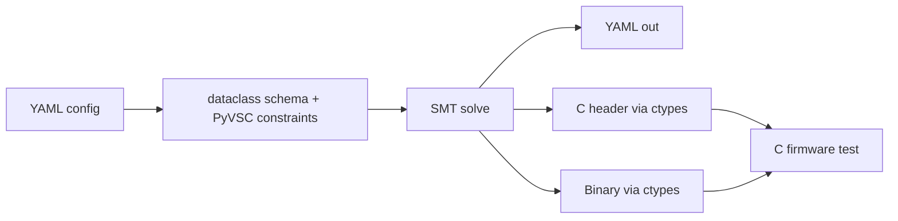

<!-- generated by yt-paper; edits will be overwritten -->
[DVCon](../dvcon/index.md) › [US](../dvcon/us.md) › [2023](../dvcon/by-year.md#2023) › [Verification](../dvcon/by-topic.md#verification)

# DatagenDV: Python Constrained Random Test Stimulus Framework

<figure class="rep-fig" markdown>
{ loading=lazy }
<figcaption>Fig. 1. DatagenDV data flow. — from the original paper (Jonathan George et al.)</figcaption>
</figure>

[:material-open-in-new: Original paper](https://dvcon-proceedings.org/wp-content/uploads/1044-Datagen-Python-Constrained-Random-Test-Stimulus-Framework.pdf){ .md-button .md-button--primary target=_blank }

| | |
|---|---|
| Authors | Jonathan George (Microsoft Corporation), James Mackenzie (Microsoft Corporation) |
| Venue | DVCon US 2023 |
| Topic | Verification |
| Type | PAPER |
| ID | `ref-20261018-d08e` |

## Summary

**DatagenDV is a Python pre-processing framework that combines dataclasses, ruamel.yaml, PyVSC (SMT-based constrained random) and ctypes to generate YAML, C headers and packed binary stimulus for C firmware tests, reusing SystemVerilog block-level constraints.**

**DatagenDV는 dataclasses, ruamel.yaml, PyVSC(SMT 기반 constrained random), ctypes를 결합한 Python 전처리 프레임워크로, SystemVerilog 블록 레벨 제약을 재사용하여 C 펌웨어 테스트용 YAML, C 헤더, 패킹된 바이너리 stimulus를 생성한다.**

## Key Insights

- Moving stimulus generation from C firmware into a Python pre-processing step removes in-simulation randomization cycles and makes generated data independent of DUT behavior.

- 자극 생성을 C 펌웨어에서 Python 전처리 단계로 옮기면 시뮬레이션 내 랜덤화 사이클이 사라지고, 생성된 데이터가 DUT 동작과 무관해진다.

- PyVSC's SystemVerilog-like constraint syntax allowed a 60-field instruction with 300 lines of SV constraints to be ported in about one day, versus weeks of effort in an earlier project using Python's random library.

- PyVSC의 SystemVerilog 유사 제약 문법 덕분에 SV 제약 300줄과 60개 필드를 가진 명령어를 약 하루 만에 이식했으며, 이전 프로젝트에서 Python random 라이브러리로 수 주가 걸렸던 작업과 대비된다.

- Selecting one of 10 enum values was reported as 6 orders of magnitude faster in Python than randomizing in C on a simulated processor (earlier project, paper's figure).

- 10개 enum 값 중 선택하는 작업이 시뮬레이션된 프로세서의 C 랜덤화보다 Python에서 6 orders of magnitude 빨랐다고 보고된다(이전 프로젝트, 논문 기재 수치).

- PyVSC is slower than simulator randomization (about 5 minutes for 10,000 randomizations of FrameParams) and its distribution is imperfect, so the authors recommend vetting it against project scale.

- PyVSC는 시뮬레이터 랜덤화보다 느리고(FrameParams 10,000회 랜덤화에 약 5분), 분포도 완벽하지 않아 프로젝트 규모에 맞춰 검증할 것을 저자들이 권고한다.

- ctypes-based binary output is limited to flat structures with byte-aligned packing; nested structures and non-byte-aligned packing are listed as future work.

- ctypes 기반 바이너리 출력은 바이트 정렬된 평탄한 구조체로 제한되며, 중첩 구조와 비바이트 정렬 패킹은 향후 과제로 남아 있다.

## Detailed Summary

### Background and Problem

- C firmware tests (used in simulation, emulation and post-silicon) need constrained-random data, but C randomization is less capable than SystemVerilog, and generating data on the DUT makes data validity ambiguous and costs simulator cycles.

- 시뮬레이션, 에뮬레이션, 포스트 실리콘에서 쓰이는 C 펌웨어 테스트는 constrained-random 데이터가 필요하지만, C의 랜덤화 기능은 SystemVerilog보다 제한적이다. 또한 DUT에서 데이터를 생성하면 데이터 유효성이 모호해지고 시뮬레이터 사이클이 소모된다.

- Prior Python efforts (cocotb, pyuvm) aim to replace SystemVerilog or tie Python into SV testbenches via DPI-C; DatagenDV targets an embedded C environment instead.

- 기존 Python 연구(cocotb, pyuvm)는 SystemVerilog를 대체하거나 DPI-C로 SV 테스트벤치에 Python을 연결하는 데 초점을 둔다. DatagenDV는 임베디드 C 환경을 대상으로 한다.

### Architecture and Methodology

- Pre-processing flow: YAML test config is loaded into typed dataclasses, PyVSC (Boolector SMT backend) solves constraints, and outputs are written as YAML, C headers and binary files.

- 전처리 흐름: YAML 테스트 설정을 타입이 지정된 dataclass로 읽고, PyVSC(Boolector SMT 백엔드)가 제약을 풀며, 결과를 YAML, C 헤더, 바이너리 파일로 출력한다.

- `YAMLParamsBase` with ruamel.yaml (comment-preserving) and `field(dir='in'/'out'/'in_out')` metadata control what is loaded or dumped.

- ruamel.yaml(주석 보존) 기반 `YAMLParamsBase`와 `field(dir='in'/'out'/'in_out')` 메타데이터로 로드/덤프 대상을 제어한다.

- `@rand_dataclass` pairs `rand_` PyVSC fields with plain typed fields; non-None YAML values become override constraints.

- `@rand_dataclass`는 `rand_` PyVSC 필드와 일반 타입 필드를 짝지어 주며, None이 아닌 YAML 값은 오버라이드 제약이 된다.

- ctypes generates C structs, enums and packed binaries (read via `fopen`/`fread` in C).

- ctypes로 C 구조체, enum, 패킹된 바이너리를 생성하며, C에서는 `fopen`/`fread`로 읽는다.

### Results and Conclusions

- A 40-field command struct was randomized after porting block-level SV constraints in a few days; a 60-field instruction (300 lines of SV constraints) was ported in about a day.

- 블록 레벨 SV 제약을 이식한 뒤 40개 필드의 명령 구조체를 며칠 내에 랜덤화했으며, 60개 필드 명령어(SV 제약 300줄)는 약 하루 만에 이식했다.

- PyVSC is slower than simulator randomization (about 5 minutes for 10,000 calls) and its distribution is imperfect, though no values were neglected.

- PyVSC는 시뮬레이터 랜덤화보다 느리고(10,000회 호출에 약 5분), 분포도 완벽하지 않지만 값이 누락되지는 않았다.

- Limitations: binary generation covers flat, byte-aligned structs only; nested data and non-byte-aligned packing are future work.

- 한계: 바이너리 생성은 평탄하고 바이트 정렬된 구조체만 지원하며, 중첩 데이터와 비바이트 정렬 패킹은 향후 과제이다.

- Authors report hundreds of hours saved and improved productivity across Microsoft projects.

- 저자들은 Microsoft 프로젝트들에서 수백 시간을 절감하고 생산성이 향상되었다고 보고한다.

## Videos

<iframe src="https://www.youtube-nocookie.com/embed/7g-3vBeMZLo" title="[DVCON2023]DatagenDV: Python Constrained Random Test Stimulus Framework" loading="lazy" allow="accelerometer; clipboard-write; encrypted-media; gyroscope; picture-in-picture; web-share" referrerpolicy="strict-origin-when-cross-origin" allowfullscreen></iframe>

**[DVCON2023]DatagenDV: Python Constrained Random Test Stimulus Framework** — [Watch on YouTube](https://www.youtube.com/watch?v=7g-3vBeMZLo) · [Video page](../videos/7g-3vBeMZLo.md)
