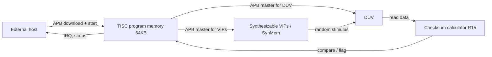

<!-- generated by yt-paper; edits will be overwritten -->
[DVCon](../dvcon/index.md) › [US](../dvcon/us.md) › [2021](../dvcon/by-year.md#2021) › [Verification](../dvcon/by-topic.md#verification)

# Synthesizable Random Testbench for Multimedia IP Verification

<figure class="rep-fig" markdown>
{ loading=lazy }
<figcaption>Fig. 1 shows three different testbench architectures with own pros and cons. In the simple testbench architecture, shown in Fig. 1(a), a few essential components are integrated with the Design under Verification (DUV). The test program, which accesses DUV, verification IPs and SDRAMs to control overall test behaviors, is written in C/C++ — from the original paper (Sanggyu Park et al.)</figcaption>
</figure>

[:material-open-in-new: Original paper](https://dvcon-proceedings.org/wp-content/uploads/synthesizable-random-testbench-for-multimedia-ip-verification.pdf){ .md-button .md-button--primary target=_blank }

| | |
|---|---|
| Authors | Sanggyu Park (Samsung Electronics Co., Ltd) |
| Venue | DVCon US 2021 |
| Topic | Verification |
| Type | PAPER |
| ID | `ref-20261018-d099` |

## Summary

**A fully synthesizable, isolated random testbench built on a test-specialized processor (TISC), a run-time random number network (RNGNET), and an AXI memory VIP (SynMem) that runs unchanged on simulation, emulation, and FPGA so that multimedia IP random regressions are reproducible and compact.**

**테스트 특화 프로세서(TISC), 런타임 난수 생성 네트워크(RNGNET), AXI 메모리 VIP(SynMem)로 구성된, 시뮬레이션·에뮬레이션·FPGA에서 동일하게 동작하는 완전 합성 가능 격리형 랜덤 테스트벤치를 제안하여 멀티미디어 IP 랜덤 레그레션의 재현성과 프로그램 크기를 개선한다.**

## Key Insights

- Isolation is the key to reproducibility: the testbench has no host link or external timing dependency, so a failure found on FPGA can be replayed in simulation. Host-driven USB/PCIe testbenches were judged non-reproducible because link timing cannot be modeled.

- 격리 구조가 재현성의 핵심이다. 테스트벤치에 호스트 링크나 외부 타이밍 의존성이 없어 FPGA에서 발견한 실패를 시뮬레이션에서 그대로 재현할 수 있다. USB/PCIe 기반 호스트 구동 테스트벤치는 링크 타이밍을 모델링할 수 없어 재현이 불가능하다고 평가되었다.

- A test-specialized ISA shrinks register-write programs. Variable-length DUT_WRITE encoding reduced program size to 13%~30% of fixed-length encoding; the Bayer Image Processor (9,209 configuration registers) went from 90KB fixed-length to 32KB variable-length.

- 테스트 특화 ISA로 레지스터 쓰기 프로그램을 줄인다. 가변 길이 DUT_WRITE 인코딩은 고정 길이 대비 프로그램 크기를 13%~30%로 줄였고, 9,209개 설정 레지스터를 가진 Bayer Image Processor는 고정 길이 90KB에서 가변 길이 32KB로 감소했다.

- RNGNET moves bulk random data generation into run time. A 256-element Gamma LUT that needs at least 520 bytes as a DUT_WRITE sequence is configured in 27 bytes.

- RNGNET은 대량의 랜덤 데이터 생성을 런타임으로 옮긴다. DUT_WRITE 시퀀스로 최소 520바이트가 필요한 256개 원소 Gamma LUT를 27바이트로 구성할 수 있다.

- Rich conditional execution (32 general flags, per-instruction conditions) keeps control flow linear. The same if/else example encodes to 56 bytes with conditional flags, 70 bytes with JUMP, and 80 bytes with CALL.

- 32개 범용 플래그 기반 조건부 실행으로 분기 없이 제어 흐름을 선형으로 유지한다. 동일한 if/else 예제가 조건 플래그 56바이트, JUMP 70바이트, CALL 80바이트로 인코딩되었다.

- Scale of the problem: the image scaler regression ran 100M tests, and even with variable-length encoding the total test-program size exceeded 600GB. Per-test programs of listed IPs stayed at or below 32KB, within the 64KB program memory of TISC.

- 규모 측면: 이미지 스케일러 레그레션은 1억(100M) 테스트를 수행했으며, 가변 길이 인코딩을 적용해도 전체 테스트 프로그램 크기가 600GB를 넘었다. 열거된 IP의 프로그램은 모두 32KB 이하로, TISC의 64KB 프로그램 메모리 한계 내에 있었다.

## Detailed Summary

### Background and Problem

- Multimedia IPs (ISP, image scaler, display processing unit, PDAF accelerator) expose thousands of configuration parameters. Covering their constrained-random space needs millions of tests, which is infeasible in simulation alone. FPGA or emulation can run the volume, but the simulation-to-FPGA expertise gap and reproducibility remain open.

- Multimedia IP(ISP, 이미지 스케일러, 디스플레이 처리 유닛, PDAF 가속기)는 수천 개의 설정 파라미터를 가진다. 이들의 constrained-random 공간을 커버하려면 수백만 건의 테스트가 필요하며, 시뮬레이션만으로는 불가능하다. FPGA나 에뮬레이션으로 물량을 소화할 수 있지만, 시뮬레이션과 FPGA 사이의 전문성 격차와 재현성 문제가 남아 있다.

- Two conventional testbench styles were evaluated and rejected:
  - (a) Simple architecture: a C/C++ test program on the host drives DUT, VIPs, and SDRAM over USB/PCIe. Register access and data transfer dominate run time, and issues cannot be reproduced in simulation because link timing is neither controllable nor modelable.
  - (b) Microcontroller-embedded architecture: removes the host link, but simulation is slower, maintenance is harder, and debugging test firmware is difficult for simulation-based DV engineers.

- 기존 두 가지 테스트벤치 방식을 검토했고 모두 채택하지 않았다.
  - (a) 단순 구조: 호스트의 C/C++ 테스트 프로그램이 USB/PCIe를 통해 DUT, VIP, SDRAM을 구동한다. 레지스터 접근과 데이터 전송이 실행 시간을 지배하며, USB 링크의 타이밍을 제어하거나 모델링할 수 없어 시뮬레이션에서 이슈를 재현할 수 없다.
  - (b) 마이크로컨트롤러 내장 구조: 호스트 링크는 제거되지만, 시뮬레이션 속도가 느리고 유지보수가 어려우며, 시뮬레이션 기반 DV 엔지니어에게 테스트 펌웨어 디버깅이 어렵다.

- Requirements: an isolated, fully synthesizable system with no outside-world interaction, so issues reproduce identically across simulation, emulation, and FPGA, and host-FPGA data transfer is minimized.

- 요구사항: 외부 세계와 상호작용하지 않는 완전 합성 가능한 격리 시스템을 만들어 시뮬레이션, 에뮬레이션, FPGA에서 이슈가 동일하게 재현되도록 하고, 호스트-FPGA 간 데이터 전송을 최소화한다.

### Architecture and Methodology

The proposed architecture (Fig. 1(c)) combines TISC and SynMem around the DUV, with no host interaction during a test.

제안 구조(Fig. 1(c))는 DUV 주변에 TISC와 SynMem을 배치하며, 테스트 중 호스트와 상호작용하지 않는다.

**TISC (Test Instruction Set Core)**

**TISC (Test Instruction Set Core)**

- Three-stage pipeline with address generation, decode, and execution. The ALU is combinational (32-bit); the MDU is sequential, shift-and-add based, and only 1,762 gates, since multiply and divide are rare in test programs.

- 주소 생성, 디코드, 실행으로 구성된 3단 파이프라인이다. ALU는 조합 논리(32비트)이며, MDU는 시프트와 덧셈 기반의 순차 로직으로 1,762 게이트에 불과하다. 테스트 프로그램에서 곱셈과 나눗셈은 드물기 때문이다.

- Register file: 32 registers of 32 bits, split into 16 general and special registers, with 11 usable for general purposes. The split keeps the register file at 2-read/1-write.

- 레지스터 파일: 32비트 레지스터 32개를 범용 16개와 특수 레지스터로 나누며, 범용 레지스터 중 11개를 일반 용도로 쓸 수 있다. 이 분할로 레지스터 파일을 2-read/1-write 구조로 유지한다.

- Programmable I/O: 64-bit Event Activators and Event Receptors (half in general registers, half in special registers), 3 General Handshake Masters, and 2 General Handshake Slaves. It can implement 32-bit AXI interfaces.

- 프로그래머블 I/O: 64비트 Event Activator와 Event Receptor(절반은 범용 레지스터, 절반은 특수 레지스터에 매핑), 3채널 General Handshake Master, 2채널 General Handshake Slave를 가진다. 32비트 AXI 인터페이스를 구현할 수 있다.

- Programmable timers generate periodic or random events. RNGNET is mapped to one general and one special register.

- 프로그래머블 타이머는 주기적 또는 랜덤 이벤트를 생성한다. RNGNET은 범용 레지스터 1개와 특수 레지스터 1개에 매핑된다.

- Two APB masters: one for the DUV and one for the VIPs. The DUV master includes a checksum calculator (result in R15) and random inter-transaction delay (APBRNG, with a PRNG updating the lower 16 bits).

- APB 마스터 2개: DUV용과 VIP용. DUV용 마스터에는 체크섬 계산기(결과는 R15)와 트랜잭션 사이의 랜덤 지연(APBRNG, 하위 16비트를 PRNG가 갱신)이 포함된다.

- Clock controller produces clock enables for DUV and VIPs, hiding multi-cycle instruction delays and gating the DUV clock during VIP configuration.

- 클록 컨트롤러는 DUV와 VIP에 대한 클록 enable 신호를 생성하여 다사이클 명령의 지연을 숨기고, VIP 설정 중 DUV 클록을 게이팅한다.

- Program memory is a 64KB SRAM loaded by the external host over APB. Load/store to program memory takes 4 cycles.

- 프로그램 메모리는 64KB SRAM이며 외부 호스트가 APB로 적재한다. 프로그램 메모리에 대한 load/store는 4사이클이 걸린다.

**ISA**

**ISA**

- The MSB of the first byte selects conditional vs. unconditional execution; the remaining 7 bits are the opcode. Conditional instructions add an 8-bit condition code. Instruction lengths range from 8 bits (no operand) to 80 bits (conditional, two 32-bit constants), with 28 operand formats.

- 첫 바이트의 MSB가 조건부/무조건부 실행을 나타내고, 나머지 7비트가 opcode다. 조건부 명령은 8비트 조건 코드를 추가로 가진다. 명령 길이는 피연산자가 없는 8비트부터 두 개의 32비트 상수를 가진 조건부 80비트까지이며, 28개의 피연산자 포맷이 있다.

- Pseudo-instructions: DUT_WRITE, DUT_WRITE_RND (write one of two RNGNET outputs), DUT_READ, DUT_READ_TEST (compare and flag on mismatch), DUT_READ_RPT (repeated read), DUT_WRITE_RPT.

- 의사 명령: DUT_WRITE, DUT_WRITE_RND(RNGNET 두 출력 중 하나를 기록), DUT_READ, DUT_READ_TEST(비교 후 불일치 시 플래그 설정), DUT_READ_RPT(반복 읽기), DUT_WRITE_RPT.

- Compression: address encoded as 8/16/24-bit differentials, auto-increment-by-4 opcodes, repeat-address opcodes, zero-data opcodes, and register-sourced data.

- 압축: 주소는 8/16/24비트 차분, 4씩 자동 증가하는 opcode, 반복 주소 opcode, 0 데이터 opcode, 레지스터 기반 데이터로 인코딩한다.

- Conditional execution uses 32 general flags, R11, timer events, and I/O events. SKIP is auto-inserted for runs with the same condition.

- 조건부 실행은 32개의 범용 플래그, R11, 타이머 이벤트, I/O 이벤트를 사용한다. 동일 조건이 연속될 때는 SKIP이 자동 삽입된다.

- CALL/RETURN use RET0-RET2 for nesting up to three levels. Stack PUSH/POP operate on program memory.

- CALL/RETURN은 RET0~RET2를 사용하여 최대 3단계 중첩을 지원한다. PUSH/POP 스택은 프로그램 메모리에서 동작한다.

**RNGNET (Random Number Generation Network)**

**RNGNET (Random Number Generation Network)**

- 18 PRNGs in total: eight 8-bit value PRNGs (clipped to user min/max), eight 3-bit PRNGs that drive ACTIVATORs against user thresholds, and extra 3-bit selector/mask PRNGs.

- 총 18개의 PRNG: 사용자 최소/최대값으로 클리핑되는 8비트 값 PRNG 8개, 사용자 임계값과 비교하는 ACTIVATOR를 구동하는 3비트 PRNG 8개, 그리고 추가 3비트 selector/mask PRNG.

- Clipped values are concatenated into 32-bit words (CONCAT), combined with a random SELECTOR, summed with a BASE register (constant bias or accumulation for dependency), and clipped into R12. Reading R12 activates the PRNGs.

- 클리핑된 값들은 CONCAT으로 32비트 워드가 되고, 랜덤 SELECTOR와 결합되며, BASE 레지스터와 더해진 뒤(상수 바이어스 또는 이전 값 누적으로 의존성 부여) R12에 클리핑되어 나온다. R12를 읽으면 PRNG가 활성화된다.

- ACTIVE gating produces mixed-frequency sequences (a fast component plus a slow component). The Gamma LUT example uses two such components.

- ACTIVE 게이팅으로 고주파와 저주파 성분이 섞인 시퀀스를 만든다. Gamma LUT 예제는 이러한 성분 두 개를 사용한다.

**SynMem (Synthetic Memory VIP)**

**SynMem (Synthetic Memory VIP)**

- An AXI slave with an APB slave for configuration, implemented without physical memory. Read-request queues, a read data synthesizer, and a write checksum calculator are present in Fig. 8/9. Note: the provided text is truncated before the detailed SynMem description, so its internals are not summarized further here.

- 물리 메모리 없이 구현된 AXI 슬레이브이며, 설정용 APB 슬레이브를 가진다. 읽기 요청 큐, 읽기 데이터 합성기, 쓰기 체크섬 계산기가 Fig. 8/9에 나타난다. 주의: 제공된 본문이 SynMem 상세 설명 이전에서 잘려 있어 내부 구조는 더 이상 요약하지 않는다.

### Results and Conclusions

- **Conditional vs. branching code** (Fig. 4, same if/else function): 56 bytes (conditional flags), 70 bytes (JUMP), 80 bytes (CALL). Linearized DUT_WRITEs compress better, which the author takes as the basis for preferring conditional execution.

- **조건부 vs 분기 코드**(Fig. 4, 동일한 if/else 함수): 조건 플래그 56바이트, JUMP 70바이트, CALL 80바이트. 선형화된 DUT_WRITE가 더 잘 압축되며, 저자는 이를 조건부 실행 선호의 근거로 제시한다.

- **RNGNET for Gamma LUT** (Fig. 6): a 10-bit-in, 14-bit-out LUT with 256 explicit points and 768 interpolated entries. A SystemVerilog-generated DUT_WRITE sequence needs at least 520 bytes. The RNGNET configuration needs 27 bytes (24 configuration, 1 repeat opcode, 1 repeat count, 1 R12 operand).

- **Gamma LUT용 RNGNET**(Fig. 6): 10비트 입력, 14비트 출력 LUT로, 256개 명시 점과 768개 보간 항목으로 구성된다. SystemVerilog로 생성한 DUT_WRITE 시퀀스는 최소 520바이트가 필요하다. RNGNET 구성은 27바이트(설정 24, 반복 opcode 1, 반복 횟수 1, R12 피연산자 1)다.

- **Program size by IP** (Table 1), fixed-length / variable-length / run-time random generation:
  - Histogram-based Image Equalizer: 58KB / 7.6KB / 6.2KB
  - UI Composer: 24KB / 14KB / 8KB
  - PDAF Accelerator: 61KB / 26KB / 18KB
  - Bayer Image Processor: 90KB / 32KB / 13KB (9,209 configuration registers in total)
  - Image Scaler: 17KB / 6KB / 3KB

- **IP별 프로그램 크기**(Table 1), 고정 길이 / 가변 길이 / 런타임 랜덤 생성 순:
  - Histogram-based Image Equalizer: 58KB / 7.6KB / 6.2KB
  - UI Composer: 24KB / 14KB / 8KB
  - PDAF Accelerator: 61KB / 26KB / 18KB
  - Bayer Image Processor: 90KB / 32KB / 13KB (설정 레지스터 총 9,209개)
  - Image Scaler: 17KB / 6KB / 3KB

- Variable-length encoding gives 13%~30% of fixed-length size for register writes. It is less effective for LUTs with random or many elements, such as the 800-element 12-bit gain LUT in the Bayer Image Processor's Constant Radial Anti-Shading function.

- 가변 길이 인코딩은 레지스터 쓰기에서 고정 길이 대비 13%~30% 크기를 달성한다. 랜덤 값이나 원소 수가 많은 LUT에는 효과가 작으며, 예로 Bayer Image Processor의 Constant Radial Anti-Shading 함수의 800개 원소 12비트 gain LUT가 있다.

- Output checking via automatic checksum: a 1,088-word PDAF statistics readout is verified with one DUT_READ_RPT and one compare, against a 32-bit reference checksum.

- 자동 체크섬 출력 검사: PDAF 통계 1,088워드를 DUT_READ_RPT 한 번과 비교 한 번으로, 32비트 기준 체크섬과 대조하여 검증한다.

- Scale: the image scaler verification ran 100M tests covering all scaling ratios; total test-program size still exceeded 600GB with variable-length encoding. All listed IPs stay at or below 32KB per program, which the author judges sufficient for the 64KB limit.

- 규모: 이미지 스케일러 검증은 모든 스케일링 비율을 커버하기 위해 100M 테스트를 수행했으며, 가변 길이 인코딩을 적용해도 테스트 프로그램 전체 크기가 600GB를 넘었다. 열거된 모든 IP는 프로그램당 32KB 이하이며, 저자는 이것이 64KB 한계에 충분하다고 판단한다.

- Design rationale: the author tried an interpreter on a classical microprocessor and abandoned it because peripherals become slow software or hard-to-debug hardware. DV engineers accept the custom core because all state, including TISC's, is visible in one waveform.

- 설계 근거: 저자는 기존 마이크로프로세서 위에 인터프리터를 구현하는 방식을 시도했으나 포기했다. 주변 로직이 느린 소프트웨어 또는 디버깅이 어려운 하드웨어가 되기 때문이다. DV 엔지니어는 TISC 상태를 포함한 모든 상태를 하나의 파형에서 볼 수 있어 커스텀 코어를 받아들였다.

- Limitations of the provided text: it is truncated during the SynMem section; the FPGA adoption-trend figure (Fig. 12) is referenced but its data is not in the text; the claim of "perfect reproduction" across platforms is stated but no cross-platform measurement is presented in the visible text.

- 제공된 본문의 한계: SynMem 절에서 잘려 있다. FPGA 채택 추세 그림(Fig. 12)이 언급되지만 데이터는 본문에 없다. 플랫폼 간 "완벽한 재현"이라는 주장은 기술되어 있으나, 보이는 본문에는 플랫폼 간 측정 결과가 제시되지 않는다.

## Videos

<iframe src="https://www.youtube-nocookie.com/embed/BEUFeKUEctY" title="[DVCON2021]Synthesizable Random Testbench for Multimedia IP Verification" loading="lazy" allow="accelerometer; clipboard-write; encrypted-media; gyroscope; picture-in-picture; web-share" referrerpolicy="strict-origin-when-cross-origin" allowfullscreen></iframe>

**[DVCON2021]Synthesizable Random Testbench for Multimedia IP Verification** — [Watch on YouTube](https://www.youtube.com/watch?v=BEUFeKUEctY) · [Video page](../videos/BEUFeKUEctY.md)
