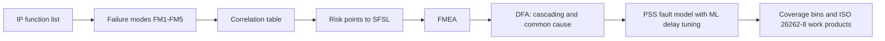

<!-- generated by yt-paper; edits will be overwritten -->
[DVCon](../dvcon/index.md) › [US](../dvcon/us.md) › [2023](../dvcon/by-year.md#2023) › [Verification](../dvcon/by-topic.md#verification)

# Early Detection of Functional Corner Case Bugs using Methodologies of the ISO 26262

<figure class="rep-fig" markdown>
{ loading=lazy }
<figcaption>Figure 9. Verification with ML based PSS action sequence model — from the original paper (Moonki Jang et al.)</figcaption>
</figure>

[:material-open-in-new: Original paper](https://dvcon-proceedings.org/wp-content/uploads/1096-Early-Detection-of-Functional-Corner-Case-Bugs-using-Methodologies-of-the-ISO-26262.pdf){ .md-button .md-button--primary target=_blank }

| | |
|---|---|
| Authors | Moonki Jang (Samsung Electronics), Sunil Roe (Samsung Electronics), Youngsik Kim (Samsung Electronics), Seonil Brian Choi (Samsung Electronics) |
| Venue | DVCon US 2023 |
| Topic | Verification |
| Type | PAPER |
| ID | `ref-20261018-d1ce` |

## Summary

**The paper adapts ISO 26262 HARA, FMEA and DFA into a Systematic Failure Analysis (SFA) flow that ranks pre-silicon verification targets by risk, and uses an ML-tuned PSS delay model to hit time-critical interference corner cases.**

**이 논문은 ISO 26262의 HARA, FMEA, DFA를 위험도 기반으로 pre-silicon 검증 대상을 선정하는 Systematic Failure Analysis(SFA) 흐름으로 적용하고, ML로 보정한 PSS 지연 모델을 사용해 시간 임계 간섭 코너 케이스를 재현하는 방법을 제시합니다.**

## Key Insights

- SFA reuses ISO 26262 safety analysis to rank verification targets by a risk score (SFSL); the example CPU_CPD_FM5 (power-down vs. snoop race, linked to Errata 1500609) is rated SFSL_A with P=3, S=4.

- SFA는 ISO 26262 안전 분석을 재활용해 검증 대상을 위험 점수(SFSL)로 순위화하며, 예시인 CPU_CPD_FM5(power-down과 snoop 경쟁, Errata 1500609 관련)는 P=3, S=4로 SFSL_A 등급을 받았습니다.

- Delays are generated by a clock-cycle SV delay counter in the testbench rather than in software, because SW delays have microsecond granularity and vary with cache and pipeline state, which breaks the linear delay-to-timestamp mapping needed for regression.

- 지연은 SW가 아닌 testbench의 클럭 단위 SV delay counter로 생성합니다. SW 지연은 마이크로초 단위이며 캐시와 파이프라인 상태에 따라 달라져, 회귀 검증에 필요한 지연-타임스탬프 선형성을 깨기 때문입니다.

- Per-function linear regression plus the extended Euclidean algorithm yields delay pairs that place two functions' target-condition hits at a common simulation timestamp; an ML step discards nonlinear data to handle external delay perturbations.

- 기능별 선형 회귀와 확장 유클리드 알고리즘을 결합해 두 기능의 목표 조건 발생 시점이 같은 시뮬레이션 타임스탬프에 놓이는 지연 쌍을 구하며, ML 단계는 외부 지연 변동으로 생긴 비선형 데이터를 제외합니다.

- The only quantitative result is about a 15% increase in CPU functional coverage bins for SFSL-B-or-higher items; the paper reports no bug counts, hit rates, or runtime figures.

- 논문이 제시하는 유일한 정량 결과는 SFSL-B 이상 항목에서 CPU 기능 커버리지 bin이 약 15% 증가한 것이며, 버그 개수, 적중률, 실행 시간은 보고되지 않았습니다.

- Fault injection through the memory backdoor (uncorrectable ECC, MMU translation fault, RAS error injection) combined with coupling factors (false sharing, DVM, exclusive access) targets systematic bugs in error-handling paths and is reusable for SW recovery verification.

- 메모리 backdoor를 통한 fault injection(uncorrectable ECC, MMU translation fault, RAS error injection)과 coupling factor(false sharing, DVM, exclusive access)를 결합해 오류 처리 경로의 systematic 버그를 찾으며, 이 모델은 SW 복구 검증에도 재사용할 수 있습니다.

## Detailed Summary

### Background and Problem

- ISO 26262 requires persistent impact analysis and risk assessment but proposes no new verification method for systematic faults. Time-critical interference corner cases (FM5 type, e.g., power-gating vs. snoop races) often escape to silicon and force costly mask revisions.

- ISO 26262는 지속적인 영향 분석과 위험 평가를 요구하지만, systematic 고장에 대한 새로운 검증 방법은 제시하지 않습니다. FM5 유형의 시간 임계 간섭 코너 케이스(예: power-gating과 snoop 경쟁)는 실리콘 단계까지 빠져나가 비용이 큰 mask 개정을 유발하는 경우가 많습니다.

- Existing directed and random tests struggle to hit conditions that require precise timing across several elements. The paper aims to bring ISO 26262 HARA, FMEA and DFA into pre-silicon verification planning.

- 기존 directed 및 random 테스트는 여러 요소가 정밀한 타이밍 조건을 만족해야 하는 상황을 재현하기 어렵습니다. 본 논문은 ISO 26262의 HARA, FMEA, DFA를 pre-silicon 검증 계획에 도입하는 것을 목표로 합니다.

### Architecture and Methodology

- SFA flow: failure modes (FM1–FM5) per IP function, correlation table of incoming and outgoing accesses, hazardous function list, and risk points (proven-in-use P1–P4, severity S1–S4, errata, workaround W1–W4) mapped to SFSL A–D (thresholds >12, >8, >4, ≤4).

- SFA 흐름: IP 기능별 failure mode(FM1–FM5), 입출력 접근 correlation table, hazardous function list, 위험 점수(proven-in-use P1–P4, 심각도 S1–S4, errata, workaround W1–W4)를 SFSL A–D(임계값 >12, >8, >4, ≤4)에 매핑합니다.

- DFA covers cascading failures (via the correlation table) and common cause failures (via backdoor fault injection with ECC, MMU and RAS errors). Results are recorded as FTR.

- DFA는 correlation table 기반의 cascading failure와 메모리 backdoor를 통한 ECC, MMU, RAS 오류 주입 기반의 common cause failure를 다룹니다. 결과는 FTR로 기록합니다.

- Timing control: an SV delay counter at clock resolution, triggered by a `pss_delay` action per function. The output monitor logs target-hit timestamps. Per-function linear fits of delay vs. timestamp are solved with the extended Euclidean algorithm to find aligned delay pairs. An ML step filters nonlinear data.

- 타이밍 제어: 클럭 단위 SV delay counter를 사용하며, 기능별 `pss_delay` action으로 트리거합니다. Output monitor는 목표 조건 발생 타임스탬프를 기록합니다. 기능별 지연-타임스탬프 선형 적합을 확장 유클리드 알고리즘으로 풀어 정렬된 지연 쌍을 구하며, ML 단계는 비선형 데이터를 걸러냅니다.

### Results and Conclusions

- The only quantitative result is about a 15% increase in CPU functional coverage bins for SFSL-B-or-higher items. No bug counts, hit rates or runtimes are reported.

- 유일한 정량 결과는 SFSL-B 이상 항목에서 CPU 기능 커버리지 bin이 약 15% 증가한 것입니다. 버그 개수, 적중률, 실행 시간은 보고되지 않았습니다.

- SFA outputs are mapped to ISO 26262-8:2018 9.5 verification work products. FMEA and DFA data can feed an FMEDA once random-HW failure rates and diagnostic coverage are added.

- SFA 산출물은 ISO 26262-8:2018 9.5의 검증 work product에 매핑됩니다. 랜덤 HW 고장률과 진단 커버리지를 추가하면 FMEA 및 DFA 데이터를 FMEDA에 활용할 수 있습니다.

- The authors claim ML regression produces verification code that reaches the target condition from the target specification alone. This is asserted without measured evidence in the text.

- 저자들은 ML 회귀가 목표 조건만 설정해도 해당 조건에 도달하는 검증 코드를 생성한다고 주장하지만, 본문에는 이를 뒷받침하는 측정 근거가 없습니다.

## Videos

<iframe src="https://www.youtube-nocookie.com/embed/q5J0AUqZLUY" title="[DVCon2023] Early Detection of Functional Corner Case Bugs using Methodologies of the ISO 26262" loading="lazy" allow="accelerometer; clipboard-write; encrypted-media; gyroscope; picture-in-picture; web-share" referrerpolicy="strict-origin-when-cross-origin" allowfullscreen></iframe>

**[DVCon2023] Early Detection of Functional Corner Case Bugs using Methodologies of the ISO 26262** — [Watch on YouTube](https://www.youtube.com/watch?v=q5J0AUqZLUY) · [Video page](../videos/q5J0AUqZLUY.md)
