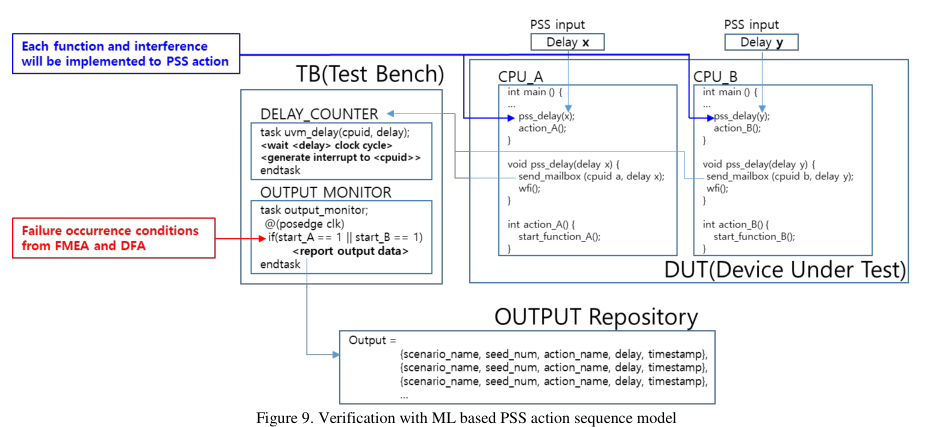

<!-- generated by yt-paper; edits will be overwritten -->
[DVCon](../dvcon/index.md) › [US](../dvcon/us.md) › [2023](../dvcon/by-year.md#2023) › [Verification](../dvcon/by-topic.md#verification)

# Early Detection of Functional Corner Case Bugs using Methodologies of the ISO 26262

<figure class="rep-fig" markdown>
{ loading=lazy }
<figcaption>Figure 9. Verification with ML based PSS action sequence model — from the original paper (Moonki Jang et al.)</figcaption>
</figure>

[:material-open-in-new: Original paper](https://dvcon-proceedings.org/wp-content/uploads/1096-Early-Detection-of-Functional-Corner-Case-Bugs-using-Methodologies-of-the-ISO-26262.pdf){ .md-button .md-button--primary target=_blank }

| | |
|---|---|
| Authors | Moonki Jang (Samsung Electronics), Sunil Roe (Samsung Electronics), Youngsik Kim (Samsung Electronics), Seonil Brian Choi (Samsung Electronics) |
| Venue | DVCon US 2023 |
| Topic | Verification |
| Type | PAPER |
| ID | `ref-20261018-d1ce` |

## Summary

**The paper adapts ISO 26262 safety analyses (FMEA, DFA, risk assessment) into a pre-silicon Systematic Failure Analysis (SFA) flow and uses an ML-tuned PSS action sequence with a clock-accurate delay counter to reproduce time-critical interference corner cases.**

**이 논문은 ISO 26262의 안전 분석(FMEA, DFA, 위험 평가)을 pre-silicon 설계 검증용 Systematic Failure Analysis(SFA) 흐름으로 적용하고, 클록 정밀도의 delay counter와 ML로 튜닝한 PSS action sequence로 시간 임계 간섭 corner case를 재현하는 방법을 제시한다.**

## Key Insights

- SFA ranks failure modes into SFSL levels from four risk points (Proven-in-use P1-P4, Severity S1-S4, known issues in other projects, and workaround W1-W4). SFSL_A is Risk Level > 12, SFSL_B > 8, SFSL_C > 4, and SFSL_D <= 4. The risk-level formula is in Figure 1, which is not present in the extracted text.

- SFA는 네 가지 위험 요소(Proven-in-use P1-P4, Severity S1-S4, 타 프로젝트 known issue, Workaround W1-W4)로 failure mode를 SFSL 등급으로 분류한다. SFSL_A는 Risk Level > 12, SFSL_B는 > 8, SFSL_C는 > 4, SFSL_D는 <= 4이다. 위험 수준 계산식은 Figure 1에 있으나 추출된 텍스트에는 없다.

- Corner-case timing is controlled by a testbench delay counter at clock-cycle resolution rather than software delay. The stated reasons are that SW delay has a microsecond minimum unit and varies with CPU cache and pipeline state, which would break the linearity the ML model needs.

- 타이밍 corner case는 SW delay가 아니라 클록 사이클 단위 해상도의 testbench delay counter로 제어한다. 논문이 든 이유는 SW delay의 최소 단위가 마이크로초이고 CPU 캐시와 파이프라인 상태에 따라 값이 달라져 ML에 필요한 선형성이 깨진다는 것이다.

- Delay-to-timestamp relations for two functions are fitted with linear regression. The extended Euclidean algorithm then solves the Diophantine equation for delay pairs that make both target conditions occur at the same simulation timestamp. Nonlinear outliers are removed before fitting.

- 두 function의 delay-시각 관계를 선형 회귀로 근사하고, 확장 유클리드 알고리즘으로 두 조건이 같은 시뮬레이션 timestamp에 발생하는 delay 조합(Diophantine 방정식의 해)을 구한다. 선형에서 벗어난 데이터는 학습에서 제외한다.

- DFA covers cascading failures (from the correlation table) and common cause failures (from backdoor fault injection into shared memory: uncorrectable ECC, MMU translation faults, and RAS injection). Coupling factors include false sharing, DVM broadcast, and exclusive access. Example findings include a stalled ACE interface, a PCIe posted write that waits on a snoop, and CPU accesses during ECC error state.

- DFA는 correlation table 기반의 cascading failure와, 공유 메모리 backdoor를 통한 fault injection 기반의 common cause failure(uncorrectable ECC, MMU translation fault, RAS 주입)를 함께 다룬다. 결합 요인에는 false sharing, DVM broadcast, exclusive access가 포함된다. 예로 ACE 인터페이스 stall, snoop 응답을 기다리는 PCIe posted write, ECC 오류 상태에서의 CPU 접근이 보고되었다.

- The reported quantitative result is about a 15% increase in CPU functional coverage bins for SFSL-B or higher items. The paper gives no bug counts, runtime figures, or baseline comparison. Its outputs are mapped to ISO 26262-8:2018 9.5 verification work products and to FMEDA inputs.

- 정량 결과는 SFSL-B 이상 CPU 항목에서 functional coverage bin이 약 15% 증가했다는 것이 전부다. 버그 검출 건수, 실행 시간, 기준선 비교는 없다. 결과물은 ISO 26262-8:2018 9.5 검증 작업 산출물과 FMEDA 입력으로 매핑된다.

## Detailed Summary

### Background and Problem

- ISO 26262 does not prescribe a new verification method for systematic failures. RTL design errors are the typical systematic failure. As SoC complexity grows, corner cases from unintended interference between components (for example, snoop arriving between coherency disconnect and disable, or a clock-gating config colliding with a gating enable) often escape pre-silicon verification and surface at silicon. That causes costly respins.

- ISO 26262는 systematic failure에 대한 새로운 검증 방법을 규정하지 않는다. RTL 설계 오류가 대표적인 systematic failure다. SoC 복잡도가 높아지면서 컴포넌트 간 의도하지 않은 간섭에서 생기는 corner case(예: coherency disconnect와 disable 사이에 도착하는 snoop, clock gating 설정과 gating enable의 충돌)가 pre-silicon 검증을 빠져나가 실리콘 단계에서 발견되는 경우가 많다. 이는 비용이 큰 respin으로 이어진다.

- The target class is FM5 ("absence of independence / freedom from interference"). These failures need a specific interfering access at a specific weak point, which existing directed and random tests rarely reproduce.

- 대상은 FM5("absence of independence / freedom from interference")류 failure다. 이 실패는 특정 약점 지점에서 특정 간섭 접근이 있어야 발생하므로 기존 directed 및 random 테스트로는 재현이 어렵다.

### Architecture and Methodology

The paper proposes Systematic Failure Analysis (SFA), which applies HARA-style risk thinking and the FMEA/DFA steps of ISO 26262 to design verification. The flow is:

논문은 ISO 26262의 HARA 스타일 위험 사고와 FMEA/DFA 단계를 설계 검증에 적용한 Systematic Failure Analysis(SFA)를 제안한다. 흐름은 위 mermaid 다이어그램과 같다.

```mermaid
flowchart LR
  A[Failure modes FM1-FM5 per IP function] --> B[Correlation table: incoming/outgoing access]
  B --> C[Hazardous function list]
  C --> D[Risk points: P, S, known issues, W]
  D --> E[SFSL_A..D]
  E --> F[FMEA]
  F --> G[DFA: cascading and common cause]
  G --> H[ML-tuned PSS action sequence + delay counter]
  H --> I[Coverage bins and ISO 26262-8 work products]
```

- **Failure modes**: FM1 integration, FM2 accessibility, FM3 functionality, FM4 state transition (power/clock gating, reset), and FM5 FFI. Examples are CPU_CPD_FM5 and CMU_ACG_FM5.

- **Failure mode**: FM1 integration, FM2 accessibility, FM3 functionality, FM4 state transition(power/clock gating, reset), FM5 FFI로 구성된다. 예시는 CPU_CPD_FM5, CMU_ACG_FM5이다.

- **Correlation table**: lists incoming and outgoing accesses per function (snoop, DVM, interrupt, debug command, power-gating config) to identify dependencies.

- **Correlation table**: function별 incoming/outgoing 접근(snoop, DVM, interrupt, debug command, power-gating config)을 나열해 의존성을 파악한다.

- **Hazardous functions**: power gating, clock gating, reset, buffer overflow, and exception handling. The paper states that most empirical bugs occur in state-transition sequences.

- **Hazardous function**: power gating, clock gating, reset, buffer overflow, exception handling이 포함된다. 논문은 실증적으로 버그가 state transition 시퀀스에서 많이 발생한다고 본다.

- **Risk factors**: Proven-in-use P4 (new in-house IP) through P1 (same IP already used). Severity S4 (whole system unavailable) through S1 (no impact). Known issues from other projects and errata (for example, Errata 1500609). Workaround W4 (HW revision required) through W1 (SW workaround without performance impact). The final risk level combines these points, but the formula is only in a figure that is missing from the text.

- **위험 요소**: Proven-in-use는 P4(새로운 자체 IP)부터 P1(다른 제품에서 이미 사용된 IP)까지다. Severity는 S4(전체 시스템 사용 불가)부터 S1(영향 없음)까지다. Known issue는 타 프로젝트 이력과 errata를 포함한다(예: Errata 1500609). Workaround는 W4(HW 개정 필요)부터 W1(성능 영향 없는 SW workaround)까지다. 최종 위험 수준은 이들 점수의 조합이나, 계산식은 텍스트에 없는 그림에만 있다.

- **DFA**: checks whether a failure mode can act as a Dependent Failure Initiator (DFI). Cascading failures are derived from the correlation table. Common cause failures are checked by injecting faults into shared resources through the memory backdoor: uncorrectable ECC, MMU translation faults (valid bit cleared in the page descriptor), and RAS error injection into L1/L2/L3 caches. The PSS fault model is also reused for SW recovery verification.

- **DFA**: failure mode가 cascading failure를 일으키는 Dependent Failure Initiator(DFI)가 될 수 있는지 확인한다. Cascading failure는 correlation table로 도출한다. Common cause failure는 메모리 backdoor로 공유 자원에 fault를 주입해 확인한다. 주입 대상은 uncorrectable ECC, MMU translation fault(page descriptor의 valid 비트 조작), L1/L2/L3 캐시에 대한 RAS error 주입이다. 같은 PSS fault model은 SW 복구 검증에도 재사용된다.

- **ML-based sequence tuning**: `pss_delay` actions are inserted before each function in the PSS-generated CPU SW. The delay request goes through a mailbox to a SV testbench delay counter. The counter counts rising clock edges and raises an interrupt to the requesting core when the count completes. An output monitor logs the simulation timestamp when the target condition occurs, and the results are saved to an output repository.

- **ML 기반 sequence 튜닝**: PSS로 생성한 CPU SW의 각 function 앞에 `pss_delay` action을 넣는다. delay 요청은 mailbox를 거쳐 SV testbench의 delay counter로 전달된다. counter는 클록 상승 엣지를 세고, 카운트가 끝나면 요청한 코어에 인터럽트를 보낸다. output monitor는 target condition이 발생한 시뮬레이션 timestamp를 로그로 남기고, 결과는 output repository에 저장된다.

- **Delay solving**: for function_A and function_B, delay values are swept and (delay, timestamp) pairs are collected. Linear equations are fitted per function. For a Diophantine constraint with $d=\gcd(a,b)$, the particular solution is $x_0 = s\cdot c/d$ and $y_0 = t\cdot c/d$, and the general solution is $x = x_0 + k\cdot b/d$ and $y = y_0 - k\cdot a/d$. Only linear-consistent data is used for training, to absorb external perturbations.

- **Delay 해 구하기**: function_A와 function_B에 대해 delay 값을 스윕하여 (delay, timestamp) 쌍을 수집하고, function별 선형 방정식을 적합한다. $d=\gcd(a,b)$일 때 특수해는 $x_0 = s\cdot c/d$, $y_0 = t\cdot c/d$이고, 일반해는 $x = x_0 + k\cdot b/d$, $y = y_0 - k\cdot a/d$이다. 외부 요인으로 흔들린 데이터는 학습에 쓰지 않고 선형성이 유지된 데이터만 사용한다.

### Results and Conclusions

- The paper reports that ML-based regression generates verification code that reproduces a target condition when the user specifies only the desired condition for each element.

- ML 기반 regression은 사용자가 각 element에 대해 target condition만 지정하면 해당 조건을 재현하는 검증 코드를 생성한다고 보고된다.

- SFA results were mapped to the verification work products of ISO 26262-8:2018 9.5. The paper says most of these are already covered by existing verification. The additions are new cross-function coverage bins from the correlation table, risk analysis, and DFA. The ML fault model also covers critical sequences.

- SFA 결과는 ISO 26262-8:2018 9.5의 검증 작업 산출물로 분류되었다. 논문은 대부분이 기존 검증으로 이미 커버된다고 본다. 추가된 것은 correlation table, 위험 분석, DFA로 도출된 새로운 cross-function coverage bin이며, ML fault model은 hazardous function의 critical sequence를 시뮬레이션으로 커버한다.

- For CPU items at SFSL-B or higher, functional coverage bins increased by about 15%.

- SFSL-B 이상의 CPU 항목에 대해 functional coverage bin이 약 15% 증가했다.

- The SFA outputs feed the risk assessment for systematic faults in ISO 26262. They are also combined with random-fault failure rates and diagnostic coverage to build the FMEDA. The authors argue the approach extends to IEC 61508.

- SFA 결과는 ISO 26262의 systematic fault 위험 평가에 사용되며, random HW fault의 failure rate와 diagnostic coverage를 더해 FMEDA를 만드는 데 쓰인다. 저자들은 IEC 61508로의 확장도 주장한다.

- Limitations: the paper gives no bug-detection counts, silicon escape data, runtime cost, or ML model metrics. The risk-level formula and some result figures are not in the extracted text, so this summary does not cite them.

- 한계: 버그 검출 건수, 실리콘 유출 데이터, 실행 비용, ML 모델 지표가 제시되지 않았다. 위험 수준 계산식과 일부 결과 그림은 추출 텍스트에 없어 본 요약에서는 인용하지 않았다.

- Figure references: Figure 2 (FMEA example), Figure 5 (DFA result), Figure 9 (testbench with ML PSS model), Figure 13 (SFA result).

- 그림 참조: Figure 2(FMEA 예시), Figure 5(DFA 결과), Figure 9(ML PSS 모델 검증 구조), Figure 13(SFA 결과).

## Videos

<iframe src="https://www.youtube-nocookie.com/embed/q5J0AUqZLUY" title="[DVCon2023] Early Detection of Functional Corner Case Bugs using Methodologies of the ISO 26262" loading="lazy" allow="accelerometer; clipboard-write; encrypted-media; gyroscope; picture-in-picture; web-share" referrerpolicy="strict-origin-when-cross-origin" allowfullscreen></iframe>

**[DVCon2023] Early Detection of Functional Corner Case Bugs using Methodologies of the ISO 26262** — [Watch on YouTube](https://www.youtube.com/watch?v=q5J0AUqZLUY) · [Video page](../videos/q5J0AUqZLUY.md)
