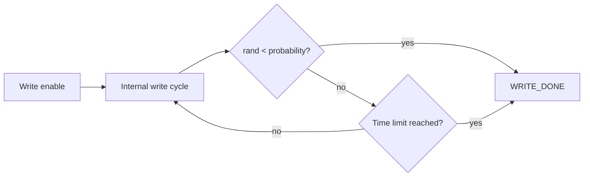

<!-- generated by yt-paper; edits will be overwritten -->
[DVCon](../dvcon/index.md) › [US](../dvcon/us.md) › [2024](../dvcon/by-year.md#2024) › [Verification](../dvcon/by-topic.md#verification)

# Variation-Aware Modeling Method for MRAM Behavior Model using System-Verilog

<figure class="rep-fig" markdown>
{ loading=lazy }
<figcaption>Fig. 3. Write operation flow chart of MRAM — from the original paper (S. Do et al.)</figcaption>
</figure>

[:material-open-in-new: Original paper](https://dvcon-proceedings.org/wp-content/uploads/1091.pdf){ .md-button .md-button--primary target=_blank }

| | |
|---|---|
| Authors | S. Do (Samsung Electronics, Foundry Division), S. Shin (Samsung Electronics, Foundry Division), J. Jang (Samsung Electronics, Foundry Division), D. Kim (Samsung Electronics, Foundry Division) |
| Venue | DVCon US 2024 |
| Topic | Verification |
| Type | PAPER |
| ID | `ref-20261018-d4fc` |

## Summary

**A System-Verilog behavioral model for embedded MRAM that injects MTJ write-time randomness and per-bit write-voltage variation, enabling variation-aware IP verification for Samsung Foundry's DNA IP.**

**MTJ의 쓰기 시간 랜덤성과 비트별 쓰기 전압 변동을 주입하는 System-Verilog 기반 임베디드 MRAM 행동 모델로, Samsung Foundry DNA IP의 variation-aware IP 검증을 가능하게 한다.**

## Key Insights

- Replacing the fixed-time write model with a probabilistic internal-write loop ($urandom_range) bounded by a maximum write time makes write-busy timing vary as it does on silicon.

- 고정 시간 쓰기 모델을 최대 쓰기 시간으로 제한되는 확률적 내부 쓰기 루프($urandom_range)로 대체하여, 쓰기 busy 타이밍이 실리콘처럼 변동하도록 만든다.

- Per-bit minimum write voltage is sampled with $dist_normal and stored in a packed struct 'mbit' (data plus two 10-bit reference voltages), which lets the model inject realistic write failures.

- 비트별 최소 쓰기 전압은 $dist_normal로 샘플링되어 packed struct 'mbit'(data와 두 개의 10비트 reference voltage)에 저장되며, 이를 통해 현실적인 쓰기 실패를 주입할 수 있다.

- Table I gives 16 Mb fail-bit ratios of 21.83500% (write-0) and 45.57641% (write-1) at trim code 0, falling to 0.00001% (write-0) at trim code 10.

- Table I에 따르면 trim code 0에서 16 Mb의 fail-bit 비율은 write-0 21.83500%, write-1 45.57641%이며, write-0 trim code 10에서는 0.00001%로 떨어진다.

- The paper argues System-Verilog is preferable to Verilog-A for digital-centric verification of analog-like behavior, but evidence is qualitative: no coverage, runtime, or silicon-correlation data are reported, and voltages are obfuscated as trim codes.

- 논문은 아날로그 유사 동작의 디지털 중심 검증에는 Verilog-A보다 System-Verilog가 적합하다고 주장하지만, 근거는 정성적이다. 커버리지, 실행 시간, 실리콘 상관관계 데이터는 보고되지 않았고 전압은 trim code로 치환되어 제시된다.

## Detailed Summary

### Background and Problem

- Behavioral models for large memories abstract away analog detail, so conventional register-based SRAM-style models cannot capture MRAM MTJ randomness: probabilistic write completion (variable write time) and write-voltage spread from process variation.

- 대용량 메모리의 행동 모델은 아날로그 세부 동작을 추상화하므로, 기존 SRAM식 register 기반 모델로는 MRAM MTJ의 랜덤성(확률적 쓰기 완료에 따른 가변 쓰기 시간, 공정 변동에 따른 쓰기 전압 편차)을 표현할 수 없다.

- The authors judge Verilog-A (used for prior PMC modeling) as more complex and time-consuming than SystemVerilog, citing a SystemVerilog PLL model as precedent.

- 저자들은 (기존 PMC 모델링에 쓰인) Verilog-A가 System-Verilog보다 복잡하고 시간이 많이 든다고 보며, System-Verilog 기반 PLL 모델을 선례로 든다.

- Goal: enable variation-aware test operations (write-voltage trimming, failure injection) for embedded MRAM during pre-silicon IP verification.

- 목표: 사전 실리콘 IP 검증 중 임베디드 MRAM에 대해 variation-aware 테스트 동작(쓰기 전압 trim, 실패 주입)을 가능하게 하는 것이다.

### Architecture and Methodology

- Time variation: on each negedge CK while WRITE_BUSY is high, a $urandom_range-based check continues or stops the internal write; a maximum write time forces completion, so write duration fluctuates within spec.

- 시간 변동: WRITE_BUSY가 high인 동안 negedge CK마다 $urandom_range 기반 검사가 내부 쓰기를 계속하거나 중단시키며, 최대 쓰기 시간이 완료를 강제하여 쓰기 기간이 규격 내에서 변동한다.

- Voltage variation: per-bit minimum write voltage is drawn with $dist_normal; a packed struct `mbit` (data, ref1_voltage, ref0_voltage) replaces plain reg arrays for main and repair rows.

- 전압 변동: 비트별 최소 쓰기 전압을 $dist_normal로 생성하며, packed struct `mbit`(data, ref1_voltage, ref0_voltage)이 main 및 repair row의 일반 reg 배열을 대체한다.

- A test-pin trim of the reference write voltage shifts the number of failing bits.

- 테스트 핀으로 reference 쓰기 전압을 trim하면 실패 비트 수가 변한다.

### Results and Conclusions

- Verified with Samsung DNA IP controlling embedded MRAM; time-variation mode produces variable write-busy behavior versus the fixed-time baseline (Figs. 9–10).

- Samsung DNA IP가 임베디드 MRAM을 제어하는 환경에서 검증되었으며, 시간 변동 모드는 고정 시간 기준 대비 가변적인 write-busy 동작을 보인다(Figs. 9–10).

- Table I (16 Mb): at trim code 0, write-0 fail ratio is 21.83500% (3,663,305 bits) and write-1 is 45.57641% (7,646,453 bits); write-0 falls to 0.13499% at trim code 5.

- Table I (16 Mb): trim code 0에서 write-0 실패 비율은 21.83500%(3,663,305 bits), write-1은 45.57641%(7,646,453 bits)이며, write-0은 trim code 5에서 0.13499%로 감소한다.

- Voltage data are replaced by trim codes for security reasons. Cross-checking with a Siemens TMBIST solution under development is mentioned.

- 보안상의 이유로 전압 데이터는 trim code로 치환되었다. 개발 중인 Siemens TMBIST 솔루션과의 교차 검증이 언급된다.

- The paper is qualitative: no coverage, runtime, or silicon-correlation results are reported.

- 본 논문은 정성적이며, 커버리지, 실행 시간, 실리콘 상관관계 결과는 보고되지 않았다.

## Videos

<iframe src="https://www.youtube-nocookie.com/embed/BPcFEl__kKc" title="[DVCON2024] Variation-Aware Modeling Method for MRAM Behavior Model using System-Verilog" loading="lazy" allow="accelerometer; clipboard-write; encrypted-media; gyroscope; picture-in-picture; web-share" referrerpolicy="strict-origin-when-cross-origin" allowfullscreen></iframe>

**[DVCON2024] Variation-Aware Modeling Method for MRAM Behavior Model using System-Verilog** — [Watch on YouTube](https://www.youtube.com/watch?v=BPcFEl__kKc) · [Video page](../videos/BPcFEl__kKc.md)
