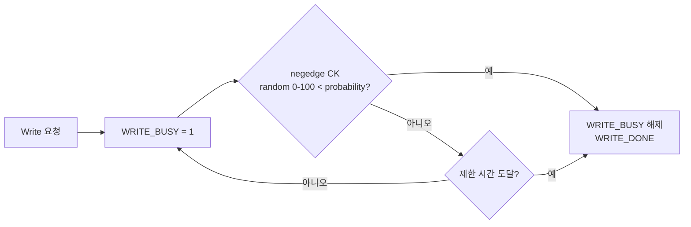
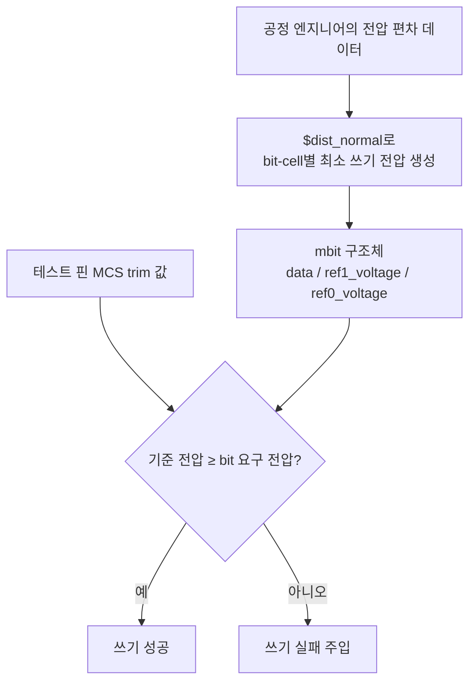

<!-- generated by yt-paper; edits will be overwritten -->
[DVCon](../dvcon/index.md) › [US](../dvcon/us.md) › [2024](../dvcon/by-year.md#2024) › [Verification](../dvcon/by-topic.md#verification)

# Variation-Aware Modeling Method for MRAM Behavior Model using System-Verilog

[:material-open-in-new: Original paper](https://dvcon-proceedings.org/wp-content/uploads/1091.pdf){ .md-button .md-button--primary target=_blank }

| | |
|---|---|
| Authors | S. Do, S. Shin, J. Jang, D. Kim (Samsung Electronics, Foundry Division). 학회/저널 정보는 본문에 없음. 입력 힌트의 "Laura Leblanc"는 본문과 일치하지 않음. |
| Venue | DVCon US 2024 |
| Topic | Verification |
| Type | PAPER |
| ID | `ref-20261018-d4fc` |

## Summary

**MRAM의 확률적 쓰기 시간과 bit-cell별 쓰기 전압 편차를 SystemVerilog 행동 모델에 반영해, 프로세스 변동을 고려한 IP 검증을 가능하게 하는 방법을 제안한다.**

&nbsp;

## Key Insights

- MRAM 쓰기는 MTJ의 확률적 특성 때문에 단일 쓰기로 보장되지 않아 내부 write/read 반복이 필요하고, 그 결과 쓰기 시간이 가변적이다. 기존 register 기반 메모리 모델은 이런 동작을 표현할 수 없다.

&nbsp;

- 쓰기 시간 변동은 $urandom_range로 매 클럭 negedge마다 확률 판정을 하고, 제한 시간이 도달하면 강제로 쓰기를 완료시키는 방식으로 모델링한다. 기능 검증 시 타이밍 여유를 점검하는 데 쓸 수 있다.

&nbsp;

- 쓰기 전압 변동은 bit-cell별 최소 필요 쓰기 전압을 $dist_normal(정규분포)로 생성하고, typedef struct packed(mbit)에 data와 ref0/ref1 전압 필드를 함께 담아 저장하는 구조다. 메모리 배열 타입을 확장하는 방식이라 기존 메모리 선언 구조와 호환성 고려가 필요하다.

&nbsp;

- trim 값(MCS 테스트 핀)에 따른 fail bit 수를 16Mb/128Mb 기준으로 제시해, 트리밍 설정이 불량 bit 수에 미치는 영향을 검증 시나리오에 포함할 수 있음을 보였다. 다만 실제 전압 데이터는 보안상 trim 값으로 대체되었다.

&nbsp;

- 정량적 성능 지표(시뮬레이션 속도 오버헤드, 실리콘 상관 정확도 등)는 제시되지 않고, 파형 비교와 DNA IP 검증 및 Siemens TMBIST와의 교차 확인 정도로만 검증되었다. 방법론의 일반성은 주장되지만 근거는 제한적이다.

&nbsp;

## Detailed Summary

### 배경 및 문제 정의

&nbsp;

메모리 IP의 행동 모델(behavioral model)은 논리 시뮬레이션용으로 주요 기능(read, write, scan shift, capture 등)만 구현하는 것이 일반적이다. SRAM처럼 bit-cell을 register로 표현하는 방식은 쓰기/읽기 동작이 단순하므로 충분하다. 그러나 MRAM은 MTJ(Magnetic Tunnel Junction) 소자의 확률적 특성 때문에 이 방식으로는 다음 두 가지 변동을 표현할 수 없다.

&nbsp;

- **쓰기 시간 변동**: 단일 쓰기로 데이터가 보장되지 않아 내부적으로 write/read를 반복하며, 그 결과 쓰기 완료 시간이 매번 달라진다.

&nbsp;

- **쓰기 전압 변동**: 공정 변동에 따라 bit-cell마다 필요한 최소 쓰기 전압이 다르다. 또한 신뢰성/내구성 문제 때문에 MRAM은 공정별 최적 쓰기 전압을 trim으로 찾아 사용한다.

&nbsp;

저자들은 이 두 변동을 SystemVerilog 행동 모델에 반영해, 실리콘 전 디지털 검증에서 trim·calibration 기능까지 검증할 수 있게 하는 것을 목표로 한다. 또한 Verilog-A 대신 SystemVerilog를 쓰는 것이 모델링 용이성 측면에서 바람직하다고 주장한다(관련 연구 PMC의 Verilog-A 모델, PLL의 SystemVerilog 모델을 인용).

&nbsp;

### 핵심 아키텍처 및 방법론

&nbsp;

모델링은 두 가지 접근으로 구성된다.

&nbsp;

**1) 시간 변동 모델링 (Time-Variation)**

&nbsp;

내부 쓰기 시퀀스를 확률적으로 계속/중단하도록 만든다. 쓰기 busy 신호(WRITE_BUSY)가 1인 동안 negedge CK마다 `$urandom_range(0,100)`으로 난수를 뽑고, 그 값이 설정된 probability보다 작으면 쓰기를 종료(WRITE_DONE)한다. 쓰기 시간이 지정된 제한에 도달하면 쓰기를 강제로 완료시켜, 쓰기 시간은 변동하지만 사양 내에서 항상 쓰기가 보장되도록 한다. 문서의 코드 조각은 일부가 OCR로 깨져 있어(예: `WRITE_BISY`, `endl=`) 정확한 구현은 원문 흐름으로만 파악 가능하다.

&nbsp;

**2) 전압 변동 모델링 (Voltage-Variation)**

&nbsp;

공정 변동으로 생기는 쓰기 전압 편차를 반영한다. 편차 데이터는 공정 엔지니어에게서 받아야 한다. 다음 구조를 사용한다.

&nbsp;

- MTJ의 쓰기 전압 특성이 정규분포를 따른다고 보고, `$dist_normal`로 bit-cell별 최소 필요 쓰기 전압을 생성한다.

&nbsp;

- `typedef struct packed`로 `mbit` 타입을 정의한다. 필드는 `logic data`, `bit [9:0] ref1_voltage`, `bit [9:0] ref0_voltage`이다.

&nbsp;

- 기존 메모리 배열 선언(`reg [...] mem[...]`, mem0~mem7 repair row 포함)을 `mbit` 배열로 바꾼다(Fig. 6 → Fig. 7).

&nbsp;

- 쓰기 시 기준 전압(trim 설정)이 해당 bit-cell의 최소 요구 전압을 만족하지 못하면 의도적으로 쓰기 실패를 발생시킨다.

&nbsp;

### 실험 결과 및 결론

&nbsp;

**검증 방식**

&nbsp;

- 고정 쓰기 시간 시뮬레이션(Fig. 10)에서는 WBF(Write Busy Flag)가 규칙적으로 올라가고 내려간다.

&nbsp;

- 시간 변동 모드(Fig. 9)에서는 쓰기 시간이 무작위로 바뀌는 것을 파형으로 확인했다.

&nbsp;

- 전압 변동 모드에서는 최소 쓰기 전압을 만족하지 못하는 bit-cell에서 의도한 쓰기 실패가 나타났다. 테스트 핀으로 기준 전압을 trim하면 실패 bit 수가 증감했다.

&nbsp;

- 이 모델을 DNA(Digital Nonvolatile-memory Assist) IP 검증에 적용했고, 개발 중인 Siemens TMBIST 솔루션과도 교차 확인했다고 밝혔다.

&nbsp;

**Fig. 8 / Table I: trim 값별 fail bit 수 (16Mb / 128Mb 기준, ideal)**

&nbsp;

| trim 값 | Write-0 fail 비율 | Write-0 fail bit (16Mb) | Write-1 fail 비율 | Write-1 fail bit (16Mb) |
|---|---|---|---|---|
| 0 | 21.83500% | 3,663,305 | 45.57641% | 7,646,453 |
| 1 | 11.08118% | 1,859,114 | 25.24925% | 4,236,122 |
| 2 | 4.77904% | 801,789 | 11.08118% | 1,859,114 |
| 3 | 1.73814% | 291,611 | 3.77202% | 632,840 |

&nbsp;

trim 값이 커질수록 fail 비율이 단조 감소하는 경향을 보인다. 원문은 실제 전압 값 대신 trim 값으로 표기했다(보안 이유).

&nbsp;

**결론 및 한계**

&nbsp;

- 저자들은 SystemVerilog 기반 행동 모델에 쓰기 시간·전압 변동을 넣어, trim/calibration 및 실패 주입 같은 테스트 기능을 사전 실리콘 검증에서 수행할 수 있게 했다고 결론짓는다. 제안 방법은 다른 메모리 IP에도 확장 가능하다고 주장한다.

&nbsp;

- 다만 문서에는 시뮬레이션 성능 오버헤드, 실리콘 측정 데이터와의 정량적 상관, 커버리지 지표가 제시되지 않았다. 검증 근거는 파형 비교와 IP 검증 적용 사례 수준에 머문다.

&nbsp;

- 학회·발표 정보는 본문에 나타나지 않는다.

&nbsp;

## Videos

<iframe src="https://www.youtube-nocookie.com/embed/BPcFEl__kKc" title="[DVCON2024] Variation-Aware Modeling Method for MRAM Behavior Model using System-Verilog" loading="lazy" allow="accelerometer; clipboard-write; encrypted-media; gyroscope; picture-in-picture; web-share" referrerpolicy="strict-origin-when-cross-origin" allowfullscreen></iframe>

**[DVCON2024] Variation-Aware Modeling Method for MRAM Behavior Model using System-Verilog** — [Watch on YouTube](https://www.youtube.com/watch?v=BPcFEl__kKc) · [Video page](../videos/BPcFEl__kKc.md)
