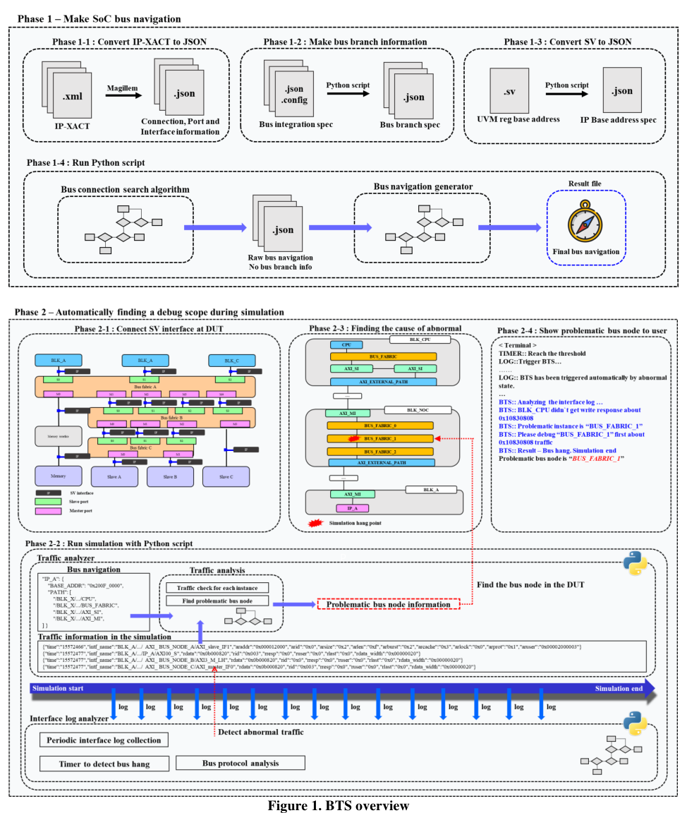
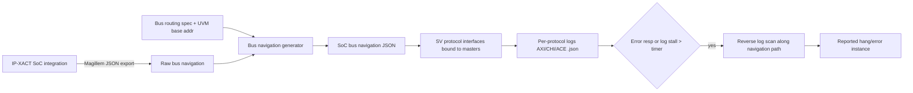

<!-- generated by yt-paper; edits will be overwritten -->
[DVCon](../dvcon/index.md) › [US](../dvcon/us.md) › [2024](../dvcon/by-year.md#2024) › [Verification](../dvcon/by-topic.md#verification)

# Bus Trace System: Automating Bus Traffic Debugging in IP-XACT Based SoC Beyond Traditional Debugging Methods

<figure class="rep-fig" markdown>
{ loading=lazy }
<figcaption>Figure 1. BTS overview — from the original paper (Wonyeong So et al.)</figcaption>
</figure>

[:material-open-in-new: Original paper](https://dvcon-proceedings.org/wp-content/uploads/1078.pdf){ .md-button .md-button--primary target=_blank }

| | |
|---|---|
| Authors | Wonyeong So (Samsung Electronics Co. Ltd.), Yonghyun Yang (Samsung Electronics Co. Ltd.), Sun-il Roe (Samsung Electronics Co. Ltd.), Moonki Jang (Samsung Electronics Co. Ltd.), Youngsik Kim (Samsung Electronics Co. Ltd.), Seonil Brian Choi (Samsung Electronics Co. Ltd.); affiliation: Samsung Electronics Co. Ltd., Seoul, Korea |
| Venue | DVCon US 2024 |
| Topic | Verification |
| Type | PAPER |
| ID | `ref-20261018-dded` |

## Summary

**BTS (Bus Trace System) automatically builds SoC bus navigation paths from IP-XACT integration data and, using only simulation interface logs, pinpoints the bus node responsible for bus hangs and error responses without waveform inspection.**

**BTS(Bus Trace System)는 IP-XACT 통합 정보로 SoC 버스 navigation 경로를 자동 생성하고, 시뮬레이션 인터페이스 로그만으로 waveform 확인 없이 bus hang 및 error response를 유발한 버스 노드를 찾아내는 기법이다.**

## Key Insights

- BTS replaces node-by-node waveform tracing with a two-phase flow: (1) build SoC bus navigation JSON from IP-XACT (via Magillem export), a bus routing spec, and per-IP base addresses; (2) bind SystemVerilog protocol interfaces/inspectors to all masters and analyze per-protocol logs (AXI.json, CHI.json, ACE.json) during simulation.

- BTS는 노드별 waveform 추적을 두 단계 흐름으로 대체한다. (1) Magillem JSON export, 버스 routing spec, IP별 base address로 SoC 버스 navigation JSON을 만들고, (2) 마스터에 SystemVerilog 프로토콜 인터페이스를 바인딩해 프로토콜별 로그(AXI.json, CHI.json, ACE.json)를 시뮬레이션 중 분석한다.

- Bus navigation uses a two-stage search: a raw navigation file is first built from the key-interface graph (e.g., AXI MISC_M), then rectified with bus routing address ranges so that the counter instance is selected correctly at routing instances.

- Bus navigation은 두 단계 탐색으로 만든다. 먼저 key interface 그래프(예: AXI MISC_M)로 raw navigation 파일을 만들고, 이후 bus routing 주소 범위로 보정해 routing instance에서 counter instance를 정확히 고른다.

- Log analysis triggers on an error response or when the log stops printing past a timer threshold, then scans traffic backwards from the end of the log along the navigation path; in the worked example the hang was localized to BUS_FABRIC_1 because the last write response appeared at BUS_FABRIC_2.

- 로그 분석은 error response가 발생하거나 로그 출력이 멈추고 timer가 임계값을 넘으면 시작된다. 이후 navigation 경로를 따라 로그 끝에서부터 역방향으로 스캔한다. 예제에서는 마지막 write response가 BUS_FABRIC_2에서만 나타나 BUS_FABRIC_1이 hang 지점으로 보고되었다.

- Across three Samsung SoC projects, bus hang plus error response bugs were 10.6-12.0% of total bugs (A: 466/3,964; B: 112/1,057; C: 503/4,199), and at least 50% of these occurred before implementation start.

- 세 개 SoC 프로젝트에서 bus hang과 error response 버그는 전체 버그의 10.6~12.0%였다(A: 466/3,964, B: 112/1,057, C: 503/4,199). 이 버그들의 50% 이상은 implementation 시작 이전에 발생했다.

- The paper gives no measured debug-time reduction or runtime overhead; the benefit is argued qualitatively (worst case 10T for a 10-node path versus direct localization), so the performance claim is unvalidated.

- 논문은 디버그 시간 단축 수치나 런타임 오버헤드를 측정해 제시하지 않는다. 이점은 정성적으로만 주장되며(10노드 경로의 최악 10T 대비 직접 위치 파악), 성능 주장은 검증되지 않았다.

## Detailed Summary

### Background and Problem

- SoC complexity (multi-core coherence, 3D and multi-chip integration) has grown the number of IP interfaces and bus node instances. The paper cites verification engineer peaks rising from 4.8 (2007) to 11.6 (2016), and the verification share of project time rising from 47% (2014) to 54% (2018).

- SoC 복잡도(multi-core coherence, 3D 및 multi-chip 집적)가 증가하면서 IP 인터페이스와 bus node 인스턴스 수가 늘었다. 논문은 검증 엔지니어 피크 수가 2007년 4.8명에서 2016년 11.6명으로 증가했고, 프로젝트 시간 중 검증 비중이 2014년 47%에서 2018년 54%로 늘었다고 인용한다.

- For bus hang and error response, the conventional method traces every relevant bus node to find where the error first appears. In the paper's example, a master reaching a slave through 10 bus nodes requires up to $10T$ in the worst case, where $T$ is the time to check one node.

- bus hang과 error response의 경우 기존 방식은 관련 bus node를 모두 추적해 오류가 처음 나타난 지점을 찾는다. 논문 예시에서 마스터가 bus node 10개를 거쳐 slave에 접근하면, 노드당 확인 시간을 $T$라 할 때 최악의 경우 $10T$가 필요하다.

- Engineers with less SoC experience take longer. Even experienced engineers cannot reliably spot the faulty node at a glance.

- SoC 경험이 적은 엔지니어일수록 시간이 더 걸린다. 숙련된 엔지니어도 문제 노드를 한눈에 찾기 어렵다.

### Architecture and Methodology

BTS runs in two phases.

BTS는 두 단계로 동작한다.

**Phase 1: SoC bus navigation generation**

**1단계: SoC bus navigation 생성**

- The IP-XACT integration data is exported to JSON with Magillem. A separate script converts the bus integration spec into a bus routing spec JSON, and another reads the SoC-level UVM register base-address SystemVerilog file to produce a base-address JSON per IP.

- IP-XACT 통합 정보를 Magillem으로 JSON으로 export한다. 별도 스크립트가 bus integration spec을 bus routing spec JSON으로 변환하고, SoC 수준 UVM register base-address SystemVerilog 파일을 읽어 IP별 base-address JSON을 만든다.

- Bus connection search: starting from the host CPU and using the UVM register model file for the final destination list, the algorithm walks adjacent instances via key interfaces per protocol (AXI, ACE, CHI, custom). Example: for AXI slaves, MISC_M is the key interface, and its connected interface identifies the counter instance. The search recurses until a destination is reached, producing a **raw** navigation file. This file ignores routing and may be wrong.

- Bus connection search: host CPU에서 시작하며, UVM register model 파일로 최종 목적지 목록을 만든다. 프로토콜별 key interface(AXI, ACE, CHI, custom)를 따라 인접 인스턴스를 탐색한다. 예: AXI slave의 key interface는 MISC_M이며, 연결된 인터페이스가 counter instance를 결정한다. 목적지에 도달할 때까지 재귀 탐색하여 **raw** navigation 파일을 만든다. 이 파일은 routing 정보를 고려하지 않아 잘못된 정보를 포함할 수 있다.

- Bus navigation generator: the raw file is refined with routing address ranges per destination base address. At each bus routing instance, the counter interface is chosen by matching the target address to the interface's range, producing the final navigation file.

- Bus navigation generator: 목적지 IP의 base address별 routing 주소 범위로 raw 파일을 보정한다. Routing instance마다 목표 주소가 속한 인터페이스 범위를 기준으로 counter interface를 고르고, 최종 navigation 파일을 만든다.

**Phase 2: Debug-scope discovery during simulation**

**2단계: 시뮬레이션 중 디버그 범위 탐지**

- Testbench SystemVerilog interfaces are bound to all DUT masters. Each protocol interface contains inspectors: a handshake detector that accepts only valid transactions, a burst-length checker, and a timer for hang detection.

- 테스트벤치의 SystemVerilog 인터페이스를 DUT의 모든 마스터에 바인딩한다. 각 프로토콜 인터페이스에는 inspector가 포함된다. 유효 트랜잭션만 검출하는 handshake detector, burst length 검사기, hang 검출용 timer가 있다.

- For efficiency, logs are written per protocol (AXI.json, CHI.json, ACE.json) rather than per master, and only valid traffic is recorded in chronological order.

- 효율을 위해 마스터별이 아니라 프로토콜별 로그(AXI.json, CHI.json, ACE.json)를 작성하며, 유효 트래픽만 시간순으로 기록한다.

- A Python analyzer runs concurrently. It activates on a bus error response, or when log output stalls and the timer exceeds a threshold. It computes the IP base address of the faulty traffic, retrieves that IP's navigation path, and scans the log backwards from the last instance, since responses return along the path. The first point where the response is missing is reported.

- Python 분석기가 시뮬레이션과 병행하여 실행된다. Bus error response가 발생하거나 로그 출력이 멈추고 timer가 임계값을 넘으면 동작한다. 문제 트래픽의 IP base address를 계산하고, 해당 IP의 navigation 경로를 가져온 뒤, 마지막 인스턴스부터 로그를 역방향으로 스캔한다. 응답은 경로를 거슬러 돌아오기 때문이다. 응답이 빠진 첫 지점이 보고된다.

- Worked example: BLK_CPU writes to 0x1083_0808 and gets no response from IP_A. The base address is 0x1083_0000. The last write response appears at BUS_FABRIC_2 but not BUS_FABRIC_1, so BUS_FABRIC_1 is reported as the hang point in the terminal output.

- 작동 예시: BLK_CPU가 0x1083_0808에 write를 발행했지만 IP_A로부터 응답을 받지 못한다. Base address는 0x1083_0000이다. 마지막 write response 로그는 BUS_FABRIC_2에서만 나타나므로 BUS_FABRIC_1이 hang 지점으로 터미널에 보고된다.

### Results and Conclusions

- Table 1 (three SoC projects):

- 표 1 (세 개 SoC 프로젝트):

| Project | Bus hang | Error response | Total bugs | Ratio |
|---|---|---|---|---|
| A | 320 | 146 | 3,964 | 0.1176 |
| B | 76 | 36 | 1,057 | 0.106 |
| C | 411 | 92 | 4,199 | 0.12 |

| Project | Bus hang | Error response | Total bugs | Ratio |
|---|---|---|---|---|
| A | 320 | 146 | 3,964 | 0.1176 |
| B | 76 | 36 | 1,057 | 0.106 |
| C | 411 | 92 | 4,199 | 0.12 |

- The paper concludes that about 10-12% of all errors are of the kind BTS can identify.

- 논문은 전체 오류의 약 10~12%가 BTS로 식별 가능한 유형이라고 결론짓는다.

- Cumulative occurrence (Figure 7) shows that at least 50% of these bugs occurred before implementation start in all three projects, and the rate stays above 50% when measured from synthesis start. The authors argue that early bus stabilization shortens the schedule, because bugs found after synthesis can force re-synthesis and delay layout. A hang can also mask IP, security, and other bugs.

- 누적 발생률(Figure 7)에 따르면 세 프로젝트 모두 이런 버그의 최소 50%가 implementation 시작 이전에 발생했다. Synthesis 시작 기준으로 측정해도 50% 이상이 관찰된다. 저자들은 초기 bus 안정화가 일정을 단축한다고 주장한다. Synthesis 이후 발견된 버그는 re-synthesis를 유발하고 layout을 지연시킬 수 있기 때문이다. 또한 hang은 IP, 보안 등 다른 버그의 발견을 지연시킬 수 있다.

- Limitations: the paper reports no measured debug-time reduction, no per-case turnaround numbers, and no runtime overhead. Figure 7 is cited but is not in the provided caption list. The benefits are presented qualitatively.

- 한계: 논문은 디버그 시간 단축 수치, 사례별 TAT, 런타임 오버헤드를 측정해 보고하지 않는다. Figure 7은 본문에서 인용되지만 제공된 caption 목록에는 없다. 이점은 정성적으로 제시된다.

## Videos

<iframe src="https://www.youtube-nocookie.com/embed/zHAIrWaCa3Y" title="[DVCON2024] Bus Trace System: Automating Bus Traffic Debugging in IP-XACT Based SoC Beyond ... Debug" loading="lazy" allow="accelerometer; clipboard-write; encrypted-media; gyroscope; picture-in-picture; web-share" referrerpolicy="strict-origin-when-cross-origin" allowfullscreen></iframe>

**[DVCON2024] Bus Trace System: Automating Bus Traffic Debugging in IP-XACT Based SoC Beyond ... Debug** — [Watch on YouTube](https://www.youtube.com/watch?v=zHAIrWaCa3Y) · [Video page](../videos/zHAIrWaCa3Y.md)
