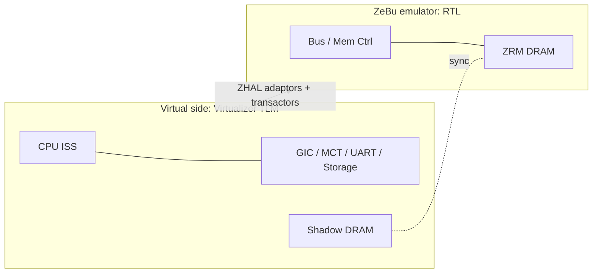

<!-- generated by yt-paper; edits will be overwritten -->
[DVCon](../dvcon/index.md) › [India](../dvcon/india.md) › [2024](../dvcon/by-year.md#2024) › [Emulation](../dvcon/by-topic.md#emulation)

# Unveiling Advance Hybrid Emulation Methodology for Accelerated Android Home Screen Bring-up and System Level Verification

<figure class="rep-fig" markdown>
{ loading=lazy }
<figcaption>Figure 6. Hybrid Platform Architecture — from the original paper (Rinkesh Yadav et al.)</figcaption>
</figure>

[:material-open-in-new: Original paper](https://dvcon-proceedings.org/wp-content/uploads/5B3-DVCon_India_2024_Final_Paper_2224.pdf){ .md-button .md-button--primary target=_blank }

| | |
|---|---|
| Authors | Rinkesh Yadav (Samsung Semiconductor India Research), Sarang Kalbande (Samsung Semiconductor India Research), Garima Srivastava (Samsung Semiconductor India Research), Hyundon Kim (Samsung Electronics); DVCon Europe |
| Venue | DVCon India 2024 |
| Topic | Emulation |
| Type | PAPER |
| ID | `ref-20261018-e0d9` |

## Summary

**Proposes a hybrid emulation methodology that splits an SoC between a SystemC/TLM virtual platform (CPU, peripherals, shadow DRAM) and ZeBu RTL emulation (bus, memory controller), reducing Android home-screen bring-up on a ~2B-gate Exynos SoC from ~4 days to ~72 minutes.**

**CPU, 주변장치, shadow DRAM은 SystemC/TLM 가상 플랫폼에, bus와 memory controller는 ZeBu RTL 에뮬레이션에 배치하는 하이브리드 에뮬레이션 방법론을 제안하며, 약 20억 게이트 Exynos SoC에서 Android 홈 화면 bring-up 시간을 약 4일에서 약 72분으로 줄였다.**

## Key Insights

- Pure ZeBu emulation at a 1 MHz driver clock needs about 4 days to reach the Android home screen on a ~2B-gate Exynos SoC, which makes iterative kernel and driver work impractical.

- 1 MHz 드라이버 클록의 순수 ZeBu 에뮬레이션은 약 20억 게이트 Exynos SoC에서 Android 홈 화면에 도달하는 데 약 4일이 걸려 반복적인 커널 및 드라이버 작업이 non-realistic하다.

- Moving CPU, GIC, MCT, UART, peripherals and DRAM to a SystemC/TLM virtual side (ARM Fast Models) while keeping bus and memory controller on ZeBu brings the home screen up in ~72 min (Linux kernel ~2 min, Android logo ~12 min).

- CPU, GIC, MCT, UART, 주변장치, DRAM을 SystemC/TLM 가상 측(ARM Fast Models)으로 옮기고 bus와 memory controller는 ZeBu에 유지하면 홈 화면 bring-up이 약 72분(Linux 커널 약 2분, Android 로고 약 12분)으로 단축된다.

- Shared DRAM, which pairs emulator-side ZRM memory with a virtual-side shadow memory synchronized through transactors, is the mechanism used to cut CPU-DRAM transaction latency.

- 에뮬레이터 측 ZRM 메모리와 가상 측 shadow memory를 transactor로 동기화하는 shared DRAM이 CPU-DRAM 트랜잭션 지연을 줄이는 핵심 메커니즘이다.

- Hybrid mode has no cache coherency and no SMP support (Fast Models are single-core), so both must be disabled during Linux and Android bring-up.

- 하이브리드 모드는 cache coherency와 SMP를 지원하지 않으므로(Fast Models는 single-core), Linux 및 Android bring-up 동안 둘 다 비활성화해야 한다.

- Debugging is harder than in pure emulation: the ~1M-cycle recording window may miss root causes separated by billions of instructions, and the proposed gear-shift method (moving CPU state to RTL after boot) is aimed at CPU benchmarking.

- 디버그는 순수 에뮬레이션보다 어려우며, 약 100만 사이클의 기록 윈도우는 수십억 명령어 떨어진 근본 원인을 놓칠 수 있고, 제안된 gear-shift 방식(부팅 후 CPU 상태를 RTL로 이동)은 CPU 벤치마크를 겨냥한다.

## Detailed Summary

### Background and Problem

- Software bring-up usually happens post-silicon, where RTL debug visibility is poor and silicon re-spin risk is high. Simulation (~100 Hz) and FPGA prototypes are too slow or lack visibility for OS-level work.

- SW bring-up은 보통 post-silicon 단계에서 이루어지며, 이때 RTL 디버그 가시성이 낮고 silicon re-spin 위험이 크다. 시뮬레이션(약 100 Hz)과 FPGA 프로토타입은 OS 수준 작업에 너무 느리거나 가시성이 부족하다.

- Pure emulation on a ~2B-gate Exynos SoC at a 1 MHz driver clock takes about 4 days to reach the Android home screen. CPU-DRAM transactions dominate boot time, which makes iterative kernel and driver development impractical.

- 약 20억 게이트 Exynos SoC의 순수 에뮬레이션은 1 MHz 드라이버 클록에서 Android 홈 화면까지 약 4일이 걸린다. CPU-DRAM 트랜잭션이 부팅 시간을 지배하여 반복적인 커널 및 드라이버 개발이 비현실적이다.

### Architecture and Methodology

- Partition: the virtual side (Virtualizer, TLM/VDK, ARM Fast Models) runs CPU, GIC, MCT, UART, peripherals, storage and DRAM. The ZeBu emulator runs bus, memory controller and M/M IPs in RTL.

- 분할: 가상 측(Virtualizer, TLM/VDK, ARM Fast Models)은 CPU, GIC, MCT, UART, 주변장치, storage, DRAM을 실행한다. ZeBu 에뮬레이터는 bus, memory controller, M/M IP를 RTL로 실행한다.

- Connectivity: ZHAL adaptors wrap the transactors in the emulation testbench as TLM models. The CPU runs on an ISS, which is much faster than gate-level emulation.

- 연결: ZHAL adaptor가 에뮬레이션 testbench의 transactor를 감싸 TLM 모델로 제공한다. CPU는 ISS로 동작하며 gate-level 에뮬레이션보다 훨씬 빠르다.

- Shared DRAM: emulator-side ZRM memory is kept in sync with a virtual-side shadow memory through transactors, which reduces CPU-DRAM latency.

- Shared DRAM: 에뮬레이터 측 ZRM 메모리를 transactor로 가상 측 shadow memory와 동기화하여 CPU-DRAM 지연을 줄인다.

- Limits: no cache coherency and no SMP, so both must be disabled. Debug spans TLM chart view, T32 and VP disassembly, adaptor log levels, and Verdi waveforms.

- 한계: cache coherency와 SMP를 지원하지 않으므로 둘 다 비활성화해야 한다. 디버그는 TLM chart view, T32 및 VP disassembly, adaptor log level, Verdi 파형을 포함한다.

### Results and Conclusions

- Table 2 (Exynos, ~2B gates): pure emulation needs about 4 days for the Android home screen. Hybrid needs about 2 min for the Linux kernel, about 12 min for the Android logo and about 72 min for the home screen.

- Table 2(Exynos, 약 20억 게이트): 순수 에뮬레이션은 Android 홈 화면까지 약 4일이 필요하다. 하이브리드는 Linux 커널 약 2분, Android 로고 약 12분, 홈 화면 약 72분이 필요하다.

- Software debug is harder: the ~1M-cycle recording window may miss root causes that sit billions of instructions from the symptom.

- SW 디버그는 더 어렵다. 약 100만 사이클의 기록 윈도우는 증상으로부터 수십억 명령어 떨어진 근본 원인을 놓칠 수 있다.

- Future work: a gear-shift method moves CPU state from the virtual CPU to the RTL CPU after boot to enable CPU benchmarks. SMP/coherency and multi-chip support are also being explored.

- 향후 과제: 부팅 후 가상 CPU 상태를 RTL CPU로 옮기는 gear-shift 방식으로 CPU 벤치마크를 가능하게 하며, SMP/coherency와 multi-chip 지원도 연구 중이다.

- This is an industrial experience report based on a single SoC. Its comparison is limited to bring-up time.

- 단일 SoC 기반의 산업 경험 보고서이며, 비교는 bring-up 시간에 한정된다.

## Videos

<iframe src="https://www.youtube-nocookie.com/embed/z_FazIJe56Q" title="[DVCON2024_INDIA]Unveiling Advance Hybrid Emulation for Accelerated Android Home Screen Bring-up" loading="lazy" allow="accelerometer; clipboard-write; encrypted-media; gyroscope; picture-in-picture; web-share" referrerpolicy="strict-origin-when-cross-origin" allowfullscreen></iframe>

**[DVCON2024_INDIA]Unveiling Advance Hybrid Emulation for Accelerated Android Home Screen Bring-up** — [Watch on YouTube](https://www.youtube.com/watch?v=z_FazIJe56Q) · [Video page](../videos/z_FazIJe56Q.md)
