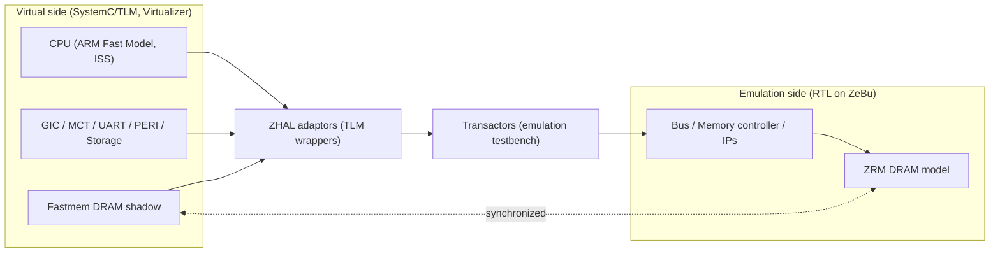

<!-- generated by yt-paper; edits will be overwritten -->
[DVCon](../dvcon/index.md) › [India](../dvcon/india.md) › [2024](../dvcon/by-year.md#2024) › [Emulation](../dvcon/by-topic.md#emulation)

# Unveiling Advance Hybrid Emulation Methodology for Accelerated Android Home Screen Bring-up and System Level Verification

<figure class="rep-fig" markdown>
{ loading=lazy }
<figcaption>Figure 1. SoC development stages and their cost comparison based on scaling transistor size — from the original paper (Rinkesh Yadav et al.)</figcaption>
</figure>

[:material-open-in-new: Original paper](https://dvcon-proceedings.org/wp-content/uploads/5B3-DVCon_India_2024_Final_Paper_2224.pdf){ .md-button .md-button--primary target=_blank }

| | |
|---|---|
| Authors | Rinkesh Yadav (Samsung Semiconductor India Research), Sarang Kalbande (Samsung Semiconductor India Research), Garima Srivastava (Samsung Semiconductor India Research), Hyundon Kim (Samsung Electronics) |
| Venue | DVCon India 2024 |
| Topic | Emulation |
| Type | PAPER |
| ID | `ref-20261018-e0d9` |

## Summary

**The paper presents a hybrid emulation platform that moves the CPU and DRAM model to a SystemC/TLM virtual side (Virtualizer, ARM Fast Models) and keeps the rest of the SoC on a ZeBu emulator, connected by transactors and a shared-DRAM model, cutting Android home-screen bring-up on a ~2B-gate Exynos SoC from about 4 days in pure emulation to about 72 minutes.**

**이 논문은 CPU와 DRAM 모델을 SystemC/TLM 가상 측(Virtualizer, ARM Fast Models)으로 옮기고 나머지 SoC는 ZeBu 에뮬레이터에 두며, transactor와 공유 DRAM 모델로 두 영역을 연결하는 하이브리드 에뮬레이션 플랫폼을 제시한다. 이를 통해 약 20억 게이트 Exynos SoC의 Android 홈 화면 bring-up 시간을 순수 에뮬레이션의 약 4일에서 약 72분으로 줄였다.**

## Key Insights

- Pure emulation at a 1 MHz driver clock needed about 4 days to bring up the full Android home screen on a ~2-billion-gate Exynos SoC, which makes iterative kernel and driver development impractical.

- 1 MHz 드라이버 클럭의 순수 에뮬레이션에서는 약 20억 게이트 Exynos SoC의 Android 홈 화면 bring-up에 약 4일이 걸려, 커널 및 드라이버를 반복 개발하기 어렵다.

- The hybrid platform reached a Linux kernel boot in about 2 minutes, the Android logo in about 12 minutes, and the Android home screen in about 72 minutes; this is roughly 80x faster than the 4-day pure-emulation figure (derived from the reported numbers).

- 하이브리드 플랫폼은 Linux 커널 부팅에 약 2분, Android 로고까지 약 12분, Android 홈 화면까지 약 72분이 걸렸다. 이는 보고된 수치로부터 계산하면 4일 대비 약 80배 빠르다.

- The CPU and DRAM are moved to the virtual side: the CPU runs as an ISS model, and DRAM is a Fastmem shadow model synchronized with the emulator's ZRM DRAM through transactors and ZHAL adaptors, which reduces the CPU-to-DRAM transaction bottleneck.

- CPU와 DRAM을 가상 측으로 옮긴다. CPU는 ISS 기반 ARM Fast Model로 동작하고, DRAM은 Fastmem 섀도우 모델이 되어 ZeBu의 ZRM DRAM과 transactor를 통해 동기화된다. 이로써 CPU-DRAM 트랜잭션 병목이 줄어든다.

- Hybrid mode has real limitations: the SystemC/TLM models do not support cache coherency, and ARM Fast Models lack multi-core simulation, so cache coherency and SMP must be disabled for Linux and Android work.

- 하이브리드 모드에는 제약이 있다. SystemC/TLM 모델은 cache coherency를 지원하지 않고, ARM Fast Model은 멀티코어 시뮬레이션을 지원하지 않으므로 Linux 및 Android 개발 시 cache coherency와 SMP를 비활성화해야 한다.

- Debug is split across domains: TLM Chart View, the VP disassembly and T32 debugger for software, transactor/adaptor log levels for HW-SW transactions, and Verdi waveforms for RTL. However, the million-cycle waveform window can miss the root cause of bugs that appear billions of instructions later.

- 디버그는 TLM Chart View, VP disassembly 및 T32 디버거(SW), transactor/adaptor 로그 레벨(HW-SW 트랜잭션), Verdi 파형(RTL)으로 나뉜다. 다만 약 100만 사이클의 디버그 윈도우는 수십억 명령 뒤에 관측되는 버그의 근본 원인을 놓칠 수 있다.

## Detailed Summary

### Background and Problem

- Software bring-up and validation on post-silicon hardware start too late, which hurts time to market and raises the risk of silicon re-spin. Post-silicon debug is also hard because RTL visibility is limited.

- SoC 소프트웨어 bring-up과 검증이 post-silicon 단계에서 이루어지면 제품 출시 시점이 늦어지고 silicon re-spin 비용 위험이 커진다. 또한 RTL 가시성이 낮아 post-silicon에서는 HW/SW 버그를 디버그하기 어렵다.

- The paper compares the four pre-silicon and silicon options. RTL simulation runs at about 100 Hz for the latest cores, so booting an OS is impractical. Emulation (ZeBu Server 5) reaches about 5 MHz with full visibility, but its cost of ownership is about an order of magnitude higher. FPGA prototypes have high cost and low debug visibility.

- 논문은 pre-silicon 및 silicon 단계의 4가지 검증 방식을 비교한다. RTL 시뮬레이션은 최신 코어 기준 약 100 Hz로 동작해 OS 부팅에 적합하지 않다. 에뮬레이션(ZeBu Server 5)은 약 5 MHz에 전체 내부 상태 가시성을 제공하지만 소유 비용이 약 한 자릿수(order of magnitude) 더 크다. FPGA 프로토타입은 비용이 높고 디버그 가시성이 낮다.

- In pure emulation, the CPU-to-DRAM transactions are the bottleneck for Linux and Android boot. The emulator driver clock was about 1 MHz, so bringing up the Android home screen took about 4 days.

- 순수 에뮬레이션에서는 Linux 및 Android 부팅의 병목이 CPU-DRAM 간 트랜잭션이다. 에뮬레이터 드라이버 클럭이 약 1 MHz였으며, Android 홈 화면 bring-up에 약 4일이 걸렸다.

### Architecture and Methodology

The hybrid platform splits the SoC across two domains:

하이브리드 플랫폼은 SoC를 두 영역으로 나눈다.

- **Virtual side (TLM/VDK, SystemC):** CPU (ISS-based ARM Fast Model), GIC, MCT, UART, PERI, storage, and a Fastmem DRAM shadow.

- **가상 측 (TLM/VDK, SystemC):** CPU(ISS 기반 ARM Fast Model), GIC, MCT, UART, PERI, 스토리지, Fastmem DRAM 섀도우.

- **Emulation side (RTL on ZeBu):** bus, memory controller, memory-mapped IPs, and the ZRM DRAM model.

- **에뮬레이션 측 (ZeBu의 RTL):** 버스, 메모리 컨트롤러, memory-mapped IP, ZRM DRAM 모델.

Connectivity uses ZHAL (ZeBu Hybrid Adaptors Library) adaptors inside Virtualizer Studio, which are wrapped as TLM models, and transactors in the emulation testbench. The shared-DRAM model keeps the emulator DRAM and the virtual shadow memory synchronized through the transactor, so most CPU memory traffic stays on the fast virtual side.

연결은 Virtualizer Studio 안에 있는 ZHAL(ZeBu Hybrid Adaptors Library) 어댑터(TLM 모델로 래핑)와 에뮬레이션 testbench의 transactor로 이루어진다. 공유 DRAM 모델은 에뮬레이터 DRAM과 가상 섀도우 메모리를 transactor를 통해 동기화하여 대부분의 CPU 메모리 트래픽이 빠른 가상 측에서 처리되도록 한다.

Debug methods are: (i) TLM transaction debug in Chart View; (ii) SW debugging through the VP disassembly view and the T32 debugger (breakpoints, register forcing, memory dumps); (iii) transactor and adaptor debug through log levels; and (iv) RTL waveform debug in Verdi.

디버그 방식은 (i) Chart View의 TLM 트랜잭션 디버그, (ii) VP disassembly 기능과 T32 디버거를 통한 SW 디버그(브레이크포인트, 레지스터 강제 설정, 메모리 덤프), (iii) 로그 레벨을 이용한 transactor 및 adaptor 디버그, (iv) Verdi의 RTL 파형 디버그로 구성된다.

Known limitations are the lack of cache coherency and SMP in the TLM/Fast Model setup, which requires both to be disabled during Linux and Android development. The debug window is about one million cycles, while a full boot can run billions of instructions, so root-cause analysis for late-observed bugs is hard.

알려진 제약은 TLM/Fast Model 구성에서 cache coherency와 SMP를 지원하지 않는다는 점이며, 이 때문에 Linux 및 Android 개발 시 두 기능을 비활성화해야 한다. 디버그 윈도우는 약 100만 사이클인 반면 전체 부팅은 수십억 명령을 실행할 수 있어, 늦게 관측되는 버그의 근본 원인 분석이 어렵다.

### Results and Conclusions

Measured on a complex Exynos SoC with about 2 billion gates:

약 20억 게이트 규모의 Exynos SoC에서 측정한 결과는 다음과 같다.

| Platform | Bring-up time |
|---|---|
| Simulation | Impractical for software development |
| Pure emulation | About 4 days to the Android home screen |
| Hybrid emulation | About 2 min to Linux boot, about 12 min to the Android logo, about 72 min to the Android home screen |

| 플랫폼 | Bring-up 시간 |
|---|---|
| 시뮬레이션 | 소프트웨어 개발에 비현실적 |
| 순수 에뮬레이션 | Android 홈 화면까지 약 4일 |
| 하이브리드 에뮬레이션 | Linux 부팅 약 2분, Android 로고 약 12분, Android 홈 화면 약 72분 |

The hybrid approach makes multi-iteration software and driver development practical while keeping RTL debug visibility on the emulator side. The authors' future work includes:

하이브리드 방식은 RTL 디버그 가시성을 에뮬레이터 측에 유지하면서 다회 반복이 필요한 소프트웨어 및 드라이버 개발을 실용적으로 만든다. 저자들의 향후 과제는 다음과 같다.

- **Gear-shift methodology:** boot Linux/Android on the virtual CPU model, then transfer the CPU state to the RTL CPU so that CPU benchmarks can run on real RTL.

- **Gear-shift 방법론:** 가상 CPU 모델로 Linux/Android를 부팅한 뒤 CPU 상태를 RTL CPU로 옮겨 실제 RTL에서 CPU 벤치마크를 수행한다.

- **SMP and cache coherency** support in hybrid mode.

- 하이브리드 모드에서의 **SMP 및 cache coherency** 지원.

- **Multi-chip and multi-die** SoC support.

- **멀티칩 및 멀티다이** SoC 지원.

## Videos

<iframe src="https://www.youtube-nocookie.com/embed/z_FazIJe56Q" title="[DVCON2024_INDIA]Unveiling Advance Hybrid Emulation for Accelerated Android Home Screen Bring-up" loading="lazy" allow="accelerometer; clipboard-write; encrypted-media; gyroscope; picture-in-picture; web-share" referrerpolicy="strict-origin-when-cross-origin" allowfullscreen></iframe>

**[DVCON2024_INDIA]Unveiling Advance Hybrid Emulation for Accelerated Android Home Screen Bring-up** — [Watch on YouTube](https://www.youtube.com/watch?v=z_FazIJe56Q) · [Video page](../videos/z_FazIJe56Q.md)
