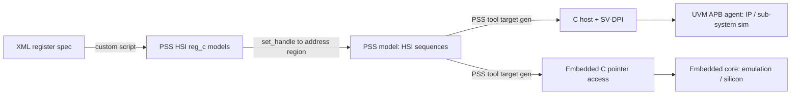

<!-- generated by yt-paper; edits will be overwritten -->
[DVCon](../dvcon/index.md) › [US](../dvcon/us.md) › [2022](../dvcon/by-year.md#2022) › [Verification](../dvcon/by-topic.md#verification)

# Using PSS-2.0 Hardware-Software Interface to validate 4G/5G Forward Error Correction Encoder/Decoder IP in Emulation & Silicon

<figure class="rep-fig" markdown>
{ loading=lazy }
<figcaption>Figure 2: PSS HSI based development flow — from the original paper (Vinit Shenoy et al.)</figcaption>
</figure>

[:material-open-in-new: Original paper](https://dvcon-proceedings.org/wp-content/uploads/Using-Portable-Stimulus-Standards-Hardware-Software-Interface-PSS-HSI-to-validate-4G5G-Forward-Error-Correction-EncoderDecoder-IP-in-emulatio.pdf){ .md-button .md-button--primary target=_blank }

| | |
|---|---|
| Authors | Vinit Shenoy (Intel Technology India Pvt Ltd, Bangalore), Suresh Vasu (Intel Technology India Pvt Ltd, Bangalore), Nithin Venkatesh (Intel Technology India Pvt Ltd, Bangalore), Suhas Reddy (Intel Technology India Pvt Ltd, Bangalore), Joydeep Maitra (Intel Technology India Pvt Ltd, Bangalore), Luis Campos (Intel Corporation, Santa Clara) |
| Venue | DVCon US 2022 |
| Topic | Verification |
| Type | PAPER |
| ID | `ref-20261018-e10a` |

## Summary

**Intel 팀은 PSS 2.0의 Hardware-Software Interface(HSI)를 사용해 4G/5G FEC encoder/decoder IP용 테스트 콘텐츠를 하나의 모델로 작성하고, 이를 UVM 기반 IP 환경과 embedded core 기반 emulation/silicon 환경에 재사용하는 방법을 제시한다.**

**Intel 팀은 PSS 2.0의 Hardware-Software Interface(HSI)를 사용해 4G/5G FEC encoder/decoder IP용 테스트 콘텐츠를 하나의 모델로 작성하고, 이를 UVM 기반 IP 환경과 embedded core 기반 emulation/silicon 환경에 재사용하는 방법을 제시한다.**

## Key Insights

- HSI lets one PSS model generate both a C host driving UVM APB agents through SV-DPI (simulation) and direct volatile-pointer register writes (embedded core), addressing the 'portability wall' between UVM and C-driver test content.

- HSI를 사용하면 하나의 PSS 모델로 SV-DPI를 통해 UVM APB agent를 구동하는 C host 코드(시뮬레이션)와 volatile 포인터로 레지스터에 직접 쓰는 코드(embedded core)를 모두 생성할 수 있어, UVM과 C 드라이버 테스트 콘텐츠 사이의 'portability wall'을 해소한다.

- Register automation: a custom XML-to-HSI script converts Intel's IPXACT-like register descriptions into reg_c models; set_handle() binds each register group to an address region (e.g., base 0x8F700000) before read/write calls.

- 레지스터 자동화: 사내 XML(IPXACT 유사) 레지스터 명세를 전용 스크립트로 HSI 레지스터 모델(reg_c)로 변환하며, 레지스터 그룹은 read/write 호출 전에 set_handle()으로 주소 영역(예: base 0x8F700000)에 바인딩한다.

- Vertical reuse is achieved by factoring IP configuration (e.g., NUM_OF_VF, NUM_OF_4G_FEC_DL) into constants and base addresses into CSV tables, plus foreach-based offset generation (e.g., 0x8 stride) for non-contiguous register arrays.

- IP 구성 파라미터(예: NUM_OF_VF, NUM_OF_4G_FEC_DL)는 상수로, base 주소는 CSV 테이블로 분리하고, 불연속 레지스터 배열은 foreach 기반으로 오프셋(예: 0x8 간격)을 생성하여 IP에서 SoC까지 vertical reuse를 달성한다.

- The paper reports a 70% reduction in test-content development time versus previous methodologies, with simple tests run at IP-level simulation and complex/stress tests on emulation and post-silicon.

- 논문은 기존 방법론 대비 테스트 콘텐츠 개발 시간을 70% 단축했다고 보고하며, 단순 테스트는 IP 레벨 시뮬레이션에서, 복잡한 stress 테스트는 emulation과 post-silicon에서 수행했다.

- Limitations: target code generation is tool-specific (not mandated by PSS), and the results are qualitative with no reported coverage numbers, cycle counts, or sample sizes.

- 한계: target 코드 생성 방식은 PSS 표준이 규정하지 않고 도구별로 다르며, 결과는 정성적이고 coverage 수치, 사이클 수, 표본 규모 등 정량 데이터가 보고되지 않았다.

## Detailed Summary

### Background and Problem

- Verification platforms (simulation, emulation, FPGA prototyping, silicon) use different languages and scopes, from IP to SoC. Industry practice uses UVM testbenches at IP/sub-system level in simulation and C-driver tests on embedded cores in emulation or silicon. The paper calls the resulting gap a 'Portability Wall': UVM sequences cannot run on embedded cores, and C-driver code cannot drive a UVM testbench natively.

- 검증 플랫폼(시뮬레이션, emulation, FPGA 프로토타이핑, 실리콘)은 서로 다른 언어와 범위(IP부터 SoC까지)를 사용한다. 업계 관행은 시뮬레이션에서 IP/서브시스템 단위 UVM testbench를, emulation이나 실리콘에서는 embedded core 위의 C 드라이버 테스트를 쓴다. 논문은 이로 인한 간극을 'Portability Wall'이라 부른다. UVM sequence는 embedded core에서 실행할 수 없고, C 드라이버 코드는 UVM testbench를 직접 구동할 수 없다.

- The target DUT is a 4G/5G Layer-1 forward error correction (FEC) IP. FEC is one of the most compute-intensive RAN L1 workloads in vRAN deployments. The FEC acceleration transaction carries no cell state, which makes it easy to virtualize and pool.

- 대상 DUT는 4G/5G Layer-1 forward error correction(FEC) IP다. FEC는 vRAN에서 가장 연산 집약적인 RAN L1 워크로드 중 하나다. FEC 가속 트랜잭션은 cell 상태 정보를 포함하지 않아 가상화와 풀링이 쉽다.

- The IP is exposed as a PCIe device with multiple virtual functions (VFs). It contains multiple 4G/5G encoder and decoder instances, so there are many register files (PCIe config space per VF, plus per-instance encoder/decoder registers). Maintaining driver code for each instance and revision is the core productivity problem.

- 이 IP는 여러 virtual function(VF)을 가진 PCIe 디바이스로 노출되며, 다수의 4G/5G encoder/decoder 인스턴스를 포함한다. 따라서 레지스터 파일이 많다(VF별 PCIe config space, 인스턴스별 encoder/decoder 레지스터). 인스턴스와 리비전마다 드라이버 코드를 유지하는 것이 핵심 생산성 문제다.

### Architecture and Methodology

The PSS HSI flow (Figure 2) has four stages:

PSS HSI 흐름(Figure 2)은 네 단계로 구성된다.

1. **Register definition.** Intel uses a custom XML format similar to IPXACT. A script converts it into HSI register models. `reg_c<R>` is parameterized by the register-value type R (packed struct or `bit[N]`), access kind (default READWRITE), and width SZ. It exposes `read()`, `read_val()`, `write()`, and `write_val()`, which are target functions that must be called in an exec body.

1. **레지스터 정의.** Intel은 IPXACT와 유사한 사내 XML 형식을 사용하며, 스크립트로 이를 HSI 레지스터 모델로 변환한다. `reg_c<R>`은 레지스터 값 타입 R(packed struct 또는 `bit[N]`), 접근 종류(기본값 READWRITE), 폭 SZ로 파라미터화된다. `read()`, `read_val()`, `write()`, `write_val()`을 제공하며, 이들은 target 함수이므로 exec body에서 호출해야 한다.

2. **Address binding.** The top-level register group is bound to an address region with `set_handle(make_handle_from_region(...))` after registration with `sys_mem_map.add_nonallocatable_region`.

2. **주소 바인딩.** `sys_mem_map.add_nonallocatable_region`으로 영역을 등록한 뒤, 최상위 레지스터 그룹을 `set_handle(make_handle_from_region(...))`으로 주소 영역에 바인딩한다.

3. **HSI sequences.** An action with `rand bit[2] qmode` fills the register struct in `post_solve` and calls `write()` in `exec body`.

3. **HSI sequence.** `rand bit[2] qmode`를 가진 action이 `post_solve`에서 레지스터 struct를 채우고, `exec body`에서 `write()`를 호출한다.

4. **Target code.** The PSS standard does not define target code. The paper shows Intel's tool-specific output:
   - *UVM target:* the generated C host code calls `write_scalar(addr, 4, data)`, exported via `export "DPI-C"`. That task finds the APB master agent and runs `apb_pkg::write_word_seq`. The host code is forked from the UVM run phase.
   - *Embedded C target:* the same write becomes `*(volatile unsigned int*)(0x8f700000) = ...`.

4. **Target 코드.** PSS 표준은 target 코드를 규정하지 않는다. 논문은 Intel 도구의 고유 출력을 보여준다.
   - *UVM target:* 생성된 C host 코드가 `export "DPI-C"`로 노출된 `write_scalar(addr, 4, data)`를 호출한다. 이 task는 APB master agent를 찾아 `apb_pkg::write_word_seq`를 실행한다. Host 코드는 UVM run phase에서 fork된다.
   - *Embedded C target:* 같은 쓰기가 `*(volatile unsigned int*)(0x8f700000) = ...`로 변환된다.

Scalability techniques described in the paper:

논문이 설명하는 확장성 기법:

- **Address factorization:** IP parameters (for example NUM_OF_VF) are constants so that one model can be reused across revisions. Base addresses are stored in a CSV table, and the paper notes that register offsets differ between IP-level and SoC-level environments.

- **주소 factorization:** NUM_OF_VF 같은 IP 파라미터를 상수로 분리해 하나의 모델을 여러 리비전에 재사용한다. Base 주소는 CSV 테이블에 저장하며, IP 레벨과 SoC 레벨에서 레지스터 오프셋이 다를 수 있음을 지적한다.

- **Non-contiguous arrays:** `foreach(IP_INGRESS_AQ[i]) IP_INGRESS_AQ[i].offset = i * 0x8;` sets a fixed stride.

- **불연속 배열:** `foreach(IP_INGRESS_AQ[i]) IP_INGRESS_AQ[i].offset = i * 0x8;`로 고정 stride를 설정한다.

- **Randomization with HSI:** an access such as `hi_vf_regs[vf_id].QMGR_INGRESS_AQ[queue_id].write_val(enqueue_data)` depends on randomized VF and queue IDs.

- **HSI와 randomization 결합:** `hi_vf_regs[vf_id].QMGR_INGRESS_AQ[queue_id].write_val(enqueue_data)`처럼 랜덤화된 VF/queue ID에 따라 접근이 결정된다.

- **Interrupts:** a `ps_event` is emitted from the ISR and waited on in the sequence. `wait()` acts as an implicit yield.

- **인터럽트:** ISR에서 `ps_event`를 emit하고 sequence에서 wait한다. `wait()`은 암시적 yield 역할을 한다.

- **Directed codegen:** `foreach` with `if (i in vf_en_list)` generates writes only for the enabled VFs in the scenario, which keeps the footprint small and makes debugging easier. HSI merges the driver and the test case into one file.

- **Directed 코드 생성:** `foreach`와 `if (i in vf_en_list)`를 사용해 시나리오에서 활성화된 VF에만 쓰기를 생성한다. 코드 footprint가 작아지고 디버깅이 쉬워진다. HSI는 드라이버와 테스트 케이스를 하나의 파일로 합친다.

- **Synchronization:** `ps_event.sync()` creates a sync point between IP configuration and the data-transfer phase, which the authors used to stress the design.

- **동기화:** `ps_event.sync()`로 IP 설정 단계와 데이터 전송 단계 사이에 sync point를 만들어 설계를 stress하는 데 사용했다.

### Results and Conclusions

- The authors report that reusing test cases from core-less to core-based environments cut test-content development time by **70%** compared with previous methodologies.

- 저자들은 core-less 환경에서 core 기반 환경까지 테스트 케이스를 재사용하여, 기존 방법론 대비 테스트 콘텐츠 개발 시간을 **70%** 단축했다고 보고한다.

- PSS produced a richer set of scenarios with more concurrency and stress. Pre-Si and Post-Si teams shared a common test plan, and coverage closure was faster. These claims are qualitative. No coverage percentages, run counts, or baseline data are given.

- PSS로 동시성과 stress가 더해진 더 풍부한 시나리오 집합을 만들었다. Pre-Si와 Post-Si 팀이 공통 테스트 계획을 공유했고, coverage closure도 빨라졌다고 한다. 다만 이 주장들은 정성적이며, coverage 비율, 실행 횟수, 기준선 데이터는 제시되지 않았다.

- The recommended split is to develop the PSS model and HSI sequences at IP level for fast turnaround. Basic functional tests run in IP simulation, and complex stress scenarios run in emulation and post-silicon.

- 권장 분담은 빠른 turnaround를 위해 PSS 모델과 HSI sequence를 IP 레벨에서 개발하는 것이다. 기본 기능 테스트는 IP 시뮬레이션에서, 복잡한 stress 시나리오는 emulation과 post-silicon에서 수행한다.

- The paper is a practitioner overview of one tool's HSI implementation, not a benchmark. Target generation details are specific to Intel's PSS tool.

- 이 논문은 벤치마크가 아니라 한 도구의 HSI 구현을 다룬 실무 개요다. Target 생성 세부사항은 Intel의 PSS 도구에 특화되어 있다.

## Videos

<iframe src="https://www.youtube-nocookie.com/embed/9xuC8uR_lGc" title="[DVCON2022]Using PSS-2.0 Hardware-Software Interface 4G/5G Forward Error Correction Emulation" loading="lazy" allow="accelerometer; clipboard-write; encrypted-media; gyroscope; picture-in-picture; web-share" referrerpolicy="strict-origin-when-cross-origin" allowfullscreen></iframe>

**[DVCON2022]Using PSS-2.0 Hardware-Software Interface 4G/5G Forward Error Correction Emulation** — [Watch on YouTube](https://www.youtube.com/watch?v=9xuC8uR_lGc) · [Video page](../videos/9xuC8uR_lGc.md)
