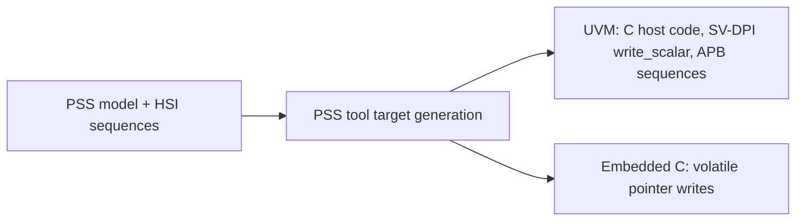

<!-- generated by yt-paper; edits will be overwritten -->
[DVCon](../dvcon/index.md) › [US](../dvcon/us.md) › [2022](../dvcon/by-year.md#2022) › [Verification](../dvcon/by-topic.md#verification)

# Using PSS-2.0 Hardware-Software Interface to validate 4G/5G Forward Error Correction Encoder/Decoder IP in Emulation & Silicon

<figure class="rep-fig" markdown>
{ loading=lazy }
<figcaption>Figure 2: PSS HSI based development flow — from the original paper (Vinit Shenoy et al.)</figcaption>
</figure>

[:material-open-in-new: Original paper](https://dvcon-proceedings.org/wp-content/uploads/Using-Portable-Stimulus-Standards-Hardware-Software-Interface-PSS-HSI-to-validate-4G5G-Forward-Error-Correction-EncoderDecoder-IP-in-emulatio.pdf){ .md-button .md-button--primary target=_blank } [:material-presentation-play: Official talk](https://youtu.be/8j3c2ZpvWPc?t=1841){ .md-button target=_blank }

| | |
|---|---|
| Authors | Vinit Shenoy, Suresh Vasu, Nithin Venkatesh, Suhas Reddy, Joydeep Maitra (Intel Technology India Pvt Ltd, Bangalore), Luis Campos (Intel Corporation, Santa Clara) |
| Venue | DVCon US 2022 |
| Topic | Verification |
| Type | PAPER |
| ID | `ref-20261018-e10a` |

## Summary

**Intel describes deploying PSS-2.0 Hardware-Software Interface (HSI) register sequences to write one driver-style test model that runs on UVM/APB in simulation and on embedded cores in emulation and silicon, for a 4G/5G FEC encoder/decoder IP.**

**Intel은 PSS-2.0 Hardware-Software Interface(HSI) 레지스터 시퀀스를 사용해 하나의 드라이버형 테스트 모델을 작성하고, 이를 시뮬레이션의 UVM/APB 환경과 에뮬레이션·실리콘의 임베디드 코어 환경 모두에서 실행한 사례를 소개하며, 대상은 4G/5G FEC 인코더/디코더 IP이다.**

## Key Insights

- HSI lets a single PSS model generate both UVM/APB sequences (via SV-DPI) and embedded-C pointer accesses, addressing the UVM-vs-C-driver 'portability wall' across IP, emulation and silicon.

- HSI를 사용하면 하나의 PSS 모델로 UVM/APB 시퀀스(SV-DPI 경유)와 임베디드 C 포인터 접근을 모두 생성할 수 있어, IP·에뮬레이션·실리콘 전반에 걸친 UVM 대 C 드라이버 간 'portability wall' 문제를 해결한다.

- The authors report a 70% reduction in test-content development time versus previous methodologies; the paper gives no baseline, project size or detailed breakdown behind this figure.

- 저자들은 기존 방법론 대비 테스트 콘텐츠 개발 시간이 70% 줄었다고 보고하지만, 이 수치의 기준선, 프로젝트 규모, 세부 분해는 논문에 제시되지 않았다.

- Factoring configuration (NUM_OF_VF constants, CSV base-address tables) and using foreach constraints for fixed-offset register arrays lets one model be reused across IP-level and SoC-level register maps.

- 구성 파라미터(NUM_OF_VF 상수, CSV 기반 base address 테이블)를 분리하고, 고정 오프셋 레지스터 배열에 foreach 제약을 사용하면 IP 수준과 SoC 수준 레지스터 맵 간에 모델을 재사용할 수 있다.

- ps_event wait()/emit() models ISRs and ps_event.sync() adds inter-thread sync points, so driver and test case merge into one file while still stressing configuration/data-transfer overlap.

- ps_event의 wait()/emit()으로 ISR을 모델링하고 ps_event.sync()로 스레드 간 동기화 지점을 추가하여, 드라이버와 테스트 케이스를 하나의 파일로 합치면서도 설정과 데이터 전송 구간의 중첩을 자극할 수 있다.

- PSS does not mandate target code, so the generated UVM and embedded-C outputs are tool-specific; the paper is an experience report with no coverage metrics or quantified stress results.

- PSS는 타겟 코드 생성 방식을 규정하지 않으므로 UVM 및 임베디드 C 출력은 툴에 종속적이며, 본 논문은 커버리지 지표나 정량적 스트레스 결과가 없는 경험 보고서이다.

## Detailed Summary

### Background and Problem

- Current practice splits verification: UVM testbenches at IP/subsystem level in simulation, and C-driver tests on embedded cores in emulation or silicon. UVM sequences cannot run on cores, and C drivers cannot drive UVM, creating a "portability wall."

- 현재 검증은 시뮬레이션의 IP/서브시스템 수준 UVM 테스트벤치와 에뮬레이션·실리콘의 임베디드 코어 기반 C 드라이버 테스트로 나뉜다. UVM 시퀀스는 코어에서 실행될 수 없고 C 드라이버는 UVM 테스트벤치를 직접 구동할 수 없어 'portability wall'이 생긴다.

- Target DUT: a 4G/5G L1 FEC encoder/decoder IP exposed as a PCIe device with multiple virtual functions (VFs) and replicated encoder/decoder instances, which multiplies register files.

- 대상 DUT는 4G/5G L1 FEC 인코더/디코더 IP로, 여러 virtual function(VF)과 복제된 인코더/디코더 인스턴스를 PCIe 장치로 노출하여 레지스터 파일이 여러 배로 늘어난다.

### Architecture and Methodology

- PSS-2.0 HSI (core library) models registers via `reg_group_c`/`reg_c`, bound to address regions with `set_handle()`. Register descriptions come from a custom IPXACT-like XML converted by script.

- PSS-2.0 HSI(core library)는 `reg_group_c`/`reg_c`로 레지스터를 모델링하고 `set_handle()`로 address region에 바인딩한다. 레지스터 기술은 IPXACT 유사 사내 XML에서 스크립트로 변환한다.

- Test content is written as PSS actions using `write()`/`read()` in `exec body`, with randomized fields in `post_solve`.

- 테스트 콘텐츠는 `exec body`에서 `write()`/`read()`를 호출하는 PSS action으로 작성하며, 랜덤화된 필드는 `post_solve`에서 설정한다.

- Target generation is tool-specific:

- 타겟 코드 생성은 툴에 따라 다르다:

- Reuse and scale: NUM_OF_VF-style constants and CSV base-address tables, `foreach` constraints for fixed-offset arrays, `ps_event` wait/emit for ISRs, and `ps_event.sync()` for concurrent threads.

- 재사용 및 확장: NUM_OF_VF 형태의 상수와 CSV base-address 테이블, 고정 오프셋 배열에 대한 `foreach` 제약, ISR용 `ps_event` wait/emit, 동시 스레드용 `ps_event.sync()`를 사용한다.

### Results and Conclusions

- Reports about 70% reduction in test-content development time versus previous methods, and reuse of tests from core-less to core-based environments.

- 기존 방법 대비 테스트 콘텐츠 개발 시간이 약 70% 감소했다고 보고하며, core-less 환경과 core 기반 환경 간 테스트 재사용이 가능했다고 한다.

- Richer, more concurrent stress scenarios; Pre- and Post-Si teams share a common test plan; faster coverage closure (qualitative only).

- 동시성과 스트레스가 강화된 더 풍부한 시나리오, Pre-Si와 Post-Si 팀의 공통 테스트 계획, 빠른 커버리지 클로저를 정성적으로 언급한다.

- Proposed split: basic tests on IP-level simulation, complex stress on emulation and Post-Si.

- 제안된 역할 분담: 기본 테스트는 IP 수준 시뮬레이션, 복잡한 스트레스 테스트는 에뮬레이션과 Post-Si에서 수행한다.

- Experience report with no raw coverage numbers or detailed baselines.

- 원시 커버리지 수치나 상세한 기준선이 없는 경험 보고서이다.

## Videos

<iframe src="https://www.youtube-nocookie.com/embed/9xuC8uR_lGc" title="[DVCON2022]Using PSS-2.0 Hardware-Software Interface 4G/5G Forward Error Correction Emulation" loading="lazy" allow="accelerometer; clipboard-write; encrypted-media; gyroscope; picture-in-picture; web-share" referrerpolicy="strict-origin-when-cross-origin" allowfullscreen></iframe>

**[DVCON2022]Using PSS-2.0 Hardware-Software Interface 4G/5G Forward Error Correction Emulation** — [Watch on YouTube](https://www.youtube.com/watch?v=9xuC8uR_lGc) · [Video page](../videos/9xuC8uR_lGc.md)

**Official presentation:** [DVCon U.S. 2022 · Portable Stimulus Standard (PSS) · 30:41](https://youtu.be/8j3c2ZpvWPc?t=1841){ target=_blank }
