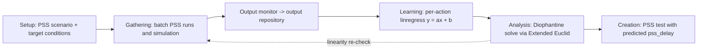

<!-- generated by yt-paper; edits will be overwritten -->
[DVCon](../dvcon/index.md) › [US](../dvcon/us.md) › [2022](../dvcon/by-year.md#2022) › [Verification](../dvcon/by-topic.md#verification)

# PSS action sequence modeling using Machine Learning

<figure class="rep-fig" markdown>
{ loading=lazy }
<figcaption>Figure 2. Structure of PSS action sequence model A. PSS scenario generation — from the original paper (Moonki Jang et al.)</figcaption>
</figure>

[:material-open-in-new: Original paper](https://dvcon-proceedings.org/wp-content/uploads/PSS-action-sequence-modeling-using-Machine-Learning-1.pdf){ .md-button .md-button--primary target=_blank }

| | |
|---|---|
| Authors | Moonki Jang (Samsung Electronics), Myeongwhan Hyun (Samsung Electronics), Hyunkyu Ahn (Samsung Electronics), Jiwoong Kim (Samsung Electronics), Yunwhan Kim (Samsung Electronics), Dongjoo Kim (Samsung Electronics) |
| Venue | DVCon US 2022 |
| Topic | Verification |
| Type | PAPER |
| ID | `ref-20261018-e710` |

## Summary

**The paper combines PSS-generated tests with linear regression over simulation-measured delay-vs-timestamp data, then solves the resulting linear Diophantine equations with the Extended Euclidean algorithm to find pss_delay values that align multiple actions to the same cycle, which it applies to reproducing a PCIe–ACE deadlock.**

**이 논문은 PSS로 생성한 테스트에서 얻은 delay-타임스탬프 데이터에 선형 회귀를 적용하고, 그 결과로 나온 선형 Diophantine 방정식을 Extended Euclidean 알고리즘으로 풀어 여러 action을 같은 사이클에 정렬하는 pss_delay 값을 찾는다. 이를 PCIe–ACE 데드락 재현에 적용한다.**

## Key Insights

- Cycle-accurate delay control is the enabling mechanism: pss_delay values are posted to a mailbox that the testbench polls every cycle, a cycle delay counter runs for the requested count, and an interrupt signals completion, which removes software loop jitter so the delay-to-timestamp relation stays linear.

- 사이클 정확도 있는 delay 제어가 핵심 메커니즘이다. pss_delay 값은 mailbox에 기록되고, TB가 매 사이클 이를 polling하여 지정된 사이클 수만큼 cycle delay counter를 동작시킨 뒤 완료 시 CPU interrupt를 발생시킨다. 이로써 SW loop jitter가 제거되어 delay와 타임스탬프의 선형 관계가 유지된다.

- Each action's output timestamp is fit as a linear function of its delay. The PCIe case study reports Action_1 y=8x1+1496546, Action_2 y=2x2+874352, and Action_3 y=3x3+874354, using a sweep of pss_delay from 0 to 100 in steps of 1.

- 각 action의 출력 타임스탬프는 delay의 선형 함수로 맞춰진다. PCIe 사례에서 보고된 식은 Action_1 y=8x1+1496546, Action_2 y=2x2+874352, Action_3 y=3x3+874354이며, pss_delay는 0부터 100까지 1 단위로 sweep했다.

- Aligning actions reduces to a linear Diophantine equation. For Action_2 and Action_3, 2x2 - 3x3 = 2 has particular solution X2=4, X3=2 and general solution X2=4-3k, X3=2-2k. At k=-103699 the delays become 311101 and 207400, and both actions land at timestamp 1496554, the same timestamp as Action_1 at pss_delay=1.

- action 정렬은 선형 Diophantine 방정식 문제로 환원된다. Action_2와 Action_3에 대해 2x2 - 3x3 = 2는 특수해 X2=4, X3=2와 일반해 X2=4-3k, X3=2-2k를 가진다. k=-103699일 때 delay는 311101과 207400이 되며, 두 action 모두 타임스탬프 1496554에 도달한다. 이 값은 pss_delay=1일 때 Action_1의 타임스탬프와 같다.

- The method is pairwise: the paper notes that solving three variables jointly (ax+by+cz=y) would be more efficient and proposes extending the Extended Euclidean algorithm. External, non-linear delay sources change the fitted intercept, so the linearity must be re-verified by re-gathering data before the creation stage.

- 방법은 쌍(pairwise) 단위다. 논문은 세 변수를 함께 푸는 것(ax+by+cz=y)이 더 효율적이라고 언급하며 Extended Euclidean 알고리즘의 확장을 제안한다. 외부 요인에 의한 비선형 delay는 fit된 intercept를 바꾸므로, creation 단계 전에 데이터를 다시 수집하여 선형성을 재검증해야 한다.

- The paper reports the predicted simultaneous delays but no measured confirmation run or quantitative coverage numbers; its claim of 'dramatically increased' coverage is qualitative.

- 논문은 예측된 동시 발생 delay 값은 보고하지만 측정된 확인 실행 결과나 정량적 커버리지 수치는 제시하지 않는다. '극적인' 커버리지 증가라는 주장은 정성적인 수준이다.

## Detailed Summary

### Background and Problem

- Pre-silicon PCIe–ACE protocol deadlock: a deadlock chain forms when (1) the PCIe RC buffer is full (Action_1), (2) a CPU Writeback is generated (Action_2), and (3) a snoop arises from a PCIe posted write (Action_3). All three must occur in a precise order.

- Pre-silicon PCIe–ACE 프로토콜 데드락: (1) PCIe RC 버퍼가 가득 찬 상태(Action_1), (2) CPU Writeback 발생(Action_2), (3) PCIe posted write에서 발생한 snoop(Action_3)이 동시에 정확한 순서로 일어날 때 데드락 체인이 형성된다.

- Prior PSS-based reproduction used thousands of random sequence combinations, and engineers manually adjusted constraints and added configurable delays to compare results. The SW-visible ordering did not match the HW timing.

- 기존 PSS 기반 재현은 수천 개의 랜덤 sequence 조합을 사용했고, 엔지니어가 constraint를 수동으로 조정하고 configurable delay를 추가해 결과를 비교해야 했다. SW에서 보이는 순서와 HW 타이밍이 일치하지 않았기 때문이다.

- The paper proposes automating delay selection: specify only the target condition for each action, then let ML derive the delays needed to align them.

- 본 논문은 delay 선택을 자동화하는 방법을 제안한다. 각 PSS action에 대해 목표 조건만 지정하면 ML이 action들을 정렬하는 데 필요한 delay를 도출한다.

### Architecture and Methodology

- **Delay injection:** The PSS-generated C code calls `pss_delay` (delay value + CPU id) before each target action. The value can be fixed or random, and the number of tests is configurable.

- **Delay 주입:** PSS가 생성한 C 코드는 각 target action 앞에서 `pss_delay`(delay 값 + CPU id)를 호출한다. 값은 고정하거나 랜덤으로 줄 수 있으며, 생성할 테스트 수도 설정할 수 있다.

- **Cycle delay counter (TB):** `pss_delay` writes to a mailbox memory area. The TB monitor polls it every cycle, counts the requested clock cycles, and raises a CPU interrupt on completion.

- **Cycle delay counter (TB):** `pss_delay`는 mailbox 메모리 영역에 기록된다. TB 모니터는 매 사이클 이를 polling하고, 요청된 클럭 사이클 수만큼 카운트한 뒤 완료 시 CPU에 interrupt를 발생시킨다.

- **Output monitor and repository:** The monitor checks target conditions every cycle and logs test info, timestamp, and the action that caused the condition. A log analyzer collects these messages into the output repository, which serves as training data.

- **Output monitor 및 repository:** 모니터는 매 사이클 target 조건을 검사하고, test 정보, 타임스탬프, 조건을 유발한 action 정보를 로그로 남긴다. Log analyzer가 이 메시지를 모아 output repository에 저장하며, 이것이 학습 데이터가 된다.

- **ML flow (four stages):**
  - *Setup/Gathering:* PSS batch-mode scripts create tests and run simulations with target conditions passed as a command argument.
  - *Learning:* For each action, $y = ax + b$ with slope $a$ = Δtimestamp / Δdelay, fitted with `scipy.stats.linregress`.
  - *Analysis:* Equal timestamps are required, e.g. $a_1x_1+b_1 = a_2x_2+b_2 = a_3x_3+b_3$. For two actions this becomes $ax+by=c$, solved with the Extended Euclidean algorithm. A solution exists only if $\gcd(a,b)$ divides $c$ (Bézout). The general solution is $x = x_0 + k\,b/d$, $y = y_0 - k\,a/d$.
  - *Creation:* PSS regenerates tests with the predicted delays. The paper says the gathering and learning steps should be repeated to confirm the linear fit still holds.

- **ML 흐름 (4단계):**
  - *Setup/Gathering:* PSS batch mode 스크립트로 테스트를 생성하고, target 조건을 command argument로 전달하여 시뮬레이션을 실행한다.
  - *Learning:* action별로 $y = ax + b$를 구하며, 기울기 $a$ = Δtimestamp / Δdelay이고 `scipy.stats.linregress`로 fit한다.
  - *Analysis:* 타임스탬프가 같아야 한다. 예를 들어 $a_1x_1+b_1 = a_2x_2+b_2 = a_3x_3+b_3$. 두 action의 경우 $ax+by=c$ 형태가 되어 Extended Euclidean 알고리즘으로 푼다. $\gcd(a,b)$가 $c$를 나눌 때만 해가 존재한다(Bézout). 일반해는 $x = x_0 + k\,b/d$, $y = y_0 - k\,a/d$이다.
  - *Creation:* 예측된 delay로 PSS 테스트를 다시 생성한다. 논문은 선형 fit이 여전히 유효한지 확인하기 위해 gathering과 learning 단계를 반복할 것을 권장한다.

- **PCIe case study:** Delays were swept from 0 to 100 (step 1) and fitted as shown in Table II. The Action_2/Action_3 pair was solved first: $2x_2 - 3x_3 = 2$ gives particular $X_2=4$, $X_3=2$ and general $X_2 = 4-3k$, $X_3 = 2-2k$. At $k=-103699$, $X_2=311101$ and $X_3=207400$, and both actions reach timestamp 1496554. That value matches Action_1 at pss_delay=1, so the predicted delays are (1, 311101, 207400).

- **PCIe 사례 연구:** delay를 0부터 100까지 1 단위로 sweep하여 Table II와 같이 fit했다. Action_2/Action_3 쌍을 먼저 풀었다: $2x_2 - 3x_3 = 2$의 특수해는 $X_2=4$, $X_3=2$이고, 일반해는 $X_2 = 4-3k$, $X_3 = 2-2k$이다. $k=-103699$일 때 $X_2=311101$, $X_3=207400$이며, 두 action 모두 타임스탬프 1496554에 도달한다. 이 값은 pss_delay=1일 때 Action_1의 타임스탬프와 일치하므로, 예측된 delay는 (1, 311101, 207400)이다.

### Results and Conclusions

- The paper demonstrates the method on one case: the Action_2/Action_3 solution combined with Action_1's sampled timestamp gives a common timestamp of 1496554 for pss_delay values (1, 311101, 207400).

- 논문은 한 가지 사례로 방법을 보여준다. Action_2/Action_3 해와 Action_1의 샘플 타임스탬프를 결합하면 pss_delay 값 (1, 311101, 207400)에서 공통 타임스탬프 1496554가 나온다.

- The paper reports the prediction only. It does not show a measured re-run confirming simultaneous occurrence, and it gives no quantitative coverage numbers. The coverage claim is qualitative.

- 논문은 예측 결과만 보고한다. 동시 발생을 확인하는 측정된 재실행 결과는 제시하지 않으며, 정량적 커버리지 수치도 없다. 커버리지 향상 주장은 정성적이다.

- Stated limitations:
  - The solver is pairwise. A joint three-variable Diophantine solver is suggested as more efficient.
  - External delays add non-linear components that shift the intercept and invalidate later results. The linearity of the analysis range must be re-verified before creation.

- 명시된 한계:
  - solver가 쌍 단위다. 세 변수를 함께 푸는 Diophantine solver가 더 효율적이라고 제안된다.
  - 외부 delay는 intercept를 바꾸는 비선형 성분을 추가하므로, 이후 결과를 무효화한다. creation 전에 분석 구간의 선형성을 재검증해야 한다.

- Overall, the work turns manual constraint tuning for concurrent-event reproduction into a data-driven delay derivation on top of PSS and cycle-accurate simulation.

- 전반적으로 이 연구는 동시 이벤트 재현을 위한 수동 constraint 조정을 PSS와 사이클 정확도 시뮬레이션 기반의 데이터 기반 delay 도출로 대체한다.

## Videos

<iframe src="https://www.youtube-nocookie.com/embed/KsLeNKgw_wU" title="[DVCON2022] PSS action sequence modeling using Machine Learning" loading="lazy" allow="accelerometer; clipboard-write; encrypted-media; gyroscope; picture-in-picture; web-share" referrerpolicy="strict-origin-when-cross-origin" allowfullscreen></iframe>

**[DVCON2022] PSS action sequence modeling using Machine Learning** — [Watch on YouTube](https://www.youtube.com/watch?v=KsLeNKgw_wU) · [Video page](../videos/KsLeNKgw_wU.md)
