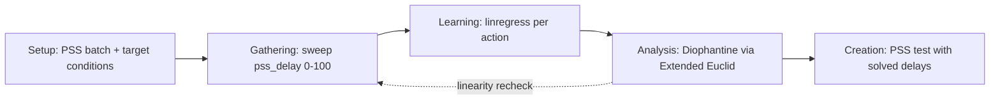

<!-- generated by yt-paper; edits will be overwritten -->
[DVCon](../dvcon/index.md) › [US](../dvcon/us.md) › [2022](../dvcon/by-year.md#2022) › [Verification](../dvcon/by-topic.md#verification)

# PSS action sequence modeling using Machine Learning

<figure class="rep-fig" markdown>
{ loading=lazy }
<figcaption>Figure 2. Structure of PSS action sequence model A. PSS scenario generation — from the original paper (Moonki Jang et al.)</figcaption>
</figure>

[:material-open-in-new: Original paper](https://dvcon-proceedings.org/wp-content/uploads/PSS-action-sequence-modeling-using-Machine-Learning-1.pdf){ .md-button .md-button--primary target=_blank }

| | |
|---|---|
| Authors | Moonki Jang (Samsung Electronics), Myeongwhan Hyun (Samsung Electronics), Hyunkyu Ahn (Samsung Electronics), Jiwoong Kim (Samsung Electronics), Yunwhan Kim (Samsung Electronics), Dongjoo Kim (Samsung Electronics) |
| Venue | DVCon US 2022 |
| Topic | Verification |
| Type | PAPER |
| ID | `ref-20261018-e710` |

## Summary

**The paper proposes a PSS + ML loop that sweeps per-action pss_delay values, fits linear delay-to-timestamp models, and solves linear Diophantine equations with the Extended Euclidean algorithm to compute delays that make multiple actions hit their target conditions in the same cycle, demonstrated on a PCIe/ACE deadlock.**

**이 논문은 PSS와 ML을 결합해 액션별 pss_delay를 스윕하고, 선형 회귀로 delay-대-타임스탬프 모델을 얻은 뒤 Extended Euclidean 알고리즘으로 선형 Diophantine 방정식을 풀어 여러 액션이 같은 사이클에 목표 조건에 도달하도록 delay를 계산하는 방법을 제안하며, PCIe/ACE 데드락 사례로 검증했습니다.**

## Key Insights

- Replacing manual random-constraint tuning with a delay sweep, a linear fit, and a Diophantine solve yields directly computable pss_delay values for simultaneous actions; the PCIe example gives delays 1, 311101, and 207400 for a common timestamp of 1496554.

- 수동 랜덤 제약 튜닝을 delay 스윕, 선형 피팅, Diophantine 풀이로 대체하면 동시 실행 액션에 필요한 pss_delay 값을 직접 계산할 수 있으며, PCIe 예시에서는 delay 1, 311101, 207400으로 공통 타임스탬프 1496554를 얻었습니다.

- Cycle-accurate delay control relies on per-cycle mailbox polling and a HW cycle delay counter instead of SW loops, since SW loop jitter would break the linearity the regression depends on.

- 사이클 정확도 delay 제어는 SW 루프 대신 사이클마다 mailbox를 확인하는 방식과 HW 사이클 delay 카운터에 의존하며, SW 루프의 지터는 회귀가 요구하는 선형성을 깨뜨립니다.

- The linear model is fragile: one logged Action_2 point (delay 1 at timestamp 876154) deviates from the fitted line (predicted 874354), which shifts the intercept and invalidates solutions, so the authors require re-verification of linearity before creating final tests.

- 선형 모델은 취약합니다. Action_2의 한 로그 지점(delay 1, 타임스탬프 876154)은 피팅선(예측 874354)에서 벗어나 절편을 바꾸므로, 저자들은 최종 테스트 생성 전에 선형성 재검증을 요구합니다.

- The paper reports no quantitative coverage, run-count, or effort metrics despite claiming a 'dramatic' coverage increase; evidence is a single PCIe deadlock case study.

- 논문은 '획기적인' 커버리지 향상을 주장하지만 정량적 커버리지, 실행 횟수, 공수 지표는 제시하지 않으며, 근거는 PCIe 데드락 단일 사례 연구입니다.

- The method is pairwise in this work (two actions solved at a time, then a third checked against the result); the authors note a three-variable extended Euclidean solver would be more efficient but do not present it.

- 본 연구의 방법은 쌍(pairwise) 방식입니다. 두 액션을 먼저 풀고 세 번째 액션을 그 결과와 대조합니다. 저자들은 3변수 확장 Euclidean solver가 더 효율적이라고 언급하지만 이를 제시하지는 않습니다.

## Detailed Summary

### Background and Problem

- Reproducing a PCIe-vs-ACE protocol deadlock pre-silicon required thousands of random PSS scenarios plus repeated manual constraint tuning, because actions that are concurrent in SW execute at different HW times.

- PCIe와 ACE 프로토콜 간 데드락을 pre-silicon에서 재현하려면 수천 개의 랜덤 PSS 시나리오와 반복적인 수동 제약 튜닝이 필요했습니다. SW에서 동시인 액션이 HW에서는 서로 다른 시점에 실행되기 때문입니다.

- Goal: specify only the target condition per action and let the flow learn the delay-to-timestamp relation and compute delays that align the actions.

- 목표: 액션별 목표 조건만 지정하면 흐름이 delay-대-타임스탬프 관계를 학습하고, 액션을 정렬하는 delay를 계산하도록 하는 것입니다.

### Architecture and Methodology

- Testbench: PSS C code writes each action's delay and CPU ID to a mailbox; the TB checks it every cycle and a cycle delay counter raises a CPU interrupt on completion.

- 테스트벤치: PSS C 코드가 각 액션의 delay와 CPU ID를 mailbox에 기록하고, TB는 매 사이클 이를 확인하며 사이클 delay 카운터가 완료 시 CPU 인터럽트를 발생시킵니다.

- Output monitor checks target conditions every cycle and logs timestamps; a log analyzer fills the output repository.

- 출력 모니터는 매 사이클 목표 조건을 확인해 타임스탬프를 기록하고, 로그 분석기가 출력 저장소를 채웁니다.

- Learning: fit $y = a\,x + b$ per action with SciPy `linregress`.

- 학습: SciPy `linregress`로 액션별 $y = a\,x + b$를 피팅합니다.

- Analysis: for two actions, $a_1x_1+b_1=a_2x_2+b_2$ becomes $ax+by=c$; the Extended Euclidean algorithm gives a particular solution, and $k$ generates the general family.

- 분석: 두 액션에 대해 $a_1x_1+b_1=a_2x_2+b_2$는 $ax+by=c$가 되며, Extended Euclidean 알고리즘이 특수해를 구하고 $k$가 일반해 집합을 생성합니다.

### Results and Conclusions

- Fitted models: Action_1 $y=8x_1+1496546$, Action_2 $y=2x_2+874352$, Action_3 $y=3x_3+874354$.

- 피팅 모델: Action_1 $y=8x_1+1496546$, Action_2 $y=2x_2+874352$, Action_3 $y=3x_3+874354$.

- General solution for Action_2/3: $X_2=4-3k$, $X_3=2-2k$; $k=-103699$ gives $X_2=311101$, $X_3=207400$, and all three actions reach timestamp 1496554 (Action_1 delay 1).

- Action_2/3의 일반해: $X_2=4-3k$, $X_3=2-2k$. $k=-103699$일 때 $X_2=311101$, $X_3=207400$이며, 세 액션 모두 타임스탬프 1496554에 도달합니다(Action_1 delay 1).

- The authors conclude the flow can reproduce the deadlock on demand, but provide no quantitative coverage or effort data; external delay that breaks linearity must be filtered out before the creation stage.

- 저자들은 이 흐름으로 데드락을 요청 시 재현할 수 있다고 결론짓지만, 정량적 커버리지나 공수 데이터는 제시하지 않습니다. 선형성을 깨는 외부 delay는 최종 테스트 생성 전에 걸러내야 합니다.

## Videos

<iframe src="https://www.youtube-nocookie.com/embed/KsLeNKgw_wU" title="[DVCON2022] PSS action sequence modeling using Machine Learning" loading="lazy" allow="accelerometer; clipboard-write; encrypted-media; gyroscope; picture-in-picture; web-share" referrerpolicy="strict-origin-when-cross-origin" allowfullscreen></iframe>

**[DVCON2022] PSS action sequence modeling using Machine Learning** — [Watch on YouTube](https://www.youtube.com/watch?v=KsLeNKgw_wU) · [Video page](../videos/KsLeNKgw_wU.md)
