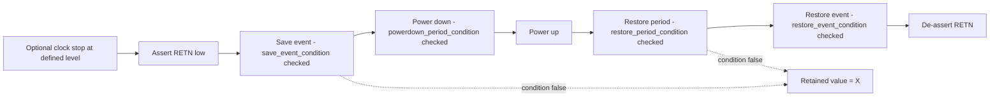

<!-- generated by yt-paper; edits will be overwritten -->
[DVCon](../dvcon/index.md) › [US](../dvcon/us.md) › [2025](../dvcon/by-year.md#2025) › [EDA](../dvcon/by-topic.md#eda)

# Future Proofing Power Intent Specification through Unified Power Format (UPF) 4.0 for Evolving Advanced State Retention Strategies

<figure class="rep-fig" markdown>
![Figure 6. Single-Control Retention: Clock Behaviour [4]](../assets/figures/ref-20261018-e797.png){ loading=lazy }
<figcaption>Figure 6. Single-Control Retention: Clock Behaviour [4] — from the original paper (Lakshmanan Balasubramanian et al.)</figcaption>
</figure>

[:material-open-in-new: Original paper](https://dvcon-proceedings.org/wp-content/uploads/1136-2.pdf){ .md-button .md-button--primary target=_blank }

| | |
|---|---|
| Authors | Lakshmanan Balasubramanian (Texas Instruments (India) Pvt. Ltd.), Amit Srivastava (Synopsys Inc.), Raguvaran Easwaran (Intel Technology India Pvt. Ltd.), John Decker (Cadence Design Systems), Rick Koster (Siemens Mentor), Progyna Khondkar (Cadence Design Systems), Paul Bailey (Nordic Semiconductors), Barry Pangrle (Abacus Semiconductor Corporation), Shreedhar Ramachandra (Synopsys Inc.), Phil Giangarra (Cadence Design Systems), John Biggs (PragmatIC), David Cheng (Cadence Design Systems; affiliation 9 listed as TBD) |
| Venue | DVCon US 2025 |
| Topic | EDA |
| Type | PAPER |
| ID | `ref-20261018-e797` |

## Summary

**The paper proposes UPF 4.0 extensions (new predefined event/period conditions, an async_set_reset_effect option, and an applies_to filter) so that clock, reset and control-signal constraints of advanced state-retention (SR) elements can be specified and verified at RTL/PA-simulation stage instead of late in the design cycle.**

**이 논문은 UPF 4.0에 새 predefined 조건(save/restore event 및 period 조건), async_set_reset_effect 옵션, applies_to 필터를 추가해, 고급 State Retention(SR) 소자의 클록·리셋·제어 신호 제약을 후기 gate-level 단계가 아닌 RTL 및 PA 시뮬레이션 단계에서 명세하고 검증할 수 있게 하는 방안을 제안한다.**

## Key Insights

- UPF 3.1 and earlier only check retention constraints at the save event, the restore event, and the power-down-to-power-up interval; clock-level conditions during the restore period or power-down period cannot be expressed, which pushes such bugs to late PA gate-level or AMS simulation.

- UPF 3.1 이하는 retention 제약을 save 이벤트, restore 이벤트, 전원 차단에서 전원 복구 사이 구간에서만 검사할 수 있어, restore 구간이나 power-down 구간의 클록 조건은 표현할 수 없다. 이로 인해 해당 위반은 PA gate-level 또는 AMS 시뮬레이션에서야 발견된다.

- UPF 4.0 adds save_event_condition, restore_event_condition, restore_period_condition and powerdown_period_condition, which replace the legacy save_condition, restore_condition and retention_condition options (now deprecated); the predefined names UPF_GENERIC_CLOCK and UPF_GENERIC_ASYNC_SET_RESET are the only generic references allowed in these conditions.

- UPF 4.0은 save_event_condition, restore_event_condition, restore_period_condition, powerdown_period_condition을 추가하며, 기존 save_condition, restore_condition, retention_condition 옵션은 legacy로 지정된다. 이 조건들에서 일반 참조로 허용되는 이름은 UPF_GENERIC_CLOCK과 UPF_GENERIC_ASYNC_SET_RESET뿐이다.

- If any save/restore condition is violated (level-sensitive: at any time in the interval; edge-sensitive: at the edge), the save or restore operation fails and the retained value becomes X. The restore_period_condition must hold throughout the entire restore period or the retention element is corrupted.

- save 또는 restore 조건이 위반되면(level-sensitive는 구간 전체, edge-sensitive는 에지 시점 기준) 해당 동작이 실패하고 retained value는 X가 된다. restore_period_condition은 restore 구간 전체에서 참이어야 하며, 그렇지 않으면 retention 소자가 손상된다.

- The new async_set_reset_effect option (ignored, retained_value, output_value) defines how set/reset affects Q and the retained value during the restore period, while having no effect in normal operation; the case study enumerates these three behaviours for single-control and dual-control elements.

- 새 async_set_reset_effect 옵션(ignored, retained_value, output_value)은 restore 구간에서 set/reset이 Q 출력과 retained value에 어떻게 영향을 주는지 정의하며, 정상 동작에는 영향을 주지 않는다. 사례 연구는 single-control 및 dual-control 소자에 대해 이 세 가지 동작을 열거한다.

- The enhanced options are verification-only with no explicit synthesis or implementation effect; correct silicon still depends on define_retention_cell and map_retention_cell being specified correctly. The paper provides no quantitative silicon or simulation results.

- 향상된 옵션들은 검증 전용이며 합성 및 구현 흐름에 명시적 영향이 없다. 따라서 실리콘 정확성은 여전히 define_retention_cell과 map_retention_cell의 올바른 지정에 달려 있다. 논문은 정량적 실험 결과나 실리콘 데이터를 제시하지 않는다.

## Detailed Summary

### Background and Problem

- State retention (SR) keeps critical state across power-down and sleep modes. Advanced SR elements (for example, single-control balloon-latch cells that are resilient to an undriven clock) save area and power, but they impose boundary conditions on CLK, CLRZ/RESET and RET that the current power intent standard cannot express.

- State retention(SR)은 전원 차단 및 sleep 모드에서 핵심 상태를 보존한다. 고급 SR 소자(예: 정지된 클록에도 견디는 single-control balloon-latch 셀)는 면적과 전력을 줄이지만, 현재 전력 의도(power intent) 표준으로는 표현할 수 없는 CLK, CLRZ/RESET, RET 관련 경계 조건을 요구한다.

- The paper contrasts two behaviours. Conventional SR (Figure 4, Code 2) needs CLK frozen at logic 0 during save and restore, expressed with save_condition/restore_condition. Advanced SR (Figure 5(a)) needs CLK low between save and restore. Figure 5(b) needs CLK low between save and power-down and between power-up and restore, and low or undriven during power-down, because the clock-tree driver is powered off.

- 논문은 두 동작을 대비한다. 기존 SR(Figure 4, Code 2)은 save와 restore 동안 CLK를 논리 0으로 고정해야 하며, 이는 save_condition/restore_condition으로 표현한다. 고급 SR(Figure 5(a))은 save와 restore 사이 CLK가 low여야 한다. Figure 5(b)는 클록 트리 드라이버가 꺼지므로 save와 power-down 사이, power-up과 restore 사이에는 CLK가 low여야 하고, power-down 중에는 low이거나 구동되지 않아야 한다(undriven).

- UPF 3.1 (Code 1) can express the save and restore events, but not clock or reset conditions during the restore and power-down periods. Those violations are only found in PA gate-level simulation or AMS co-simulation, which is costly and often late.

- UPF 3.1(Code 1)은 save와 restore 이벤트는 표현할 수 있지만, restore 및 power-down 구간의 클록·리셋 조건은 표현할 수 없다. 이러한 위반은 PA gate-level이나 AMS co-simulation에서만 발견되며, 이는 비용이 크고 대개 늦게 이루어진다.

### Architecture and Methodology

The paper is a standards proposal for IEEE 1801 UPF 4.0 (IEEE Std 1801-2024 is cited). It works in three parts:

이 논문은 IEEE 1801 UPF 4.0에 대한 표준 제안이다(IEEE Std 1801-2024 인용). 세 부분으로 구성된다.

1. **Retention command semantics.** It extends `define_retention_cell`, `map_retention_cell` and `set_retention`:
   - New predefined conditions: `save_event_condition`, `restore_event_condition`, `restore_period_condition`, `powerdown_period_condition`.
   - Legacy options `save_condition`, `restore_condition` and `retention_condition` are deprecated.
   - `async_set_reset_effect <ignored | retained_value | output_value>`.
   - `applies_to <flop | latch | any>` filters which state element types a strategy applies to.
   - Edge-triggered and level-sensitive save and restore events are defined precisely. For example, a level-sensitive save event is the trailing edge of save_signal.
   - `UPF_GENERIC_ASYNC_SET_RESET` is the logical OR of normalized active-high set and reset. `UPF_GENERIC_CLOCK` is the clock (edge-triggered flop) or latch enable.

1. **Retention 명령 의미론.** `define_retention_cell`, `map_retention_cell`, `set_retention`을 확장한다.
   - 새 predefined 조건: `save_event_condition`, `restore_event_condition`, `restore_period_condition`, `powerdown_period_condition`.
   - 기존 `save_condition`, `restore_condition`, `retention_condition` 옵션은 deprecated 처리한다.
   - `async_set_reset_effect <ignored | retained_value | output_value>`를 추가한다.
   - `applies_to <flop | latch | any>`로 적용 대상 상태 소자 유형을 제한한다.
   - edge-triggered와 level-sensitive의 save 및 restore 이벤트를 정확히 정의한다. 예를 들어 level-sensitive save 이벤트는 save_signal의 trailing edge다.
   - `UPF_GENERIC_ASYNC_SET_RESET`은 정규화된 active-high set과 reset의 OR이다. `UPF_GENERIC_CLOCK`은 edge-triggered flop의 클록 또는 latch의 enable이다.

2. **Single-control retention case study (RETN active-low).** The sequence is: optionally stop the clock, assert RETN, save, power down, power up, restore, de-assert RETN. Clock behaviour is specified in six variants (a–f), from "clock ignored" to "clock low at save and restore events, during restore period, and not high during power-down." Reset behaviour is specified with three async_set_reset_effect variants.

2. **Single-control retention 사례(RETN active-low).** 순서는 다음과 같다. 선택적으로 클록을 멈추고, RETN을 assert하고, save하고, 전원을 차단하고, 전원을 복구하고, restore하고, RETN을 de-assert한다. 클록 동작은 여섯 가지 변형(a–f)으로 명세된다. "클록 무시"에서 "save와 restore 이벤트, restore 구간에서 low, power-down 구간에서 high가 아님"까지 포함한다. 리셋 동작은 세 가지 async_set_reset_effect 변형으로 명세된다.

3. **Dual-control retention case study (separate SAVE and RESTORE).** The sequence is: stop the clock, assert SAVE, de-assert it, power down, power up, assert RESTORE, de-assert it. Clock behaviour is specified in six variants (a–f), and reset behaviour (Figure 9) is shown across three cases. In case (a), RESET is obeyed when RESTORE is inactive and ignored when RESTORE is active. Cases (b) and (c) apply the async_set_reset_effect option during restore.

3. **Dual-control retention 사례(SAVE와 RESTORE 분리).** 순서는 다음과 같다. 클록을 멈추고, SAVE를 assert하고 de-assert하고, 전원을 차단하고, 전원을 복구하고, RESTORE를 assert하고 de-assert한다. 클록 동작은 여섯 가지 변형(a–f)이며, 리셋 동작은 Figure 9의 세 경우로 제시된다. 경우 (a)에서는 RESTORE가 비활성일 때 RESET이 무시되지 않고 적용되며, RESTORE가 활성일 때는 async_set_reset_effect가 ignored로 설정되어 RESET이 무시된다. 경우 (b)와 (c)에서는 restore 모드에서 async_set_reset_effect 옵션이 적용된다.

Representative flow for the single-control element:

Single-control 소자의 대표 흐름:

Note: the paper describes this as a sequence of states. The diagram is a visual aid, not a figure from the paper.

참고: 논문은 이를 상태 순서로 설명한다. 다이어그램은 시각적 보조이며 논문의 그림이 아니다.

### Results and Conclusions

- The paper presents no quantitative results, benchmarks, or silicon data. Its contribution is the UPF 4.0 syntax and semantics, illustrated with UPF code fragments and waveform figures (Figures 6–9).

- 논문은 정량적 결과, 벤치마크, 실리콘 데이터를 제시하지 않는다. 기여는 UPF 4.0 문법과 의미론이며, 이를 UPF 코드 예시와 파형 그림(Figure 6–9)으로 설명한다.

- The key outcome is that clock and reset constraints across all power-domain states (save, restore, restore period, power-down period) become checkable at RTL and PA simulation stage. This removes the verification gap the paper identifies.

- 핵심 결과는 모든 전원 도메인 상태(save, restore, restore 구간, power-down 구간)에서 클록과 리셋 제약을 RTL 및 PA 시뮬레이션 단계에서 검사할 수 있게 되었다는 점이다. 이로써 논문이 지적한 검증 격차가 줄어든다.

- The authors state that the new options are verification-only, with no explicit effect on synthesis or implementation. Implementation correctness still depends on correct `define_retention_cell` and `map_retention_cell` mappings.

- 저자들은 새 옵션이 검증 전용이며 합성이나 구현에 명시적 영향이 없다고 밝힌다. 구현의 정확성은 여전히 올바른 `define_retention_cell`과 `map_retention_cell` 매핑에 달려 있다.

- The paper positions UPF 4.0 as a path for specifying SR strategies that balance energy efficiency, performance and data integrity. It also offers best practices: keep the clock inactive and isolate domain outputs before power-down.

- 논문은 UPF 4.0을 에너지 효율, 성능, 데이터 무결성의 균형을 맞추는 SR 전략 명세 경로로 제시한다. 또한 모범 사례로 power-down 전에 클록을 비활성 상태로 유지하고 도메인 출력을 격리할 것을 권장한다.

## Videos

<iframe src="https://www.youtube-nocookie.com/embed/MH85nB2tYmI" title="[DVCON2025]Future Proofing Power Intent Specification UPF 4.0 for Evolving Advanced State Retention" loading="lazy" allow="accelerometer; clipboard-write; encrypted-media; gyroscope; picture-in-picture; web-share" referrerpolicy="strict-origin-when-cross-origin" allowfullscreen></iframe>

**[DVCON2025]Future Proofing Power Intent Specification UPF 4.0 for Evolving Advanced State Retention** — [Watch on YouTube](https://www.youtube.com/watch?v=MH85nB2tYmI) · [Video page](../videos/MH85nB2tYmI.md)
