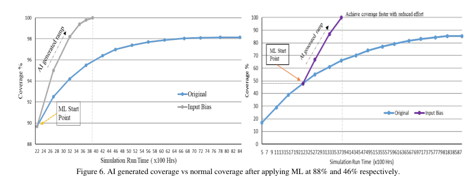
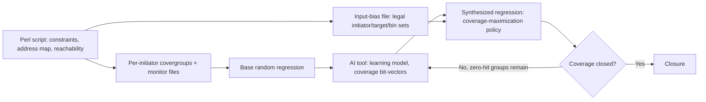

<!-- generated by yt-paper; edits will be overwritten -->
[DVCon](../dvcon/index.md) › [US](../dvcon/us.md) › [2025](../dvcon/by-year.md#2025) › [Verification](../dvcon/by-topic.md#verification)

# AI - accelerating coverage closure using intelligent stimulus generation

<figure class="rep-fig" markdown>
{ loading=lazy }
<figcaption>Figure 3 Script utilizing input files to generate plug n play coverage files. — from the original paper (Jainender Kumar et al.)</figcaption>
</figure>

[:material-open-in-new: Original paper](https://dvcon-proceedings.org/wp-content/uploads/1100.pdf){ .md-button .md-button--primary target=_blank }

| | |
|---|---|
| Authors | Jainender Kumar (Samsung-India), Ronak Bhatt (Samsung-India), Garima Srivastava (Samsung-India), Ashutosh Sinha (Cadence-India), Prashant Teotia (Cadence-India) |
| Venue | DVCon US 2025 |
| Topic | Verification |
| Type | PAPER |
| ID | `ref-20261018-ea2b` |

## Summary

**The paper proposes using the Cadence Xcelium SimAI "input-bias" feature, driven by a Perl-generated per-initiator/target bias file, to break coverage saturation in SoC bus-matrix regressions, reporting roughly 54–56% simulation-time reduction on a ~600K-bin mobile fabric.**

**Cadence Xcelium SimAI의 "input-bias" 기능과 Perl 스크립트로 생성한 initiator/target별 바이어스 파일을 활용해 SoC 버스 매트릭스 regression의 커버리지 포화를 해소하는 방법을 제안하며, 약 600K bin 규모 모바일 패브릭에서 시뮬레이션 시간을 54~56% 이상 줄였다고 보고한다.**

## Key Insights

- Cross-coverage explodes with interconnect size: the Table I SoCs have 134–202 initiators, 383–598 targets, and 594K–1659K cover bins, and the paper states that a multi-die setup of the same die raises bin count 3–4x.

- Interconnect 규모에 따라 cross coverage가 급증한다. Table I의 SoC는 initiator 134–202개, target 383–598개, cover bin 594K–1659K개이며, 같은 die를 multi-die로 구성하면 bin 수가 3–4배 증가한다고 문서는 밝힌다.

- Plain randomization saturates because it keeps hitting the same bins. The input-bias file reweights constraints toward non-hit bins while keeping stimulus random, which the paper credits with avoiding saturation.

- 단순 randomization은 같은 bin을 반복해서 맞히기 때문에 포화된다. input-bias 파일은 stimulus의 무작위성을 유지하면서 제약 조건의 가중치를 미달성 bin 쪽으로 재조정하여 포화를 피한다고 주장한다.

- Reported results on a ~100-initiator / ~380-target fabric with ~600K bins: 89%→100% coverage took ~8.4K sim hours originally versus ~3.8K with AI (>54% reduction); 46%→100% took ~8.7K versus ~3.8K (>56%). Training earlier in the regression gave larger gains.

- 약 100개 initiator, 약 380개 target, 약 600K bin 규모 패브릭의 결과: 89%→100% 도달에 원래 약 8.4K 시뮬레이션 시간이 필요했으나 AI 적용 시 약 3.8K로 줄었다(54% 이상 감소). 46%→100%는 약 8.7K에서 약 3.8K로 줄었다(56% 이상). regression 초기에 학습시킬수록 이득이 컸다.

- The bias file lists only legal initiator–target–bin combinations, e.g., APB passive targets are restricted to READ, so simulation time is not wasted on illegal crosses. Because the same Perl script generates it, the setup is portable across projects.

- 바이어스 파일은 합법적인 initiator–target–bin 조합만 포함한다. 예를 들어 APB passive target은 READ만 허용되어 불법 cross에 시간을 낭비하지 않는다. 같은 Perl 스크립트로 생성되므로 프로젝트 간 이식이 쉽다.

- Caveat: all evidence comes from a single proprietary-tool study on anonymized designs. The text is internally inconsistent (saturation at 98% vs. '89% to 98%', and a 30% headline vs. 54–56% in Table II), and it omits ML model details and run-to-run variance, so teams should validate on their own design.

- 주의: 근거는 독점 도구를 사용한 단일 산업 사례 연구 하나뿐이다. 본문도 내부적으로 일관되지 않다(98% 포화 vs. '89%에서 98%', 헤드라인 30% vs. Table II의 54–56%). ML 모델 세부 사항과 실행 간 편차도 생략되어 있으므로, 자신의 설계에서 검증해야 한다.

## Detailed Summary

### Background and Problem

- Modern SoC bus matrices connect many initiators and targets over mixed protocols. Cover groups cross parameters such as initiator, target, size, length, burst type, and direction. The paper cites an example of 150 initiators × 500 targets producing more than half a million bins.

- 최신 SoC 버스 매트릭스는 다수의 initiator와 target을 혼합 프로토콜로 연결한다. Cover group은 initiator, target, size, length, burst 종류, direction 등 파라미터의 교차곱으로 구성된다. 문서는 150 initiator × 500 target 예시에서 50만 개 이상의 bin이 생성된다고 제시한다.

- Randomized stimulus saturates: after a point, the randomization engine keeps hitting the same bins, so successive iterations add little coverage. Closure then takes thousands of iterations and substantial manual effort, which lengthens time-to-market.

- Randomized stimulus는 포화된다. 일정 시점 이후 randomization 엔진이 같은 bin을 반복해서 맞히므로 반복 실행에서 커버리지 증가가 미미해진다. 이에 따라 closure에 수천 회의 반복과 많은 수작업이 필요하고 time-to-market이 늘어난다.

- Illegal or unreachable bins waste simulation time, and simulation farms have memory and compute limits.

- 불법 또는 도달 불가능한 bin은 시뮬레이션 시간을 낭비하며, 시뮬레이션 팜은 메모리와 연산 자원에 제약이 있다.

- Table I reports 134/149/143/202 initiators, 400/383/407/598 targets, and 1033K/604K/594K/1659K cover bins for SoC 1–4.

- Table I은 SoC 1–4의 initiator 134/149/143/202개, target 400/383/407/598개, cover bin 1033K/604K/594K/1659K개를 보고한다.

### Architecture and Methodology

**Coverage generation (Perl script).** Inputs are initiator constraints, target address space, and initiator–target reachability. The script builds per-initiator covergroups that cross BurstLength, BurstKind, BurstSize, and Direction, gated by `iff (target_target == TARGET_n)`. It also emits monitor connection files for a UVM environment and filters illegal or invalid bins. Initiator and target databases (Figures 4 and 5) hold these fields. For APB, active targets allow READ and WRITE while passive targets allow READ only, which prevents illegal crosses and RTL-altering writes.

**커버리지 생성 (Perl 스크립트).** 입력은 initiator 제약 조건, target 주소 공간, initiator–target 도달성 정보이다. 스크립트는 BurstLength, BurstKind, BurstSize, Direction을 교차하고 `iff (target_target == TARGET_n)`로 게이팅한 initiator별 covergroup을 생성한다. 또한 UVM 환경용 monitor 연결 파일을 출력하고, 불법 또는 무효 bin을 걸러낸다. Initiator 및 target 데이터베이스(Figure 4, 5)가 이 필드를 관리한다. APB의 경우 active target은 READ와 WRITE를 허용하고 passive target은 READ만 허용하여, 불법 cross와 RTL 동작을 바꿀 수 있는 쓰기를 방지한다.

**AI flow.** The flow has three stages:

**AI 흐름.** 세 단계로 구성된다.

- **Base regression:** The simulator logs all random variables during any regression, regardless of coverage level. The AI tool then emits configuration/path info, coverage bit-vectors, and randomization data.

- **Base regression:** 시뮬레이터는 커버리지 수준과 무관하게 모든 regression에서 random 변수를 기록한다. AI 도구는 이로부터 설정/경로 정보, 커버리지 bit-vector, randomization 데이터를 생성한다.

- **Synthesis:** An iterative learning loop, with user-defined use cases and convergence policies (for example, coverage maximization to target uncovered bins), produces a synthesized regression and saves models and reports.

- **Synthesis:** 사용자가 정의한 use case와 수렴 정책(예: 미커버 bin을 겨냥하는 coverage maximization)을 바탕으로 반복 학습 루프를 돌려 synthesized regression을 만들고, 모델과 리포트를 저장한다.

- **Synthesized run:** A one-time input-bias file, generated by the same Perl script, specifies valid bins per initiator and accessible target. The example file restricts initiator index 83 and target index 210 to Direction [1,2], Length [1], Kind [2], and Size [1,2,4,8]. The learning matrix is updated each run.

- **Synthesized run:** Perl 스크립트가 생성한 1회성 input-bias 파일이 initiator별, 접근 가능한 target별 유효 bin을 지정한다. 예시 파일은 initiator 인덱스 83과 target 인덱스 210에 대해 Direction [1,2], Length [1], Kind [2], Size [1,2,4,8]로 제한한다. 매 실행마다 학습 행렬이 갱신된다.

Claimed features: automatic constraint learning; zero-hit cover-group detection that drives the convergence strategy; biased stimulus that keeps randomization; and elimination of redundant tests.

주장하는 기능: 자동 제약 학습, 수렴 전략을 결정하는 zero-hit cover group 탐지, randomization을 유지하는 바이어스 stimulus, 중복 테스트 제거.

### Results and Conclusions

- **Mobile platform** (~100 initiators, ~380 targets, >300K target bins, ~600K total): the original regression needed >8,400 hours after reaching ~98% coverage, while the input-bias approach reached 100% in ~3,800 hours.

- **모바일 플랫폼** (약 100 initiator, 약 380 target, target bin 30만 개 이상, 전체 약 60만 bin): 원래 regression은 약 98% 커버리지 도달 후 100%까지 8,400시간 이상이 필요했으나, input-bias 방식은 약 3,800시간에 100%에 도달했다.

- **Table II:** 89%→100% took ~8.4K hours originally versus ~3.8K with AI (>54% reduction). 46%→100% took ~8.7K hours versus ~3.8K (>56%).

- **Table II:** 89%→100%는 원래 약 8.4K시간에서 AI 적용 시 약 3.8K시간으로 줄었다(54% 이상 감소). 46%→100%는 약 8.7K시간에서 약 3.8K시간으로 줄었다(56% 이상).

- **Hard-to-hit cover group** (wlbt_core, 9,250 bins): the original regression ran >8,700 hours to ~85%, while input bias reached 100% in ~3,800 hours.

- **Hard-to-hit cover group** (wlbt_core, 9,250 bin): 원래 regression은 약 85%까지 8,700시간 이상이 걸렸으나, input bias는 약 3,800시간에 100%에 도달했다.

- Figure 7 shows that applying AI earlier in the regression yields larger gains.

- Figure 7은 regression 초기에 AI를 적용할수록 이득이 크다는 것을 보여준다.

- The conclusion claims 100% closure in at least 30% less time across SoCs with 0.7–1M bins, and says the method is scalable, portable, and applicable to multi-die designs.

- 결론은 0.7–1M bin 규모 SoC에서 최소 30% 적은 시간에 100% closure를 달성한다고 주장하며, 방법이 확장 가능하고 이식성이 있으며 multi-die 설계에도 적용 가능하다고 밝힌다.

- Limitations: the evidence is a single industrial study using a proprietary tool. The paper does not detail the ML model, the number of trials, or run-to-run variance. Its headline figures are also inconsistent (98% saturation vs. "89% to 98%", and 30% vs. 54–56%).

- 한계: 근거는 독점 도구를 사용한 단일 산업 사례 연구이다. ML 모델 세부 사항, 시행 횟수, 실행 간 편차는 제시되지 않는다. 헤드라인 수치도 일관되지 않다(98% 포화 vs. "89%에서 98%", 30% vs. 54–56%).

## Videos

<iframe src="https://www.youtube-nocookie.com/embed/3KjFoF6fVDU" title="[DVCON2025]AI - accelerating coverage closure using intelligent stimulus generation " loading="lazy" allow="accelerometer; clipboard-write; encrypted-media; gyroscope; picture-in-picture; web-share" referrerpolicy="strict-origin-when-cross-origin" allowfullscreen></iframe>

**[DVCON2025]AI - accelerating coverage closure using intelligent stimulus generation ** — [Watch on YouTube](https://www.youtube.com/watch?v=3KjFoF6fVDU) · [Video page](../videos/3KjFoF6fVDU.md)
