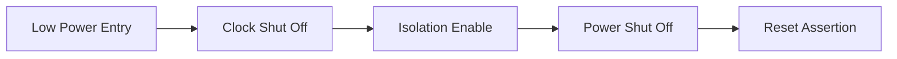

<!-- generated by yt-paper; edits will be overwritten -->
[DVCon](../dvcon/index.md) › [US](../dvcon/us.md) › [2023](../dvcon/by-year.md#2023) › [Verification](../dvcon/by-topic.md#verification)

# A Hardware and Software integrated power optimization approach with power aware simulations at SOC

<figure class="rep-fig" markdown>
{ loading=lazy }
<figcaption>Figure 1. PA Verification Flow — from the original paper (Eldin Ben Jacob et al.)</figcaption>
</figure>

[:material-open-in-new: Original paper](https://dvcon-proceedings.org/wp-content/uploads/1093-A-HW-and-SW-integrated-power-optimization-approaches-with-power-aware-simulations-at-SOC.pdf){ .md-button .md-button--primary target=_blank }

| | |
|---|---|
| Authors | Eldin Ben Jacob (Samsung Semiconductors India Research), Harshal Kothari (Samsung Semiconductors India Research), Sriram Kazhiyur Soundarrajan (Samsung Semiconductors India Research), Somasunder Kattepura Sreenath (Samsung Semiconductors India Research) |
| Venue | DVCon US 2023 |
| Topic | Verification |
| Type | PAPER |
| ID | `ref-20261018-ed23` |

## Summary

**Presents a combined hardware/software low-power control and UPF-based power-aware simulation methodology for a multi-domain SoC, reporting up to 30% silicon power savings and about ±0.5% pre-silicon power estimation accuracy.**

**하드웨어/소프트웨어 결합 저전력 제어와 UPF 기반 power-aware 시뮬레이션을 다중 전원 도메인 SoC에 적용한 방법론으로, 실리콘에서 최대 30% 전력 절감과 사전 실리콘 전력 추정 정확도 약 ±0.5%를 보고한다.**

## Key Insights

- Pre-silicon UPF-based power-aware simulation with PG netlists and power estimation reached about ±0.5% accuracy, and early silicon values correlated with the pre-silicon estimates.

- UPF 기반 power-aware 사전 실리콘 시뮬레이션(PG netlist 및 전력 추정)은 약 ±0.5% 정확도에 도달했으며, 초기 실리콘 값은 사전 실리콘 추정치와 상관관계를 보였다.

- Hardware-triggered power transitions took about 40 clock cycles versus about 200 cycles for software-triggered transitions over the slow APB clock, so a hybrid HW+SW control scheme was needed to meet power targets.

- 하드웨어 트리거 전력 전이는 약 40 클럭 사이클이 걸린 반면, 느린 APB 클럭을 거치는 소프트웨어 트리거 전이는 약 200 사이클이 걸려, 전력 목표 달성을 위해 HW+SW 혼합 제어 방식이 필요했다.

- Initial SoC power was 2.1x–3.4x the specified values; architecture tweaks with clock and power gating reached up to 83% power reduction in the tested scenarios.

- 초기 SoC 전력은 명세값의 2.1x–3.4x였으며, 클럭 게이팅과 파워 게이팅을 포함한 구조 조정으로 테스트 시나리오에서 최대 83% 전력 절감을 달성했다.

- Assertion-based clock checkers identified more than 100 free-running clocks that were brought under clock shut-off logic.

- 어서션 기반 클럭 검사기는 100개 이상의 free-running 클럭을 찾아내 클럭 셧오프 로직에 포함시켰다.

- On silicon, idle power dropped from 8.44 mW to 5.86 mW (30.6%) and a power-gated block consumed 0.58 mW against a 0.65 mW plan.

- 실리콘에서 idle 전력은 8.44 mW에서 5.86 mW(30.6%)로 감소했고, 파워 게이팅된 블록은 계획치 0.65 mW 대비 0.58 mW를 소비했다.

## Detailed Summary

### Background and Problem

- The SoC has 75 power domains, 79 clock domains and 37 voltage domains; hardware power controllers (13 power manager IPs) replace software control, so power-up/down combinations are too many to verify exhaustively.

- SoC는 75개 전원 도메인, 79개 클럭 도메인, 37개 전압 도메인을 가지며, 13개의 power manager IP가 소프트웨어 제어를 대체하여 전원 on/off 조합이 너무 많아 전수 검증이 어렵다.

- Initial power was 2.1x–3.4x the specified values across scenarios, and hardware-only triggering could not meet targets in some cases.

- 시나리오별 초기 전력은 명세값의 2.1x–3.4x였고, 하드웨어 전용 트리거만으로는 일부 경우에서 목표를 달성하지 못했다.

### Architecture and Methodology

- Power-aware flow: UPF 2.0/3.0 plus liberty files drive one-time compile; the testbench mimics the PMIC with an SV power-ball model, `$supply_on/off`, and CPU firmware masters. Checkers cover isolation, level shifters, retention, power switches and power state tables.

- Power-aware 흐름: UPF 2.0/3.0과 liberty 파일로 1회 컴파일하며, 테스트벤치는 SV power-ball 모델, `$supply_on/off`, CPU firmware master로 PMIC 동작을 모사한다. 검사기는 isolation, level shifter, retention, power switch, power state table을 다룬다.

- Low-power entry is a three-step sequence: idle-based IP gating, then a clock shut-off FSM (assertion checkers found >100 free-running clocks), then power gating with isolation and clamp cells.

- 저전력 진입은 3단계 순서로 진행된다: idle 기반 IP 게이팅, clock shut-off FSM(어서션 검사기가 100개 이상의 free-running 클럭을 발견), isolation 및 clamp 셀을 포함한 파워 게이팅.

- Hybrid control: HW event triggers (about 40 cycles) are supplemented by SW register and APB control (about 200 cycles). RTL tests are re-run as low-power simulations on PG netlists, and power is estimated from them.

- 혼합 제어: HW 이벤트 트리거(약 40 사이클)를 SW 레지스터 및 APB 제어(약 200 사이클)가 보완한다. RTL 테스트는 PG netlist 기반 저전력 시뮬레이션으로 재실행되며, 이로부터 전력을 추정한다.

### Results and Conclusions

- Pre-silicon power estimation reached about ±0.5% accuracy. On silicon, a fully configured module drew about 41 mW against 50 mW planned (18% less), and idle power fell from 8.44 mW to 5.86 mW (30.6%).

- 사전 실리콘 전력 추정은 약 ±0.5% 정확도에 도달했다. 실리콘에서 완전 구성된 모듈은 계획 50 mW 대비 약 41 mW(18% 감소)를 소비했고, idle 전력은 8.44 mW에서 5.86 mW(30.6%)로 감소했다.

- A power-gated block with minimal functionality drew 0.58 mW against 0.65 mW planned (11%). Table 2 reports PG/CG savings of 42%, 68%, 52% and 83% across scenarios B–E.

- 최소 기능만 동작하는 파워 게이팅 블록은 계획 0.65 mW 대비 0.58 mW(11%)를 소비했다. 표 2는 시나리오 B–E에서 PG/CG 절감률 42%, 68%, 52%, 83%를 보고한다.

- The paper concludes that master-slave power control and combined HW/SW triggering achieve power targets, and that early silicon values correlate with pre-silicon estimates. Further 10–75% savings from intermittent strategies are expected but not measured.

- 논문은 master-slave 전력 제어와 HW/SW 결합 트리거로 전력 목표를 달성했으며, 초기 실리콘 값이 사전 실리콘 추정치와 상관관계를 보인다고 결론짓는다. 간헐적 전력 절감 전략으로 10–75% 추가 절감이 기대되지만 측정되지는 않았다.

## Videos

<iframe src="https://www.youtube-nocookie.com/embed/Lkms-pIgkfg" title="[DVCON2023]Hardware and Software integrated power optimization approach with power aware simulation" loading="lazy" allow="accelerometer; clipboard-write; encrypted-media; gyroscope; picture-in-picture; web-share" referrerpolicy="strict-origin-when-cross-origin" allowfullscreen></iframe>

**[DVCON2023]Hardware and Software integrated power optimization approach with power aware simulation** — [Watch on YouTube](https://www.youtube.com/watch?v=Lkms-pIgkfg) · [Video page](../videos/Lkms-pIgkfg.md)
