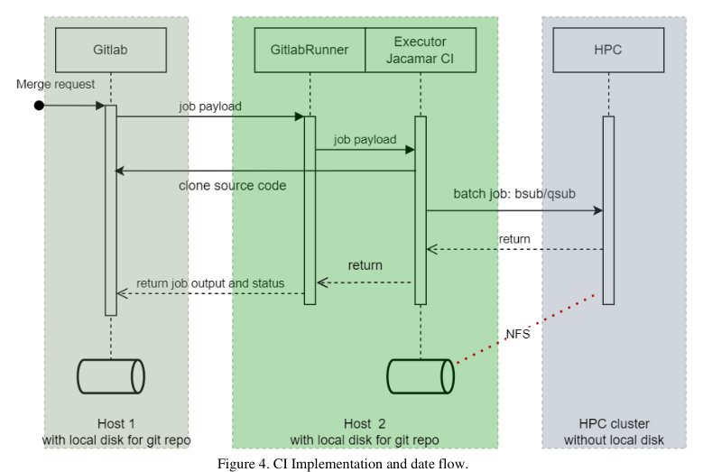
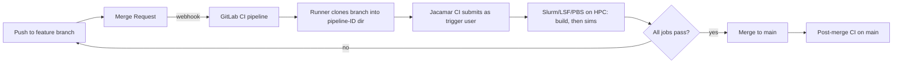

<!-- generated by yt-paper; edits will be overwritten -->
[DVCon](../dvcon/index.md) › [US](../dvcon/us.md) › [2025](../dvcon/by-year.md#2025) › [Verification](../dvcon/by-topic.md#verification)

# Continuous Integration in SoC Design: Challenges and Solutions

<figure class="rep-fig" markdown>
{ loading=lazy }
<figcaption>Figure 4. CI Implementation and date flow. — from the original paper (Liu Wei et al.)</figcaption>
</figure>

[:material-open-in-new: Original paper](https://dvcon-proceedings.org/wp-content/uploads/1028.pdf){ .md-button .md-button--primary target=_blank }

| | |
|---|---|
| Authors | Liu Wei (SDTECH Information Technology), Li Jianjun (SDTECH Information Technology), Yang Liangfeng (SDTECH Information Technology), Li Liang (SDTECH Information Technology) |
| Venue | DVCon US 2025 |
| Topic | Verification |
| Type | PAPER |
| ID | `ref-20261018-ee89` |

## Summary

**The paper describes a lightweight SoC CI system that combines GitLab CI, a Jacamar CI command adapter, and a Python regression script to run build and simulation jobs on an existing Slurm/LSF/PBS HPC cluster, with Git repositories moved to local disk and large files handled by Git LFS.**

**이 논문은 GitLab CI, Jacamar CI 명령 어댑터, Python 회귀 스크립트를 결합해 기존 Slurm/LSF/PBS HPC 클러스터에서 빌드 및 시뮬레이션 작업을 실행하는 경량 SoC CI 시스템을 제시하며, Git 저장소는 로컬 디스크로 옮기고 대용량 파일은 Git LFS로 관리합니다.**

## Key Insights

- Running CI jobs on the existing HPC cluster through a command adapter (Jacamar CI) avoids dedicated CI compute. The paper argues that CI demand peaks early in development and regression demand peaks later, so the two loads complement each other.

- 별도 CI 전용 컴퓨팅 없이 Jacamar CI 명령 어댑터를 통해 기존 HPC 클러스터에서 CI 작업을 실행합니다. 저자들은 CI 부하는 개발 초기에, 회귀 테스트 부하는 후반에 집중되므로 두 부하가 상호 보완된다고 주장합니다.

- Git repositories must sit on local disk rather than NFS-mounted working directories. The authors report that this change removed their perceived command latency. Git 2.38+ scalar clone with sparse checkout and Git LFS (with locking for binaries) address the remaining repository-size and binary-merge problems.

- Git 저장소는 NFS 마운트된 작업 디렉터리가 아닌 로컬 디스크에 있어야 합니다. 저자들은 이 변경으로 명령 지연이 체감상 사라졌다고 보고합니다. 나머지 저장소 크기 및 바이너리 병합 문제는 Git 2.38+의 scalar clone과 sparse checkout, 그리고 바이너리에 대한 잠금 기능이 있는 Git LFS로 해결합니다.

- Gate every merge with CI on the feature branch, then re-run CI on main after merge. Failed jobs block merging. Fixed random seeds keep results reproducible. Jobs run under the trigger user's identity so failed cases can be re-simulated with waveform dumps from existing builds, and so HPC quotas per team are respected.

- feature 브랜치에서 병합 전 CI를 게이트로 실행하고, 병합 후 main에서도 CI를 다시 실행합니다. 실패한 작업이 있으면 병합이 차단됩니다. 고정 random seed로 결과 재현성을 확보합니다. 작업은 트리거한 사용자의 신원으로 실행되므로, 실패 케이스는 기존 빌드 산출물로 파형 덤프를 포함해 재시뮬레이션할 수 있으며 팀별 HPC 할당량도 지킵니다.

- Reported deployment results: 19 testbench builds and 23 simulation jobs finishing within an hour, versus about one day per cycle for manual integration. Over 15 months with 41 developers: 3,303 merges, 8,213 pipelines, 1,344 failures caught early, and root cause identified within 5 minutes versus over 30 minutes in traditional flows.

- 보고된 도입 결과: 19개 testbench 빌드와 23개 시뮬레이션 작업이 1시간 이내에 완료되며, 유사 프로젝트의 수동 통합 사이클은 약 1일이 걸렸습니다. 개발자 41명, 15개월 동안 병합 3,303건, 파이프라인 8,213건을 기록했고 조기에 잡은 실패는 1,344건, 근본 원인 파악 시간은 CI 실패 후 5분 이내로 전통 방식의 30분 이상과 비교됩니다.

## Detailed Summary

### Background and Problem

- SoC build and simulation depend on HPC job schedulers (Slurm, LSF, PBS). Mainstream CI tools are not compatible with this infrastructure out of the box.

- SoC 빌드와 시뮬레이션은 HPC 작업 스케줄러(Slurm, LSF, PBS)에 의존하며, 주류 CI 도구는 이 인프라와 기본적으로 호환되지 않습니다.

- Dedicated CI compute has a dilemma. If it is small, large-scale parallel testing is impossible. If it is large, costs are excessive. Prior industry workarounds (scheduled runs, batching merges, queued jobs) suffer from poor real-time feedback and added complexity.

- 전용 CI 컴퓨팅 자원은 딜레마를 가집니다. 규모가 작으면 대규모 병렬 테스트가 불가능하고, 규모가 크면 비용이 과도합니다. 기존 업계의 우회 방법(정기 실행, 병합 묶음 처리, 작업 큐)은 실시간 피드백이 나쁘고 복잡성을 더합니다.

- Git has known problems for chip design: performance degradation in large repositories, binary merge conflicts, and repository growth from large files. Perforce and SVN handle these better, with Perforce scaling to large files and both supporting binary locking.

- 칩 설계에서 Git은 알려진 문제가 있습니다. 대형 저장소에서의 성능 저하, 바이너리 병합 충돌, 대용량 파일로 인한 저장소 증가가 그것입니다. Perforce와 SVN은 이를 더 잘 처리하며, Perforce는 대용량 파일에 강하고 둘 다 바이너리 잠금을 지원합니다.

- Load is complementary over time. Early development is CI-heavy and regression is idle. Later, merges decrease while regression grows. Sharing HPC across both can make CI possible without extra HPC hardware.

- 부하는 시간에 따라 상호 보완적입니다. 개발 초기에는 CI 부하가 크고 회귀 테스트는 유휴 상태입니다. 후반에는 병합이 줄고 회귀 테스트가 커집니다. 두 부하가 HPC를 공유하면 추가 HPC 하드웨어 없이도 CI가 가능해집니다.

### Architecture and Methodology

Core components: a version control system (GitLab), a CI platform (GitLab CI with Runner), a job scheduler (Slurm/LSF/PBS), a command adapter (Jacamar CI, which converts `sim -b a_test` into a scheduler command such as `srun -n 1 sim -b a_test`), and the HPC cluster.

핵심 구성 요소: 버전 관리 시스템(GitLab), CI 플랫폼(Runner를 포함한 GitLab CI), 작업 스케줄러(Slurm/LSF/PBS), 명령 어댑터(Jacamar CI, `sim -b a_test`를 `srun -n 1 sim -b a_test` 같은 스케줄러 명령으로 변환), 그리고 HPC 클러스터입니다.

Infrastructure: two servers. One hosts the Git server. The other hosts the Runner, the adapter, and the scheduler. Repositories are kept on local disks. The Runner's local storage and the user work server are exported over NFS to the cluster, so the cluster can build and simulate directly from them.

인프라: 서버 두 대를 사용합니다. 한 대는 Git 서버를 호스팅하고, 다른 한 대는 Runner, 어댑터, 스케줄러를 호스팅합니다. 저장소는 로컬 디스크에 보관합니다. Runner의 로컬 스토리지와 사용자 작업 서버는 NFS로 클러스터에 공유되어, 클러스터가 이들로부터 직접 빌드와 시뮬레이션을 수행할 수 있습니다.

Branch and merge policy:

브랜치 및 병합 정책:

- The main branch accepts only merges. Before RTL freeze, feature branches are per person and kept small.

- main 브랜치는 병합만 허용합니다. RTL freeze 이전에는 사람별 feature 브랜치를 만들며, 작업량을 작게 유지합니다.

- Each MR runs CI tests at IP, subsystem, and SoC levels. Builds run in parallel, each in its own directory. Simulations for a build start when that build ends, and each is a separate job.

- 각 MR은 IP, 서브시스템, SoC 수준의 CI 테스트를 실행합니다. 빌드는 각자 별도 디렉터리에서 병렬로 수행되고, 어떤 빌드의 시뮬레이션은 그 빌드가 끝나면 시작되며, 각 시뮬레이션은 별도 작업입니다.

- Any failing job blocks the merge. Developers run `git rebase main` before pushing.

- 실패한 작업이 하나라도 있으면 병합이 차단됩니다. 개발자는 push 전에 `git rebase main`을 수행합니다.

- CI re-runs after merge to main, to catch interaction effects and identify the offending merge.

- main 병합 후 CI를 다시 실행하여 상호작용 효과를 잡고, 문제를 일으킨 병합을 특정합니다.

- Automatic runs do not dump waveforms, for speed. Failed cases are re-run with dumps from the existing build artifacts.

- 자동 실행은 속도를 위해 파형을 덤프하지 않습니다. 실패한 케이스는 기존 빌드 산출물을 사용해 덤프 옵션으로 재실행합니다.

- Jobs execute under the trigger's identity, so output files are owned by the trigger and HPC usage stays within each team's quota.

- 작업은 트리거한 사용자의 신원으로 실행되므로 산출 파일의 소유자가 트리거 사용자가 되며, 팀별 HPC 사용량도 할당 정책 안에 머뭅니다.

- Fixed random seeds are used in all CI cases to avoid pass-then-fail nondeterminism.

- 모든 CI 케이스에 고정 random seed를 사용해, 통과했다가 실패하는 비결정성을 피합니다.

- For cross-role changes, cherry-pick lets a DV engineer pull a DE's branch commit into main without rewriting the DE's authorship.

- 역할 간 변경의 경우, cherry-pick으로 DV 엔지니어가 DE의 브랜치 커밋을 main에 가져올 수 있으며, DE의 작성자 정보는 유지됩니다.

Regression script and pipeline generation:

회귀 스크립트와 파이프라인 생성:

- A Python regression tool runs one test per CI invocation (`sim -t example_test_a`), returning exit code 0 for pass and non-zero for fail.

- Python 기반 회귀 도구는 CI 호출 한 번당 테스트 하나를 실행합니다(`sim -t example_test_a`). 통과 시 종료 코드 0, 실패 시 0이 아닌 값을 반환합니다.

- Builds and simulation options are defined in YAML. `sim -b` builds only, and `sim -so` simulates from an existing executable.

- 빌드와 시뮬레이션 옵션은 YAML로 정의합니다. `sim -b`는 빌드만, `sim -so`는 기존 실행 파일로 시뮬레이션만 수행합니다.

- `sim -genci -tag ci` emits GitLab jobs with build-to-sim dependencies. The parent pipeline generates a child pipeline, using GitLab's parent-child mechanism.

- `sim -genci -tag ci`는 빌드에서 시뮬레이션으로 이어지는 의존성을 가진 GitLab 작업을 생성합니다. 부모 파이프라인이 GitLab의 parent-child 메커니즘을 사용해 자식 파이프라인을 생성합니다.

Runner and adapter configuration:

Runner 및 어댑터 설정:

- The Runner uses a custom executor that is Jacamar CI, configured in `config.toml`.

- Runner는 `config.toml`에서 custom executor로 Jacamar CI를 지정합니다.

- `custom_build_dir = true` creates a per-pipeline directory named from `${CI_PIPELINE_ID}`.

- `custom_build_dir = true`로 `${CI_PIPELINE_ID}`를 이름으로 하는 파이프라인별 디렉터리를 만듭니다.

- `group_permissions = true` lets users in the same Linux group see each other's logs and waveforms.

- `group_permissions = true`로 같은 Linux 그룹의 사용자끼리 로그와 파형을 볼 수 있습니다.

- A root cron job deletes directories older than 24 hours each day at noon. Log pruning is also scheduled.

- root 권한 cron 작업이 매일 정오에 24시간이 지난 디렉터리를 삭제합니다. 로그 정리도 주기적으로 수행합니다.

Git scaling for SoC repositories:

SoC 저장소를 위한 Git 확장 방안:

- Local-disk repositories remove NFS latency.

- 로컬 디스크 저장소로 NFS 지연을 제거합니다.

- `scalar clone` (Git 2.38+) with sparse checkout limits the working tree to needed directories and prefetches remote objects in the background.

- Git 2.38+의 `scalar clone`과 sparse checkout으로 작업 트리를 필요한 디렉터리로 제한하고, 원격 객체를 백그라운드에서 미리 가져옵니다.

- Git LFS stores large files in GitLab-managed storage, keeping only pointers in the repository. LFS locking handles binary files.

- Git LFS는 대용량 파일을 GitLab 관리 스토리지에 저장하고, 저장소에는 포인터만 둡니다. 바이너리 파일은 LFS 잠금으로 처리합니다.

- Third-party IP stays on NFS outside the repository, with a version-path filelist kept in Git so version history is still tracked.

- 서드파티 IP는 저장소 밖 NFS에 두고, 버전 경로 목록 파일을 Git에 보관해 버전 이력을 추적합니다.

Tool selection: GitLab CI was chosen over Jenkins. Jenkins uses Groovy and needs dedicated maintenance. GitLab CI uses YAML. The GitLab community edition and Jacamar CI are open source and free.

도구 선택: Jenkins 대신 GitLab CI를 선택했습니다. Jenkins는 Groovy를 사용하고 전담 유지보수 인력이 필요합니다. GitLab CI는 YAML을 사용합니다. GitLab 커뮤니티 에디션과 Jacamar CI는 오픈소스이며 무료입니다.

### Results and Conclusions

Reported deployment figures (one project):

보고된 도입 수치(단일 프로젝트):

- Pipeline: 19 testbench builds and 23 simulation jobs, completing within an hour. Traditional manual integration in similar projects took about one day per cycle.

- 파이프라인: 19개 testbench 빌드와 23개 시뮬레이션 작업이 1시간 이내에 완료됩니다. 유사 프로젝트의 수동 통합은 사이클당 약 1일이 걸렸습니다.

- Load: up to 40 pipelines per day at peak, with 7 to 8 running concurrently.

- 부하: 피크 시 하루 최대 40개 파이프라인, 동시에 7~8개가 실행됩니다.

- Scope: 15-month development period, 41 developers, 3,303 merges, 8,213 pipelines. The paper reports 6,743 successes and 1,344 failures. These two numbers sum to 8,087, not 8,213, and the paper does not explain the difference.

- 범위: 15개월 개발 기간, 개발자 41명, 병합 3,303건, 파이프라인 8,213건입니다. 논문은 성공 6,743건, 실패 1,344건으로 보고합니다. 두 수치의 합은 8,087로 8,213과 다르며, 논문은 그 차이를 설명하지 않습니다.

- Debug speed: developers typically identified root causes within 5 minutes of a CI failure, versus over 30 minutes in traditional flows. Some cases exceeded 24 hours.

- 디버그 속도: 개발자는 CI 실패 후 보통 5분 이내에 근본 원인을 파악했으며, 전통 방식은 30분 이상이 걸렸습니다. 일부 사례는 24시간을 넘었습니다.

- Estimated savings: the paper multiplies 1,344 early-caught failures by 2.5 hours per integration issue (an average from prior traditional projects) to get over 3,360 hours saved. This is an estimate, not a measured result.

- 추정 절감 효과: 논문은 조기에 잡은 실패 1,344건에 기존 프로젝트의 통합 이슈당 평균 2.5시간을 곱해 3,360시간 이상의 절감을 도출합니다. 이는 측정값이 아니라 추정치입니다.

Conclusions: the authors claim a lightweight CI system that uses existing HPC, avoids extra hardware, detects errors early, reduces bug propagation, and keeps main consistently passing. Limitations: the paper gives no measured HPC cost or utilization data, no quantitative comparison with other CI approaches, and the Figure 7 pipeline chart data is not described in the text.

결론: 저자들은 기존 HPC를 활용해 추가 하드웨어 없이 조기 오류 검출, 버그 전파 감소, main 브랜치의 지속적 정상 상태 유지를 달성하는 경량 CI 시스템이라고 주장합니다. 한계: 논문은 측정된 HPC 비용이나 활용률 데이터를 제시하지 않으며, 다른 CI 방식과의 정량 비교도 없고, Figure 7의 파이프라인 차트 데이터는 본문에서 설명되지 않습니다.

## Videos

<iframe src="https://www.youtube-nocookie.com/embed/SwaKnaGIp6o" title="[DVCON2025]Continuous Integration in SoC Design: Challenges and Solutions" loading="lazy" allow="accelerometer; clipboard-write; encrypted-media; gyroscope; picture-in-picture; web-share" referrerpolicy="strict-origin-when-cross-origin" allowfullscreen></iframe>

**[DVCON2025]Continuous Integration in SoC Design: Challenges and Solutions** — [Watch on YouTube](https://www.youtube.com/watch?v=SwaKnaGIp6o) · [Video page](../videos/SwaKnaGIp6o.md)
