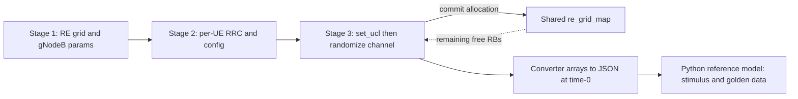

<!-- generated by yt-paper; edits will be overwritten -->
[DVCon](../dvcon/index.md) › [US](../dvcon/us.md) › [2023](../dvcon/by-year.md#2023) › [Verification](../dvcon/by-topic.md#verification)

# Creating 5G Test Scenarios, the Constrained-Random way

<figure class="rep-fig" markdown>
{ loading=lazy }
<figcaption>Fig. 4: Flow chart indicating one of the possible ways a sequence can generate a scenario. — from the original paper (Keshav Kannan et al.)</figcaption>
</figure>

[:material-open-in-new: Original paper](https://dvcon-proceedings.org/wp-content/uploads/1003-Creating-5G-Test-Scenarios-the-Constrained-Random-way.pdf){ .md-button .md-button--primary target=_blank }

| | |
|---|---|
| Authors | Keshav Kannan (Intel Corporation), Eric P. Kim (Intel Corporation) |
| Venue | DVCon US 2023 |
| Topic | Verification |
| Type | PAPER |
| ID | `ref-20261018-f0b1` |

## Summary

**A staged SystemVerilog constrained-random methodology that maps 3GPP 5G NR uplink resource allocation onto a shared RE-grid slot-map, enabling system-level CRV of multi-UE PUCCH/PUSCH/SRS scenarios with about 1% verification-time overhead.**

**3GPP 5G NR 업링크 자원 할당을 하나의 공유 RE 그리드 slot-map에 매핑하는 다단계 SystemVerilog constrained-random 방법론으로, 다수 UE의 PUCCH/PUSCH/SRS 시나리오에 대한 시스템 레벨 CRV를 약 1%의 검증 시간 오버헤드로 수행할 수 있게 한다.**

## Key Insights

- Splitting the randomization into stages that share one RE-grid slot-map (re_grid_map) turns a joint solve over all parameters into sequential, smaller solves: each inserted channel commits its RBs and symbols, so later channels only see free resources.

- 다단계 randomization을 하나의 RE 그리드 slot-map(re_grid_map)을 공유하도록 나누면 전체 파라미터를 동시에 푸는 문제가 순차적이고 작은 문제들로 바뀐다. 채널이 삽입될 때마다 RB와 심볼이 확정되므로 이후 채널은 남은 자원만 보게 된다.

- Time-domain constraints (SLIV, mapping type A/B) live in the PUSCH base class, while frequency-domain constraints are split into type-specific subclasses (type 0 RBG bitmap vs. type 1 RIV). This isolates spec-dependent conflicts and keeps each constraint local.

- 시간 영역 제약(SLIV, 매핑 타입 A/B)은 PUSCH base class에 두고, 주파수 영역 제약은 타입별 subclass(type 0의 RBG bitmap, type 1의 RIV)로 분리한다. 이렇게 하면 스펙 기반 충돌을 격리하고 각 제약을 지역적으로 유지할 수 있다.

- The flat parameter load for 64 UEs with PUCCH Fmt0, PUSCH Type1 and SRS in one slot is 11,037 randomized parameters (Table V). The paper reports that the staged approach keeps total CR overhead at about 1% of total verification execution time.

- 한 슬롯에 PUCCH Fmt0, PUSCH Type1, SRS를 배치하는 64 UE 경우의 평탄한(flat) 파라미터 부하는 11,037개다(Table V). 논문은 단계적 접근으로 전체 CR 오버헤드를 전체 검증 실행 시간의 약 1% 수준으로 유지했다고 보고한다.

- The configuration is exported as JSON at time-0 and consumed by a Python reference model that produces bit-true stimulus and golden expected data, so the same scenario can be replayed at unit or top level. Regression coverage was 428 CR scenarios and 80+ coverpoints, and more than 80 post-design-freeze RTL bugs were caught.

- 구성 정보는 time-0에 JSON으로 내보내지고, Python reference model이 이를 받아 bit-true 자극과 golden 기대값을 생성한다. 따라서 같은 시나리오를 unit 또는 top 레벨에서 재생할 수 있다. 회귀 검증은 428개의 CR 시나리오와 80개 이상의 coverpoint로 수행되었고, 설계 동결(design freeze) 이후 80개 이상의 RTL 버그가 검출되었다.

## Detailed Summary

# Creating 5G Test Scenarios, the Constrained-Random way

placeholder

### Background and Problem

&nbsp;

- System-level constrained-random verification (CRV) of 5G NR PHY is considered hard because the solution space combines many parameters with inter-dependencies taken from the 3GPP specifications (TS 38.331 RRC, TS 38.211 physical channels, TS 38.214 physical layer procedures).

&nbsp;

- Mapping the spec into SystemVerilog constraints requires understanding both the requirements and the solver. The paper addresses the intersection of time/frequency allocation constraints across channel types.

&nbsp;

- Example: inserting PUCCH and PUSCH for a single user involves about 400 randomized parameters. Complexity grows rapidly as more users and channel types share one RE grid.

&nbsp;

- Directed tests need a hand-built functional verification list and per-scenario parameter sets. The authors consider this slow, error-prone, and debug-heavy. Manually allocating 64 UEs with PUCCH, PUSCH, and SRS in one slot is described as impractical.

&nbsp;

- The goal is a valid, non-overlapping, spec-compliant allocation of all user/channel types on the time-frequency RE grid, with stress and max-throughput scenarios.

&nbsp;

### Architecture and Methodology

&nbsp;

- **Shared state:** a static enumerated array `re_grid_map[CC][SLOT][SYM][RB][LAYER]` holds the channel type per RB (PSS…PUSCH, plus OFB, BLANK, NA). `re_grid_ue` records the owning UE.

&nbsp;

- **Stage 1 (cell/link level):** randomizes numerology, bandwidth, BWP, subcarrier spacing, FFT size, and number of slots, and builds the empty grid (Fig. 2a). The number of UEs is passed in. Table II lists test modes (e.g., 1cc_4X4, 2cc_2x2, 4cc_2x2, across 15/30/60/120 kHz SCS and FR1/FR2).

&nbsp;

- **Stage 2 (RRC and UE configuration):** gNodeB and per-UE RRC parameters are randomized for all UEs and apply to all slots. Examples include BWP size, RBG size, puschRbgConfig, and PUCCH/PUSCH/SRS parameters. Program 2 maps the TS 38.214 RBG-size table to a constraint `c_bwp_rbg_size`.

&nbsp;

- **Stage 3 (channel insertion):** this is the most complex stage. Each channel-type class (PUCCH Fmt0/Fmt2, PUSCH Type0/Type1, SRS, and others) is randomized one instance at a time for a selected UE/CC/slot via `set_ucl(ue, cc, slot)`.
  - The PUSCH time-domain allocation uses the SLIV encoding. As written in the paper, SLIV = 14·(L−1)+S if (L−1)≤7, else 14·(14−L+1)+(14−1−S), with 0<L≤14−S. Type A and Type B have different valid ranges. These constraints live in the PUSCH base class.
  - Frequency-domain constraints differ between Type 0 (RBG bitmap) and Type 1 (RIV encoding of start RB and length). These live in subclasses.
  - The rectangle is defined by corners (X0,Y0)–(X1,Y1). A temporary grid `re_grid_act` maps the candidate allocation, and it is committed to `re_grid_map` only on success.
  - Each committed object's parameters are stored in converter-class arrays.

&nbsp;

- **Sequence:** Program 3 loops over UE, CC, and slot, inserting PUCCH F2, PUSCH Type1, and SRS in turn. The insertion order is not restricted.

&nbsp;

- **Output:** a JSON file is written at time-0 and consumed by a Python reference model, which generates bit-true input stimulus (top or block level) and expected data.

&nbsp;

- **Scope:** uplink only. The authors say DL extension is straightforward.

&nbsp;

### Results and Conclusions

&nbsp;

- **Parameter load (Table V):** for 64 UEs with PUCCH Fmt0, PUSCH Type1, and SRS in one slot, the staged flow issues 29 + 4416 + 1792 + 3264 + 1536 = 11,037 randomized parameters across 1 + 64×3 calls. Table III lists per-feature counts (e.g., PUSCH Type0 54, PUSCH Type1 51, PUCCH Fmt0 28, PUCCH Fmt2 27, SRS 24, UE configs 69).

&nbsp;

- **Randomization vs. simulation time (Table VI):**
  - 1 slot, 1 UE, 1 channel: under 30 s.
  - 1 slot, 4 UEs, 1 channel: under 1 min.
  - 1 slot, 64 UEs, 1 channel: about 30 min (simulation about 1 h per slot).
  - 1 slot, 64 UEs, 3 channels: about "1:30 mins" as printed (simulation about 2 h per slot).
  - The paper reports that total CR overhead is about 1% of total verification execution time. The table does not show how that 1% was derived.

&nbsp;

- **Coverage and bug yield:** 428 constraint-random scenarios were derived. Over 400 high-level scenarios ran in every regression. More than 80 coverpoints targeted channel-type parameters. More than 80 RTL bugs were found after design freeze, mostly critical and causing hangs in specific scenarios. Performance sequences (max throughput, 64-UE multi-slot, large PUCCH F2 payloads) were also added.

&nbsp;

- **Reuse:** the infrastructure is plug-and-play across levels. Failing tests can be replayed without re-randomization, and failures can move between unit and top levels for fast debug.

&nbsp;

- **Conclusion:** the authors argue that a hierarchical multi-stage constraint structure with a common RE grid makes system-level CRV of a full 5G uplink feasible at low overhead. Limitations: the paper is an industry experience report, with uplink only, the complex type-selection method is out of scope, and no direct quantitative comparison against a directed-test baseline is given.

&nbsp;

---

&nbsp;

### 배경 및 문제

&nbsp;

- 5G NR PHY의 시스템 레벨 CRV는 3GPP 스펙(TS 38.331 RRC, TS 38.211 물리 채널, TS 38.214 물리 계층 절차)에서 가져온 상호 의존적인 파라미터가 많아 어렵다고 여겨진다. 논문은 채널 타입 간 시간/주파수 할당 제약의 교집합 문제를 다룬다.

&nbsp;

- 스펙을 SystemVerilog 제약으로 옮기려면 요구사항과 solver를 모두 이해해야 한다.

&nbsp;

- 예시: 한 사용자의 PUCCH와 PUSCH를 삽입하는 데만 약 400개의 randomized 파라미터가 필요하다. 사용자와 채널 타입이 하나의 RE 그리드를 공유하면 복잡도는 급격히 증가한다.

&nbsp;

- Directed test는 수작업 기능 검증 목록과 시나리오별 파라미터 세트를 요구한다. 저자들은 이것이 느리고 오류가 발생하기 쉬우며 디버그 부담이 크다고 본다. 한 슬롯에 PUCCH, PUSCH, SRS를 가진 64 UE를 수작업으로 할당하는 것은 비현실적이라고 설명한다.

&nbsp;

- 목표는 시간-주파수 RE 그리드 위에 모든 사용자/채널 타입을 중첩 없이, 스펙을 만족하도록 할당하는 것이며, 최대 처리량과 스트레스 시나리오도 포함한다.

&nbsp;

### 구조 및 방법론

&nbsp;

- **공유 상태:** 정적 열거형 배열 `re_grid_map[CC][SLOT][SYM][RB][LAYER]`가 RB별 채널 타입(PSS…PUSCH, 그리고 OFB, BLANK, NA)을 저장한다. `re_grid_ue`는 소유 UE를 기록한다.

&nbsp;

- **1단계 (셀/링크 레벨):** numerology, 대역폭, BWP, subcarrier spacing, FFT 크기, 슬롯 수를 randomize하고 빈 그리드(Fig. 2a)를 만든다. UE 수가 입력으로 전달된다. Table II는 테스트 모드를 나열한다(예: 1cc_4X4, 2cc_2x2, 4cc_2x2; 15/30/60/120 kHz SCS, FR1/FR2).

&nbsp;

- **2단계 (RRC 및 UE 구성):** gNodeB와 UE별 RRC 파라미터를 모든 UE에 대해 randomize하며, 모든 슬롯에 적용된다. 예시로 BWP 크기, RBG 크기, puschRbgConfig, PUCCH/PUSCH/SRS 파라미터가 있다. Program 2는 TS 38.214의 RBG 크기 표를 제약 `c_bwp_rbg_size`로 매핑한다.

&nbsp;

- **3단계 (채널 삽입):** 가장 복잡한 단계다. 각 채널 타입 클래스(PUCCH Fmt0/Fmt2, PUSCH Type0/Type1, SRS 등)를 `set_ucl(ue, cc, slot)`로 선택한 UE/CC/슬롯에 대해 한 번에 하나씩 randomize한다.
  - PUSCH 시간 영역 할당은 SLIV 인코딩을 사용한다. 논문 기재식은 SLIV = 14·(L−1)+S (if (L−1)≤7), 그 외 14·(14−L+1)+(14−1−S), 단 0<L≤14−S이다. Type A와 Type B는 유효 범위가 다르다. 이 제약들은 PUSCH base class에 있다.
  - 주파수 영역 제약은 Type 0(RBG bitmap)과 Type 1(시작 RB와 길이를 나타내는 RIV 인코딩)에서 다르며, subclass에 구현된다.
  - 직사각형 영역은 (X0,Y0)–(X1,Y1) 대각 꼭짓점으로 정의된다. 임시 그리드 `re_grid_act`로 후보 할당을 매핑하고, 성공 시에만 `re_grid_map`에 커밋한다.
  - 커밋된 객체의 파라미터는 converter 클래스 배열에 저장된다.

&nbsp;

- **시퀀스:** Program 3은 UE, CC, 슬롯을 순회하며 PUCCH F2, PUSCH Type1, SRS를 차례로 삽입한다. 삽입 순서는 제한되지 않는다.

&nbsp;

- **출력:** time-0에 JSON 파일이 생성되고, 이를 Python reference model이 읽어 bit-true 입력 자극(top 또는 block 레벨)과 기대값을 생성한다.

&nbsp;

- **범위:** 업링크만 다룬다. 저자들은 DL 확장이 간단하다고 말한다.

&nbsp;

### 결과 및 결론

&nbsp;

- **파라미터 부하 (Table V):** 한 슬롯에 PUCCH Fmt0, PUSCH Type1, SRS를 가진 64 UE의 경우, 단계적 흐름은 29 + 4416 + 1792 + 3264 + 1536 = 11,037개의 randomized 파라미터를 1 + 64×3회 호출로 처리한다. Table III은 기능별 개수를 제시한다(예: PUSCH Type0 54, PUSCH Type1 51, PUCCH Fmt0 28, PUCCH Fmt2 27, SRS 24, UE 구성 69).

&nbsp;

- **Randomization 시간 대 시뮬레이션 시간 (Table VI):**
  - 1 슬롯, 1 UE, 채널 1개: 30초 미만.
  - 1 슬롯, 4 UE, 채널 1개: 1분 미만.
  - 1 슬롯, 64 UE, 채널 1개: 약 30분 (슬롯당 시뮬레이션 약 1시간).
  - 1 슬롯, 64 UE, 채널 3개: 표에 기재된 대로 "~1:30 mins" (슬롯당 시뮬레이션 약 2시간).
  - 논문은 전체 CR 오버헤드가 전체 검증 실행 시간의 약 1%라고 보고한다. 표에는 이 1%가 어떻게 산출되었는지 나타나 있지 않다.

&nbsp;

- **커버리지 및 버그 검출:** 428개의 constraint-random 시나리오가 도출되었다. 400개 이상의 상위 레벨 시나리오가 매 회귀에서 실행되었다. 채널 타입 파라미터를 겨냥한 80개 이상의 coverpoint가 있었다. 설계 동결 이후 80개 이상의 RTL 버그가 검출되었으며, 대부분 치명적이고 특정 시나리오에서 hang을 일으켰다. 최대 처리량, 다중 슬롯 64 UE, 대용량 payload의 PUCCH F2 같은 성능 시퀀스도 추가되었다.

&nbsp;

- **재사용:** 인프라는 여러 레벨에서 plug-and-play로 재사용된다. 실패한 테스트는 재randomize 없이 재생할 수 있고, unit과 top 레벨 사이에서 실패를 옮겨 빠르게 디버그할 수 있다.

&nbsp;

- **결론:** 저자들은 공통 RE 그리드를 가진 계층적 다단계 제약 구조 덕분에 전체 5G 업링크의 시스템 레벨 CRV가 낮은 오버헤드로 가능하다고 주장한다. 한계: 산업 경험 보고서이며, 업링크만 다루고, 복잡한 타입 선택 방식은 범위에서 제외되었으며, directed test 기준과의 정량적 직접 비교는 제시되지 않았다.

&nbsp;

## Videos

<iframe src="https://www.youtube-nocookie.com/embed/UUzJcTvJEOE" title="[DVCON2023]Creating 5G Test Scenarios, the Constrained-Random way" loading="lazy" allow="accelerometer; clipboard-write; encrypted-media; gyroscope; picture-in-picture; web-share" referrerpolicy="strict-origin-when-cross-origin" allowfullscreen></iframe>

**[DVCON2023]Creating 5G Test Scenarios, the Constrained-Random way** — [Watch on YouTube](https://www.youtube.com/watch?v=UUzJcTvJEOE) · [Video page](../videos/UUzJcTvJEOE.md)
