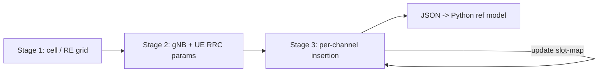

<!-- generated by yt-paper; edits will be overwritten -->
[DVCon](../dvcon/index.md) › [US](../dvcon/us.md) › [2023](../dvcon/by-year.md#2023) › [Verification](../dvcon/by-topic.md#verification)

# Creating 5G Test Scenarios, the Constrained-Random way

<figure class="rep-fig" markdown>
{ loading=lazy }
<figcaption>Fig. 4: Flow chart indicating one of the possible ways a sequence can generate a scenario. — from the original paper (Keshav Kannan et al.)</figcaption>
</figure>

[:material-open-in-new: Original paper](https://dvcon-proceedings.org/wp-content/uploads/1003-Creating-5G-Test-Scenarios-the-Constrained-Random-way.pdf){ .md-button .md-button--primary target=_blank } [:material-presentation-play: Official talk](https://youtu.be/XAdej6mha0c){ .md-button target=_blank }

| | |
|---|---|
| Authors | Keshav Kannan (Intel Corporation), Eric P. Kim (Intel Corporation) |
| Venue | DVCon US 2023 |
| Topic | Verification |
| Type | PAPER |
| ID | `ref-20261018-f0b1` |

## Summary

**A multi-stage SystemVerilog constrained-random methodology builds a shared 5G NR uplink resource grid so that system-level CRV is feasible, reporting about 1% verification-time overhead and 80+ post-freeze RTL bugs found.**

**여러 단계로 나눈 SystemVerilog constrained-random 방법론으로 공유 5G NR 업링크 resource grid를 구성해 시스템 레벨 CRV를 가능하게 하며, 검증 시간 오버헤드 약 1%와 설계 동결 이후 80건 이상의 RTL 버그 검출을 보고한다.**

## Key Insights

- Splitting randomization into stages (cell/RE grid, RRC/UE parameters, per-channel insertion) with one shared static RE-grid array keeps constraints local; channels interact only through resource availability.

- 무작위화를 단계별(셀/RE grid, RRC/UE 파라미터, 채널별 삽입)로 나누고 하나의 정적 RE-grid 배열을 공유하면 제약이 지역화되며, 채널 간 상호작용은 자원 가용성을 통해서만 일어난다.

- The paper estimates the unstaged randomization load for 64 UEs with PUCCH F0, PUSCH Type-1 and SRS in one slot at 11,037 parameter randomizations (Table V), which motivates the staged decomposition.

- 논문은 한 슬롯에 PUCCH F0, PUSCH Type-1, SRS를 가진 64 UE를 배치할 때 단계 분리 없이는 11,037개 파라미터 무작위화가 필요하다고 분석하며(Table V), 이것이 단계적 분해의 동기가 된다.

- Reported results: 428 constraint-random scenarios, 80+ RTL bugs found after design freeze (mostly critical hangs), and 80+ functional coverpoints.

- 보고된 결과: 428개의 constraint-random 시나리오, 설계 동결 이후 80건 이상의 RTL 버그 검출(대부분 치명적 hang), 80개 이상의 기능 커버포인트.

- Randomization overhead is about 1% of verification execution time; 64 UEs with 3 channel types takes ~1:30 min versus ~2 h simulation per slot (Table VI).

- 무작위화 오버헤드는 검증 실행 시간의 약 1%이며, 64 UE와 3개 채널 타입은 ~1:30 min이 걸리고 슬롯당 시뮬레이션은 ~2 h이다(Table VI).

- Scope caveat: the paper covers uplink only (DL extension is asserted as straightforward, not shown), and the complex SLIV/RIV frequency-allocation method is explicitly out of scope.

- 범위 주의: 논문은 업링크만 다루며(DL 확장은 간단하다고 주장만 하고 보이지 않음), 복잡한 SLIV/RIV 주파수 할당 방식은 명시적으로 범위 밖이다.

## Detailed Summary

### Background and Problem

- System-level CRV for 5G NR PHY is hard: one UE with PUCCH and PUSCH already involves about 400 randomized, inter-dependent parameters, and complexity grows with users and channels sharing one RE grid.

- 5G NR PHY의 시스템 레벨 CRV는 어렵다. PUCCH와 PUSCH를 가진 UE 1개만으로도 약 400개의 상호 의존적 무작위 파라미터가 생기며, 하나의 RE grid를 공유하는 사용자와 채널이 늘수록 복잡도가 커진다.

- Directed tests are time-consuming and error-prone; manually allocating 64 UEs with PUCCH, PUSCH and SRS in one slot is described as impractical.

- Directed test는 시간이 많이 들고 오류가 발생하기 쉽다. 한 슬롯에 PUCCH, PUSCH, SRS를 가진 64 UE를 수동으로 할당하는 것은 비현실적이라고 서술된다.

### Architecture and Methodology

- A static enum-typed RE-grid array (`re_grid_map`) is shared by all stages; each RB is tagged with a channel type or NA/OFB/BLANK state.

- 모든 단계가 공유하는 정적 enum 타입 RE-grid 배열(`re_grid_map`)을 사용하며, 각 RB는 채널 타입 또는 NA/OFB/BLANK 상태로 표시된다.

- Stage 1 sets cell/link parameters (numerology, BW, BWP, SCS, FFT, slots). Stage 2 randomizes gNB and per-UE RRC parameters, including BWP and RBG size constraints from TS 38.214.

- 1단계는 셀/링크 파라미터(numerology, BW, BWP, SCS, FFT, 슬롯 수)를 설정한다. 2단계는 gNB 및 UE별 RRC 파라미터를 무작위화하며, TS 38.214 기반의 BWP 및 RBG 크기 제약을 포함한다.

- Stage 3 inserts one channel instance at a time (PUSCH Type-0/1, PUCCH F0/F2, SRS) via `set_ucl()`, restricted to free RBs in a time/frequency rectangle; time-domain constraints live in the base class and frequency constraints in subclasses.

- 3단계는 `set_ucl()`로 채널 인스턴스(PUSCH Type-0/1, PUCCH F0/F2, SRS)를 한 번에 하나씩 삽입하며, 시간/주파수 직사각형 내의 빈 RB로 제한한다. 시간 영역 제약은 base class에, 주파수 영역 제약은 subclass에 둔다.

- Committed parameters are serialized to JSON for a Python reference model that generates bit-true stimulus and golden data.

- 확정된 파라미터는 JSON으로 직렬화되어 Python reference model에 전달되고, 이 모델이 bit-true 자극과 golden 데이터를 생성한다.

### Results and Conclusions

- 428 constraint-random scenarios were run with weekly multi-seed regressions, finding 80+ RTL bugs after design freeze, mostly critical hangs.

- 428개의 constraint-random 시나리오를 주간 다중 seed 회귀로 실행했으며, 설계 동결 이후 80건 이상의 RTL 버그를 찾았고 대부분 치명적 hang이었다.

- Over 80 functional coverpoints target channel-type parameters; 16 test modes (Table II) cover 1–4 CCs and 2x2/4x4 configurations.

- 80개 이상의 기능 커버포인트가 채널 타입 파라미터를 대상으로 하며, 16개의 테스트 모드(Table II)가 1–4 CC와 2x2/4x4 구성을 다룬다.

- Randomization takes ~30 s for 1 UE/1 channel and ~30 min for 64 UEs/1 channel; 64 UEs with 3 channel types take ~1:30 min against ~2 h simulation per slot. Overall overhead is about 1%.

- 1 UE/1 채널 무작위화는 약 30 s, 64 UE/1 채널은 약 30 min이 걸린다. 64 UE/3 채널 타입은 약 1:30 min이 걸리며, 슬롯당 시뮬레이션 ~2 h와 비교된다. 전체 오버헤드는 약 1%이다.

- Limitation: results are uplink only, and the DL extension is not demonstrated.

- 한계: 결과는 업링크에 한정되며 DL 확장은 입증되지 않았다.

## Videos

<iframe src="https://www.youtube-nocookie.com/embed/UUzJcTvJEOE" title="[DVCON2023]Creating 5G Test Scenarios, the Constrained-Random way" loading="lazy" allow="accelerometer; clipboard-write; encrypted-media; gyroscope; picture-in-picture; web-share" referrerpolicy="strict-origin-when-cross-origin" allowfullscreen></iframe>

**[DVCON2023]Creating 5G Test Scenarios, the Constrained-Random way** — [Watch on YouTube](https://www.youtube.com/watch?v=UUzJcTvJEOE) · [Video page](../videos/UUzJcTvJEOE.md)

**Official presentation:** [DVCon U.S. 2023](https://youtu.be/XAdej6mha0c){ target=_blank }
