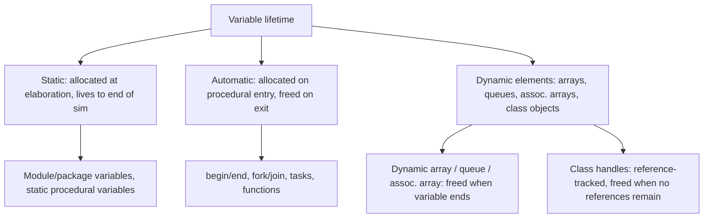

<!-- generated by yt-paper; edits will be overwritten -->
[DVCon](../dvcon/index.md) › [US](../dvcon/us.md) › [2021](../dvcon/by-year.md#2021) › [Verification](../dvcon/by-topic.md#verification)

# The Life of a SystemVerilog Variable

<figure class="rep-fig" markdown>
{ loading=lazy }
<figcaption>Figure 1 — from the original paper (Dave Rich et al.)</figcaption>
</figure>

[:material-open-in-new: Original paper](https://dvcon-proceedings.org/wp-content/uploads/the-life-of-a-systemverilog-variable.pdf){ .md-button .md-button--primary target=_blank }

| | |
|---|---|
| Authors | Dave Rich (Mentor, a Siemens Business) |
| Venue | DVCon US 2021 |
| Topic | Verification |
| Type | PAPER |
| ID | `ref-20261018-f51f` |

## Summary

**This tutorial explains SystemVerilog static, automatic, and dynamic-element variable lifetimes, and uses code examples to show how implicit static initializers, static initialization order, static recursion, fork/join_none scope extension, and class-handle references cause hard-to-debug behavior, along with the fix for each case.**

**이 튜토리얼은 SystemVerilog의 static, automatic, 동적 요소 변수 수명을 설명하고, 묵시적 static 초기화, static 초기화 순서, static 재귀, fork/join_none에 의한 scope 연장, 클래스 핸들 참조가 디버그하기 어려운 동작을 일으키는 사례를 코드 예제로 보여주며 각 경우의 해결책을 제시합니다.**

## Key Insights

- Variables declared inside procedural blocks, tasks, or functions are implicitly static when they have an initializer, so the initializer runs only once. In the countones example, the second call with 8'b01010101 returns 8 instead of 4 because count carries over from the first call. Fix this by splitting the declaration and assignment, or by declaring the variable or function automatic.

- 절차적 블록, task, function 안에서 선언되고 초기화식이 있는 변수는 묵시적으로 static이므로 초기화는 한 번만 실행됩니다. countones 예제에서 두 번째 호출 countones(8'b01010101)은 count가 첫 호출에서 이어져 4 대신 8을 반환합니다. 선언과 대입을 분리하거나 변수 또는 function을 automatic으로 선언하여 해결합니다.

- Static variables with initializers that depend on other static variables are exposed to the static initialization order fiasco. All static initializers run at time 0 in an unpredictable order (4! = 24 orderings for the four-variable example). Avoid it by assigning in procedural code or by using construct-on-first-use.

- 다른 static 변수에 의존하는 초기화를 가진 static 변수는 static 초기화 순서 문제(fiasco)에 노출됩니다. 모든 static 초기화는 시간 0에 예측 불가능한 순서로 실행됩니다(변수 4개 예제에서 4! = 24가지 순서). 절차적 코드에서 대입하거나 construct-on-first-use를 사용하여 피할 수 있습니다.

- Subroutines default to static lifetime unless the module or function is declared automatic. For factorial(3) with a static N, the result is 1 instead of 6, because the single static N is overwritten by each recursive call. Declaring module automatic or function automatic gives each call its own N, yielding 1*2*3 = 6.

- Module 또는 function을 automatic으로 선언하지 않으면 subroutine은 기본적으로 static 수명을 가집니다. static N을 쓰는 factorial(3)은 재귀 호출마다 단일 static N이 덮어써져 6 대신 1을 반환합니다. module automatic 또는 function automatic을 선언하면 각 호출이 자신의 N을 가져 1*2*3 = 6이 됩니다.

- Automatic variables referenced by fork/join_none children outlive their parent scope. In the paper's example, both spawned $display calls execute after the loop variable vi reaches 2 and the initial block ends, because the scope's life extends until the forked processes finish.

- fork/join_none 자식 프로세스가 참조하는 automatic 변수는 부모 scope보다 오래 살아남습니다. 논문 예제에서 루프 변수 vi가 2에 도달하고 initial 블록이 끝난 뒤에도 생성된 두 $display 호출이 실행되는데, scope 수명이 포크된 프로세스가 끝날 때까지 연장되기 때문입니다.

- Class objects have no explicit destroy and are freed only when no handles remain. In the Figure 9 example, the program finishes with 6 live objects (1 in static h and 5 in the static queue list). Storing handles in long-lived containers can therefore leak memory, and removing unneeded references remains the user's responsibility.

- Class 객체에는 명시적 destroy가 없으며, 남은 핸들이 없을 때만 해제됩니다. Figure 9 예제는 살아 있는 객체 6개(static h에 1개, static 큐 list에 5개)로 끝납니다. 따라서 장기 컨테이너에 핸들을 저장하면 메모리 누수가 생길 수 있고, 불필요한 참조를 제거하는 일은 여전히 사용자의 책임입니다.

## Detailed Summary

### Background and Problem

- Verilog's `wire`/`reg` model had no software-style variable lifetime concept. Hardware "exists for the life of the device," so the default mental model for SystemVerilog variables is static.

- Verilog의 `wire`/`reg` 모델에는 소프트웨어 방식의 변수 수명 개념이 없었습니다. 하드웨어는 "장치의 수명 동안 존재"하므로 SystemVerilog 변수의 기본 사고 모델은 static입니다.

- SystemVerilog serves both design and verification. Testbenches cross-probe design variables, and procedural scopes (tasks, functions, named blocks, classes) introduce non-static lifetimes. Mixing the two causes common, hard-to-debug errors:
  - initialization timing and ordering of static variables,
  - implicit static lifetime of variables declared in procedural code,
  - concurrent threads (fork/join_none) that outlive their parent scope,
  - recursion in default-static subroutines,
  - memory retention and leaks through class handles and dynamic containers.

- SystemVerilog는 설계와 검증을 모두 지원합니다. 테스트벤치는 설계 변수를 cross-probe하고, 절차적 scope(task, function, named block, class)는 비-static 수명을 도입합니다. 이 둘이 섞이면서 흔하고 디버그하기 어려운 오류가 발생합니다.
  - static 변수의 초기화 시점과 순서,
  - 절차적 코드에서 선언된 변수의 묵시적 static 수명,
  - 부모 scope보다 오래 살아남는 동시 스레드(fork/join_none),
  - 기본 static subroutine의 재귀,
  - class 핸들과 동적 컨테이너를 통한 메모리 유지 및 누수.

- The paper categorizes variable lifetimes, states each category's intended use model, and shows how to correct improper usage.

- 논문은 변수 수명을 범주화하고, 각 범주의 의도된 사용 모델을 설명하며, 잘못된 사용을 바로잡는 방법을 보여줍니다.

### Architecture and Methodology

This is a tutorial organized around code examples, not an experimental study. It follows three axes: name spaces, lifetime qualifiers, and dynamic data types.

이 논문은 실험 연구가 아니라 코드 예제 중심의 튜토리얼입니다. 구조는 name space, 수명 한정자, 동적 데이터 타입의 세 축을 따릅니다.

**II.A Static variables and scopes.** Name spaces include module (with interface, package, program, checker), block, and compilation-unit scopes. Static variables are allocated during elaboration, before time 0.

**II.A Static 변수와 scope.** Name space에는 module(interface, package, program, checker 포함), block, compilation-unit scope가 있습니다. Static 변수는 elaboration 단계, 즉 시간 0 이전에 할당됩니다.

- Figure 1: package `P` variable `A` is imported into modules `X` and `Y`. `Y` instantiates `X` twice, creating `Y.m1.B` and `Y.m2.B`, plus its own `B`. That gives one `A` and three `B` variables. Importing does not duplicate the package variable.

- Figure 1: package `P`의 변수 `A`가 module `X`와 `Y`에 import됩니다. `Y`는 `X`를 두 번 인스턴스화하여 `Y.m1.B`와 `Y.m2.B`를 만들고, 자체 `B`도 가집니다. 따라서 `A`는 1개, `B`는 3개입니다. Import가 package 변수를 복제하지는 않습니다.

- Static initialization order fiasco: all static initializers run at time 0 in an unpredictable order (4! = 24 orderings for the four variables in the example). Mitigations are to assign in procedural code, or to use "construct on first use" (a static function that initializes on first access).

- Static 초기화 순서 문제(fiasco): 모든 static 초기화는 시간 0에 예측 불가능한 순서로 실행됩니다(예제의 변수 4개에 대해 4! = 24가지 순서). 완화 방법은 절차적 코드에서 대입하거나, 처음 접근할 때 초기화하는 static 함수인 "construct on first use"를 사용하는 것입니다.

**II.B Automatic variables and procedural blocks.** Automatic storage is allocated on entry to `begin/end`, `fork/join`, a task, or a function, and freed on exit. Automatic variables are referenced only within their scope, while static variables can be reached by hierarchical name.

**II.B Automatic 변수와 절차적 블록.** Automatic 저장소는 `begin/end`, `fork/join`, task, function 진입 시 할당되고 종료 시 해제됩니다. Automatic 변수는 자신의 scope 안에서만 참조할 수 있지만, static 변수는 계층적 이름으로 접근할 수 있습니다.

- Figure 2: five variables named `A` with different lifetimes, declared implicitly or explicitly.

- Figure 2: 암묵적 또는 명시적으로 선언된, 서로 다른 수명을 가진 `A`라는 이름의 변수 5개.

- Figure 3 (implicit static pitfall): a variable with an initializer inside a procedural block is implicitly static, so the initializer runs once. Four fixes are shown for `countones`: (1) split declaration and assignment, (2) explicit `automatic` on the variable, (3) `automatic` on the function, (4) explicit `static` when persistence is intended. Procedural `for` loop variables and variables inside class methods default to automatic, a change allowed because Verilog had no backward-compatibility constraint there.

- Figure 3(묵시적 static 함정): 절차적 블록에서 초기화식이 있는 변수는 묵시적으로 static이므로 초기화는 한 번만 실행됩니다. `countones`에 대해 네 가지 해결책이 제시됩니다. (1) 선언과 대입 분리, (2) 변수에 명시적 `automatic`, (3) function에 `automatic`, (4) 지속성이 의도된 경우 명시적 `static`. 절차적 `for` 루프 변수와 class 메서드 내부 변수는 기본이 automatic입니다. Verilog에는 이 부분에 하위 호환성 제약이 없었기 때문에 이 변경이 가능했습니다.

- Figure 4 (fork/join_none): loop variable `vi` is automatic. Each iteration allocates a copy `vj` initialized from `vi`. Forked processes don't start until the parent blocks or terminates, so the scope's life extends until the spawned `$display` calls finish. Output is `2 1` / `2 0` (or the alternate ordering).

- Figure 4(fork/join_none): 루프 변수 `vi`는 automatic입니다. 각 반복은 `vi`로 초기화된 `vj` 복사본을 할당합니다. 포크된 프로세스는 부모가 블록되거나 종료될 때까지 시작하지 않으므로, 생성된 `$display`가 끝날 때까지 scope 수명이 연장됩니다. 출력은 `2 1` / `2 0`(또는 대체 순서)입니다.

**III. Data types with dynamic elements.** Dynamic types allocate and free storage through procedural assignment or method calls. Storage is released when the variable's life ends.

**III. 동적 요소를 가진 데이터 타입.** 동적 타입은 절차적 대입이나 메서드 호출로 저장소를 할당하고 해제합니다. 저장소는 변수 수명이 끝나면 해제됩니다.

- Dynamic arrays (Figure 5): `new[100]` allocates, and assigning `{10,20,30}` resizes, possibly copying all elements. Sizing once at the start of life is recommended. Indexing starts at 0. Use `new[]` for arrays and `new()` for class constructors.

- 동적 배열(Figure 5): `new[100]`은 할당하고, `{10,20,30}` 대입은 크기를 바꾸며 모든 요소를 복사할 수 있습니다. 수명 초기에 한 번 크기를 정하는 것이 권장됩니다. 인덱스는 0부터 시작합니다. 배열에는 `new[]`를, class 생성자에는 `new()`를 사용합니다.

- Queues (Figure 6): head/tail push and pop are cheap. The paper describes a linked-list implementation with higher per-element memory and traversal cost for middle elements. In the example, `qa` is freed at time 10 when its scope ends.

- 큐(Figure 6): head/tail의 push/pop은 저렴합니다. 논문은 연결 리스트 구현으로 요소당 메모리 사용량이 많고 중간 요소 접근에는 순회가 필요하다고 설명합니다. 예제에서 `qa`는 시간 10에 scope가 끝나면서 해제됩니다.

- Associative arrays (Figure 7): elements are allocated on first write. A default value (`'{default:'1}`) returns `FFFF` on read without allocating. Dense access favors dynamic arrays. Sparse access, or non-integer keys such as strings or class handles, favors associative arrays. Copying is allowed only between associative arrays with the same index type.

- 연관 배열(Figure 7): 요소는 처음 쓸 때 할당됩니다. 기본값(`'{default:'1}`)은 할당 없이 읽을 때 `FFFF`를 반환합니다. 밀집 접근에는 동적 배열이, 희소 접근이나 문자열·class 핸들 같은 비정수 키에는 연관 배열이 적합합니다. 복사는 같은 index 타입의 연관 배열 사이에서만 허용됩니다.

- Arrays of arrays (Figure 8): SystemVerilog has no true multidimensional arrays. `DQ` is a dynamic array of byte queues. The loops fill queues with 1 through 5 elements (15 bytes total), and `DQ[0] = DQ[4]` replaces the first queue, bringing the total to 18 bytes.

- 배열의 배열(Figure 8): SystemVerilog에는 진정한 다차원 배열이 없습니다. `DQ`는 byte 큐의 동적 배열입니다. 루프가 큐를 1~5개 요소로 채워 총 15바이트가 되며, `DQ[0] = DQ[4]`는 첫 큐를 대체하여 총합을 18바이트로 만듭니다.

- Class objects (Figure 9): objects are accessed through handles and have no explicit destroy. An object is freed once no references remain. `run1` creates a temporary that is discarded on exit. `run2` also pushes the temporary's handle into a static queue, so the object survives. The final state has 6 live objects: 1 in static `h` and 5 in the static queue. Users must still remove unneeded references to avoid leaks.

- Class 객체(Figure 9): 객체는 핸들로 접근하며 명시적 destroy가 없습니다. 참조가 남지 않으면 객체가 해제됩니다. `run1`은 종료 시 버려지는 임시 변수를 만듭니다. `run2`는 임시 변수의 핸들을 static 큐에도 push하므로 객체가 살아남습니다. 최종 상태에는 살아 있는 객체가 6개입니다(static `h`에 1개, static 큐에 5개). 누수를 피하려면 사용자가 불필요한 참조를 제거해야 합니다.

**IV. Subroutine lifetimes.** Early Verilog allowed only static tasks and functions with no call stack, so recursion and re-entrancy were impossible. Verilog-2001 added `automatic`. SystemVerilog added a module/interface-level lifetime qualifier that makes all routines automatic by default. Class methods are always automatic and cannot be declared static. A `static` keyword placed before `function` in a class denotes a class-level method, not a lifetime.

**IV. Subroutine 수명.** 초기 Verilog는 static task와 function만 허용하고 호출 스택이 없어 재귀와 재진입이 불가능했습니다. Verilog-2001은 `automatic`을 추가했습니다. SystemVerilog는 module/interface 수준 수명 한정자를 추가하여 모든 루틴을 기본 automatic으로 만들었습니다. Class 메서드는 항상 automatic이며 static으로 선언할 수 없습니다. Class에서 `function` 앞에 붙는 `static` 키워드는 수명이 아니라 class 수준 메서드를 뜻합니다.

- Figure 10: a static `factorial(int N)` called with `N=3` recursively calls `factorial(2)` and `factorial(1)`. The single static `N` is overwritten, so the result is 1*1*1 = 1 instead of 6. Declaring `module automatic` or `function automatic` gives each call its own `N`, yielding 1*2*3 = 6.

- Figure 10: static `factorial(int N)`을 `N=3`으로 호출하면 `factorial(2)`와 `factorial(1)`을 재귀 호출합니다. 단일 static `N`이 덮어써져 결과가 6이 아닌 1(1*1*1)이 됩니다. `module automatic` 또는 `function automatic`을 선언하면 각 호출이 자신의 `N`을 가져 1*2*3 = 6이 됩니다.

### Results and Conclusions

As a tutorial, the paper reports no experimental measurements. Its conclusions are qualitative guidance:

튜토리얼이므로 실험 측정 결과는 보고되지 않습니다. 결론은 정성적 가이드라인입니다.

- Qualify lifetimes explicitly (`automatic` or `static`) on variables, functions, and modules. The defaults are static for procedural variables with initializers and for module-level subroutines.

- 변수, function, module에 수명(`automatic` 또는 `static`)을 명시적으로 지정하십시오. 기본값은 초기화식이 있는 절차적 변수와 module 수준 subroutine에서 static입니다.

- Avoid initializers that depend on other static variables. Assign them in procedural code or use construct-on-first-use.

- 다른 static 변수에 의존하는 초기화를 피하고, 절차적 코드에서 대입하거나 construct-on-first-use를 사용하십시오.

- Expect automatic variables referenced by `fork/join_none` children to outlive their parent scope.

- `fork/join_none` 자식이 참조하는 automatic 변수는 부모 scope보다 오래 살아남을 수 있다고 예상하십시오.

- Choose dynamic types by access pattern. Dynamic arrays suit dense sequential access, queues suit head/tail operations, and associative arrays suit sparse access or non-integer keys at higher per-element cost.

- 접근 패턴에 따라 동적 타입을 선택하십시오. 동적 배열은 밀집 순차 접근에, 큐는 head/tail 연산에, 연관 배열은 희소 접근이나 비정수 키에 적합하며 요소당 비용이 더 큽니다.

- Class handles avoid dangling references because the simulator tracks them, but they can still leak memory when held in long-lived containers.

- Class 핸들은 시뮬레이터가 추적하므로 dangling 참조에서 안전하지만, 장기 컨테이너에 저장되면 여전히 메모리 누수를 일으킬 수 있습니다.

The paper summarizes that it demonstrates interactions between named scopes and variable lifetimes, the allocation behavior of each data type, and common coding errors with their fixes.

논문은 named scope와 변수 수명의 상호작용, 각 데이터 타입의 할당 동작, 흔한 코딩 오류와 해결책을 보여준다고 요약합니다.

## Videos

<iframe src="https://www.youtube-nocookie.com/embed/b7Xs_FX_gzs" title="[DVCON2021]The Life of a SystemVerilog Variable " loading="lazy" allow="accelerometer; clipboard-write; encrypted-media; gyroscope; picture-in-picture; web-share" referrerpolicy="strict-origin-when-cross-origin" allowfullscreen></iframe>

**[DVCON2021]The Life of a SystemVerilog Variable ** — [Watch on YouTube](https://www.youtube.com/watch?v=b7Xs_FX_gzs) · [Video page](../videos/b7Xs_FX_gzs.md)
