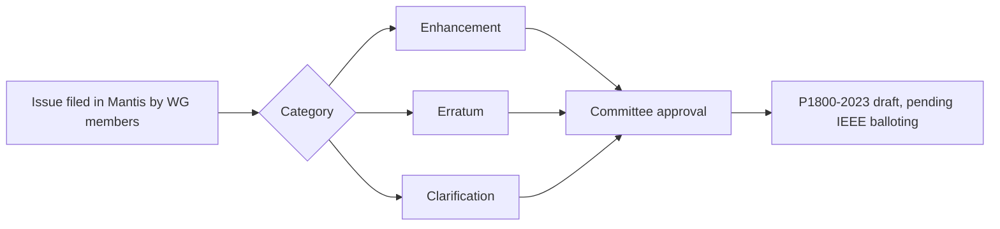

<!-- generated by yt-paper; edits will be overwritten -->
[DVCon](../dvcon/index.md) › [US](../dvcon/us.md) › [2023](../dvcon/by-year.md#2023) › [Verification](../dvcon/by-topic.md#verification)

# What’s Next for SystemVerilog in the Upcoming IEEE 1800 standard

[:material-open-in-new: Original paper](https://dvcon-proceedings.org/wp-content/uploads/1114-Whats-Next-for-SystemVerilog-in-the-Upcoming-IEEE-1800-standard.pdf){ .md-button .md-button--primary target=_blank }

| | |
|---|---|
| Authors | Dave Rich (affiliation not stated in the document) |
| Venue | DVCon US 2023 |
| Topic | Verification |
| Type | PAPER |
| ID | `ref-20261018-f7f6` |

## Summary

**Dave Rich reviews the goals and the key enhancements, errata, and clarifications being approved for the upcoming IEEE 1800 SystemVerilog revision (P1800-2023), as tracked by the P1800 Working Group in the Mantis database.**

**Dave Rich는 Mantis 데이터베이스에서 P1800 Working Group이 관리하는 차기 IEEE 1800 SystemVerilog 개정(P1800-2023)의 목표와 주요 enhancement, erratum, clarification 항목을 정리한다.**

## Key Insights

- The P1800-2023 draft had 26 enhancements, 109 errata, and 61 clarifications approved at the time of writing; these categories overlap, so an issue's Mantis ID is a more reliable reference than its category.

- P1800-2023 초안은 작성 시점에 26개 enhancement, 109개 erratum, 61개 clarification이 승인되었다. 이 범주들은 서로 겹치므로, 범주보다 Mantis ID로 이슈를 참조하는 것이 더 정확하다.

- Covergroup extension (Mantis 4703, 'covergroup extends g1') lets a derived class add coverpoints, cross them with base-class coverpoints, and override bins (e.g., ignore_bins), removing the need to replicate base coverpoints.

- Covergroup 확장(Mantis 4703, 'covergroup extends g1')을 사용하면 파생 클래스에서 coverpoint를 추가하고, 기반 클래스 coverpoint와 cross하며, ignore_bins 등으로 bin을 override할 수 있어 VIP 기반 클래스의 coverpoint 복제가 필요 없어진다.

- Real-number support is deliberately limited: random weights over real ranges use only the ':/' form, and covergroup bins over reals need the type_option.real_interval option to discretize, since expressions such as (0.1 + 0.2) == 0.3 can never evaluate true.

- 실수(real) 지원은 의도적으로 제한된다. 실수 범위에 대한 랜덤 가중치는 ':/' 형식만 사용할 수 있고, 실수 기반 covergroup bin은 이산화를 위해 type_option.real_interval 옵션이 필요하다. (0.1 + 0.2) == 0.3은 결코 true로 평가되지 않기 때문이다.

- Method chaining disambiguates by parentheses: F.member is a hierarchical reference to a static variable inside F, while F().member selects a member of the returned class handle (123 vs 0 in the paper's example).

- 메서드 체이닝은 괄호로 구분된다. F.member는 F 내부 static 변수에 대한 계층적 참조이고, F().member는 반환된 클래스 핸들의 멤버를 선택한다(논문 예시에서 0 대 123).

- Mantis 2841 permits non-integral expressions such as int'(threshold) directly in constraints, removing the need for a shadow integral variable computed in pre_randomize(); the new ref static qualifier (Mantis 2583) makes ref arguments legal in fork/join_none, but automatic ref arguments remain barred from nonblocking targets, force, and join_any/join_none references.

- Mantis 2841은 constraint에서 int'(threshold)와 같은 비정수형 식을 직접 허용하여 pre_randomize()에서 계산하는 보조 정수 변수를 불필요하게 만든다. 새 ref static 지정자(Mantis 2583)는 ref 인수를 fork/join_none에서 합법화하지만, automatic ref 인수는 여전히 nonblocking 대상, force, join_any/join_none 참조가 금지된다.

## Detailed Summary

### Background and Problem

- The last SystemVerilog LRM revision was completed in 2016 and published as IEEE 1800-2017. Since then, tool vendors have added extensions and clarifying changes independently, leaving users and other tool vendors with unclear specifications. Examples include built-in functions such as $sformatf being accepted in constant expressions even though the LRM does not allow it.

- SystemVerilog LRM의 마지막 개정은 2016년에 완료되어 IEEE 1800-2017로 발행되었다. 이후 툴 벤더들이 독립적으로 확장 기능과 명확화 변경을 추가하면서 사용자와 다른 툴 벤더 모두 언어 명세를 해석하기 어려워졌다. 예를 들어 LRM이 허용하지 않는 $sformatf 같은 내장 함수가 constant expression에서 사용되는 경우가 있다.

- Users respond by avoiding SystemVerilog features, continuing with Verilog-1995 syntax, or adding workaround packages and other languages (Chisel, Perl, Python, Ruby).

- 사용자들은 SystemVerilog 기능 도입을 피하고 Verilog-1995 문법을 계속 쓰거나, 우회용 패키지와 다른 언어(Chisel, Perl, Python, Ruby)를 도입하고 있다.

- The P1800 project was created in late 2019 with a target publication of 2024. A Working Group of end users and tool vendors submits issues through the Mantis database. Issues fall into three categories: Enhancements (new features), Errata (obvious mistakes or contradictions in the LRM), and Clarifications (ambiguous or missing text).

- P1800 프로젝트는 2019년 말에 생성되었으며 2024년 발행을 목표로 한다. 최종 사용자와 툴 벤더로 구성된 Working Group이 Mantis 데이터베이스를 통해 이슈를 제출한다. 이슈는 Enhancement(신규 기능), Errata(LRM의 명백한 오류 또는 모순), Clarification(모호하거나 누락된 설명)의 세 범주로 나뉜다.

- Status at writing: 26 enhancements, 109 errata, and 61 clarifications approved. The categories overlap, and issues can change category during review.

- 작성 시점의 상태는 26개 enhancement, 109개 erratum, 61개 clarification 승인이다. 범주는 서로 겹치며, 검토 과정에서 이슈의 범주가 바뀔 수 있다.

### Architecture and Methodology

This is an overview paper, not an experimental or architectural study. It reviews the issue-processing methodology and a selected set of Mantis items:

이 문서는 실험이나 아키텍처 연구가 아닌 개요 논문이다. 이슈 처리 방법론과 선별된 Mantis 항목을 검토한다.

**Enhancements**

**Enhancements**

- **Covergroup extension (Mantis 4703):** a derived class can use `covergroup extends g1;` to override a base coverpoint's bins (e.g., `ignore_bins`) and cross a new coverpoint with a base-class coverpoint, avoiding replication in VIP base-class libraries.

- **Covergroup 확장(Mantis 4703):** 파생 클래스에서 `covergroup extends g1;`을 사용해 기반 coverpoint의 bin을 override(예: `ignore_bins`)하고, 새 coverpoint를 기반 클래스 coverpoint와 cross할 수 있다. VIP 기반 클래스 라이브러리에서 복제를 피할 수 있다.

- **Unpacked array map() (Mantis 7610):** an element-wise method with implicit `item` and `item.index`, returning a new array whose type follows the `with()` expression. Examples: `B = A.map() with (byte'(item));` and `C = A.map(a) with (a + B[a.index]);`.

- **Unpacked array map()(Mantis 7610):** 암시적 `item`과 `item.index`를 사용하는 요소별 메서드로, 반환 배열의 타입은 `with()` 식을 따른다. 예: `B = A.map() with (byte'(item));`, `C = A.map(a) with (a + B[a.index]);`.

- **Boolean `ifdef (Mantis 1084):** `` `ifdef (A && B) `` and `` `ifdef (A || B) `` replace the nested-`ifdef`/intermediate-`define` workaround. Only definedness is tested, not macro value.

- **Boolean `ifdef(Mantis 1084):** `` `ifdef (A && B) `` 및 `` `ifdef (A || B) ``는 중첩 `ifdef`와 중간 `define`을 쓰는 우회 방식을 대체한다. 매크로의 정의 여부만 검사하며 값은 검사하지 않는다.

- **Multiline strings (Mantis 7308):** triple-quoted literals (`"""..."""`) that may contain single and double quotes. Related issues: 1397, 1507, 7562.

- **다중 행 문자열(Mantis 7308):** 작은따옴표와 큰따옴표를 포함할 수 있는 삼중 따옴표 리터럴(`"""..."""`). 관련 이슈: 1397, 1507, 7562.

- **Real-number modeling (Mantis 7295, 7669):** real types are allowed in random variables and constraints. Only the `:/` weight form is valid over real ranges, since `:=` would give an infinite weight. Covergroups use `type_option.real_interval = 0.01` to split `[0.75:0.85]` into 10 nonoverlapping bins.

- **실수 모델링(Mantis 7295, 7669):** 랜덤 변수와 constraint에서 real 타입을 허용한다. 실수 범위에는 `:/` 가중치 형식만 유효하며, `:=`는 무한한 가중치를 의미하므로 허용되지 않는다. Covergroup은 `type_option.real_interval = 0.01`로 `[0.75:0.85]`를 겹치지 않는 10개 bin으로 나눈다.

- **Method call chaining (Mantis 2735):** a function result can select a member directly. Parentheses distinguish `F().member` (returned handle) from `F.member` (Verilog hierarchical reference to a static variable).

- **메서드 체이닝(Mantis 2735):** 함수 반환값에서 멤버를 바로 선택할 수 있다. 괄호로 `F().member`(반환된 핸들)와 `F.member`(정적 변수에 대한 Verilog 계층 참조)를 구분한다.

- **Static ref arguments (Mantis 2583):** a `ref static` formal guarantees a static actual lifetime, making `fork ... join_none` monitors on ref arguments legal. Ref arguments must match type exactly, and automatic actuals are barred from nonblocking targets, force statements, and join_any/join_none references.

- **Static ref 인수(Mantis 2583):** `ref static` 형식 인수는 실제 인수가 static 수명을 가짐을 보장하여, ref 인수에 대한 `fork ... join_none` 모니터를 합법화한다. Ref 인수는 타입이 정확히 일치해야 하며, automatic 실제 인수는 nonblocking 대상, force 문, join_any/join_none 참조가 금지된다.

**Errata**

**Errata**

- **Mantis 7172:** `@(clocking_block)` was documented as equivalent to `@(posedge phi1)`. The LRM now states that the clocking event fires in the Observed region, after the Active/Reactive region, which avoids sampling races.

- **Mantis 7172:** `@(clocking_block)`이 `@(posedge phi1)`와 동등하다고 문서화되어 있었다. 이제 LRM은 clocking event가 Active/Reactive 영역 이후의 Observed 영역에서 발생한다고 명시하여 샘플링 레이스를 피한다.

- **Mantis 2841:** the constraint-expression rule (integral types only) is contradicted by constraint guards with object handles. The fix permits non-integral expressions such as `randvar < int'(threshold);`.

- **Mantis 2841:** 정수형만 허용한다는 constraint 식 규칙이 object handle을 쓰는 constraint guard와 모순된다. 수정안은 `randvar < int'(threshold);`와 같은 비정수형 식을 허용한다.

**Clarifications**

**Clarifications**

- **Mantis 1014:** the rules for compiler directives that must stand alone on a line, such as `` `ifdef NAME text `endif ``, are clarified.

- **Mantis 1014:** `` `ifdef NAME text `endif ``처럼 한 줄에 단독으로 있어야 하는 compiler directive의 규칙을 명확히 했다.

- **Mantis 225:** "blocking statement," "blocking assignment," and "non-blocking assignment" are formally defined. `A <= #1 2;` and `A = 3;` are not blocking statements, while `A = #4 5;` is.

- **Mantis 225:** "blocking statement", "blocking assignment", "non-blocking assignment"를 공식 정의했다. `A <= #1 2;`와 `A = 3;`은 blocking statement가 아니고, `A = #4 5;`는 blocking statement이다.

- **Mantis 325:** the single-number shorthand for packed arrays was rejected because the endianness was ambiguous. The LRM now states that the shorthand applies only to unpacked arrays.

- **Mantis 325:** packed array의 단일 숫자 축약 표기는 엔디언이 모호하여 기각되었다. LRM은 이제 이 축약 표기가 unpacked array에만 적용됨을 명시한다.

### Results and Conclusions

- The paper reports no experimental results. Its outcome is a catalog of the approved changes and the process that produced them: 26 enhancements, 109 errata, and 61 clarifications approved for the draft.

- 이 논문은 실험 결과를 보고하지 않는다. 결과물은 승인된 변경 목록과 그 결과를 만든 절차로, 초안에 대해 enhancement 26개, erratum 109개, clarification 61개가 승인되었다.

- Some features, such as method chaining and the clarified compiler-directive rules, were already implemented by many tools, so the standard formalizes existing behavior. Others, such as covergroup extension and real-number constraints, are new language capabilities.

- Method chaining이나 compiler directive 명확화 규칙처럼 이미 많은 툴이 구현한 동작은 표준으로 공식화되었다. Covergroup 확장이나 실수 constraint처럼 새로운 언어 기능도 포함된다.

- Some proposals were dropped as unjustified or redundant, such as the packed-array shorthand. Many issues were resolved by other changes.

- packed array 축약 표기처럼 정당화되지 않았거나 중복된 제안은 기각되었고, 많은 이슈는 다른 변경으로 해결되었다.

- The author states that P1800-2023 is not yet a formally approved IEEE standard, and all features remain subject to final IEEE balloting. The stated motive is to keep the language current and to let users protect their verification IP investment.

- 저자는 P1800-2023이 아직 공식 승인된 IEEE 표준이 아니며, 모든 기능이 최종 IEEE 투표 승인에 따른다고 밝힌다. 언어를 최신 상태로 유지하고 사용자의 검증 IP 투자를 보호하는 것이 제시된 목적이다.

## Videos

<iframe src="https://www.youtube-nocookie.com/embed/gk4Nr1n50Ac" title="[DVCON2023]What’s Next for SystemVerilog in the Upcoming IEEE 1800 standard " loading="lazy" allow="accelerometer; clipboard-write; encrypted-media; gyroscope; picture-in-picture; web-share" referrerpolicy="strict-origin-when-cross-origin" allowfullscreen></iframe>

**[DVCON2023]What’s Next for SystemVerilog in the Upcoming IEEE 1800 standard ** — [Watch on YouTube](https://www.youtube.com/watch?v=gk4Nr1n50Ac) · [Video page](../videos/gk4Nr1n50Ac.md)
