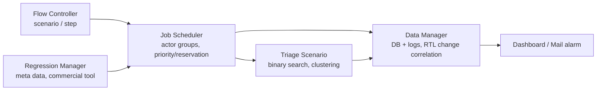

<!-- generated by yt-paper; edits will be overwritten -->
[DVCon](../dvcon/index.md) › [US](../dvcon/us.md) › [2020](../dvcon/by-year.md#2020) › [Verification](../dvcon/by-topic.md#verification)

# Accelerating SOC Verification Using Process Automation and Integration

<figure class="rep-fig" markdown>
{ loading=lazy }
<figcaption>Figure 4: Integrated Platform and Internal Queue for Automation and Verification — from the original paper (Seonghee Yim et al.)</figcaption>
</figure>

[:material-open-in-new: Original paper](https://dvcon-proceedings.org/wp-content/uploads/accelerating-soc-verification-using-process-automation-and-integration.pdf){ .md-button .md-button--primary target=_blank }

| | |
|---|---|
| Authors | Seonghee Yim (Samsung Electronics), Hanna Jang (Samsung Electronics), Sunchang Choi (Samsung Electronics), Seonil Brian Choi (Samsung Electronics); affiliation: Samsung Electronics, Hwaseong, Korea |
| Venue | DVCon US 2020 |
| Topic | Verification |
| Type | PAPER |
| ID | `ref-20261018-f844` |

## Summary

**A Samsung SoC verification automation platform that wraps existing team-specific IP/block/SoC regression flows in a CI-like system with five modules (flow controller, regression manager, job scheduler, triage scenario, data manager), reporting up to 43% verification-time reduction per level on a mobile AP project.**

**Samsung의 SoC 검증 자동화 플랫폼으로, 팀별로 흩어진 IP/블록/SoC 레벨 regression 흐름을 CI 유사 시스템에 감싸는 5개 모듈(flow controller, regression manager, job scheduler, triage scenario, data manager)로 구성되며, 모바일 AP 프로젝트에서 레벨별 검증 시간을 최대 43% 줄였다고 보고한다.**

## Key Insights

- Integration was done bottom-up: a platform interface wraps existing per-engineer and per-team environments instead of forcing a unified top-down environment, which the authors chose to limit verification stability and adoption risk.

- 통합은 bottom-up 방식으로 진행되었다. 기존 개인/팀별 환경을 그대로 두고 인터페이스로 감싸며, 전면 top-down 통합은 검증 안정성과 도입 위험 때문에 채택하지 않았다.

- Workflows are modeled as scenarios (start-step to end-step sequences of steps), and each step is split into pre, body and post parts so that scenarios and steps are reusable with conditional inputs bound at execution time.

- 워크플로는 scenario(start-step에서 end-step까지의 step 시퀀스)로 모델링되며, 각 step은 pre, body, post로 나뉘어 실행 시점에 조건부 입력을 바인딩하면서 재사용할 수 있다.

- The triage scenario narrows failing regions with binary search and density-based clustering to reorder failing test cases per block, aiming to cut time spent on failure cases; the paper reports up to 43% per-step time reduction when triage is applied to failure cases.

- Triage scenario는 binary search와 density-based clustering으로 실패 영역을 좁히고 블록별로 실패 테스트 순서를 재정렬한다. 논문은 실패 케이스에 triage를 적용했을 때 step당 최대 43% 시간 절감을 보고한다.

- Reported per-level reductions are about 35% (VL1), 43% (VL2), 28% (VL3) and 27% (VL4). The VL1 model in Table 1 is 20T before vs. 16T after, and VL3/VL4 gains are smaller because IP-level time is excluded. The authors state the failure-time statistics are not clear and the figures are approximations from actual projects.

- 보고된 레벨별 절감률은 VL1 약 35%, VL2 43%, VL3 28%, VL4 27%이다. Table 1의 VL1 모델은 before 20T, after 16T이며, VL3/VL4는 IP 레벨 시간이 제외되어 절감률이 낮다. 저자들은 실패 시간 분포가 명확하지 않아 수치가 실제 프로젝트 기반의 근사치라고 밝힌다.

- The data manager stores RTL change history, per-step logs and results, and correlates design changes with simulation failures to support debugging, and the system reuses existing workflows and tools (including a commercial regression tool) to reduce platform build effort.

- Data manager는 RTL 변경 이력, step별 로그와 결과를 저장하고 설계 변경과 시뮬레이션 실패를 연계해 디버그를 돕는다. 기존 워크플로와 상용 regression 도구를 재사용해 플랫폼 구축 비용을 줄인다.

## Detailed Summary

### Background and Problem

- SoC TAT (turn-around time) pressure is rising while SoC size and complexity grow. The project is split into IP, block and top-level SoC stages, and each team maintains its own scripts and environments, which makes the user-specific development environments hard to manage.

- SoC 규모와 복잡도가 커지는 동시에 TAT(turn-around time) 압박이 강해지고 있다. 프로젝트는 IP, 블록, SoC top 단계로 나뉘며, 각 팀이 자체 스크립트와 환경을 유지하기 때문에 사용자별 개발 환경 관리가 어려워진다.

- Continuous integration (Jenkins) addresses environment and version consistency, but it does not cover the verification-specific needs: scenario-level control, failure prioritization, and cross-level data linkage.

- Continuous integration(Jenkins)은 환경과 버전 일관성 문제를 다루지만, 시나리오 단위 제어, 실패 우선순위 지정, 레벨 간 데이터 연계 같은 검증 특화 요구는 충족하지 못한다.

- The paper defines Verification Levels (VL1 to VL4) that map to development stages. VL1 is IP-level verification with block-level starting next. VL2 combines IP and block work with SoC-top start. VL3 and VL4 focus on block and SoC verification, and VL4 is mainly regression.

- 논문은 개발 단계에 대응하는 검증 레벨(VL1~VL4)을 정의한다. VL1은 IP 레벨 검증이며 블록 레벨이 이어서 시작된다. VL2는 IP와 블록 작업을 함께 수행하고 SoC top 작업이 시작된다. VL3와 VL4는 블록과 SoC 검증에 집중하며, VL4는 주로 regression이다.

### Architecture and Methodology

Three integration strategies are discussed: top-down (force unification), bottom-up (interface over existing environments), and hybrid. The authors adopt bottom-up because the existing environments are already optimized per unit and first-trial top-down integration is risky.

세 가지 통합 전략(top-down: 강제 통합, bottom-up: 기존 환경 위의 인터페이스, hybrid)을 논의한다. 저자들은 기존 환경이 단위별로 이미 최적화되어 있고, 초기 top-down 통합은 위험하다는 이유로 bottom-up을 채택했다.

- **Flow controller**: Similar to CI, but with a finer-grained model. A scenario runs from a start-step to an end-step through normal steps, and each step has pre, body and post parts.

- **Flow controller**: CI와 유사하지만 더 세밀한 모델을 갖는다. Scenario는 start-step에서 end-step까지 normal step을 거쳐 실행되며, 각 step은 pre, body, post 부분을 가진다.

- **Regression manager**: Manages regression test cases and wraps internal queues and a third-party commercial regression tool used at Samsung. Regression environments are configured by script and reported as meta data.

- **Regression manager**: regression 테스트 케이스를 관리하고, 내부 queue와 Samsung에서 사용 중인 3rd-party 상용 regression 도구를 감싼다. Regression 환경은 스크립트로 구성되고 meta data로 보고된다.

- **Job scheduler** (internally developed): The job unit is one scenario. Jobs are scheduled by priority or reservation time and are distributed over actor groups for load balancing. Each job tracks scenario and step status across its lifetime.

- **Job scheduler**(내부 개발): job 단위는 scenario 하나다. 우선순위 또는 예약 시간으로 스케줄링하며, 부하 분산을 위해 actor 그룹에 분배된다. 각 job은 실행 중 scenario와 step 상태를 추적한다.

- **Triage scenario**: Classifies failures from regression data. It uses binary search and machine-learning-based density clustering (the paper states the clustering reorders the error test list per block cluster). It can re-run tests to narrow failures. The motivation is that design changes trigger too many tests and that test cases across blocks affect each other.

- **Triage scenario**: regression 데이터를 기반으로 실패를 분류한다. Binary search와 머신러닝 기반 density clustering을 사용한다(논문은 클러스터링으로 블록별 에러 테스트 목록을 재정렬한다고 기술). 필요 시 재실행으로 실패 범위를 좁힌다. 설계 변경이 과도한 테스트를 유발하고, 블록 간 테스트가 서로 영향을 준다는 점이 동기다.

- **Data manager**: Collects all job data. Verification tasks and results are stored in a database, while user inputs and logs are stored as files. Abnormal-data meta information is formalized and linked across stages. Status is pushed to a dashboard and to email alerts. Ongoing work targets quantifying design change amounts per stage.

- **Data manager**: 모든 job 데이터를 수집한다. 검증 작업과 결과는 DB에, 사용자 입력과 로그는 파일로 저장된다. 비정상 데이터의 meta 정보는 형식화되어 단계 간에 연결된다. 상태는 dashboard와 이메일 알림으로 전달된다. 진행 중인 연구는 단계별 설계 변경량을 정량화하는 것이다.

### Results and Conclusions

Table 1 gives an analytic model with unit time T. For VL1, A1 = 4T and B1 = 16T, so the existing time is 20T and the proposed time is max(A1, B1) = 16T when no IP or block failures occur. Later levels use max-of-parallel-run-time formulas instead of sums.

Table 1은 단위 시간 T를 쓰는 분석 모델을 제시한다. VL1에서 A1 = 4T, B1 = 16T이므로 기존 시간은 20T이고, IP나 블록 실패가 없을 때 제안 방식 시간은 max(A1, B1) = 16T다. 이후 레벨은 합 대신 병렬 실행 시간의 최댓값 공식을 사용한다.

Measured reductions in Figure 8 (applied to some IPs and their blocks and to the SoC top):

Figure 8의 실측 절감률(일부 IP와 해당 블록, SoC top에 적용):

- VL1: about 35%

- VL1: 약 35%

- VL2: 43%

- VL2: 43%

- VL3: 28%

- VL3: 28%

- VL4: 27%

- VL4: 27%

The paper reports a maximum of 43% per step when triage is applied to failure cases. The authors caveat that failure-time distribution by level is not clearly characterized, so these numbers are approximate and project-specific.

Triage를 실패 케이스에 적용했을 때 step당 최대 43% 절감을 보고한다. 저자들은 레벨별 실패 시간 분포가 명확히 규명되지 않았다고 밝히므로, 이 수치는 프로젝트 기반의 근사치다.

The conclusion is that existing workflows were automated and linked for a flagship mobile AP SoC project. Reuse of existing environments lowered integration effort, and the saved time was reinvested into extra verification. Future work includes density-based reordering of error tests, a classifier for sanity-test selection, and a dynamic distributed job scheduler.

결론적으로, 플래그십 모바일 AP SoC 프로젝트에서 기존 워크플로를 자동화하고 연계했다. 기존 환경 재사용으로 통합 비용이 줄었고, 절약된 시간은 추가 검증에 투입되었다. 향후 과제는 에러 테스트의 density 기반 재정렬, sanity test 선택을 위한 분류 모델, 동적 분산 job scheduler 적용이다.

## Videos

<iframe src="https://www.youtube-nocookie.com/embed/zgdf-5MBHk4" title="[DVCON2020] Accelerating SOC Verification Using Process Automation and Integration" loading="lazy" allow="accelerometer; clipboard-write; encrypted-media; gyroscope; picture-in-picture; web-share" referrerpolicy="strict-origin-when-cross-origin" allowfullscreen></iframe>

**[DVCON2020] Accelerating SOC Verification Using Process Automation and Integration** — [Watch on YouTube](https://www.youtube.com/watch?v=zgdf-5MBHk4) · [Video page](../videos/zgdf-5MBHk4.md)
