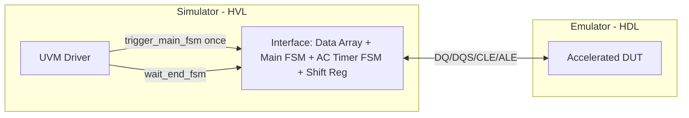

<!-- generated by yt-paper; edits will be overwritten -->
[DVCon](../dvcon/index.md) › [US](../dvcon/us.md) › [2025](../dvcon/by-year.md#2025) › [Emulation](../dvcon/by-topic.md#emulation)

# Design scheme for Emulator-friendly Memory Verification IP to Accelerate Simulation Performance

<figure class="rep-fig" markdown>
{ loading=lazy }
<figcaption>Figure 1. Key Idea of Design Scheme for Emulator-friendly Memory Verification IP — from the original paper (Sunghyeon Kang et al.)</figcaption>
</figure>

[:material-open-in-new: Original paper](https://dvcon-proceedings.org/wp-content/uploads/1015.pdf){ .md-button .md-button--primary target=_blank }

| | |
|---|---|
| Authors | Sunghyeon Kang (SK hynix), Munsik Bae (SK hynix), Jinsung Song (SK hynix), Minsung Kang (SK hynix), Sangkyoo Jeong (SK hynix), Seokho Hong (Siemens EDA) |
| Venue | DVCon US 2025 |
| Topic | Emulation |
| Type | PAPER |
| ID | `ref-20261018-fb94` |

## Summary

**The paper redesigns a UVM NAND memory VIP into a synthesizable interface (block-transfer data array, Main Operation FSM, AC timer FSM, and shift-register strobe generator) so that the emulator-side DUT no longer stalls on per-beat simulator communication, yielding about 27x higher simulation throughput on Veloce StratoM.**

**이 논문은 UVM NAND 메모리 VIP를 합성 가능한 인터페이스(블록 단위 데이터 배열, Main Operation FSM, AC 타이머 FSM, 쉬프트 레지스터 기반 스트로브 생성기)로 재설계하여, 에뮬레이터 측 DUT가 시뮬레이터와의 빈번한 통신으로 멈추지 않도록 하고, Veloce StratoM에서 약 27배의 시뮬레이션 처리량 향상을 달성한 방법을 제시한다.**

## Key Insights

- Co-emulation bottleneck is the HDL-HVL communication count, not raw testbench cost: the redesign batches whole transactions into a Data Array transferred once per command (write at EXIT, read at IDLE) instead of per-beat driver calls.

- 코에뮬레이션의 병목은 테스트벤치 자체 비용보다 HDL-HVL 간 통신 횟수에 있다. 이 재설계는 명령마다 한 번만 전송되는 Data Array로 전체 트랜잭션을 묶어 전달하여(쓰기는 EXIT, 읽기는 IDLE 시점), 비트 단위로 드라이버가 호출하는 방식을 피한다.

- Replacing Verilog #delay-based AC timing in UVM drivers/monitors with synthesizable timers removes time-consuming simulator regions; AC timing is handled by a timer FSM (SET/COUNT/CHECK/DONE) walking a linked AC timing list (e.g., tDQSQ, tQH, tCHZ).

- UVM Driver/Monitor 내부의 Verilog #delay 기반 AC 타이밍을 합성 가능한 타이머로 대체하여 시뮬레이터에서 시간이 많이 드는 영역을 제거한다. AC 타이밍은 타이머 FSM(SET/COUNT/CHECK/DONE)이 연결된 AC 타이밍 리스트(예: tDQSQ, tQH, tCHZ)를 따라 처리한다.

- Per-cycle, per-bit signals such as DQS toggling (tDQSRE) are generated by a shift register sampled on the emulator clock, avoiding a FSM for each strobe edge.

- DQS 토글처럼 사이클마다 비트 단위로 적용되는 신호(tDQSRE)는 에뮬레이터 클록으로 샘플링한 쉬프트 레지스터로 생성하여, 스트로브 에지마다 FSM을 두지 않는다.

- Measured result on Veloce StratoM with Questa 2023.3: simulation time 7.38 ms/hour (conventional NAND VIP) vs 204 ms/hour (redesigned), about 27x; data transfer 10 KB/s vs 360 KB/s (36x); physical NAND board 304 ms/hour and 550 KB/s, so the redesigned VIP reaches about 67% (simulation) and 65% (data rate) of the board.

- Veloce StratoM과 Questa 2023.3 환경에서 측정한 결과, 시뮬레이션 시간은 기존 NAND VIP 7.38 ms/hour에서 재설계 후 204 ms/hour로 약 27배 향상되었다. 데이터 전송률은 10 KB/s에서 360 KB/s(36배)로 올랐다. 물리 NAND 보드(304 ms/hour, 550 KB/s) 대비 재설계 VIP는 각각 약 67%(시뮬레이션)와 65%(데이터 전송률)에 도달했다.

- Motivation is vendor-specific NAND commands and fast-changing specs that EDA pre-packaged emulator VIPs may not support promptly; a customized VIP also gives checkers and debug signals. Only one NAND scenario (sequential write-read, PCIe 4.0 SSD controller) is evaluated.

- 동기는 벤더 고유 NAND 명령과 빠르게 바뀌는 사양을 EDA 기성 에뮬레이터 VIP가 신속히 지원하지 못하는 점이다. 맞춤형 VIP는 체커와 디버그 신호도 제공한다. 평가는 PCIe 4.0 SSD 컨트롤러의 순차 쓰기-읽기 시나리오 하나에 한정되어 있다.

## Detailed Summary

### Background and Problem

- In co-emulation, the DUT runs on the emulator while the UVM testbench runs in the simulator. Every interaction across the HDL/HVL boundary is costly, so a non-accelerated Memory VIP that communicates frequently over the memory interface becomes the bottleneck and erodes the TAT benefit of emulation.

- 코에뮬레이션에서는 DUT가 에뮬레이터에서 동작하고 UVM 테스트벤치는 시뮬레이터에서 동작한다. HDL과 HVL 경계를 넘는 모든 상호작용의 비용이 크기 때문에, 메모리 인터페이스에서 빈번하게 통신하는 비가속 Memory VIP가 병목이 되어 에뮬레이션의 TAT 이점을 떨어뜨린다.

- Using a conventional UVM Memory VIP through a mode such as Veloce SvTbBringup keeps the tests running, but the time-consuming regions (Verilog #delay AC timing in drivers/monitors) are reported to the emulator as events, causing a clear performance drop. Performance remains well below testing with a physical memory board.

- Veloce SvTbBringup 같은 모드로 기존 UVM Memory VIP를 사용하면 테스트는 실행되지만, 드라이버/모니터 내부의 Verilog #delay 기반 AC 타이밍 등 시간이 많이 드는 영역이 에뮬레이터에 이벤트로 보고되어 성능이 크게 떨어진다. 물리 메모리 보드로 검증할 때보다 여전히 훨씬 느리다.

- EDA pre-packaged emulator VIPs may not support vendor-specific or undisclosed NAND commands and rapidly changing specs, so customized VIP is needed.

- EDA 기성 에뮬레이터 VIP는 벤더 고유의 비공개 NAND 명령이나 빠르게 변하는 사양을 신속히 지원하지 못할 수 있어, 맞춤형 VIP가 필요하다.

### Architecture and Methodology

The core idea is to move memory operations out of the UVM Driver/Monitor into an accelerated interface containing FSMs and arrays, with the driver calling interface tasks only once per transaction.

핵심 아이디어는 메모리 동작을 UVM Driver/Monitor 밖으로 옮겨, FSM과 배열을 가진 가속 인터페이스에서 처리하는 것이다. 드라이버는 트랜잭션당 인터페이스 태스크를 한 번만 호출한다.

- **Data Array sizing**: the array size is chosen so each transaction fits the emulator's per-unit-time bandwidth limit. Write data is sent once at EXIT; read data is loaded once at IDLE when the driver triggers the FSM.

- **Data Array 크기 설정**: 배열 크기는 단위 시간당 에뮬레이터 대역폭 한계 안에 각 트랜잭션이 들어가도록 정한다. 쓰기 데이터는 EXIT 시점에 한 번 전송되고, 읽기 데이터는 드라이버가 FSM을 트리거하는 IDLE 시점에 한 번 적재된다.

- **Main Operation FSM** (IDLE, WAIT, DRIVE, PAUSE, EXIT): DRIVE moves data to/from the DUT under AC timing; back-pressure moves to PAUSE; a command abort from any state leads to EXIT; wait_end_fsm() returns at EXIT.

- **Main Operation FSM** (IDLE, WAIT, DRIVE, PAUSE, EXIT): DRIVE 상태에서 AC 타이밍을 지키며 DUT와 데이터를 주고받는다. Back-pressure가 발생하면 PAUSE로 이동하며, 모든 상태에서 명령 중단이 발생하면 EXIT로 간다. wait_end_fsm()은 EXIT에서 반환된다.

- **AC Timer FSM** (IDLE, SET, COUNT, CHECK, DONE): triggered from any Main FSM state except IDLE for one-time parameters. For NAND read, tDQSQ, tQH and tCHZ are registered in a linked AC timing list; each is removed after counting and the next is checked, and the FSM signals DONE when the list is empty.

- **AC Timer FSM** (IDLE, SET, COUNT, CHECK, DONE): IDLE을 제외한 Main FSM 상태에서 일회성 파라미터에 대해 트리거된다. NAND 읽기의 경우 tDQSQ, tQH, tCHZ를 연결된 AC 타이밍 리스트에 등록한다. 각 항목은 카운트가 끝나면 제거되고 다음 항목을 CHECK에서 확인하며, 리스트가 비면 DONE을 Main FSM에 알린다.

- **Shift register for strobes**: for continuously applied timing such as tDQSRE (RE-to-DQS latency), a 1-bit-per-cycle shift register sampled on the emulator clock toggles DQS when the RE-sampled bit reaches the target tap. This repeats for every RE occurrence.

- **스트로브용 쉬프트 레지스터**: tDQSRE(RE에서 DQS까지의 지연)처럼 지속적으로 적용되는 타이밍은 에뮬레이터 클록으로 샘플링한 1비트 쉬프트 레지스터로 처리한다. RE 신호가 샘플링되어 목표 탭에 도달하면 DQS를 토글하며, RE가 발생할 때마다 반복한다.

- Simulation metrics: simulation time per hour during the memory-operation peak, and data transfer rate measured with IO Meter.

- 시뮬레이션 지표: 메모리 동작 피크 구간의 시간당 시뮬레이션 시간과, IO Meter로 측정한 데이터 전송률.

### Results and Conclusions

- Setup: Veloce StratoM emulator (Veloce OS v23.0.2), Questa 2023.3 simulator, PCIe 4.0 SSD controller SoC DUT, VirtuaLab PCIe 1.9.0 host, NAND topology of 4 channels, 4 CEs, 2 LUNs. Scenario: sequential write-read.

- 실험 환경: Veloce StratoM 에뮬레이터(Veloce OS v23.0.2), Questa 2023.3 시뮬레이터, PCIe 4.0 SSD 컨트롤러 SoC DUT, VirtuaLab PCIe 1.9.0 호스트, NAND 토폴로지 4 채널, 4 CE, 2 LUN. 시나리오는 순차 쓰기-읽기이다.

- Simulation time: conventional NAND VIP 7.38 ms/hour; redesigned VIP 204 ms/hour (about 27x); physical NAND board 304 ms/hour (redesign about 67%).

- 시뮬레이션 시간: 기존 NAND VIP 7.38 ms/hour, 재설계 VIP 204 ms/hour(약 27배), 물리 NAND 보드 304 ms/hour(재설계 VIP는 약 67%).

- Data transfer: conventional 10 KB/s; redesigned 360 KB/s (36x); NAND board 550 KB/s (redesign about 65%).

- 데이터 전송률: 기존 10 KB/s, 재설계 360 KB/s(36배), NAND 보드 550 KB/s(재설계 VIP는 약 65%).

- The authors also note that checkers and debug signals of a VIP, which are hard to quantify, support early SoC verification before memory silicon exists.

- 저자들은 정량화하기 어려운 VIP의 체커와 디버그 신호가 메모리 실리콘이 나오기 전 SoC 초기 검증에 도움이 된다고 언급한다.

- Limitations: a single NAND scenario is evaluated, and the paper gives little detail on the exact interface widths or the AC timing list implementation.

- 한계: NAND 시나리오 하나만 평가했으며, 인터페이스 폭이나 AC 타이밍 리스트 구현의 세부 사항은 제한적으로만 기술되어 있다.

- Conclusion: the approach (appropriately sized data types, FSM-based interfaces, and synthesizable AC timers) can substantially reduce emulator-simulator communication and suits early memory controller verification.

- 결론: 적절한 데이터 타입 선언, FSM 기반 인터페이스, 합성 가능한 AC 타이머를 통해 에뮬레이터-시뮬레이터 간 통신을 크게 줄일 수 있으며, 이는 초기 메모리 컨트롤러 검증에 적합하다.

## Videos

<iframe src="https://www.youtube-nocookie.com/embed/NZnsCEQcW28" title="[DVCON2025]Design scheme for Emulator-friendly Memory Verification IP to Accelerate Simulation " loading="lazy" allow="accelerometer; clipboard-write; encrypted-media; gyroscope; picture-in-picture; web-share" referrerpolicy="strict-origin-when-cross-origin" allowfullscreen></iframe>

**[DVCON2025]Design scheme for Emulator-friendly Memory Verification IP to Accelerate Simulation ** — [Watch on YouTube](https://www.youtube.com/watch?v=NZnsCEQcW28) · [Video page](../videos/NZnsCEQcW28.md)
